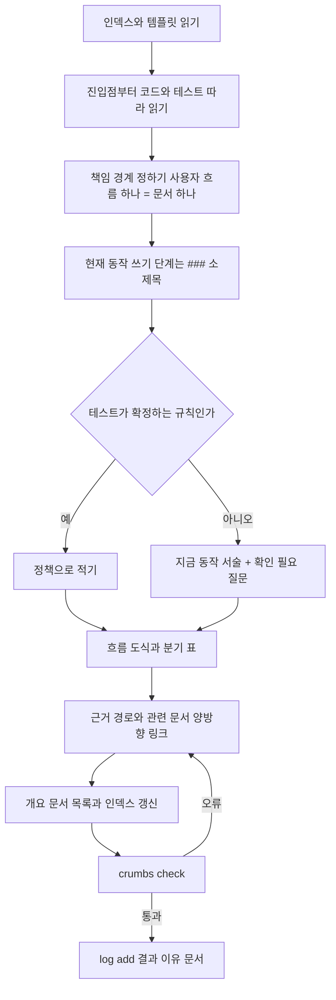

# crumbs-spec 🍞

**한국어** · [English](README.md)

[](https://github.com/Sienna94/crumbs-spec/actions/workflows/ci.yml) [](https://www.npmjs.com/package/crumbs-spec)

에이전트가 길을 잃지 않게 문서마다 빵부스러기(링크)를 남기고, 인덱스에서 상세 문서까지 한 길로 이어지는 **살아 있는 스펙**을 만들어요. 저장소가 *지금* 어떻게 동작하는지를 책임 단위 문서로 두고, 그 문서들이 잘 이어져 있는지 명령 하나로 검사하고, 에이전트가 문서를 쓰고·찾고·묻고·반영하는 절차를 스킬로 고정한 도구예요.

## 왜 만들었나요

실제 앱 저장소에서 수십 개의 스펙 문서를 에이전트와 함께 운영하다 보니 같은 일이 자꾸 반복됐어요.

1. 스펙이 변경 단위(기능별 `spec.md`, 티켓)로만 남아서, 몇 달 뒤 "지금 이 규칙이 뭐지?"에 답할 문서가 없었어요.
2. 위키처럼 쌓으니 같은 규칙이 여러 문서에 조금씩 다르게 적혔고, 어느 쪽이 맞는지 아무도 몰랐어요. 나중에 벤치마크를 돌려 보니 에이전트가 문서 간 불일치를 셋이나 찾아냈어요.
3. 에이전트가 문서를 읽을 때 폴더 구조와 검색에 기대다 보니 다른 영역으로 새거나 grep으로 떨어졌어요. 질문 하나에 문서 8개를 읽는 일도 있었고요.

"문서를 더 잘 쓰자"로는 해결이 안 됐어요. **구조를 기계가 강제하는 도구**가 필요했어요. 정책의 소유자를 하나로 정하고, 링크 그래프를 검사하고, 모르는 것은 질문으로 남기게 하면 에이전트도 사람도 같은 길로 문서에 닿아요. 그래서 빵부스러기를 뿌리기 시작했어요.

## 다른 도구와 어떻게 다른가요

Spec Kit은 구현 전 계획을, LLM Wiki는 자료를 쌓는 위키를 잘 다뤄요. crumbs-spec은 그 사이의 빈자리, **구현이 끝난 뒤에도 남아야 하는 현재 상태**를 맡아요. 대체가 아니라 보완 관계예요.

| | GitHub Spec Kit | OpenSpec | Karpathy LLM Wiki | **crumbs-spec** |
|---|---|---|---|---|
| 문서 단위 | 변경(기능) 하나: `spec.md`·`plan.md`·`tasks.md` | 현재 상태 스펙 + 변경 델타 | 엔티티·개념·원본 요약 페이지 | **책임(사용자 흐름) 하나**. 정책은 문서 하나가 소유 |
| 시점 | 구현 전 | 구현 전·후 | 자료 반영 시점 | **구현 뒤 현재 동작** |
| 기존 코드 | "추론하지 않는다"고 스스로 밝힘 | 온보딩은 있으나 코드→스펙 초안은 없음 | 원본 자료가 대상, 코드 아님 | **crumbs-writer 스킬이 코드·테스트에서 초안을 만들고, 모르는 것은 `[확인 필요]` 질문으로 남겨요** |
| 탐색 | 폴더와 파일 이름 | 폴더와 파일 이름 | 인덱스 우선 | **인덱스 → 개요 → 상세 링크만**. ID·front matter 없음 |
| 기계 검사 | spec·plan·tasks 일관성 | `openspec validate`(구조) 검사와 아카이브 시 델타 병합 | 고아 페이지·끊긴 링크 lint(LLM 판단 포함) | **결정론적 16개 구조 규칙**: 링크·앵커·도달 가능·역링크·정책 이름 중복·근거 경로·절 순서·흐름 도식·로그 형식·닫히지 않은 주석 |
| 구현 후 동기화 | 팀이 유지 방식을 고름 | `archive`/`sync`로 변경분만 | 질의 결과를 위키에 환류 | **에이전트 규칙("요청 없어도 같은 변경에서 문서 갱신")과 결정 로그** |
| 사람 가독성 | 산문 | 산문 | 산문 | **흐름 도식(Mermaid)과 분기 표를 템플릿에 포함** |

Kiro 스펙과 BMAD는 Spec Kit과 비슷하게 기능 단위이고 구현 전에 쓰이므로 따로 싣지 않았어요. 한국어 기획 문서가 다섯 가지를 모두 비교해요.

LLM Wiki에서는 원본/위키/스키마 분리, 인덱스 우선, 추가 전용 로그, 사람이 감독하는 ingest를 그대로 가져왔어요. 일부러 다르게 한 건 셋이에요. 엔티티 페이지 대신 책임 단위로 조직하고(여러 흐름이 분기 축으로 쓰는 개념만 `concepts/`에 둬요), 문서는 에이전트가 유지하되 사람이 소유하고, lint는 LLM 판단 없이 결정론적으로만 해요. 더 자세한 비교는 [docs/IMPLEMENTATION_PLAN.md](docs/IMPLEMENTATION_PLAN.md) 1절에 있어요.

## 중요하게 생각한 것

- **현재 상태의 단일 진실.** 변경 디렉터리를 만들지 않아요. 문서는 "무엇이 바뀌었나"가 아니라 "지금 어떻게 동작하나"를 설명해요.
- **추측 금지.** 코드·테스트·승인된 자료로 확인되지 않은 규칙은 "지금은 이렇게 동작한다" 서술과 `[확인 필요]` 질문으로만 남겨요. `check`는 질문이 남은 문서마다 `open-question` 경고를 하나씩 내요. 어떤 서술이 추측인지는 스킬 규칙과 리뷰어의 몫이고, `check`는 판별하지 못해요.
- **정책 하나에 주인 하나, 이름 단위로 검사.** `check`는 같은 정책 이름이 두 문서에 있거나 한 문서에 두 번 있으면 거부해요. 다른 이름으로 같은 말을 하는 두 정책은 찾지 못하고, 그 이름 규칙은 writer 스킬이 맡아요.
- **사람 우선의 본문.** ID, 상태 표, 문법 강제가 없어요. 탐색 정보는 링크와 제목에만 둬요.
- **검사는 결정론적으로, 판단은 사람과 스킬이.** `check`는 구조만 봐요. 문체·내용·노후 판정은 스킬 지침과 사람이 맡아요.
- **결정은 한 곳에.** 질문이 답을 얻으면 로그에 `decision` 항목을 남기고 문서는 날짜 링크 하나로 그 결정을 가리켜요.
- **두 언어.** `crumbs.json`의 `lang`이 저장소 전체의 템플릿, 스킬, 메시지, AGENTS 블록 언어를 정해요. 기본값은 영어(`en`)이고 `ko`를 쓰면 한국어가 돼요.

## 처음 보는 코드에서도 맞게 쓸까요? (RealWorld 실험)

[RealWorld](https://github.com/realworld-apps/realworld) "Conduit" API를 구현한 공개 백엔드 두 개에 writer 스킬을 돌리고, 그 프로젝트의 공식 API 테스트로 문서를 채점했어요. 생성된 문서, 프롬프트, 정답지, 채점 행은 모두 [crumbs-spec-conduit](https://github.com/Sienna94/crumbs-spec-conduit)에 공개했어요.

- **준비.** 같은 API를 구현한 두 저장소를 커밋으로 고정했어요. [Nitro + Prisma](https://github.com/realworld-apps/nitro-prisma-zod-realworld-example-app)(TypeScript)와 [Django Ninja](https://github.com/c4ffein/realworld-django-ninja)(Python)예요. 구현체마다 Opus 5.5 에이전트 하나가 코드와 테스트만 보고 문서를 썼어요. 쓰는 동안 실험 저장소에는 공식 스펙 저장소가 없었고, 나중 커밋에서 추가했어요.
- **정답지.** 두 구현체가 고정해 둔 버전의 공식 Hurl 테스트에서 요청 하나를 한 행으로 삼았어요. 준비·정리 요청을 빼면 130행이에요.
- **채점.** 다른 모델(Sonnet 5.5)이 모든 행을 채점했어요. `correct`는 상태 코드와 검증하는 값을 문서가 모두 적은 경우, `partial`은 하나라도 빠진 경우, `wrong`은 문서가 반대로 적은 경우, `missing`은 다룬 문서가 없는 경우예요. 정책마다 코드와도 대조했어요.

| | Nitro + Prisma | Django Ninja |
|---|---|---|
| 저장소의 코드 / 테스트 | 약 1,400줄 / 단위 테스트 파일 2개 | 약 2,300줄 / 앱마다 엔드포인트 테스트 |
| 문서 / 정책 | 28 / 51 | 26 / 91 |
| 테스트로 확정된 정책 / 질문으로 남긴 정책 | 6 / 45 | 50 / 41 |
| 공식 테스트 행 정답 | **125 / 130** | **116 / 130** |
| 부분 / 오답 / 누락 | 5 / 0 / 0 | 14 / 0 / 0 |
| 지어낸 정책(코드에 없는 것) | 0 | 0 |
| 일부를 과장한 정책 | 1 | 6 |
| writer 토큰 / 걸린 시간 | 16.5만 / 2시간 40분 | 20.2만 / 2시간 47분 |

- **공식 테스트와 어긋난 문장도, 지어낸 정책도 없었어요.** 놓친 것은 모두 세부가 빠진 경우예요. Nitro의 부분 정답 5개는 문서가 다루지 않은 `null` 입력과 태그 순서예요. Django의 14개 중 12개는 질문 하나에서 나왔어요. 앱의 오류 처리기와 테스트가 401 응답 본문을 다르게 보여서 writer가 둘 다 적고 질문으로 남겼어요.
- **질문이 붙은 서술도 대부분 맞았어요.** 아직 `[needs confirmation]`이 붙은 서술만으로 정답 판정을 받은 행이 Nitro 12개, Django 32개예요. "지금은 이렇게 동작해요"에 질문을 붙이는 방식이 테스트가 증명하는 범위를 넘지 않으면서도 문서를 쓸모 있게 했어요.
- **테스트가 적으면 질문이 많아져요.** Nitro는 단위 테스트 파일이 2개뿐이라 정책 51개 중 45개가 질문으로 남았어요. 그중 29개는 공식 테스트가 답해 주는데, 관리자가 먼저 확정할 목록이 바로 이거예요.
- **공식 테스트가 다루지 않는 문제도 질문으로 올렸어요.** Django의 글 목록은 토큰을 읽지 않고 세션 사용자를 보고, `createUser` 명령은 마이그레이션에서 이름이 바뀐 필드로 사용자를 찾아요. Nitro 문서는 이메일 형식을 검사하지 않는다고도 그대로 적었는데, 공식 테스트의 더 새 버전은 이걸 검사해요.

한계도 있어요. 구현체마다 한 번씩, writer 모델 하나로 돌렸어요. 채점자도 모델이라 작성자가 인용된 앵커가 모두 있는지 확인하고 일부 행을 직접 대조했어요. RealWorld는 널리 알려진 프로젝트라 저장소에 스펙이 없어도 writer가 학습 중에 봤을 수 있어요. 공식 테스트는 문서 내용의 일부만 검증해서, Nitro 정책 20개와 Django 정책 41개는 코드와만 대조했어요. Django 채점자는 의존성 버전을 고정하지 않고 코드를 실행했기 때문에 "일부 과장" 판정 중 몇 개는 라이브러리 버전에 따라 달라질 수 있어요.

### 앞서 비공개 앱에서 돌린 결과 (일화)

이 실험 전에 비공개 앱의 세 영역(코드 약 4만 줄)을 다시 쓰고, 기존 스펙 체계와 crumbs에 같은 질문 18개를 문서만 보고 답하게 했어요. crumbs는 17개 대 15개로 정답이 적었지만 읽은 파일은 70개 대 64개, 토큰은 18% 적었어요. crumbs의 부분 정답 3개는 writer가 세부를 버린 경우여서 "조건이 붙은 값은 버리지 않는다" 규칙을 스킬에 넣었어요. 작성자가 채점했고, 질문은 기존 스펙에서 나왔고, 데이터는 공개할 수 없어서 일화로 읽어 주세요. 탐색 비용 비교는 아직 공개 코드에서 다시 돌리지 않았어요.

## 설치와 빠른 시작

Node.js 20 이상이 필요하고 실행 의존성은 없어요.

```bash
npx crumbs-spec init --skills all   # 문서 구조 + 에이전트 스킬 4종
npx crumbs-spec init                # 문서 구조만
npx crumbs-spec check               # 링크 그래프와 구조 검사
```

한국어 저장소는 `--lang ko`를 붙여요.

`init`은 다음 파일을 만들고, 이미 있는 파일은 절대 덮어쓰지 않아요. `--skills all`이면 SKILL.md 여덟 개도 함께 써요. AGENTS.md에서는 `<!-- crumbs:start -->`와 `<!-- crumbs:end -->` 사이의 자기 블록만 바꿔요.

```
crumbs.json                      설정
docs/specs/index.md              인덱스(입구)
docs/specs/log.md                추가 전용 로그
docs/specs/templates/overview.md 개요 템플릿
docs/specs/templates/detail.md   상세 템플릿
docs/raw/README.md               원본 자료 디렉터리(읽기 전용)
AGENTS.md                        crumbs 블록(에이전트 규칙)
```

`crumbs.json`이 이미 있으면 `init`은 그 설정을 그대로 두고 `--spec-dir`와 `--lang`은 무시해요(그렇다고 알려 줘요). `init`의 마지막 줄은 다음에 실행할 명령이에요: `npx crumbs-spec check`.

npm에 [`crumbs-spec`](https://www.npmjs.com/package/crumbs-spec)으로 올라가 있어요. 저장소를 클론해서 쓰려면 `npm run build` 뒤 `node dist/src/cli.js <명령>`으로 실행해요.

## 기존 프로젝트에 추가하기

이미 코드와 문서가 있는 저장소에 넣는 순서예요. 한 번에 다 옮기지 말고 도메인 하나부터 시작해요.

1. **저장소 루트에서 `init`을 실행해요.** 스펙 루트가 따로 있으면 `--spec-dir`로 지정해요(예: `docs/crumbs`). 기존 파일은 건드리지 않고, `AGENTS.md`가 이미 있으면 `<!-- crumbs:start -->`와 `<!-- crumbs:end -->` 사이 블록만 끼워 넣어요.

   ```bash
   npx crumbs-spec init --spec-dir docs/crumbs --skills claude
   ```

2. **에이전트가 규칙을 읽게 해요.** Codex와 Claude Code(v2.1.277 이상)는 `AGENTS.md`를 바로 읽어요. 다만 `CLAUDE.md`(또는 `.claude/CLAUDE.md`, `CLAUDE.local.md`)가 있는 저장소에서는 Claude Code가 그 파일만 읽으니, 거기에 `@AGENTS.md` 한 줄을 넣어 crumbs 블록을 가져와요. 이때 `init`이 안내를 출력해요. 스킬은 `.claude/skills/`(Claude Code)와 `.agents/skills/`(Codex)에서 자동으로 찾아요.

3. **기존 문서는 옮기지 않아요.** writer는 코드와 테스트만 원본으로 삼고, 기존 위키·설계 메모·README는 사용자가 원본 자료로 지목하지 않는 한 읽지 않아요. 지금 코드와 맞는지 확인할 수 없기 때문이에요. 기존 문서 중 근거로 쓸 것(기획서, 계약서, 정책 결정 기록)은 `docs/raw/`에 복사해 두고 `crumbs-ingest`로 한 건씩 반영해요.

4. **첫 도메인을 코드에서 써요.** 가장 자주 질문받는 영역 하나를 고르고 writer의 "기존 코드 문서화" 모드로 맡겨요. 결과물의 `[확인 필요]` 질문 목록이 그 영역에서 사람이 결정해야 할 것의 목록이 돼요.

   ```
   src/billing/ 아래 코드를 crumbs-writer의 "기존 코드 문서화" 모드로 문서화해 줘.
   도메인 디렉터리는 docs/crumbs/billing/이다. 확인하지 못한 정책은 질문으로 남기고 끝까지 해 줘.
   ```

5. **`check`를 CI에 걸어요.** 오류(아래 검사 규칙 표에서 error인 규칙)만 실패시키고 경고는 무시해요. 스펙 루트 안의 Markdown 가운데 아직 crumbs 문서가 아닌 것은 `crumbs.json`의 `exclude`에 넣어요. 항목은 스펙 루트 기준 상대 경로이고, `/`로 끝나면 그 디렉터리를 제외해요. 글롭 패턴은 없어요. 필수 절이 하나도 없는 문서는 `check`가 알려 줘요.

6. **코드를 바꿀 때 문서를 같이 바꿔요.** AGENTS 블록이 "요청이 없어도 같은 변경에서 소유 문서를 갱신한다"를 에이전트에게 요구하니까, PR마다 `check`와 로그 항목이 함께 들어와요. 도메인이 하나씩 늘어나면서 인덱스가 채워져요.

기존 스펙 체계가 있다면 두 체계에 같은 질문을 던져 비교해 보세요. 읽은 파일 수와 정답률로 어느 쪽이 더 잘 찾히는지 바로 보여요.

## 스펙이 만들어지는 순서

writer 스킬이 "기존 코드 문서화" 모드로 일할 때의 순서예요. "변경 반영" 모드는 1~2단계가 "바뀐 코드 경로를 근거에 적은 소유 문서 찾기"로 바뀌고 나머지는 같아요.



답이 생기면 `crumbs-interview`가 만든 질문에 사람이 답하고, writer가 질문 정책을 확정 정책으로 바꾸며 `decision` 로그와 결정 링크를 남겨요. 새 자료가 들어오면 `crumbs-ingest`가 영향 문서를 찾아 확인받은 뒤 반영해요.

## 문서 모델

역할은 넷이에요. 탐색은 항상 인덱스에서 시작해요.

```
docs/specs/index.md              인덱스: 도메인 목록 + 로그 링크
docs/specs/<도메인>/overview.md   개요: 범위, 흐름도, 문서 목록, 용어
docs/specs/<도메인>/<책임>.md     상세: 사용자 흐름 하나
docs/specs/log.md                로그: 한 일을 시간순으로
docs/specs/concepts/             여러 도메인이 함께 쓰는 개념(선택)
docs/raw/                        계약서·기획 메모 같은 불변 원본
```

상세 문서의 절은 고정이에요.

| 절 | 내용 |
|---|---|
| 목적 | 이 문서가 소유하는 책임 하나와 맡지 않는 범위 |
| 현재 동작 | 사용자가 겪는 대로, 현재형으로. 단계가 셋 이상이면 `###` 소제목 |
| 흐름 | 두 단계 이상이면 Mermaid 도식, 비교 축이 둘 이상이면 표 |
| 정책 | `### 정책 이름`(저장소 전체에서 유일)과 규칙. 미확정이면 지금 동작 서술 뒤에 `[확인 필요]` 질문 |
| 근거 | `/`가 들어간 백틱 경로와 설명. `check`가 경로의 존재를 확인해요 |
| 확인 필요 사항 | `- [확인 필요] [정책 이름](#앵커) — 질문` |
| 관련 문서 | 개요로 가는 링크와 이웃 문서. 역링크는 상호여야 해요 |

예시: [RealWorld 실험](#처음-보는-코드에서도-맞게-쓸까요-realworld-실험)에서 writer가 Nitro 코드로 만든 상세 문서를 고치지 않고 그대로 실었어요([원본](https://github.com/Sienna94/crumbs-spec-conduit/blob/main/nitro/docs/specs/api/articles/tag-list.md)). 이 저장소는 `lang: en`이라 제목이 영어예요. 아래 사용 예시 3에서 이 문서의 질문에 답하고 흐름도가 추가돼요.

````markdown
# Tag list
<!-- Read ../../index.md first. After changing this document, add an entry to ../../log.md -->

## Purpose
This document owns GET /api/tags, which returns the most used tag names. How tags are attached to articles is owned by [Article creation](article-create.md#article-tag-name-handling). The endpoint allows anonymous viewers as described in [Authentication token](../authentication-token.md), and the list is the same for anonymous and signed-in viewers.

## Current behavior
- The server considers only tags that at least one article uses.
- The server sorts those tags by the number of articles that use them, most used first.
- The server returns at most 10 tag names.
- The server responds with status 200 and {"tags": ["<name>"…]}.
- If no article uses a tag, the list is empty.

## Flow
None

## Policies
### Popular tag list
The tag list holds at most 10 names of tags used by at least one article, sorted by the number of articles that use each tag, most used first. The order of tags used by the same number of articles is not defined, and the list has no pagination. No test covers this rule.
[needs confirmation] What is the basis of the 10-tag limit, and what should order tags with the same usage count?

## Evidence
- `server/routes/api/tags/index.get.ts` — selects tags used by at least one article, sorts them by usage and returns at most 10 names
- `prisma/schema.prisma` — unique tag names and the relation between tags and articles

## Open questions
- [needs confirmation] [Popular tag list](#popular-tag-list) — What is the basis of the 10-tag limit, and what should order tags with the same usage count?

## Related
- [Articles API overview](overview.md)
- [Article creation](article-create.md)
- [Article update](article-update.md)
- [Article deletion](article-delete.md)
````

문서 본문은 간결한 `-한다`체로 써요. 개요의 `## 용어`는 별칭을 소유 정책으로 잇는 링크 목록이에요(`- 정액권(정액제) — [정액권 이용 중 판정](정액권.md#정액권-이용-중-판정)`). 정의만 있는 용어는 여기서 끝나고, 여러 흐름이 분기 축으로 쓰는 개념(채널, 재화, 회원 상태)만 `concepts/`에 소유 문서를 둬요.

## 명령

```bash
npx crumbs-spec init [--spec-dir <dir>] [--lang <en|ko>] [--skills <claude|codex|all>]
npx crumbs-spec check [--format text|json] [--config <path>]
npx crumbs-spec log add --kind <ingest|query|lint|drift|change|decision> "<제목>" [--body "<본문>"]
```

공통 옵션은 `--root <dir>`(저장소 루트, 기본값은 현재 디렉터리), `--lang <en|ko>`(init이 쓸 언어, 설정을 읽기 전 오류의 언어, 기본값 `en`), `-h`/`--help`, `-v`/`--version`이에요. 설정은 저장소 루트의 `crumbs.json`에 둬요(`specDir`, `index`, `overview`, `log`, `lang`, `headings`, `exclude`, `codeRoot`, `rawDir`).

`check`의 출력은 `파일:줄 심각도 규칙: 메시지` 한 줄씩이고 마지막 줄이 요약이에요.

```
docs/specs/api/articles/tag-list.md:31 error broken-link: link target not found: ../log.md#2026-11-03-decision--popular-tag-list-most-used-first-stays-ties-are-undefined-10-tags-are-cut-after-sorting-and-every-viewer-gets-the-same-unpaginated-list
docs/specs/api/articles/article-delete.md:44 warning open-question: 1 open question(s)
…
crumbs check: 28 documents, 1 error, 20 warnings
```

사용 예시 3에서 writer가 결정 링크를 고치기 전에 나온 출력이고, 나머지 경고 19개는 생략했어요. 이 저장소는 `lang: en`이라 메시지가 영어예요. `lang: ko`에서는 `링크 대상이 없음`, `미해결 질문 1개`, `crumbs check: 문서 28개, 오류 1개, 경고 20개`처럼 나와요.

**지원하는 Markdown.** 제목은 ATX(`#`부터 `######`까지)만 인식하고 setext 제목(밑줄식)은 인식하지 않아요. 인라인 링크와 참조 링크(`[텍스트][라벨]`, `[라벨][]`와 `[라벨]: 경로` 정의)를 검사해요. `[라벨]`만 쓴 축약 참조는 링크가 아니에요. 제목 앵커는 github-slugger 방식이에요. 공백마다 `-`가 되고, `-`와 `_`를 뺀 문장부호는 지우며, 연속된 `-`는 합치지 않아요. 예를 들어 `### 수량 & 한도`는 `#수량--한도`가 돼요. 스펙 루트 아래의 심볼릭 링크 파일과 디렉터리도 따라가요. 근거 경로는 `codeRoot`(기본값은 저장소 루트) 기준으로 해석하고, `rawDir` 아래 경로만 언제나 저장소 루트 기준으로 해석해요. 근거 경로에는 `/`가 있어야 하며 저장소 루트의 파일은 `./package.json`처럼 써요. `:12`, `:12-48`, `:12:5`, `:12-48,60-70` 같은 줄 표기를 받아요. `exclude` 항목은 스펙 루트 기준 상대 경로이고, `/`로 끝나면 그 디렉터리를 제외해요. JSON 출력의 모든 항목에는 `line`이 있어요(더 나은 위치가 없으면 1).

### 검사 규칙

| 규칙 | 심각도 | 잡는 것 |
|---|---|---|
| `index-missing` | 오류 | 인덱스 문서가 없어요(다른 규칙은 돌지 않아요) |
| `missing-title` | 오류 | 첫 제목이 H1이 아니에요 |
| `broken-link` | 오류 | 링크 대상 파일이 없거나, 철자(대소문자·유니코드 정규화)가 디스크의 파일과 달라요 |
| `broken-anchor` | 오류 | 링크가 가리키는 제목(앵커)이 없어요 |
| `unreachable` | 오류 | 인덱스에서 링크로 닿을 수 없는 문서예요 |
| `missing-section` | 오류 | 역할별 필수 절이 없어요 |
| `missing-backlink` | 오류 | 부모(개요·인덱스)로 돌아가는 링크가 없거나, 상세 A→B 링크에 B→A가 없어요 |
| `missing-code-path` | 오류 | 근거의 코드 경로가 존재하지 않아요 |
| `duplicate-policy` | 오류 | 같은 정책 이름이 두 문서에 있거나 한 문서에 두 번 있어요 |
| `log-format` | 오류 | 로그 항목이 `## [YYYY-MM-DD] kind \| 제목` 형식이 아니거나, 날짜가 하루를 넘어 미래예요 |
| `unterminated-comment` | 오류 | HTML 주석이 열린 뒤 닫히지 않아, 그 뒤의 문서 전체가 가려져요 |
| `open-question` | 경고 | 질문이 남은 문서마다 경고 하나예요. 개수는 미해결 질문 수예요 |
| `log-order` | 경고 | 로그 날짜가 역순이에요 |
| `missing-flow` | 경고 | 현재 동작이 6단계 이상인데 도식도 표도 없어요 |
| `section-order` | 경고 | 절 순서가 템플릿과 달라요 |
| `log-body` | 경고 | `decision` 항목에 문서 링크가 없어요 |

## 로그

로그는 한 곳(`docs/specs/log.md`)에 시간순으로 덧붙여요. 제목은 작업명이 아니라 **사용자 결과 한 문장**이고, 본문은 세 줄이에요. 항목은 `log add`로 쓰고, 제목이나 본문에 `<!--`가 있으면 거부해요.

```bash
npx crumbs-spec log add --kind change "<사용자 결과 한 문장>" \
  --body "결과: <바뀐 것>. 이유: <까닭>. 문서: [<정책>](<도메인>/<문서>.md#<앵커>)"
```

사용 예시 5에서 남긴 항목이에요. 이 저장소는 `lang: en`이라 본문 머리가 `Result:`, `Reason:`, `Document:`예요.

```markdown
## [2026-11-03] change | A malformed email on registration, login and account update is rejected with 422 and is invalid
Result: a malformed email on registration, login and account update gets status 422 with {"errors": {"email": ["is invalid"]}}; 3 api documents updated and 1 open question remains about accepted address forms. Reason: code change in server/schemas/user.schema.ts, reported by the user. Document: [Email format](api/users/registration.md#email-format)
```

`[확인 필요]` 질문이 답을 얻으면 `decision` 항목을 남기고, 확정한 정책 본문 끝에 결정 링크 하나를 둬요. 문서 안에 변경 이력을 두지 않는 대신 결정은 로그에 쌓이고 문서는 링크로만 가리켜요. 슬러그는 대괄호·`|`·쉼표·콜론을 빼므로, `|`가 있던 자리는 `--`가 돼요. 사용 예시 3에서 남긴 결정이에요.

```markdown
## [2026-11-03] decision | Popular tag list: most used first stays, ties are undefined, 10 tags are cut after sorting, and every viewer gets the same unpaginated list
Result: GET /api/tags keeps the most-used-first order, leaves the order of equally used tags undefined, applies the 10-tag limit after sorting, and returns the same list without pagination to every viewer. Reason: answers from the maintainer; existing clients may rely on most-used-first and the limit keeps the tag sidebar short. Document: [Popular tag list](api/articles/tag-list.md#popular-tag-list)
```

```markdown
### Popular tag list
The tag list holds at most 10 names of tags used by at least one article, sorted by the number of articles that use each tag, most used first, and the server applies the 10-tag limit after sorting. … (decision: [2026-11-03](../../log.md#2026-11-03-decision--popular-tag-list-most-used-first-stays-ties-are-undefined-10-tags-are-cut-after-sorting-and-every-viewer-gets-the-same-unpaginated-list))
```

kind는 `ingest`(원본 자료 반영), `query`(답을 찾아 환류), `lint`, `drift`, `change`(문서 변경), `decision`(질문 확정)이에요.

## 스킬

`init --skills`는 에이전트가 crumbs 문서를 다루는 절차를 `.claude/skills/<이름>/SKILL.md`(Claude Code)와 `.agents/skills/<이름>/SKILL.md`(Codex)에 설치해요. 기존 `SKILL.md`는 덮어쓰지 않으니 새 버전으로 바꾸려면 지우고 다시 설치해요. Claude Code가 crumbs 블록을 언제 읽는지는 [기존 프로젝트에 추가하기](#기존-프로젝트에-추가하기) 2단계에 있어요.

생성된 SKILL.md는 frontmatter 바로 뒤에 그것을 만든 crumbs-spec 버전을 적은 주석 한 줄을 둬요. 스킬과 템플릿은 패키지 버전을 따라요. 마이너 릴리스는 문구를 바꿀 수 있고 패치 릴리스는 바꾸지 않아요. 새 버전으로 올리려면 파일을 지우고 `init --skills`를 다시 실행해요.

| 스킬 | 하는 일 |
|---|---|
| `crumbs-writer` | 문서를 쓰거나 갱신해요. "변경 반영"(바뀐 코드 → 소유 문서)과 "기존 코드 문서화"(코드·테스트만으로 처음 쓰기) 두 모드. 책임 단위, 문체, 질문 형식, 흐름 도식, 개념 페이지 기준을 담고 있어요 |
| `crumbs-finder` | 인덱스 → 개요 → 상세 순으로 답을 찾아 출처와 함께 답하고, 좋은 답은 `query` 로그로 환류해요 |
| `crumbs-interview` | 요청이 건드리는 정책 중 미확인인 것을 질문으로 만들고 멈춰요 |
| `crumbs-ingest` | `docs/raw/`의 새 자료를 읽고 영향 문서를 찾아 확인받은 뒤 반영하고 `ingest` 로그를 남겨요 |

## 사용 예시

아래 예시는 모두 실험의 Nitro 백엔드로 crumbs-spec-conduit의 [`usage/`](https://github.com/Sienna94/crumbs-spec-conduit/tree/main/usage) 작업공간에서 실제로 돌린 결과예요. 예시 1은 실험의 Opus 5.5 writer예요. 예시 2~5는 요청문만 받은 Claude Sonnet 5.5 에이전트가 `AGENTS.md`를 읽고 스킬을 스스로 골랐고, 에이전트가 물은 것은 작성자가 관리자 입장에서 답했어요. 요청문은 실제로는 영어로 보냈고, 여기서는 요청문과 `check` 출력을 한국어로 옮겼어요. 작업공간이 `lang: en`이라 실제 문서에는 질문 표시와 절 이름이 영어로 들어가 있어요. 파일을 바꾼 예시는 하나씩 커밋으로 남겨 링크했어요.

### 1. 기존 코드를 처음 문서화해요

```
../vendor/nitro 아래 코드를 crumbs-writer의 "기존 코드 문서화" 모드로 문서화해 줘.
코드와 테스트만 근거로 삼고, 확인하지 못한 정책은 질문으로 남기고 끝까지 해 줘.
```

실험의 [writer 프롬프트](https://github.com/Sienna94/crumbs-spec-conduit/blob/main/eval/prompts/writer.md)를 줄인 형태예요. writer는 라우트 처리기부터 코드를 따라가며 API를 하위 디렉터리 네 개로 나누고, 상세 문서 21개와 개요를 만들었어요. 저장소에 단위 테스트 파일이 2개뿐이라 테스트로 확정된 정책은 6개, `[확인 필요]` 질문은 45개였어요. 마지막에 `check`를 돌리고 로그를 남겼어요([커밋](https://github.com/Sienna94/crumbs-spec-conduit/commit/572b0db)).

```
crumbs check: 문서 28개, 오류 0개, 경고 21개
```

경고 21개는 아직 질문이 남은 상세 문서 21개예요. 각 문서의 확인 필요 사항 절이 관리자가 정해야 할 목록이에요.

### 2. 답을 찾아요

```
GET /api/tags는 태그를 몇 개, 어떤 순서로 돌려줘?
```

finder는 색인 → API 개요 → 글 개요 → [tag-list.md](https://github.com/Sienna94/crumbs-spec-conduit/blob/main/nitro/docs/specs/api/articles/tag-list.md) 순서로 스펙 문서 4개만 읽고, 코드는 보지 않은 채 답했어요. 태그는 최대 10개이고, 많이 쓰인 순서이며, 글 하나 이상이 쓰는 태그만 나오고 페이지 나눔은 없다고요. 같은 개수인 태그의 순서와 10개 제한의 근거는 아직 `[확인 필요]` 질문이라는 점도 함께 알렸어요. 바뀐 파일은 없어요.

### 3. 모르는 정책은 묻고, 답은 결정으로 남겨요

```
태그 목록의 정렬 방식을 바꾸고 싶어. 먼저 무엇을 확인해야 해?
```

질문 스킬은 요청이 건드리는 정책 8개를 찾아 코드로 확정된 3개를 표시하고, 나머지를 질문 7개로 만들었어요. "태그 목록이 GET /api/tags인지 글 안의 tagList인지"부터 "기존 클라이언트가 지금 순서에 기대는지"까지예요. 문서는 하나도 고치지 않고 멈췄어요. 답은 이랬어요. 대상은 GET /api/tags뿐이고, 많이 쓰인 순서를 유지하고, 같은 개수의 순서는 일부러 정하지 않으며, 10개 제한은 정렬 뒤에 그대로 적용해요. writer가 정책을 확정하고 `decision` 항목과 결정 링크를 남겼어요([로그](#로그) 참고). 그 과정에서 `check`가 두 가지를 잡았어요. 결정 링크가 `../../log.md`가 아니라 `../log.md`를 가리킨 것(`broken-link`), 그리고 현재 동작이 일곱 단계로 늘었는데 흐름도가 없는 것(`missing-flow`)이에요. 그래서 writer가 흐름도를 추가했어요([커밋](https://github.com/Sienna94/crumbs-spec-conduit/commit/7b86052)).

### 4. 원본 자료를 반영해요

```
상위 API 스펙이 바뀌었어. docs/raw/realworld-b8a37f1-validate-email-format.diff를 반영해 줘.
```

자료는 RealWorld 스펙에 이메일 형식 검사를 추가한 실제 상위 커밋이에요. 반영 스킬은 자료를 읽고 색인을 따라 회원가입·로그인·정보 수정 문서를 찾은 뒤, 자료의 주장 4개를 정리했어요. 그리고 충돌에서 멈췄어요. 자료는 형식이 틀린 이메일에 422 "is invalid"를 기대하는데, 문서와 코드는 형식을 검사하지 않는다고 해요. 자료와 코드 중 무엇을 따를지 물어서, 문서는 현재 동작을 설명하므로 코드를 따르기로 했어요. 스킬은 회원가입 문서에 이메일 형식 정책 하나를 두고 현재 동작과 상위 스펙을 인용한 질문을 적었어요. 로그인·정보 수정 문서에는 그 정책으로 가는 문장 하나씩만 넣고 `ingest` 항목을 남겼어요([커밋](https://github.com/Sienna94/crumbs-spec-conduit/commit/130946a)). 변경 목록을 확인받기 전에는 아무것도 고치지 않았어요.

### 5. 코드 변경을 문서에 반영해요

```
회원가입·로그인·정보 수정에 이메일 형식 검사를 추가했어
(server/schemas/user.schema.ts, 아직 커밋 전). 이제 형식이 틀린 이메일은
422와 {"errors":{"email":["is invalid"]}}를 받아. 문서를 갱신해 줘.
```

writer는 `grep -rl 'user.schema' docs/specs`로 소유 문서를 찾았어요. 세 문서 모두 근거 절에 이 파일을 적어 두었기 때문이에요. 이메일 형식 정책을 확정 정책으로 고쳐 예시 4의 질문을 닫고, 로그인·정보 수정의 연결 문장과 흐름도 두 개를 고쳤어요. 코드만으로 정해지지 않는 것, 즉 어떤 주소를 유효로 볼지와 빈 이메일이 "is invalid"도 함께 보고하는지는 추측하지 않고 새 질문으로 남겼어요. 실제로 빈 이메일에는 두 메시지가 모두 나와요. 코드와 문서는 한 커밋이에요([커밋](https://github.com/Sienna94/crumbs-spec-conduit/commit/32fd2f3)).

### 6. CI에서 검사해요

오류가 있으면 실패하는 GitHub Actions 작업의 예시예요.

```yaml
jobs:
  specs:
    runs-on: ubuntu-latest
    steps:
      - uses: actions/checkout@v4
      - uses: actions/setup-node@v4
        with: { node-version: 20 }
      - run: npx crumbs-spec check --format json > crumbs-report.json
```

종료 코드 1이면 오류가 있어요. 경고(`open-question`, `missing-flow` 등)는 실패시키지 않아요.

## 종료 코드

| 코드 | 의미 |
|---|---|
| 0 | `check`: 오류가 없어요(경고는 허용). `init`·`log add`: 완료 |
| 1 | `check`: 오류가 하나 이상 있어요 |
| 2 | 사용법 오류, 설정 오류, 예기치 않은 I/O 오류 |

## 설계에서 뺀 것

- 요구사항 ID, front matter, EARS 같은 문법 강제. 탐색 정보는 링크와 제목에만 둬요.
- 문서 안의 변경 이력 표와 결정마다 별도 파일. 결정은 로그 한 곳에 쌓고 문서는 링크로 가리켜요.
- 정의만 있는 용어 페이지. 개요의 용어 절로 충분해요.
- `check`의 문체·내용 판정. 문체는 스킬 지침과 [docs/lint/](docs/lint/README.md)의 markdownlint 설정 샘플이 맡아요.

## 테스트와 호환성

`npm test`는 CI에서 Linux와 macOS 위에서 node:test 테스트를 돌려요(`.github/workflows/ci.yml` 참고). 변경 내역은 [CHANGELOG.md](CHANGELOG.md)에 있어요. 1.0 전에는 마이너 버전에서 검사 규칙, 템플릿, 스킬 문구가 바뀔 수 있고, 패치 버전은 버그만 고쳐요.

## 로드맵

| 단계 | 내용 | 상태 |
|---|---|---|
| 1 | `init`, `check`, 템플릿, AGENTS 블록 | 완료 |
| 2 | 스킬 4종, `log add`, 흐름 절, 책임 단위 기준, 용어·개념 페이지, 결정 로그 | 완료 |
| 3 | `crumbs reverse <path>` — 코드에서 초안 생성 명령(지금은 writer 스킬이 대신해요) | 예정 |
| 4 | `crumbs drift --base <ref>` — diff로 근거가 바뀐 문서를 찾아요 | 예정 |
| 5 | 공개 예제([crumbs-spec-conduit](https://github.com/Sienna94/crumbs-spec-conduit))와 탐색 비용 벤치마크 러너 | 예제 완료, 러너 예정 |
