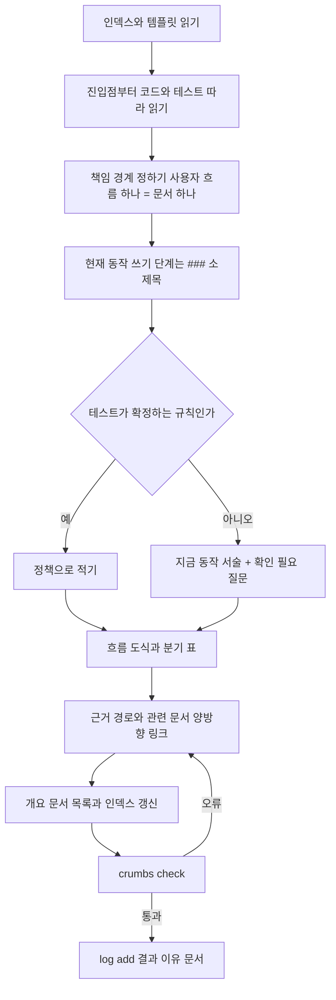
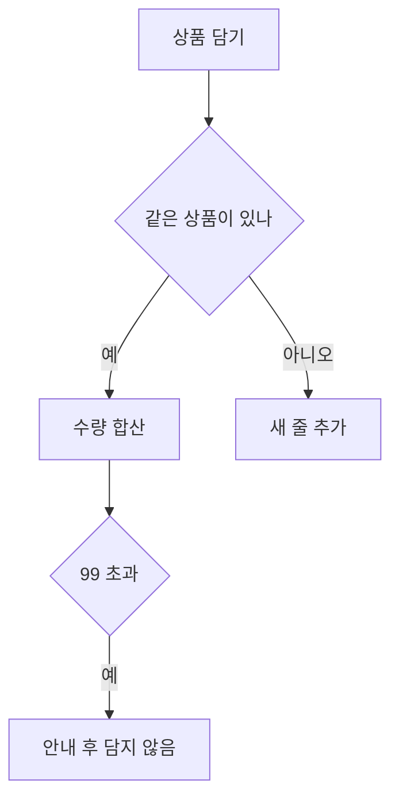

# crumbs-spec 🍞

**한국어** · [English](README.md)

에이전트가 길을 잃지 않게 문서마다 빵부스러기(링크)를 남기고, 인덱스에서 상세 문서까지 한 길로 이어지는 **살아 있는 스펙**을 만들어요. 저장소가 *지금* 어떻게 동작하는지를 책임 단위 문서로 두고, 그 문서들이 잘 이어져 있는지 명령 하나로 검사하고, 에이전트가 문서를 쓰고·찾고·묻고·반영하는 절차를 스킬로 고정한 도구예요.

## 왜 만들었나요

실제 앱 저장소에서 수십 개의 스펙 문서를 에이전트와 함께 운영하다 보니 같은 일이 자꾸 반복됐어요.

1. 스펙이 변경 단위(기능별 `spec.md`, 티켓)로만 남아서, 몇 달 뒤 "지금 이 규칙이 뭐지?"에 답할 문서가 없었어요.
2. 위키처럼 쌓으니 같은 규칙이 여러 문서에 조금씩 다르게 적혔고, 어느 쪽이 맞는지 아무도 몰랐어요. 나중에 벤치마크를 돌려 보니 에이전트가 문서 간 불일치를 셋이나 찾아냈어요.
3. 에이전트가 문서를 읽을 때 폴더 구조와 검색에 기대다 보니 다른 영역으로 새거나 grep으로 떨어졌어요. 질문 하나에 문서 8개를 읽는 일도 있었고요.

"문서를 더 잘 쓰자"로는 해결이 안 됐어요. **구조를 기계가 강제하는 도구**가 필요했어요. 정책의 소유자를 하나로 정하고, 링크 그래프를 검사하고, 모르는 것은 질문으로 남기게 하면 에이전트도 사람도 같은 길로 문서에 닿아요. 그래서 빵부스러기를 뿌리기 시작했어요.

## 다른 도구와 어떻게 다른가요

Spec Kit은 구현 전 계획을, LLM Wiki는 자료를 쌓는 위키를 잘 다뤄요. crumbs-spec은 그 사이의 빈자리, **구현이 끝난 뒤에도 남아야 하는 현재 상태**를 맡아요. 대체가 아니라 보완 관계예요.

| | GitHub Spec Kit | OpenSpec | Karpathy LLM Wiki | **crumbs-spec** |
|---|---|---|---|---|
| 문서 단위 | 변경(기능) 하나: `spec.md`·`plan.md`·`tasks.md` | 현재 상태 스펙 + 변경 델타 | 엔티티·개념·원본 요약 페이지 | **책임(사용자 흐름) 하나**. 정책은 문서 하나가 소유 |
| 시점 | 구현 전 | 구현 전·후 | 자료 반영 시점 | **구현 뒤 현재 동작** |
| 기존 코드 | "추론하지 않는다"고 스스로 밝힘 | 온보딩은 있으나 코드→스펙 초안은 없음 | 원본 자료가 대상, 코드 아님 | **코드·테스트에서 초안을 만들고 모르는 것은 `[확인 필요]` 질문으로** |
| 탐색 | 폴더와 파일 이름 | 폴더와 파일 이름 | 인덱스 우선 | **인덱스 → 개요 → 상세 링크만**. ID·front matter 없음 |
| 기계 검사 | spec·plan·tasks 일관성 | 델타 병합 | 고아 페이지·끊긴 링크 lint(LLM 판단 포함) | **결정론적 15개 규칙**: 링크·앵커·도달 가능·역링크·정책 중복·근거 경로 실존·절 순서·흐름 도식·로그 형식 |
| 구현 후 동기화 | 팀이 유지 방식을 고름 | `archive`/`sync`로 변경분만 | 질의 결과를 위키에 환류 | **에이전트 규칙("요청 없어도 같은 변경에서 문서 갱신") + 결정 로그 + 예정된 `drift`** |
| 사람 가독성 | 산문 | 산문 | 산문 | **흐름 도식(Mermaid)과 분기 표를 템플릿에 포함** |
| 측정 | 없음 | 없음 | 없음 | **같은 질문으로 두 문서 체계의 탐색 비용 비교** |

LLM Wiki에서는 원본/위키/스키마 분리, 인덱스 우선, 추가 전용 로그, 사람이 감독하는 ingest를 그대로 가져왔어요. 일부러 다르게 한 건 셋이에요. 엔티티 페이지 대신 책임 단위로 조직하고(여러 흐름이 분기 축으로 쓰는 개념만 `concepts/`에 둬요), 문서는 에이전트가 유지하되 사람이 소유하고, lint는 LLM 판단 없이 결정론적으로만 해요. 더 자세한 비교는 [docs/IMPLEMENTATION_PLAN.md](docs/IMPLEMENTATION_PLAN.md) 1절에 있어요.

## 중요하게 생각한 것

- **현재 상태의 단일 진실.** 변경 디렉터리를 만들지 않아요. 문서는 "무엇이 바뀌었나"가 아니라 "지금 어떻게 동작하나"를 설명해요.
- **추측 금지.** 코드·테스트·승인된 자료로 확인되지 않은 규칙은 "지금은 이렇게 동작한다" 서술과 `[확인 필요]` 질문으로만 남겨요. 질문 수는 `check`가 세어 줘요.
- **사람 우선의 본문.** ID, 상태 표, 문법 강제가 없어요. 탐색 정보는 링크와 제목에만 둬요.
- **검사는 결정론적으로, 판단은 사람과 스킬이.** `check`는 구조만 봐요. 문체·내용·노후 판정은 스킬 지침과 사람이 맡아요.
- **결정은 한 곳에.** 질문이 답을 얻으면 로그에 `decision` 항목을 남기고 문서는 날짜 링크 하나로 그 결정을 가리켜요.
- **두 언어.** `crumbs.json`의 `lang`이 저장소 전체의 템플릿, 스킬, 메시지, AGENTS 블록 언어를 정해요. 기본값은 영어(`en`)이고 `ko`를 쓰면 한국어가 돼요.

## 실제로 써 보니

실제 앱 저장소 세 영역(코드 약 4만 줄)을 기존 스펙 문서를 전혀 보여 주지 않고 crumbs-writer 스킬로 다시 썼어요. 그다음 기존 스펙 체계와 crumbs 체계에 같은 질문 18개를 던져 에이전트가 문서만 읽고 답하게 했어요.

**제로 베이스에서 쓰는 데 든 비용** (에이전트 1개가 도메인 하나를 맡음, 병렬 3개)

| 도메인 | 코드 범위 | 만든 문서 | 정책 | 테스트로 확정 / 질문 | 에이전트 토큰 | 작성 시간 |
|---|---|---|---|---|---|---|
| 결제 | 약 2만 줄 | 19개 | 100 | 5 / 95 | 57만 | 1시간 7분 |
| 뷰어 | 약 2만 3천 줄 | 40개 | 194 | 29 / 165 | 85만 | 1시간 7분 |
| 인증 | 약 1만 줄 | 35개 | 195 | 64 / 131 | 79만 | 1시간 13분 |

작성 시간은 에이전트 전사의 타임스탬프에서 10분 넘게 비어 있던 대기 시간을 뺀 실제 작업 시간이에요. 세 도메인을 병렬로 돌려 1시간 15분쯤에 모두 끝났어요. 지어낸 정책은 0개였고, 기존 스펙 문서와 코드가 달랐던 6곳을 모두 코드대로 적었어요. 그 뒤 사용자 흐름 단위로 다시 묶어 38개 문서가 됐어요.

**같은 질문 18개로 비교한 탐색 비용** (에이전트는 문서만 읽고 코드는 금지)

| | 기존 스펙 체계 | crumbs-spec |
|---|---|---|
| 정답 | 17 / 18 (부분 1) | 15 / 18 (부분 3) |
| 읽은 파일 수 합계 | 70 (평균 3.9, 최대 8) | 64 (평균 3.6, 최대 6) |
| 검색(grep)으로 떨어진 횟수 | 3 | 1 |
| 토큰 합계 | 232만 | 189만 (−18%) |

기존 체계의 부분 정답은 소유 문서를 못 찾은 경우였고, crumbs의 부분 정답 3개는 모두 문서엔 3~5파일로 도달했는데 writer가 화면 수치·채널 분기 같은 세부를 버린 경우였어요. 그 원인은 스킬 규칙("조건이 붙은 값은 버리지 않는다")으로 고쳤어요. 질문이 기존 스펙에서 나와 기존 체계에 유리한 편향이 있다는 점은 감안해 주세요.

## 설치와 빠른 시작

Node.js 20 이상이 필요하고 실행 의존성은 없어요.

```bash
npx crumbs-spec init --skills all   # 문서 구조 + 에이전트 스킬 4종
npx crumbs-spec init                # 문서 구조만
npx crumbs-spec check               # 링크 그래프와 구조 검사
```

한국어 저장소는 `--lang ko`를 붙여요.

`init`은 다음 일곱 파일을 만들고, 이미 있는 파일은 절대 덮어쓰지 않아요.

```
crumbs.json                      설정
docs/specs/index.md              인덱스(입구)
docs/specs/log.md                추가 전용 로그
docs/specs/templates/overview.md 개요 템플릿
docs/specs/templates/detail.md   상세 템플릿
docs/raw/README.md               원본 자료 디렉터리(읽기 전용)
AGENTS.md                        crumbs 블록(에이전트 규칙)
```

npm에 공개하기 전에는 저장소에서 `npm run build` 뒤 `node dist/src/cli.js <명령>`으로 실행해요.

## 기존 프로젝트에 추가하기

이미 코드와 문서가 있는 저장소에 넣는 순서예요. 한 번에 다 옮기지 말고 도메인 하나부터 시작해요.

1. **저장소 루트에서 `init`을 실행해요.** 스펙 루트가 따로 있으면 `--spec-dir`로 지정해요(예: `docs/crumbs`). 기존 파일은 건드리지 않고, `AGENTS.md`가 이미 있으면 `<!-- crumbs:start -->`와 `<!-- crumbs:end -->` 사이 블록만 끼워 넣어요.

   ```bash
   npx crumbs-spec init --spec-dir docs/crumbs --skills claude
   ```

2. **에이전트가 규칙을 읽게 해요.** Claude Code는 `CLAUDE.md`에 `@AGENTS.md` 한 줄이 있어야 crumbs 블록을 읽어요. 스킬은 `.claude/skills/`(Claude Code)와 `.agents/skills/`(Codex)에서 자동으로 찾아요.

3. **기존 문서는 옮기지 않아요.** writer는 코드와 테스트만 원본으로 삼고, 기존 위키·설계 메모·README는 사용자가 원본 자료로 지목하지 않는 한 읽지 않아요. 지금 코드와 맞는지 확인할 수 없기 때문이에요. 기존 문서 중 근거로 쓸 것(기획서, 계약서, 정책 결정 기록)은 `docs/raw/`에 복사해 두고 `crumbs-ingest`로 한 건씩 반영해요.

4. **첫 도메인을 코드에서 써요.** 가장 자주 질문받는 영역 하나를 고르고 writer의 "기존 코드 문서화" 모드로 맡겨요. 결과물의 `[확인 필요]` 질문 목록이 그 영역에서 사람이 결정해야 할 것의 목록이 돼요.

   ```
   src/billing/ 아래 코드를 crumbs-writer의 "기존 코드 문서화" 모드로 문서화해 줘.
   도메인 디렉터리는 docs/crumbs/billing/이다. 확인하지 못한 정책은 질문으로 남기고 끝까지 해 줘.
   ```

5. **`check`를 CI에 걸어요.** 오류(끊어진 링크·앵커, 도달 불가 문서, 빠진 역링크, 없는 코드 경로, 정책 이름 중복)만 실패시키고 경고는 둬요. 아직 crumbs로 다루지 않는 디렉터리가 스펙 루트 안에 있으면 `crumbs.json`의 `exclude`에 넣어요.

6. **코드를 바꿀 때 문서를 같이 바꿔요.** AGENTS 블록이 "요청이 없어도 같은 변경에서 소유 문서를 갱신한다"를 에이전트에게 요구하니까, PR마다 `check`와 로그 항목이 함께 들어와요. 도메인이 하나씩 늘어나면서 인덱스가 채워져요.

기존 스펙 체계가 있다면 두 체계에 같은 질문을 던져 비교해 보세요. 읽은 파일 수와 정답률로 어느 쪽이 더 잘 찾히는지 바로 보여요(5단계 벤치마크 러너가 이걸 자동화할 예정이에요).

## 스펙이 만들어지는 순서

writer 스킬이 "기존 코드 문서화" 모드로 일할 때의 순서예요. "변경 반영" 모드는 1~2단계가 "바뀐 코드 경로를 근거에 적은 소유 문서 찾기"로 바뀌고 나머지는 같아요.



답이 생기면 `crumbs-interview`가 만든 질문에 사람이 답하고, writer가 질문 정책을 확정 정책으로 바꾸며 `decision` 로그와 결정 링크를 남겨요. 새 자료가 들어오면 `crumbs-ingest`가 영향 문서를 찾아 확인받은 뒤 반영해요.

## 문서 모델

역할은 넷이에요. 탐색은 항상 인덱스에서 시작해요.

```
docs/specs/index.md              인덱스: 도메인 목록 + 로그 링크
docs/specs/<도메인>/overview.md   개요: 범위, 흐름도, 문서 목록, 용어
docs/specs/<도메인>/<책임>.md     상세: 사용자 흐름 하나
docs/specs/log.md                로그: 한 일을 시간순으로
docs/specs/concepts/             여러 도메인이 함께 쓰는 개념(선택)
docs/raw/                        계약서·기획 메모 같은 불변 원본
```

상세 문서의 절은 고정이에요.

| 절 | 내용 |
|---|---|
| 목적 | 이 문서가 소유하는 책임 하나와 맡지 않는 범위 |
| 현재 동작 | 사용자가 겪는 대로, 현재형으로. 단계가 셋 이상이면 `###` 소제목 |
| 흐름 | 두 단계 이상이면 Mermaid 도식, 비교 축이 둘 이상이면 표 |
| 정책 | `### 정책 이름`(저장소 전체에서 유일)과 규칙. 미확정이면 지금 동작 서술 뒤에 `[확인 필요]` 질문 |
| 근거 | 백틱 코드 경로와 설명. `check`가 경로의 존재를 확인해요 |
| 확인 필요 사항 | `- [확인 필요] [정책 이름](#앵커) — 질문` |
| 관련 문서 | 개요로 가는 링크와 이웃 문서. 역링크는 상호여야 해요 |

예시(`docs/specs/shopping/장바구니.md`):

````markdown
# 장바구니
<!-- ../index.md를 먼저 읽는다. 이 문서를 바꾼 뒤 ../log.md에 항목을 추가한다 -->

## 목적
사용자가 상품을 담고 수량을 바꾸고 비울 때까지의 흐름을 맡는다. 쿠폰 적용은 [쿠폰 할인](쿠폰-할인.md)이 맡는다.

## 현재 동작
- 사용자가 같은 상품을 다시 담으면 앱은 수량을 더한다.
- 수량이 99를 넘으면 앱은 "최대 99개까지 담을 수 있습니다." 안내를 보이고 담지 않는다.

## 흐름


## 정책
### 수량 상한
장바구니 한 줄의 수량은 99 이하다.

### 최소 주문 금액
지금은 합계가 10,000원 미만이면 결제 버튼을 비활성화한다.
[확인 필요] 10,000원이라는 기준의 근거는 무엇인가?

## 근거
- `src/cart/cart.ts:12-48` — 담기와 수량 합산
- `test/cart/cart.test.ts` — 수량 상한

## 확인 필요 사항
- [확인 필요] [최소 주문 금액](#최소-주문-금액) — 10,000원이라는 기준의 근거는 무엇인가?

## 관련 문서
- [쇼핑 개요](overview.md)
- [쿠폰 할인](쿠폰-할인.md)
````

문서 본문은 간결한 `-한다`체로 써요. 개요의 `## 용어`는 별칭을 소유 정책으로 잇는 링크 목록이에요(`- 정액권(정액제) — [정액권 이용 중 판정](정액권.md#정액권-이용-중-판정)`). 정의만 있는 용어는 여기서 끝나고, 여러 흐름이 분기 축으로 쓰는 개념(채널, 재화, 회원 상태)만 `concepts/`에 소유 문서를 둬요.

## 명령

```bash
npx crumbs-spec init [--spec-dir <dir>] [--lang <en|ko>] [--skills <claude|codex|all>]
npx crumbs-spec check [--format text|json] [--config <path>]
npx crumbs-spec log add --kind <ingest|query|lint|drift|change|decision> "<제목>" [--body "<본문>"]
```

공통 옵션은 `--root <dir>`(저장소 루트, 기본값은 현재 디렉터리), `--lang <en|ko>`(init이 쓸 언어, 설정을 읽기 전 오류의 언어, 기본값 `en`), `-h`/`--help`, `-v`/`--version`이에요. 설정은 저장소 루트의 `crumbs.json`에 둬요(`specDir`, `index`, `overview`, `log`, `lang`, `headings`, `exclude`, `codeRoot`, `rawDir`).

`check`의 출력은 `파일:줄 심각도 규칙: 메시지` 한 줄씩이고 마지막 줄이 요약이에요.

```
docs/specs/shopping/장바구니.md:34 error broken-anchor: 앵커가 없음: 쿠폰-할인.md#적용-순서
docs/specs/shopping/장바구니.md:20 warning open-question: 미해결 질문 표시 2개

crumbs check: 문서 4개, 오류 1개, 경고 1개
```

### 검사 규칙

| 규칙 | 심각도 | 잡는 것 |
|---|---|---|
| `index-missing` | 오류 | 인덱스 문서가 없어요(다른 규칙은 돌지 않아요) |
| `missing-title` | 오류 | 첫 제목이 H1이 아니에요 |
| `broken-link` / `broken-anchor` | 오류 | 링크 대상 파일·제목이 없어요 |
| `unreachable` | 오류 | 인덱스에서 링크로 닿을 수 없는 문서예요 |
| `missing-section` | 오류 | 역할별 필수 절이 없어요 |
| `missing-backlink` | 오류 | 부모(개요·인덱스)로 돌아가는 링크가 없거나, 상세 A→B 링크에 B→A가 없어요 |
| `missing-code-path` | 오류 | 근거의 코드 경로가 존재하지 않아요 |
| `duplicate-policy` | 오류 | 같은 정책 이름이 두 문서에 있어요 |
| `log-format` | 오류 | 로그 항목이 `## [YYYY-MM-DD] kind \| 제목` 형식이 아니에요 |
| `open-question` | 경고 | 문서의 `[확인 필요]` 수예요 |
| `log-order` | 경고 | 로그 날짜가 역순이에요 |
| `missing-flow` | 경고 | 현재 동작이 6단계 이상인데 도식도 표도 없어요 |
| `section-order` | 경고 | 절 순서가 템플릿과 달라요 |
| `log-body` | 경고 | `decision` 항목에 문서 링크가 없어요 |

## 로그

로그는 한 곳(`docs/specs/log.md`)에 시간순으로 덧붙여요. 제목은 작업명이 아니라 **사용자 결과 한 문장**이고, 본문은 세 줄이에요.

```bash
npx crumbs-spec log add --kind change "장바구니 수량 상한을 99로 올림" \
  --body "결과: 한 줄에 99개까지 담을 수 있다. 이유: 요청 SHOP-42. 문서: [수량 상한](shopping/장바구니.md#수량-상한)"
```

`[확인 필요]` 질문이 답을 얻으면 `decision` 항목을 남기고, 확정한 정책 본문 끝에 결정 링크 하나를 둬요. 문서 안에 변경 이력을 두지 않는 대신 결정은 로그에 쌓이고 문서는 링크로만 가리켜요.

```markdown
## [2026-11-02] decision | 최소 주문 금액: 10,000원은 배송비 정책에서 온 값이다
결과: 합계 10,000원 미만이면 결제 버튼이 비활성이다. 이유: 2026-11-02 기획 확인. 문서: [최소 주문 금액](shopping/장바구니.md#최소-주문-금액)
```

```markdown
### 최소 주문 금액
합계가 10,000원 미만이면 결제 버튼을 비활성화한다. (결정: [2026-11-02](../log.md#2026-11-02-decision-최소-주문-금액-10000원은-배송비-정책에서-온-값이다))
```

kind는 `ingest`(원본 자료 반영), `query`(답을 찾아 환류), `lint`, `drift`, `change`(문서 변경), `decision`(질문 확정)이에요.

## 스킬

`init --skills`는 에이전트가 crumbs 문서를 다루는 절차를 `.claude/skills/<이름>/SKILL.md`(Claude Code)와 `.agents/skills/<이름>/SKILL.md`(Codex)에 설치해요. 기존 `SKILL.md`는 덮어쓰지 않으니 새 버전으로 바꾸려면 지우고 다시 설치해요. Claude Code는 `CLAUDE.md`에 `@AGENTS.md`가 있어야 crumbs 블록의 규칙을 읽어요.

| 스킬 | 하는 일 |
|---|---|
| `crumbs-writer` | 문서를 쓰거나 갱신해요. "변경 반영"(바뀐 코드 → 소유 문서)과 "기존 코드 문서화"(코드·테스트만으로 처음 쓰기) 두 모드. 책임 단위, 문체, 질문 형식, 흐름 도식, 개념 페이지 기준을 담고 있어요 |
| `crumbs-finder` | 인덱스 → 개요 → 상세 순으로 답을 찾아 출처와 함께 답하고, 좋은 답은 `query` 로그로 환류해요 |
| `crumbs-interview` | 요청이 건드리는 정책 중 미확인인 것을 질문으로 만들고 멈춰요 |
| `crumbs-ingest` | `docs/raw/`의 새 자료를 읽고 영향 문서를 찾아 확인받은 뒤 반영하고 `ingest` 로그를 남겨요 |

## 사용 예시

### 1. 기존 코드를 처음 문서화해요

```
src/cart/ 아래 코드를 crumbs-writer의 "기존 코드 문서화" 모드로 문서화해 줘.
도메인 디렉터리는 docs/specs/shopping/이고, 확인하지 못한 정책은 질문으로 남기고 끝까지 해 줘.
```

에이전트는 인덱스와 템플릿을 읽고, 진입점부터 코드와 테스트를 따라가며 `shopping/overview.md`와 상세 문서를 만들어요. 테스트가 확정하는 규칙은 정책으로, 코드에만 있는 규칙은 "지금은 …" 서술과 `[확인 필요]` 질문으로 적어요. 끝에 `check`를 돌려 오류를 없애고 로그를 남겨요.

```
crumbs check: 문서 5개, 오류 0개, 경고 3개
```

경고는 남긴 질문의 수예요. `확인 필요 사항` 절만 훑어도 무엇을 결정해야 하는지 알 수 있어요.

### 2. 코드 변경을 문서에 반영해요

```
장바구니 수량 상한을 99에서 199로 올렸어. 문서도 맞춰 줘.
```

writer는 `grep -rl 'src/cart/cart.ts' docs/specs`로 근거에 그 경로를 적은 소유 문서를 찾고, "현재 동작"과 `### 수량 상한` 본문을 고치고, 흐름 도식의 값을 맞추고, 로그에 `change | 장바구니 수량 상한을 199로 올림`을 남겨요. 소유 문서가 둘로 보이면 멈추고 어느 쪽이 소유자인지 물어요.

### 3. 모르는 정책은 묻고, 답은 결정으로 남겨요

```
쿠폰 중복 적용 규칙을 바꾸려고 해. 먼저 뭘 확인해야 하지?
```

interview가 요청이 건드리는 정책을 나열하고, 코드·테스트·원본으로 확인된 것과 미확인인 것을 가른 뒤 미확인 정책을 질문으로 내요. 답하시면 writer가 정책을 확정 서술로 바꾸고 `decision` 로그와 결정 링크를 남겨요.

### 4. 원본 자료를 반영해요

```
docs/raw/coupon-policy-v3.pdf를 반영해 줘.
```

ingest가 자료를 읽고 영향을 받는 문서를 인덱스·역링크·근거로 찾아 "바꿀 내용 목록"을 먼저 보여 줘요. 확인을 받은 뒤에만 소유 문서를 고치고 `ingest` 로그를 남겨요. 자동 병합은 하지 않아요.

### 5. 답을 찾아요

```
장바구니에 몇 개까지 담을 수 있어?
```

finder는 인덱스 → 쇼핑 개요 → 장바구니 문서 순으로 내려가 `### 수량 상한`을 출처로 답해요. 용어·개념 질문이면 `concepts/overview.md`의 용어 절을 먼저 봐요. 문서에 답이 없으면 "문서에 없음"과 가장 가까이 간 문서를 말해요.

### 6. CI에서 검사해요

```yaml
- run: npx crumbs-spec check --format json > crumbs-report.json
```

종료 코드 1이면 오류가 있어요. 경고(`open-question`, `missing-flow` 등)는 실패시키지 않아요.

## 종료 코드

| 코드 | 의미 |
|---|---|
| 0 | `check`: 오류가 없어요(경고는 허용). `init`·`log add`: 완료 |
| 1 | `check`: 오류가 하나 이상 있어요 |
| 2 | 사용법 오류, 설정 오류, 예기치 않은 I/O 오류 |

## 설계에서 뺀 것

- 요구사항 ID, front matter, EARS 같은 문법 강제. 탐색 정보는 링크와 제목에만 둬요.
- 문서 안의 변경 이력 표와 결정마다 별도 파일. 결정은 로그 한 곳에 쌓고 문서는 링크로 가리켜요.
- 정의만 있는 용어 페이지. 개요의 용어 절로 충분해요.
- `check`의 문체·내용 판정. 문체는 스킬 지침과 [docs/lint/](docs/lint/README.md)의 markdownlint 설정 샘플이 맡아요.

## 로드맵

| 단계 | 내용 | 상태 |
|---|---|---|
| 1 | `init`, `check`, 템플릿, AGENTS 블록 | 완료 |
| 2 | 스킬 4종, `log add`, 흐름 절, 책임 단위 기준, 용어·개념 페이지, 결정 로그 | 완료 |
| 3 | `crumbs reverse <path>` — 코드에서 초안 생성 명령(지금은 writer 스킬이 대신해요) | 예정 |
| 4 | `crumbs drift --base <ref>` — diff로 근거가 바뀐 문서를 찾아요 | 예정 |
| 5 | 예제 앱과 탐색 비용 벤치마크 러너 | 예정 |
