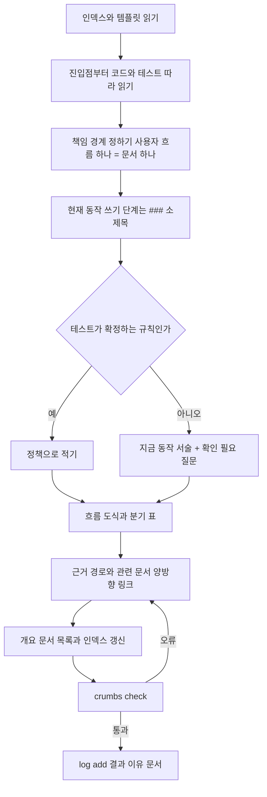
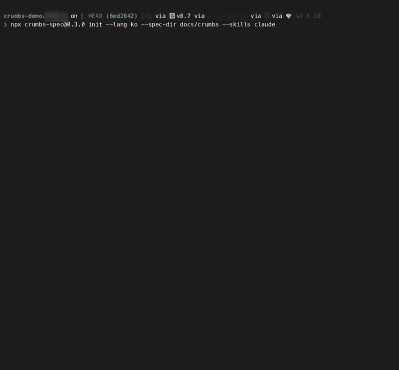

<p align="center"></p>

# crumbs-spec 🍞

**한국어** · [English](README.md)

[](https://github.com/Sienna94/crumbs-spec/actions/workflows/ci.yml) [](https://www.npmjs.com/package/crumbs-spec)

**에이전트가 길을 잃지 않도록 문서마다 빵부스러기를 남겨요!**

코딩 에이전트를 위한 살아 있는 스펙입니다. 저장소가 지금 어떻게 동작하는지 적은 Markdown 문서 묶음을 관리하고, 명령 하나로 문서가 제대로 이어져 있는지 검사해요. 모든 문서가 인덱스로 이어지고 정책마다 주인 문서가 하나예요. 에이전트가 문서를 쓰고 찾고 묻고 반영할 수 있어요!

## 왜 만들었나요

스펙이 없던 프로젝트에 팀이 함께 쓸 공통 스펙을 처음부터 쓰는 일이 너무 어려웠어요. 스펙이 있던 프로젝트도 작성자마다 자기 스타일로 써서, 에이전트가 관련 내용을 빠르게 찾지 못했고 문서가 자동으로 관리되지도 않았습니다.

그래서 실제 앱 저장소에서 스펙 문서 수십 개를 에이전트와 함께 운영해 봤어요. 같은 문제가 세 가지 반복됐습니다.

- 스펙이 변경 단위로만 남았어요. 기능별 `spec.md`, 티켓. 몇 달 뒤 "지금 이 규칙이 뭐지?"에 답하는 문서가 없었어요.
- 위키처럼 쌓으니 같은 규칙이 여러 문서에 조금씩 다르게 적혔어요. 어느 쪽이 맞는지 아무도 몰랐습니다.
- 에이전트가 폴더 이름과 grep에 의지했어요. 다른 영역으로 새거나 질문 하나에 문서 8개를 읽기도 했어요.

문서를 더 잘 쓰자는 말로는 해결이 안 됐어요. 구조를 기계가 강제하니 해결됐습니다. 정책마다 주인 하나, 검사되는 링크 그래프, 추측 대신 질문입니다. 그래서 빵부스러기를 뿌리기 시작했어요.

## 다른 도구와 어떻게 다른가요

Spec Kit은 구현 전 계획을 맡습니다. LLM Wiki는 자료를 쌓는 위키를 맡아요. crumbs-spec은 그 다음, 코드가 나간 뒤에도 맞아야 하는 현재 상태를 맡습니다.

| | GitHub Spec Kit | OpenSpec | Karpathy LLM Wiki | **crumbs-spec** |
|---|---|---|---|---|
| 문서 단위 | 변경(기능) 하나: `spec.md`·`plan.md`·`tasks.md` | 현재 상태 스펙 + 변경 델타 | 엔티티·개념·원본 요약 페이지 | **책임(사용자 흐름) 하나**. 정책은 문서 하나가 소유 |
| 시점 | 구현 전 | 구현 전·후 | 자료 반영 시점 | **구현 뒤 현재 동작** |
| 기존 코드 | "추론하지 않는다"고 스스로 밝힘 | 온보딩은 있으나 코드→스펙 초안은 없음 | 원본 자료가 대상, 코드 아님 | **crumbs-writer 스킬이 코드·테스트에서 초안을 만들고 모르는 것은 `[확인 필요]` 질문으로 남겨요** |
| 탐색 | 폴더와 파일 이름 | 폴더와 파일 이름 | 인덱스 우선 | **인덱스 → 개요 → 상세 링크만**. ID·front matter 없음 |
| 기계 검사 | spec·plan·tasks 일관성 | `openspec validate`(구조) 검사와 아카이브 시 델타 병합 | 고아 페이지·끊긴 링크 lint(LLM 판단 포함) | **결정론적 16개 구조 규칙**: 링크·앵커·도달 가능·역링크·정책 이름 중복·근거 경로·절 순서·흐름 도식·로그 형식·닫히지 않은 주석 |
| 구현 후 동기화 | 팀이 유지 방식을 고름 | `archive`/`sync`로 변경분만 | 질의 결과를 위키에 환류 | **에이전트 규칙("요청 없어도 같은 변경에서 문서 갱신")과 결정 로그** |
| 사람 가독성 | 산문 | 산문 | 산문 | **흐름 도식(Mermaid)과 분기 표를 템플릿에 포함** |

Kiro 스펙과 BMAD는 Spec Kit과 비슷해서(기능 단위, 구현 전) 따로 싣지 않았어요. 다섯 가지 비교는 [docs/IMPLEMENTATION_PLAN.md](docs/IMPLEMENTATION_PLAN.md) 1절에 있습니다.

LLM Wiki에서는 원본/위키/스키마 분리, 인덱스 우선, 추가 전용 로그, 사람이 감독하는 ingest를 가져왔어요. 다르게 한 건 셋입니다.

- 엔티티가 아니라 책임 단위로 문서를 나눕니다. 여러 흐름이 분기 축으로 쓰는 개념만 `concepts/`에 둬요.
- 문서는 에이전트가 유지하고 사람이 소유해요.
- lint는 결정론적입니다. LLM 판단이 없어요.

## 원칙

- **현재 상태의 단일 진실.** 변경 디렉터리가 없습니다. 문서는 "무엇이 바뀌었나"가 아니라 "지금 어떻게 동작하나"를 적어요.
- **추측 금지.** 코드·테스트·승인된 자료로 확인되지 않은 규칙은 "지금은 이렇게 동작한다"와 `[확인 필요]` 질문으로만 남깁니다. `check`는 질문이 남은 문서마다 `open-question` 경고를 하나 내요. 어떤 서술이 추측인지는 `check`가 몰라요. 스킬 규칙과 리뷰어가 가립니다.
- **정책 하나에 주인 하나.** 같은 정책 이름이 두 문서에 있거나 한 문서에 두 번 있으면 `check`가 거부합니다. 이름만 다른 같은 정책은 못 잡아요. 그건 writer 스킬의 이름 규칙이 맡아요.
- **사람이 읽는 본문.** ID, 상태 표, 문법 강제가 없습니다. 탐색 정보는 링크와 제목에만 둬요.
- **검사는 결정론적으로.** `check`는 구조만 봅니다. 문체·내용·노후 판정은 스킬과 사람이 해요.
- **결정은 한 곳에.** 답을 얻은 질문은 로그의 `decision` 항목이 됩니다. 문서는 날짜 링크 하나로 그걸 가리켜요.
- **두 언어.** `crumbs.json`의 `lang`이 템플릿, 스킬, 메시지, AGENTS 블록의 언어를 정합니다. 기본 `en`, 한국어는 `ko`예요.

### 설계에서 뺀 것

- 요구사항 ID, front matter, EARS 같은 문법 강제. 탐색 정보는 링크와 제목에만 둡니다.
- 문서 안의 변경 이력 표와 결정마다 별도 파일. 결정은 로그에 쌓아요.
- 정의만 있는 용어 페이지. 개요의 용어 절로 충분합니다.
- `check`의 문체·내용 판정. 문체는 스킬 지침과 [docs/lint/](docs/lint/README.md)의 markdownlint 설정 샘플이 맡아요.

## 처음 보는 코드에서도 맞게 쓸까요?

[RealWorld](https://github.com/realworld-apps/realworld) "Conduit" API를 구현한 공개 백엔드 두 개에 writer 스킬을 돌리고 그 프로젝트의 공식 API 테스트로 채점했어요. 생성 문서, 프롬프트, 정답지, 채점 행은 [crumbs-spec-conduit](https://github.com/Sienna94/crumbs-spec-conduit)에 있습니다.

준비:

- 같은 API의 구현체 두 개를 커밋으로 고정했어요. [Nitro + Prisma](https://github.com/realworld-apps/nitro-prisma-zod-realworld-example-app)(TypeScript)와 [Django Ninja](https://github.com/c4ffein/realworld-django-ninja)(Python)입니다.
- 구현체마다 Opus 5.5 에이전트 하나가 코드와 테스트만 보고 썼어요. 쓰는 동안 저장소에 공식 스펙은 없었습니다.
- 정답지는 고정 버전의 공식 Hurl 테스트 요청 하나당 한 행입니다. 준비·정리 요청을 빼면 130행이에요.
- 채점은 Sonnet 5.5가 행마다 했어요. `correct`는 상태 코드와 검증 값을 문서가 모두 적은 경우, `partial`은 하나 빠진 경우, `wrong`은 반대로 적은 경우, `missing`은 다룬 문서가 없는 경우입니다. 정책은 코드와도 대조했어요.

| | Nitro + Prisma | Django Ninja |
|---|---|---|
| 저장소의 코드 / 테스트 | 약 1,400줄 / 단위 테스트 파일 2개 | 약 2,300줄 / 앱마다 엔드포인트 테스트 |
| 문서 / 정책 | 28 / 51 | 26 / 91 |
| 테스트로 확정된 정책 / 질문으로 남긴 정책 | 6 / 45 | 50 / 41 |
| 공식 테스트 행 정답 | **125 / 130** | **116 / 130** |
| 부분 / 오답 / 누락 | 5 / 0 / 0 | 14 / 0 / 0 |
| 지어낸 정책(코드에 없는 것) | 0 | 0 |
| 일부를 과장한 정책 | 1 | 6 |
| writer 토큰 / 걸린 시간 | 16.5만 / 2시간 40분 | 20.2만 / 2시간 47분 |

결과:

- 오답도, 지어낸 정책도 없었어요. 놓친 건 전부 세부 누락입니다. Nitro의 부분 정답 5개는 `null` 입력과 태그 순서예요. Django의 14개 중 12개는 질문 하나에서 나왔어요. 오류 처리기와 테스트가 401 응답 본문을 다르게 보여서 writer가 둘 다 적고 물었어요.
- `[확인 필요]`가 붙은 서술도 대부분 맞았어요. 그런 서술만으로 정답 판정을 받은 행이 Nitro 12개, Django 32개입니다.
- 테스트가 적으면 질문이 많습니다. Nitro는 단위 테스트 파일이 2개라 정책 51개 중 45개가 질문으로 남았어요. 그중 29개는 공식 테스트가 답해 줘요.
- 공식 테스트가 안 다루는 것도 질문으로 올렸어요. Django의 글 목록은 토큰을 안 읽고 세션 사용자를 봐요. `createUser` 명령은 마이그레이션에서 이름이 바뀐 필드로 사용자를 찾아요. Nitro 문서는 이메일 형식을 검사하지 않는다고 적었는데, 더 새 버전의 공식 테스트는 이걸 검사합니다.

한계:

- 구현체마다 한 번, writer 모델 하나로 돌렸어요.
- 채점자도 모델입니다. 작성자가 인용된 앵커가 전부 있는지 확인하고 일부 행을 직접 대조했어요.
- RealWorld는 널리 알려진 프로젝트라 writer가 학습 중에 봤을 수 있어요.
- 공식 테스트는 문서 내용의 일부만 검증합니다. Nitro 정책 20개와 Django 정책 41개는 코드와만 대조했어요.
- Django 채점자는 의존성 버전을 고정하지 않고 코드를 실행했어요. "일부 과장" 판정 몇 개는 라이브러리 버전에 따라 달라질 수 있습니다.

## 설치

Node.js 20 이상. 실행 의존성은 없어요.

```bash
npx crumbs-spec init --skills all   # 문서 구조 + 에이전트 스킬 4종
npx crumbs-spec init                # 문서 구조만
npx crumbs-spec check               # 링크와 구조 검사
```

한국어 저장소는 `--lang ko`를 붙입니다.

`init`이 만드는 파일입니다.

```
crumbs.json                      설정
docs/specs/index.md              인덱스(입구)
docs/specs/log.md                추가 전용 로그
docs/specs/templates/overview.md 개요 템플릿
docs/specs/templates/detail.md   상세 템플릿
docs/raw/README.md               원본 자료 디렉터리(읽기 전용)
AGENTS.md                        crumbs 블록(에이전트 규칙)
```

`init`의 동작:

- 이미 있는 파일은 덮어쓰지 않습니다.
- `--skills all`이면 SKILL.md 여덟 개도 써요.
- AGENTS.md에서는 `<!-- crumbs:start -->`와 `<!-- crumbs:end -->` 사이의 자기 블록만 건드립니다.
- `crumbs.json`이 이미 있으면 그 설정을 두고 `--spec-dir`와 `--lang`을 무시합니다. 그렇다고 알려 줘요.
- 마지막 줄은 다음에 실행할 명령입니다: `npx crumbs-spec check`.

클론해서 쓰려면 `npm run build` 뒤 `node dist/src/cli.js <명령>`이에요.

## 기존 프로젝트에 추가하기

저장소 전체를 한 번에 문서화합니다. 기존 문서를 옮기는 게 아니라 코드에서 새로 써요.

1. **저장소 루트에서 `init`을 실행해요.** 스펙 루트가 따로 있으면 `--spec-dir`로 지정합니다. 기존 파일은 그대로 둬요.

   ```bash
   npx crumbs-spec init --spec-dir docs/crumbs --skills claude
   ```

2. **에이전트가 규칙을 읽게 해요.**
   - Codex와 Claude Code(v2.1.277 이상)는 `AGENTS.md`를 알아서 읽습니다.
   - `CLAUDE.md`(또는 `.claude/CLAUDE.md`, `CLAUDE.local.md`)가 있으면 Claude Code는 그 파일만 읽어요. 거기에 `@AGENTS.md` 한 줄을 넣습니다. `init`이 그 경우 안내를 출력해요.
   - 스킬은 `.claude/skills/`와 `.agents/skills/`에서 알아서 찾아요.

3. **기존 문서는 옮기지 않아요.**
   - writer는 코드와 테스트만 읽습니다. 기존 위키·설계 메모가 지금 코드와 맞는지 아무도 모르기 때문이에요.
   - 근거로 쓸 것(기획서, 계약서, 결정 기록)은 `docs/raw/`에 복사해 두고 `crumbs-ingest`로 한 건씩 반영해요.

4. **코드 전체를 문서화해요.** writer가 진입점부터 코드와 테스트를 따라 읽고 도메인을 나눕니다.

   ```
   이 저장소의 코드를 crumbs-writer의 "기존 코드 문서화" 모드로 문서화해 줘.
   코드와 테스트만 근거로 삼고, 확인하지 못한 정책은 질문으로 남기고 끝까지 해 줘.
   ```

   결과물의 `[확인 필요]` 질문이 사람이 정해야 할 목록입니다. 큰 저장소는 도메인별로 나눠 요청해도 되지만, 결과는 같은 인덱스 아래에 모여요.

5. **`check`를 CI에 걸어요.**
   - 오류만 실패시키고 경고는 무시합니다.
   - 스펙 루트 안의 Markdown 중 아직 crumbs 문서가 아닌 것은 `crumbs.json`의 `exclude`에 넣어요. 스펙 루트 기준 상대 경로입니다. 디렉터리는 `/`로 끝내고 글롭은 없어요.

6. **코드를 바꿀 때 문서를 같이 바꿔요.**
   - AGENTS 블록이 에이전트에게 요청 없이도 이렇게 하라고 합니다. PR마다 `check`와 로그 항목이 따라와요.
   - 도메인이 생기거나 없어지면 인덱스도 같은 변경에서 바뀌어요.

기존 스펙 체계가 있다면 두 체계에 같은 질문을 던져 보세요. 읽은 파일 수와 정답률로 어느 쪽이 더 찾기 쉬운지 보여요.

## 스펙이 만들어지는 순서

- 아래는 writer 스킬의 "기존 코드 문서화" 모드예요.
- "변경 반영" 모드는 1~2단계만 "바뀐 코드 경로를 근거에 적은 소유 문서 찾기"로 바뀝니다. 나머지는 같아요.



그 뒤로는:

- `crumbs-interview`가 미확정 정책을 질문으로 만듭니다.
- 사람이 답하면 writer가 정책을 확정하고 `decision` 항목과 링크를 남겨요.
- 새 자료는 `crumbs-ingest`가 영향 문서를 찾아 확인받은 뒤 반영합니다.

## 문서 모델

역할은 넷이에요. 탐색은 인덱스에서 시작해 부스러기를 따라 내려갑니다.

```
docs/specs/index.md              인덱스: 도메인 목록 + 로그 링크
docs/specs/<도메인>/overview.md   개요: 범위, 흐름도, 문서 목록, 용어
docs/specs/<도메인>/<책임>.md     상세: 사용자 흐름 하나
docs/specs/log.md                로그: 한 일을 시간순으로
docs/specs/concepts/             여러 도메인이 함께 쓰는 개념(선택)
docs/raw/                        계약서·기획 메모 같은 불변 원본
```

상세 문서의 절은 고정입니다.

| 절 | 내용 |
|---|---|
| 목적 | 이 문서가 소유하는 책임 하나와 맡지 않는 범위 |
| 현재 동작 | 사용자가 겪는 대로, 현재형으로. 단계가 셋 이상이면 `###` 소제목 |
| 흐름 | 두 단계 이상이면 Mermaid 도식, 비교 축이 둘 이상이면 표 |
| 정책 | `### 정책 이름`(저장소 전체에서 유일)과 규칙. 미확정이면 지금 동작 서술 뒤에 `[확인 필요]` 질문 |
| 근거 | `/`가 들어간 백틱 경로와 설명. `check`가 경로의 존재를 확인합니다 |
| 확인 필요 사항 | `- [확인 필요] [정책 이름](#앵커) — 질문` |
| 관련 문서 | 개요로 가는 링크와 이웃 문서. 역링크는 상호여야 합니다 |

아래는 [실험](#처음-보는-코드에서도-맞게-쓸까요)에서 writer가 Nitro 코드로 만든 상세 문서입니다([원본](https://github.com/Sienna94/crumbs-spec-conduit/blob/main/nitro/docs/specs/api/articles/tag-list.md)).

- 고치지 않고 그대로 실었어요.
- `lang: en` 저장소라 제목이 영어입니다.
- 이 문서의 질문은 [사용 예시](#사용-예시) 3에서 답해요.

````markdown
# Tag list
<!-- Read ../../index.md first. After changing this document, add an entry to ../../log.md -->

## Purpose
This document owns GET /api/tags, which returns the most used tag names. How tags are attached to articles is owned by [Article creation](article-create.md#article-tag-name-handling). The endpoint allows anonymous viewers as described in [Authentication token](../authentication-token.md), and the list is the same for anonymous and signed-in viewers.

## Current behavior
- The server considers only tags that at least one article uses.
- The server sorts those tags by the number of articles that use them, most used first.
- The server returns at most 10 tag names.
- The server responds with status 200 and {"tags": ["<name>"…]}.
- If no article uses a tag, the list is empty.

## Flow
None

## Policies
### Popular tag list
The tag list holds at most 10 names of tags used by at least one article, sorted by the number of articles that use each tag, most used first. The order of tags used by the same number of articles is not defined, and the list has no pagination. No test covers this rule.
[needs confirmation] What is the basis of the 10-tag limit, and what should order tags with the same usage count?

## Evidence
- `server/routes/api/tags/index.get.ts` — selects tags used by at least one article, sorts them by usage and returns at most 10 names
- `prisma/schema.prisma` — unique tag names and the relation between tags and articles

## Open questions
- [needs confirmation] [Popular tag list](#popular-tag-list) — What is the basis of the 10-tag limit, and what should order tags with the same usage count?

## Related
- [Articles API overview](overview.md)
- [Article creation](article-create.md)
- [Article update](article-update.md)
- [Article deletion](article-delete.md)
````

문체와 용어:

- 본문은 간결한 `-한다`체로 씁니다.
- 개요의 `## 용어`는 별칭을 소유 정책으로 잇는 링크 목록입니다. 예: `- 정액권(정액제) — [정액권 이용 중 판정](정액권.md#정액권-이용-중-판정)`
- 정의만 있는 용어는 여기서 끝나요. 따로 문서를 만들지 않습니다.
- 여러 흐름이 분기 축으로 쓰는 개념(채널, 재화, 회원 상태)만 `concepts/`에 소유 문서를 둬요.

## 명령

```bash
npx crumbs-spec init [--spec-dir <dir>] [--lang <en|ko>] [--skills <claude|codex|all>]
npx crumbs-spec check [--format text|json] [--config <path>]
npx crumbs-spec log add --kind <ingest|query|lint|drift|change|decision> "<제목>" [--body "<본문>"]
```

공통 옵션:

- `--root <dir>`: 저장소 루트. 기본값은 현재 디렉터리예요.
- `--lang <en|ko>`: `init`이 쓸 언어입니다. 설정을 읽기 전에 난 오류도 이 언어로 나와요.
- `-h`, `--help`: 도움말
- `-v`, `--version`: 버전

설정은 저장소 루트의 `crumbs.json`입니다. 키는 `specDir`, `index`, `overview`, `log`, `lang`, `headings`, `exclude`, `codeRoot`, `rawDir`이에요.

`check`의 출력:

- 한 줄에 발견 하나씩 `파일:줄 심각도 규칙: 메시지`로 찍습니다.
- 마지막 줄은 요약이에요.
- `lang: ko`에서는 `링크 대상이 없음`, `미해결 질문 1개`, `crumbs check: 문서 28개, 오류 1개, 경고 20개`처럼 나옵니다.

```
docs/specs/api/articles/tag-list.md:31 error broken-link: link target not found: ../log.md#2026-11-03-decision--popular-tag-list-most-used-first-stays-ties-are-undefined-10-tags-are-cut-after-sorting-and-every-viewer-gets-the-same-unpaginated-list
docs/specs/api/articles/article-delete.md:44 warning open-question: 1 open question(s)
…
crumbs check: 28 documents, 1 error, 20 warnings
```

사용 예시 3에서 writer가 링크를 고치기 전 출력입니다. 나머지 경고 19개는 생략했어요.

**지원하는 Markdown**

| 항목 | 동작 |
|---|---|
| 제목 | ATX(`#`부터 `######`까지)만 인식합니다. setext 제목(밑줄식)은 인식하지 않습니다 |
| 링크 | 인라인 링크와 참조 링크(`[텍스트][라벨]`, `[라벨][]`와 `[라벨]: 경로` 정의)를 검사합니다. `[라벨]`만 쓴 축약 참조는 링크가 아닙니다 |
| 제목 앵커 | github-slugger 방식입니다. 공백마다 `-`가 되고 `-`와 `_`를 뺀 문장부호는 지웁니다. 연속된 `-`는 합치지 않습니다. 예: `### 수량 & 한도` → `#수량--한도` |
| 심볼릭 링크 | 스펙 루트 아래의 심볼릭 링크 파일과 디렉터리도 따라갑니다 |
| 근거 경로 기준 | `codeRoot`(기본값은 저장소 루트) 기준으로 해석합니다. `rawDir` 아래 경로만 언제나 저장소 루트 기준입니다 |
| 근거 경로 형식 | `/`가 있어야 합니다. 저장소 루트의 파일은 `./package.json`처럼 씁니다. `:12`, `:12-48`, `:12:5`, `:12-48,60-70` 같은 줄 표기를 받습니다 |
| `exclude` | 스펙 루트 기준 상대 경로입니다. `/`로 끝나면 그 디렉터리를 제외합니다 |
| JSON 출력 | 모든 항목에 `line`이 있습니다(더 나은 위치가 없으면 1) |

### 검사 규칙

| 규칙 | 심각도 | 잡는 것 |
|---|---|---|
| `index-missing` | 오류 | 인덱스 문서가 없습니다(다른 규칙은 돌지 않습니다) |
| `missing-title` | 오류 | 첫 제목이 H1이 아닙니다 |
| `broken-link` | 오류 | 링크 대상 파일이 없거나 철자(대소문자·유니코드 정규화)가 디스크의 파일과 다릅니다 |
| `broken-anchor` | 오류 | 링크가 가리키는 제목(앵커)이 없습니다 |
| `unreachable` | 오류 | 인덱스에서 링크로 닿을 수 없는 문서입니다 |
| `missing-section` | 오류 | 역할별 필수 절이 없습니다 |
| `missing-backlink` | 오류 | 부모(개요·인덱스)로 돌아가는 링크가 없거나 상세 A→B 링크에 B→A가 없습니다 |
| `missing-code-path` | 오류 | 근거의 코드 경로가 존재하지 않습니다 |
| `duplicate-policy` | 오류 | 같은 정책 이름이 두 문서에 있거나 한 문서에 두 번 있습니다 |
| `log-format` | 오류 | 로그 항목이 `## [YYYY-MM-DD] kind \| 제목` 형식이 아니거나 날짜가 하루를 넘어 미래입니다 |
| `unterminated-comment` | 오류 | HTML 주석이 열린 뒤 닫히지 않아 그 뒤의 문서 전체가 가려집니다 |
| `open-question` | 경고 | 질문이 남은 문서마다 경고 하나입니다. 개수는 미해결 질문 수입니다 |
| `log-order` | 경고 | 로그 날짜가 역순입니다 |
| `missing-flow` | 경고 | 현재 동작이 6단계 이상인데 도식도 표도 없습니다 |
| `section-order` | 경고 | 절 순서가 템플릿과 다릅니다 |
| `log-body` | 경고 | `decision` 항목에 문서 링크가 없습니다 |

### 성공과 실패

명령이 끝나면 셸에 숫자 하나를 돌려줍니다. CI는 0만 성공으로 봐요.

| 숫자 | 뜻 |
|---|---|
| 0 | 성공. `check`는 오류가 없을 때(경고는 있어도 됩니다), `init`과 `log add`는 할 일을 마쳤을 때 |
| 1 | `check`가 오류를 하나 이상 찾았을 때 |
| 2 | 명령을 잘못 썼거나 `crumbs.json`이 잘못됐거나 파일을 읽고 쓰는 중에 문제가 났을 때 |

## 로그

- 파일은 `docs/specs/log.md` 하나고 시간순으로 덧붙입니다.
- 제목은 작업명이 아니라 사용자 결과 한 문장이에요.
- 본문은 결과·이유·문서 세 부분입니다.
- 제목이나 본문에 `<!--`가 있으면 `log add`가 거부해요.

```bash
npx crumbs-spec log add --kind change "<사용자 결과 한 문장>" \
  --body "결과: <바뀐 것>. 이유: <까닭>. 문서: [<정책>](<도메인>/<문서>.md#<앵커>)"
```

사용 예시 5에서 남긴 항목입니다. `lang: en` 저장소라 본문 머리가 `Result:`, `Reason:`, `Document:`예요.

```markdown
## [2026-11-03] change | A malformed email on registration, login and account update is rejected with 422 and is invalid
Result: a malformed email on registration, login and account update gets status 422 with {"errors": {"email": ["is invalid"]}}; 3 api documents updated and 1 open question remains about accepted address forms. Reason: code change in server/schemas/user.schema.ts, reported by the user. Document: [Email format](api/users/registration.md#email-format)
```

질문이 답을 얻으면:

- `decision` 항목을 남깁니다.
- 확정한 정책 끝에 결정 링크 하나를 둡니다. 문서 안에 변경 이력은 없고 로그가 대신 들고 있어요.
- 슬러그는 대괄호·`|`·쉼표·콜론을 빼므로 `|` 자리는 `--`가 됩니다.

사용 예시 3에서 남긴 결정입니다. 이 링크를 받은 정책 문장은 그 예시에 있어요.

```markdown
## [2026-11-03] decision | Popular tag list: most used first stays, ties are undefined, 10 tags are cut after sorting, and every viewer gets the same unpaginated list
Result: GET /api/tags keeps the most-used-first order, leaves the order of equally used tags undefined, applies the 10-tag limit after sorting, and returns the same list without pagination to every viewer. Reason: answers from the maintainer; existing clients may rely on most-used-first and the limit keeps the tag sidebar short. Document: [Popular tag list](api/articles/tag-list.md#popular-tag-list)
```

kind:

- `ingest`: 원본 자료 반영
- `query`: 답을 찾아 환류
- `lint`, `drift`: 검사 실행 기록. 아직 이 kind를 쓰는 명령은 없어요
- `change`: 문서 변경
- `decision`: 질문 확정

## 스킬

- `init --skills`는 `.claude/skills/<이름>/SKILL.md`(Claude Code)와 `.agents/skills/<이름>/SKILL.md`(Codex)에 설치합니다.
- 기존 `SKILL.md`는 덮어쓰지 않습니다. 새 버전으로 올리려면 지우고 `init --skills`를 다시 실행해요.
- SKILL.md 첫 줄은 그 파일을 만든 crumbs-spec 버전을 적은 주석입니다.
- 1.0 전에는 마이너 버전에서 검사 규칙·템플릿·스킬 문구가 바뀔 수 있고 패치 버전은 버그만 고쳐요. 변경 내역은 [CHANGELOG.md](CHANGELOG.md)에 있습니다.

| 스킬 | 하는 일 |
|---|---|
| `crumbs-writer` | 문서를 쓰거나 갱신합니다. "변경 반영"(바뀐 코드 → 소유 문서)과 "기존 코드 문서화"(코드·테스트만으로 처음 쓰기) 두 모드. 책임 단위, 문체, 질문 형식, 흐름 도식, 개념 페이지 기준을 담고 있습니다 |
| `crumbs-finder` | 인덱스 → 개요 → 상세 순으로 답을 찾아 출처와 함께 답하고 좋은 답은 `query` 로그로 환류합니다 |
| `crumbs-interview` | 요청이 건드리는 정책 중 미확인인 것을 질문으로 만들고 멈춥니다 |
| `crumbs-ingest` | `docs/raw/`의 새 자료를 읽고 영향 문서를 찾아 확인받은 뒤 반영하고 `ingest` 로그를 남깁니다 |

## 사용 예시



비공개 Android 앱에서 `init`부터 문서 작성, `check`까지 한 번에 돌린 화면이에요. 프로젝트명과 클래스명은 흐리게 처리했습니다.

<details>
<summary><b>예시 1~6 펼쳐 보기</b></summary>

예시 1~5는 실험의 Nitro 백엔드로 crumbs-spec-conduit의 [`usage/`](https://github.com/Sienna94/crumbs-spec-conduit/tree/main/usage) 작업공간에서 돌렸어요.

- 예시 1은 실험의 Opus 5.5 writer입니다.
- 예시 2~5는 요청문만 받은 Sonnet 5.5 에이전트가 `AGENTS.md`를 읽고 스킬을 스스로 골랐어요.
- 에이전트의 질문에는 작성자가 답했어요.
- 요청과 답은 영어로 주고받았고 여기서는 한국어로 옮겼어요. 에이전트 답은 요약이고 문서·로그 인용은 원문 그대로입니다.
- 파일을 바꾼 예시는 하나씩 커밋입니다. 읽은 파일과 토큰 수는 [RUNS.md](https://github.com/Sienna94/crumbs-spec-conduit/blob/main/usage/RUNS.md)에 있어요.

### 1. 기존 코드를 처음 문서화해요

요청:

> `../vendor/nitro` 아래 코드를 crumbs-writer의 "기존 코드 문서화" 모드로 문서화해 줘. 코드와 테스트만 근거로 삼고, 확인하지 못한 정책은 질문으로 남기고 끝까지 해 줘.

결과([커밋](https://github.com/Sienna94/crumbs-spec-conduit/commit/572b0db)):

- 하위 디렉터리 네 개에 상세 문서 21개입니다.
- 테스트로 확정된 정책 6개, 질문으로 남은 정책 45개예요.
- writer가 마지막에 남긴 로그 항목이에요.

```markdown
## [2026-11-02] change | The API under /api is documented from code and tests, covering transport, authentication, users, profiles, articles and comments
Result: 21 draft detail documents for api, 45 open questions. Reason: first documented from code and tests. Document: [Unique conflict field selection](api/http-transport.md#unique-conflict-field-selection)
```

```
crumbs check: 28 documents, 0 errors, 21 warnings
```

질문이 남은 문서마다 경고 하나입니다.


### 2. 답을 찾아요

요청:

> `GET /api/tags`는 태그를 몇 개, 어떤 순서로 돌려줘?

에이전트의 답:

> 최대 10개입니다. 글이 하나 이상 붙은 태그만 세고 그 태그를 쓰는 글이 많은 순서로 정렬해요. 페이지 나눔은 없고 익명이든 로그인했든 같은 목록을 받아요. 응답은 200과 `{"tags": [...]}`입니다.
>
> 아직 확정되지 않은 것이 둘 있어요. 글 수가 같은 태그끼리의 순서는 정해져 있지 않고 10개 제한의 근거는 없어요. 둘 다 테스트가 없어요.
>
> 출처: `docs/specs/api/articles/tag-list.md` › Policies › Popular tag list

- 부스러기를 따라 인덱스 → API 개요 → 글 개요 → [tag-list.md](https://github.com/Sienna94/crumbs-spec-conduit/blob/main/nitro/docs/specs/api/articles/tag-list.md) 4개만 읽었어요. 코드는 안 봤어요.
- 파일은 바꾸지 않았어요.


### 3. 먼저 묻고, 답은 결정으로 남겨요

요청:

> 태그 목록의 정렬 방식을 바꾸고 싶어. 먼저 무엇을 확인해야 해?

에이전트의 답:

> 요청이 건드리는 정책 8개를 봤습니다.
>
> - 코드로 확정된 것: 많이 쓰인 순 정렬, 글이 붙은 태그만 포함, 모든 사용자에게 같은 목록.
> - 확정되지 않은 것: 글 수가 같을 때의 순서, 10개 제한의 근거, 페이지 나눔 없음, 글 안의 `tagList` 순서, 이번 변경의 범위.
>
> 아래 `[needs confirmation]` 질문 7개에 답해 주시면 문서를 고칠게요. 그 전에는 아무것도 바꾸지 않아요.

작성자의 답:

> 많이 쓰인 순은 유지해. 글 수가 같을 때의 순서는 일부러 정하지 않아. 10개 제한은 사이드바 때문에 유지하고 정렬한 뒤에 적용해. 모든 사용자에게 같은 목록이고 페이지 나눔은 없어. 글 안의 `tagList`는 이번 범위 밖이야.

결과([커밋](https://github.com/Sienna94/crumbs-spec-conduit/commit/7b86052)):

- writer가 정책을 확정하고 끝에 결정 링크를 붙였습니다.

```markdown
### Popular tag list
The tag list holds at most 10 names of tags used by at least one article, sorted by the number of articles that use each tag, most used first, and the server applies the 10-tag limit after sorting. The limit keeps the tag sidebar short. The order of tags used by the same number of articles is intentionally undefined, so clients must not rely on it, while existing clients may rely on the most-used-first order. The list is the same for every viewer and has no pagination. No test covers this rule. (decision: [2026-11-03](../../log.md#2026-11-03-decision--popular-tag-list-most-used-first-stays-ties-are-undefined-10-tags-are-cut-after-sorting-and-every-viewer-gets-the-same-unpaginated-list))
```

- 현재 동작이 7단계가 되자 `check`가 `missing-flow` 경고를 냈어요. writer가 흐름 절에 Mermaid 도식을 넣었습니다.
- 처음 쓴 결정 링크 `../log.md`는 `check`가 `broken-link`로 잡았어요. `../../log.md`로 고쳤습니다.
- 로그에 남긴 `decision` 항목은 [로그](#로그)에 있어요.


### 4. 원본 자료를 반영해요

요청:

> 상위 API 스펙이 바뀌었어. `docs/raw/realworld-b8a37f1-validate-email-format.diff`를 반영해 줘.

에이전트의 답:

> 자료는 회원가입·로그인·정보 수정에서 형식이 틀린 이메일에 422와 "is invalid"를 기대합니다. 지금 코드(`server/schemas/user.schema.ts`)는 형식을 검사하지 않고 회원가입 문서에도 "검사하지 않는다"고 적혀 있어요. 영향 문서는 `registration.md`, `login.md`, `current-user-update.md` 3개입니다.
>
> 둘 중 하나를 정해 주세요.
>
> - A. 자료를 계약으로 보고 문서를 자료대로 고쳐요.
> - B. 현재 동작을 유지하고 상위 스펙의 기대는 질문으로 남겨요.
>
> 정하기 전에는 바꾸지 않아요.

작성자의 답:

> B. 코드를 따르고 상위 스펙은 질문으로 남겨.

결과([커밋](https://github.com/Sienna94/crumbs-spec-conduit/commit/130946a)):

- 회원가입 문서에 `Email format` 정책 하나가 생겼습니다.

```markdown
### Email format
Registration, login and account update accept any email that is non-blank after trimming and apply no format check. Registration and account update store a value such as "not-an-email", and login with such a value ends in the unknown-email 401 response. The upstream API spec expects status 422 with {"errors": {"email": ["is invalid"]}} for a malformed email on registration, login and account update, and it declares the email fields of the login, registration, account and account update objects with the email format. No test in this repository covers an email format check.
[needs confirmation] Should registration, login and account update reject a malformed email with status 422 and "is invalid" as the upstream API spec expects, and which addresses count as valid?
```

- 로그인·정보 수정 문서는 이 정책으로 가는 링크 한 줄씩만 받았어요.
- 근거에 `docs/raw/` 아래 diff 경로를 적고 로그에 `ingest` 항목을 남겼습니다.


### 5. 코드 변경을 문서에 반영해요

요청:

> 회원가입·로그인·정보 수정에 이메일 형식 검사를 추가했어(`server/schemas/user.schema.ts`, 아직 커밋 전). 이제 형식이 틀린 이메일은 422와 `{"errors":{"email":["is invalid"]}}`를 받아. 문서를 갱신해 줘.

결과([커밋](https://github.com/Sienna94/crumbs-spec-conduit/commit/32fd2f3)):

- writer가 `grep -rl 'user.schema' docs/specs`로 소유 문서 3개를 찾았습니다.
- `Email format`을 확정하고 예시 4의 질문을 닫았어요.

```markdown
### Email format
Registration, login and account update require the email to be a valid address after trimming. An email that fails the check is rejected with status 422 and {"errors": {"email": ["is invalid"]}} before the server hashes a password, looks up an account or writes to the database. On account update, the check applies only when the request contains an email. All three endpoints use the same check. No test covers this rule.
```

- 코드로 정해지지 않는 것은 새 정책 `Accepted email address forms`의 질문으로 남겼습니다. 어떤 주소가 유효한지, 빈 이메일도 "is invalid"를 함께 받는지예요.
- 회원가입·로그인 흐름도를 고치고 `change` 항목을 남겼어요. 그 항목은 [로그](#로그)에 있어요.


### 6. CI에서 검사해요

```yaml
jobs:
  specs:
    runs-on: ubuntu-latest
    steps:
      - uses: actions/checkout@v4
      - uses: actions/setup-node@v4
        with: { node-version: 20 }
      - run: npx crumbs-spec check --format json > crumbs-report.json
```

`check`가 오류를 하나라도 찾으면 1을 돌려주고 CI는 그 단계를 실패로 표시합니다. 경고만 있으면 0을 돌려주니 실패하지 않아요.

</details>
