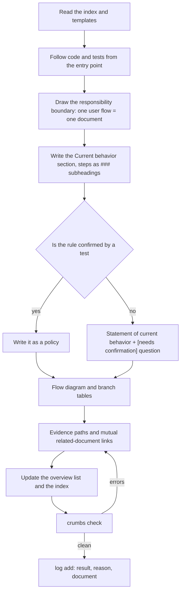
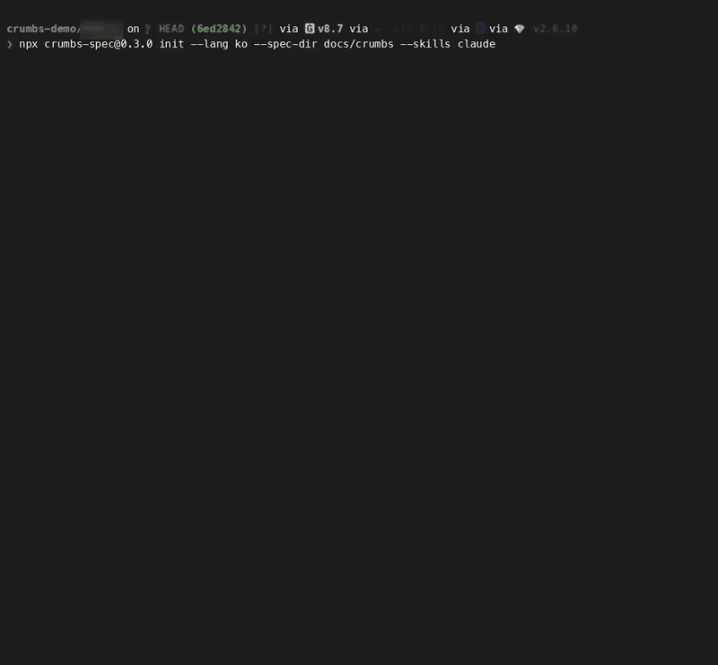

# crumbs-spec 🍞

[한국어](README.ko.md) · **English**

[](https://github.com/Sienna94/crumbs-spec/actions/workflows/ci.yml) [](https://www.npmjs.com/package/crumbs-spec)

**crumbs-spec leaves breadcrumbs on every document so an agent never gets lost!**

Living specs for coding agents. It keeps a set of Markdown documents that describe how a repository behaves right now, and one command checks that they are linked correctly. Every document links back to the index and every policy has one owner. Agents can write, find, question and ingest the documents!

## Why

Writing a shared spec from scratch for a project that had none was too hard. Projects that had specs were no better: every author wrote in their own style, so agents could not find the relevant part quickly and nothing kept the documents up to date.

So we ran dozens of spec documents with coding agents on a real app. Three problems kept coming back.

- Specs lived in change units: one `spec.md` per feature, tickets. Months later nothing answered "what is the rule right now?"
- Stacking them like a wiki put the same rule in several places with slightly different wording. Nobody knew which one was right.
- Agents navigated by folder names and grep. They wandered into unrelated areas, and one question could cost eight documents.

Writing better documents did not fix it. A machine enforcing the structure did: one owner per policy, a checked link graph, and questions instead of guesses. So we started scattering breadcrumbs.

## Compared with other tools

Spec Kit covers planning before implementation. LLM Wiki covers accumulating sources. crumbs-spec covers what comes after: the current state that has to stay correct once the code ships.

| | GitHub Spec Kit | OpenSpec | Karpathy's LLM Wiki | **crumbs-spec** |
|---|---|---|---|---|
| Document unit | One change (feature): `spec.md`, `plan.md`, `tasks.md` | Current-state spec + change deltas | Entity, concept and source-summary pages | **One responsibility (user flow)**. Each policy is owned by exactly one document |
| Point in time | Before implementation | Before and after | When a source is ingested | **Current behavior after implementation** |
| Existing code | States that it "does not infer" | Has onboarding, but no code-to-spec drafting | Targets sources, not code | **The crumbs-writer skill drafts from code and tests; the unknown becomes a `[needs confirmation]` question** |
| Navigation | Folders and file names | Folders and file names | Index first | **Index → overview → detail by links only**. No IDs, no front matter |
| Machine checks | Consistency across spec, plan and tasks | `openspec validate` (structure) and delta merge on archive | Orphan page and broken link lint (with LLM judgment) | **16 structural rules**: links, anchors, reachability, backlinks, duplicate policy names, evidence paths, section order, flow diagrams, log format, unterminated comments |
| Sync after implementation | The team picks a maintenance model | `archive`/`sync` for the change in hand | Feeds query results back into the wiki | **Agent rule ("update the owning document in the same change, even unasked") and a decision log** |
| Human readability | Prose | Prose | Prose | **Flow diagrams (Mermaid) and branch tables in the template** |

Kiro specs and BMAD are close to Spec Kit (per feature, before implementation), so they are not listed. Section 1 of [docs/IMPLEMENTATION_PLAN.md](docs/IMPLEMENTATION_PLAN.md) (Korean) compares all five.

From LLM Wiki we kept the raw/wiki/schema split, index-first navigation, the append-only log and supervised ingest. Three things are different.

- Documents are organized by responsibility, not by entity. Only concepts that several flows branch on get a page under `concepts/`.
- Agents maintain the documents. People own them.
- Lint is deterministic. No LLM judgment.

## Principles

- **One source of truth for the current state.** No change directories. A document says how it behaves now, not what changed.
- **No guessing.** A rule that code, tests or an approved source does not confirm is written as "right now it does X" plus a `[needs confirmation]` question (`[확인 필요]` with `lang: ko`). `check` warns once per document with open questions. It cannot tell a guess from a fact; that is the skill's rule and the reviewer's job.
- **One owner per policy.** `check` rejects a policy name that appears in two documents, or twice in one. It does not catch two names for the same rule; the writer skill's naming rules are for that.
- **Prose for people.** No IDs, no status tables, no enforced grammar. Navigation lives in links and headings.
- **Deterministic checks.** `check` looks at structure only. Style, content and staleness are for skills and people.
- **Decisions in one place.** An answered question becomes a `decision` log entry. The document points at it with one dated link.
- **Two languages.** `lang` in `crumbs.json` picks the language of templates, skills, messages and the AGENTS block. `en` by default, `ko` for Korean.

### What we left out

- Requirement IDs, front matter and enforced grammar such as EARS. Navigation lives in links and headings.
- Change-history tables inside documents and one file per decision. Decisions go into the log.
- Definition-only term pages. The overview's terms section is enough.
- Style and content judgment in `check`. Style is for the skill guidance and the markdownlint sample under [docs/lint/](docs/lint/README.md).

## Does it work on unfamiliar code?

We ran the writer skill on two open-source backends of the [RealWorld](https://github.com/realworld-apps/realworld) "Conduit" API and graded the result against the project's official API tests. Documents, prompts, ground truth and every grading row are in [crumbs-spec-conduit](https://github.com/Sienna94/crumbs-spec-conduit).

Setup:

- Two pinned implementations of the same API: [Nitro + Prisma](https://github.com/realworld-apps/nitro-prisma-zod-realworld-example-app) (TypeScript) and [Django Ninja](https://github.com/c4ffein/realworld-django-ninja) (Python).
- One Opus 5.5 agent per implementation, writing from code and tests only. The official spec was not in the repository while it wrote.
- Ground truth: each request in the official Hurl suite at the pinned version. 130 rows after dropping setup and cleanup.
- Grading by Sonnet 5.5, one verdict per row. `correct` means status and every asserted value are in the documents, `partial` that one is missing, `wrong` that the documents contradict it, `missing` that no document covers it. Every policy was also checked against the code.

| | Nitro + Prisma | Django Ninja |
|---|---|---|
| Code / tests in the repository | ~1,400 lines / 2 unit test files | ~2,300 lines / endpoint tests for each app |
| Documents / policies | 28 / 51 | 26 / 91 |
| Policies confirmed by tests / left as questions | 6 / 45 | 50 / 41 |
| Suite rows correct | **125 / 130** | **116 / 130** |
| Suite rows partial / wrong / missing | 5 / 0 / 0 | 14 / 0 / 0 |
| Invented policies (code does not do it) | 0 | 0 |
| Policies partly overstated | 1 | 6 |
| Writer tokens / wall time | 165k / 2 h 40 min | 202k / 2 h 47 min |

What came out:

- No row was wrong and no policy was invented. Every miss is a missing detail. Nitro's five partials are `null` inputs and tag order. Twelve of Django's fourteen trace back to one question: the error handler and its tests disagree on the 401 body, so the writer wrote both and asked.
- Statements still marked `[needs confirmation]` were mostly right. 12 Nitro rows and 32 Django rows were graded correct on one.
- Fewer tests, more questions. Nitro has two unit test files, so 45 of its 51 policies stayed questions. The suite answers 29 of them.
- The writers raised things no suite row tests. Django's article list ignores the token and reads the session user. Its `createUser` command looks users up by a field a migration renamed. The Nitro documents say plainly that the email format is not checked, which a newer suite version does test.

Limits:

- One run per implementation, one writer model.
- The grader is a model. The author checked that every cited anchor exists and spot-checked rows.
- RealWorld is well known. The writer may have seen it in training.
- The suite covers part of what the documents say. 20 Nitro and 41 Django policies were checked against code only.
- The Django grader ran with unpinned dependencies, so some "partly overstated" verdicts may depend on library versions.

## Install

Node.js 20 or later. No runtime dependencies.

```bash
npx crumbs-spec init --skills all   # document structure + four agent skills
npx crumbs-spec init                # structure only
npx crumbs-spec check               # check links and structure
```

Add `--lang ko` for a Korean repository.

Files `init` writes:

```
crumbs.json                      configuration
docs/specs/index.md              index (the entrance)
docs/specs/log.md                append-only log
docs/specs/templates/overview.md overview template
docs/specs/templates/detail.md   detail template
docs/raw/README.md               raw sources directory (read-only)
AGENTS.md                        crumbs block (agent rules)
```

How `init` behaves:

- It never overwrites a file that exists.
- With `--skills all` it also writes eight SKILL.md files.
- In AGENTS.md it only touches its own block between `<!-- crumbs:start -->` and `<!-- crumbs:end -->`.
- If `crumbs.json` already exists, it keeps it, ignores `--spec-dir` and `--lang`, and says so.
- Its last line is the next command to run: `npx crumbs-spec check`.

From a clone: `npm run build`, then `node dist/src/cli.js <command>`.

## Adding it to an existing project

Document the whole repository in one go. Nothing is migrated; the documents are written fresh from the code.

1. **Run `init` at the repository root.** Pass `--spec-dir` if your spec root lives elsewhere. Existing files stay as they are.

   ```bash
   npx crumbs-spec init --spec-dir docs/crumbs --skills claude
   ```

2. **Make sure the agent reads the rules.**
   - Codex and Claude Code (v2.1.277 or later) read `AGENTS.md` on their own.
   - If the repository also has a `CLAUDE.md` (or `.claude/CLAUDE.md`, `CLAUDE.local.md`), Claude Code reads only that file. Add the line `@AGENTS.md` to it. `init` prints a reminder when it sees one.
   - Skills are picked up from `.claude/skills/` and `.agents/skills/`.

3. **Do not migrate old documents.**
   - The writer reads code and tests only. Nobody knows whether existing wikis or design notes still match the code.
   - Copy the ones worth keeping as evidence (plans, contracts, decision records) into `docs/raw/` and ingest them one at a time with `crumbs-ingest`.

4. **Document the whole codebase.** The writer follows code and tests from the entry points and splits them into domains.

   ```
   Document this repository's code with crumbs-writer in "document existing code" mode.
   Use code and tests only. Leave unconfirmed policies as questions and finish the whole thing.
   ```

   The `[needs confirmation]` questions in the result are the list of things someone has to decide. A large repository can be requested domain by domain, and the results still gather under one index.

5. **Put `check` in CI.**
   - Fail on errors, ignore warnings.
   - Markdown under the spec root that is not a crumbs document yet goes into `exclude` in `crumbs.json`: paths relative to the spec root, a trailing `/` for a directory, no globs.

6. **Update documents in the same change as the code.**
   - The AGENTS block tells the agent to do this unasked. Each PR carries `check` and a log entry.
   - When a domain appears or disappears, the index changes in the same commit.

If you already have a spec system, ask both the same questions. Files read and correct answers show which one is easier to navigate.

## How a spec gets written

- Below is the writer skill in "document existing code" mode.
- In "reflect a change" mode, only steps 1–2 change: "find the owning document whose evidence names the changed path". The rest is the same.



After that:

- `crumbs-interview` turns open policies into questions.
- A person answers, and the writer confirms the policy with a `decision` entry and a link.
- New material goes through `crumbs-ingest`, which finds the affected documents and asks before changing them.

## Document model

Four roles. Navigation starts at the index and follows the crumbs down.

```
docs/specs/index.md              index: domain list + log link
docs/specs/<domain>/overview.md  overview: scope, flow diagram, document list, terms
docs/specs/<domain>/<topic>.md   detail: one user flow
docs/specs/log.md                log: what was done, in order
docs/specs/concepts/             concepts shared by several domains (optional)
docs/raw/                        immutable sources such as contracts and plans
```

Detail document sections are fixed.

- Headings follow `lang` and can be renamed through `headings` in `crumbs.json`.
- With `lang: ko` they are 목적, 현재 동작, 흐름, 정책, 근거, 확인 필요 사항, 관련 문서.

| Section | Content |
|---|---|
| Purpose | The one responsibility this document owns and what it does not cover |
| Current behavior | As the user experiences it, in the present tense; three or more steps become `###` subheadings |
| Flow | A Mermaid diagram for two or more steps; a table when there are two or more comparison axes |
| Policies | `### policy name` (unique across the repository) and the rule; if unconfirmed, a statement of current behavior followed by a `[needs confirmation]` question |
| Evidence | Backticked paths that contain a `/`, each with a description; `check` verifies the path exists |
| Open questions | `- [needs confirmation] [policy name](#anchor) — question` |
| Related | Link to the overview and neighboring documents; backlinks must be mutual |

Below is a detail document the writer produced from the Nitro code in [the experiment](#does-it-work-on-unfamiliar-code) ([source](https://github.com/Sienna94/crumbs-spec-conduit/blob/main/nitro/docs/specs/api/articles/tag-list.md)).

- It is unedited.
- Example 3 under [Usage examples](#usage-examples) answers its question.

````markdown
# Tag list
<!-- Read ../../index.md first. After changing this document, add an entry to ../../log.md -->

## Purpose
This document owns GET /api/tags, which returns the most used tag names. How tags are attached to articles is owned by [Article creation](article-create.md#article-tag-name-handling). The endpoint allows anonymous viewers as described in [Authentication token](../authentication-token.md), and the list is the same for anonymous and signed-in viewers.

## Current behavior
- The server considers only tags that at least one article uses.
- The server sorts those tags by the number of articles that use them, most used first.
- The server returns at most 10 tag names.
- The server responds with status 200 and {"tags": ["<name>"…]}.
- If no article uses a tag, the list is empty.

## Flow
None

## Policies
### Popular tag list
The tag list holds at most 10 names of tags used by at least one article, sorted by the number of articles that use each tag, most used first. The order of tags used by the same number of articles is not defined, and the list has no pagination. No test covers this rule.
[needs confirmation] What is the basis of the 10-tag limit, and what should order tags with the same usage count?

## Evidence
- `server/routes/api/tags/index.get.ts` — selects tags used by at least one article, sorts them by usage and returns at most 10 names
- `prisma/schema.prisma` — unique tag names and the relation between tags and articles

## Open questions
- [needs confirmation] [Popular tag list](#popular-tag-list) — What is the basis of the 10-tag limit, and what should order tags with the same usage count?

## Related
- [Articles API overview](overview.md)
- [Article creation](article-create.md)
- [Article update](article-update.md)
- [Article deletion](article-delete.md)
````

Style and terms:

- The overview's "Terms" section links aliases to the owning policy. Example: `- Subscription pass(flat-rate pass) — [Pass active check](pass.md#pass-active-check)`
- A term that is only a definition stops there. It gets no document of its own.
- Concepts that several flows branch on (channel, currency, member state) get a document under `concepts/`.

## Commands

```bash
npx crumbs-spec init [--spec-dir <dir>] [--lang <en|ko>] [--skills <claude|codex|all>]
npx crumbs-spec check [--format text|json] [--config <path>]
npx crumbs-spec log add --kind <ingest|query|lint|drift|change|decision> "<title>" [--body "<body>"]
```

Common options:

- `--root <dir>`: repository root. Defaults to the current directory.
- `--lang <en|ko>`: the language `init` writes in, and the language of errors raised before `crumbs.json` is read.
- `-h`, `--help`: help
- `-v`, `--version`: version

Configuration is `crumbs.json` at the repository root. Its keys are `specDir`, `index`, `overview`, `log`, `lang`, `headings`, `exclude`, `codeRoot`, `rawDir`.

`check` output:

- One finding per line, as `file:line severity rule: message`.
- The last line is the summary.

```
docs/specs/api/articles/tag-list.md:31 error broken-link: link target not found: ../log.md#2026-11-03-decision--popular-tag-list-most-used-first-stays-ties-are-undefined-10-tags-are-cut-after-sorting-and-every-viewer-gets-the-same-unpaginated-list
docs/specs/api/articles/article-delete.md:44 warning open-question: 1 open question(s)
…
crumbs check: 28 documents, 1 error, 20 warnings
```

From example 3, before the writer fixed the link. 19 more warnings omitted.

**Supported Markdown**

| Item | Behavior |
|---|---|
| Headings | Only ATX headings (`#` to `######`) are recognized; setext headings are not |
| Links | Inline links and reference links (`[text][label]`, and `[label][]` with a `[label]: path` definition) are checked. A shortcut reference such as `[label]` alone is not a link |
| Heading anchors | github-slugger: each space becomes `-`, punctuation other than `-` and `_` is dropped, and nothing is collapsed. Example: `### Quantity & limits` → `#quantity--limits` |
| Symlinks | Symlinked files and directories under the spec root are followed |
| Evidence path base | Resolved against `codeRoot` (the repository root by default), except paths under `rawDir`, which are always resolved against the repository root |
| Evidence path form | Must contain a `/`, so a repository-root file is written `./package.json`. Line suffixes such as `:12`, `:12-48`, `:12:5` and `:12-48,60-70` are accepted |
| `exclude` | Paths relative to the spec root; an entry ending in `/` excludes that directory |
| JSON output | Every finding carries a `line` (1 when there is no better position), so JSON output always includes it |

### Check rules

| Rule | Severity | What it catches |
|---|---|---|
| `index-missing` | error | The index document is missing (no other rule runs) |
| `missing-title` | error | The first heading is not an H1 |
| `broken-link` | error | The link target file does not exist, or its spelling differs from the file on disk |
| `broken-anchor` | error | The link points to a heading that does not exist |
| `unreachable` | error | A document that cannot be reached from the index by links |
| `missing-section` | error | A required section for the role is missing |
| `missing-backlink` | error | No link back to the parent (overview or index), or a detail A→B link without B→A |
| `missing-code-path` | error | An evidence code path does not exist |
| `duplicate-policy` | error | The same policy name appears in two documents, or twice in one |
| `log-format` | error | A log entry is not in the form `## [YYYY-MM-DD] kind \| title`, or the date is more than a day in the future |
| `unterminated-comment` | error | An HTML comment is opened and never closed, hiding the rest of the document |
| `open-question` | warning | One warning per document that still has open questions (the count is the number of questions) |
| `log-order` | warning | Log dates are out of order |
| `missing-flow` | warning | Current behavior has six or more steps but no diagram or table |
| `section-order` | warning | Sections are not in template order |
| `log-body` | warning | A `decision` entry has no document link |

### Success and failure

When a command finishes it hands one number back to the shell. CI treats only 0 as success.

| Number | Meaning |
|---|---|
| 0 | Success. For `check`, no errors (warnings are allowed); for `init` and `log add`, the work is done |
| 1 | `check` found at least one error |
| 2 | The command was used wrongly, `crumbs.json` is invalid, or reading or writing a file failed |

## Log

- One file, `docs/specs/log.md`, appended in order.
- The title is one sentence about the user outcome, not a task name.
- The body has three parts: result, reason, document.
- `log add` refuses a title or body that contains `<!--`.

```bash
npx crumbs-spec log add --kind change "<one sentence about the user outcome>" \
  --body "Result: <what changed>. Reason: <why>. Document: [<policy>](<domain>/<document>.md#<anchor>)"
```

The entry from example 5:

```markdown
## [2026-11-03] change | A malformed email on registration, login and account update is rejected with 422 and is invalid
Result: a malformed email on registration, login and account update gets status 422 with {"errors": {"email": ["is invalid"]}}; 3 api documents updated and 1 open question remains about accepted address forms. Reason: code change in server/schemas/user.schema.ts, reported by the user. Document: [Email format](api/users/registration.md#email-format)
```

When a question is answered:

- Add a `decision` entry.
- Put one decision link at the end of the policy. There is no change history inside documents; the log holds it.
- The slug drops brackets, `|`, commas and colons, so the `|` becomes `--`.

The decision from example 3. The policy that received this link is shown in that example.

```markdown
## [2026-11-03] decision | Popular tag list: most used first stays, ties are undefined, 10 tags are cut after sorting, and every viewer gets the same unpaginated list
Result: GET /api/tags keeps the most-used-first order, leaves the order of equally used tags undefined, applies the 10-tag limit after sorting, and returns the same list without pagination to every viewer. Reason: answers from the maintainer; existing clients may rely on most-used-first and the limit keeps the tag sidebar short. Document: [Popular tag list](api/articles/tag-list.md#popular-tag-list)
```

Kinds:

- `ingest`: a source was applied
- `query`: an answer was fed back
- `lint`, `drift`: check runs. No command writes these kinds yet
- `change`: a document changed
- `decision`: a question was settled

## Skills

- `init --skills` installs them under `.claude/skills/<name>/SKILL.md` (Claude Code) and `.agents/skills/<name>/SKILL.md` (Codex).
- An existing `SKILL.md` is never overwritten. To upgrade, delete it and run `init --skills` again.
- Each SKILL.md starts with a comment naming the crumbs-spec version that wrote it.
- Until 1.0, a minor version may change check rules, templates and skill text. A patch version only fixes bugs. Changes are listed in [CHANGELOG.md](CHANGELOG.md).

| Skill | What it does |
|---|---|
| `crumbs-writer` | Writes or updates documents in two modes: "reflect a change" (changed code → owning document) and "document existing code" (first draft from code and tests only). Carries the rules for responsibility size, style, question format, flow diagrams and concept pages |
| `crumbs-finder` | Finds the answer index → overview → detail, cites the source, and feeds good answers back as `query` log entries |
| `crumbs-interview` | Turns the unconfirmed policies a request touches into questions and stops |
| `crumbs-ingest` | Reads new material under `docs/raw/`, finds the affected documents, applies them after confirmation and leaves an `ingest` entry |

## Usage examples



One run on a private Android app, from `init` through writing the documents to `check`. Project and class names are blurred.

<details>
<summary><b>Show examples 1–6</b></summary>

Examples 1–5 were run on the Nitro backend from the experiment, in the [`usage/`](https://github.com/Sienna94/crumbs-spec-conduit/tree/main/usage) workspace of crumbs-spec-conduit.

- Example 1 is the experiment's Opus 5.5 writer.
- Examples 2–5 are a Sonnet 5.5 agent that got the request, read `AGENTS.md` and picked the skill on its own.
- The author answered its questions.
- Agent answers are condensed. Document and log quotes are verbatim.
- Each example that changed files is one commit. Files read and token counts are in [RUNS.md](https://github.com/Sienna94/crumbs-spec-conduit/blob/main/usage/RUNS.md).

### 1. Document existing code

Request:

> Document the code under `../vendor/nitro` with crumbs-writer in "document existing code" mode, from code and tests only. Leave unconfirmed policies as questions and finish the whole thing.

Result ([commit](https://github.com/Sienna94/crumbs-spec-conduit/commit/572b0db)):

- 21 detail documents in four subdirectories.
- 6 policies confirmed by tests, 45 left as questions.
- The log entry the writer left at the end:

```markdown
## [2026-11-02] change | The API under /api is documented from code and tests, covering transport, authentication, users, profiles, articles and comments
Result: 21 draft detail documents for api, 45 open questions. Reason: first documented from code and tests. Document: [Unique conflict field selection](api/http-transport.md#unique-conflict-field-selection)
```

```
crumbs check: 28 documents, 0 errors, 21 warnings
```

One warning per document that still has open questions.


### 2. Find an answer

Request:

> How many tags does `GET /api/tags` return, and in what order?

Agent's answer:

> At most 10. Only tags used by at least one article count, sorted by how many articles use each tag, most used first. There is no pagination, and anonymous and signed-in viewers get the same list. The response is 200 with `{"tags": [...]}`.
>
> Two points are still unconfirmed. The order of tags with the same count is not defined, and nothing explains the limit of 10. Neither has a test.
>
> Source: `docs/specs/api/articles/tag-list.md` › Policies › Popular tag list

- Followed the crumbs: index → API overview → articles overview → [tag-list.md](https://github.com/Sienna94/crumbs-spec-conduit/blob/main/nitro/docs/specs/api/articles/tag-list.md), four in all. No code.
- No file changed.


### 3. Ask first, then record the decision

Request:

> I want to change how the tag list is ordered. What do I need to confirm first?

Agent's answer:

> The request touches eight policies.
>
> - Confirmed by code: most-used-first order, only tags with articles, the same list for every viewer.
> - Not confirmed: tie order, the basis of the 10-tag limit, no pagination, the order of `tagList` inside an article, and the scope of this change.
>
> Answer the seven `[needs confirmation]` questions below and I will update the documents. Until then I change nothing.

Author's answer:

> Keep most-used-first. Tie order stays undefined on purpose. The limit of 10 stays because of the sidebar and applies after sorting. Same list for everyone, no pagination. `tagList` inside articles is out of scope.

Result ([commit](https://github.com/Sienna94/crumbs-spec-conduit/commit/7b86052)):

- The writer confirmed the policy and added the decision link at the end.

```markdown
### Popular tag list
The tag list holds at most 10 names of tags used by at least one article, sorted by the number of articles that use each tag, most used first, and the server applies the 10-tag limit after sorting. The limit keeps the tag sidebar short. The order of tags used by the same number of articles is intentionally undefined, so clients must not rely on it, while existing clients may rely on the most-used-first order. The list is the same for every viewer and has no pagination. No test covers this rule. (decision: [2026-11-03](../../log.md#2026-11-03-decision--popular-tag-list-most-used-first-stays-ties-are-undefined-10-tags-are-cut-after-sorting-and-every-viewer-gets-the-same-unpaginated-list))
```

- Current behavior grew to seven steps, so `check` raised `missing-flow`. The writer added a Mermaid diagram to the Flow section.
- The first decision link pointed at `../log.md`. `check` caught it as `broken-link`, and the writer fixed it to `../../log.md`.
- The `decision` entry it logged is shown under [Log](#log).


### 4. Ingest a source

Request:

> The upstream API spec changed. Apply `docs/raw/realworld-b8a37f1-validate-email-format.diff`.

Agent's answer:

> The source expects 422 with "is invalid" for a malformed email on registration, login and account update. The code (`server/schemas/user.schema.ts`) checks no format, and the registration document says so. Three documents are affected: `registration.md`, `login.md`, `current-user-update.md`.
>
> Please choose one.
>
> - A. Treat the source as the contract and rewrite the documents to match it.
> - B. Keep the current behavior and record the upstream expectation as a question.
>
> I change nothing until you decide.

Author's answer:

> B. Follow the code and keep the upstream spec as a question.

Result ([commit](https://github.com/Sienna94/crumbs-spec-conduit/commit/130946a)):

- The registration document got one new `Email format` policy.

```markdown
### Email format
Registration, login and account update accept any email that is non-blank after trimming and apply no format check. Registration and account update store a value such as "not-an-email", and login with such a value ends in the unknown-email 401 response. The upstream API spec expects status 422 with {"errors": {"email": ["is invalid"]}} for a malformed email on registration, login and account update, and it declares the email fields of the login, registration, account and account update objects with the email format. No test in this repository covers an email format check.
[needs confirmation] Should registration, login and account update reject a malformed email with status 422 and "is invalid" as the upstream API spec expects, and which addresses count as valid?
```

- The login and account update documents each got one link to this policy.
- The diff under `docs/raw/` went into Evidence, and the log got an `ingest` entry.


### 5. Reflect a code change

Request:

> I added email format validation to registration, login and account update (`server/schemas/user.schema.ts`, not committed yet). A malformed email now gets 422 with `{"errors":{"email":["is invalid"]}}`. Update the docs.

Result ([commit](https://github.com/Sienna94/crumbs-spec-conduit/commit/32fd2f3)):

- The writer found the three owning documents with `grep -rl 'user.schema' docs/specs`.
- It confirmed `Email format` and closed the question from example 4.

```markdown
### Email format
Registration, login and account update require the email to be a valid address after trimming. An email that fails the check is rejected with status 422 and {"errors": {"email": ["is invalid"]}} before the server hashes a password, looks up an account or writes to the database. On account update, the check applies only when the request contains an email. All three endpoints use the same check. No test covers this rule.
```

- What the code does not settle became a new policy, `Accepted email address forms`, with a question: which addresses count as valid, and whether a blank email also reports "is invalid".
- It updated the registration and login flow diagrams and logged the `change` entry shown under [Log](#log).


### 6. Check in CI

```yaml
jobs:
  specs:
    runs-on: ubuntu-latest
    steps:
      - uses: actions/checkout@v4
      - uses: actions/setup-node@v4
        with: { node-version: 20 }
      - run: npx crumbs-spec check --format json > crumbs-report.json
```

When `check` finds at least one error it returns 1 and CI marks the step failed. Warnings alone return 0 and do not fail the build.

</details>
