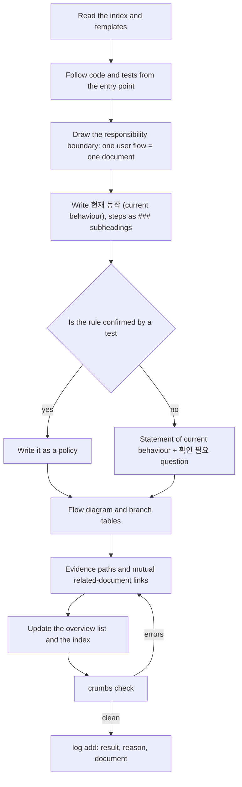
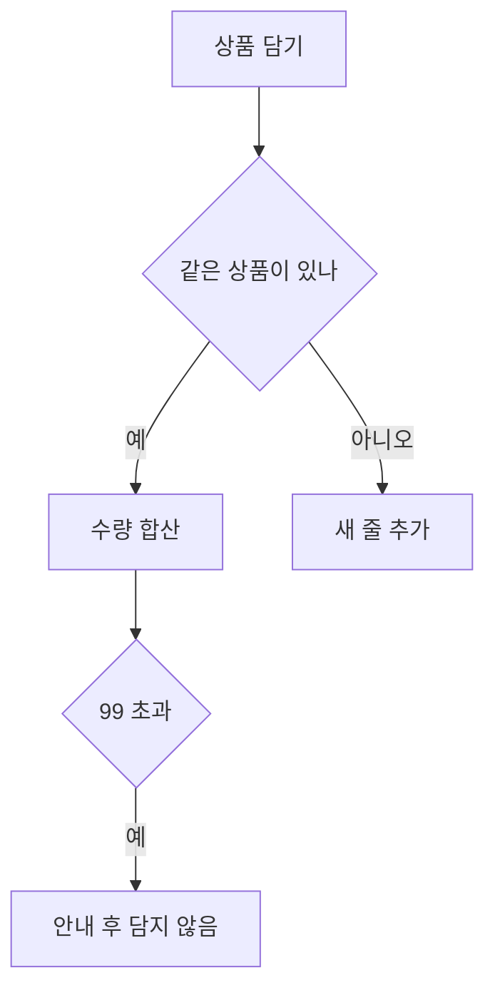

# crumbs-spec 🍞

[한국어](README.ko.md) · **English**

crumbs-spec leaves breadcrumbs (links) on every document so an agent never gets lost, and keeps a **living spec** that leads from the index to the detail document in one path. It describes how the repository behaves *right now* in responsibility-sized documents, checks with one command that those documents are properly linked, and fixes the procedures an agent follows to write, find, ask about and ingest them as skills.

## Why we built it

Running dozens of spec documents together with agents on a real app repository, the same three things kept happening.

1. Specs only survived as change units (per-feature `spec.md`, tickets), so months later there was no document that answered "what is the rule right now?".
2. Piling them up like a wiki put the same rule into several documents with slightly different wording, and nobody knew which one was right. A later benchmark had an agent find three such contradictions.
3. When agents read documents they leaned on folder structure and search, so they wandered into other areas or fell back to grep. One question cost eight documents.

"Write better documents" did not fix it. We needed **a tool that enforces structure by machine**. Give every policy exactly one owner, check the link graph, and make the unknown a question instead of a guess, and both agents and people reach the document by the same path. So we started scattering breadcrumbs.

## How it differs from other tools

Spec Kit is good at pre-implementation planning and LLM Wiki at accumulating sources. crumbs-spec takes the gap between them: **the current state that must survive after implementation**. It complements them rather than replacing them.

| | GitHub Spec Kit | OpenSpec | Karpathy's LLM Wiki | **crumbs-spec** |
|---|---|---|---|---|
| Document unit | One change (feature): `spec.md`, `plan.md`, `tasks.md` | Current-state spec + change deltas | Entity, concept and source-summary pages | **One responsibility (user flow)**. Each policy is owned by exactly one document |
| Point in time | Before implementation | Before and after | When a source is ingested | **Current behaviour after implementation** |
| Existing code | States that it "does not infer" | Has onboarding, but no code-to-spec drafting | Targets sources, not code | **Drafts from code and tests; the unknown becomes a `[확인 필요]` question** |
| Navigation | Folders and file names | Folders and file names | Index first | **Index → overview → detail by links only**. No IDs, no front matter |
| Machine checks | Consistency across spec, plan and tasks | Delta merge | Orphan page and broken link lint (with LLM judgement) | **15 deterministic rules**: links, anchors, reachability, backlinks, duplicate policies, evidence paths, section order, flow diagrams, log format |
| Sync after implementation | The team picks a maintenance model | `archive`/`sync` for the change in hand | Feeds query results back into the wiki | **Agent rule ("update the owning document in the same change, even unasked") + decision log + planned `drift`** |
| Human readability | Prose | Prose | Prose | **Flow diagrams (Mermaid) and branch tables in the template** |
| Measurement | None | None | None | **Compares navigation cost of two document systems with the same questions** |

From LLM Wiki we kept the raw/wiki/schema split, index-first navigation, the append-only log and human-supervised ingest. Three things are deliberately different: documents are organised by responsibility rather than entity (only concepts that several flows branch on get a page under `concepts/`), documents are maintained by agents but owned by people, and lint is deterministic with no LLM judgement. See section 1 of [docs/IMPLEMENTATION_PLAN.md](docs/IMPLEMENTATION_PLAN.md) (Korean) for the full comparison.

## What we cared about

- **A single source of truth for the current state.** No change directories. Documents explain "how it behaves now", not "what changed".
- **No guessing.** A rule not confirmed by code, tests or approved sources is written only as "right now it behaves like this" plus a `[확인 필요]` (needs confirmation) question. `check` counts the questions for you.
- **People-first prose.** No IDs, no status tables, no enforced grammar. Navigation lives in links and headings only.
- **Deterministic checks, human judgement.** `check` looks at structure only. Style, content and staleness are for skill guidance and people.
- **Decisions in one place.** When a question gets its answer, a `decision` entry goes into the log and the document points at it with a single dated link.
- **Two languages.** `lang` in `crumbs.json` selects the language of the templates, skills, messages and AGENTS block for the whole repository. It defaults to English (`en`); `ko` gives Korean. This README is the English guide.

## What happened when we used it

We rewrote three areas of a real app repository (about 40,000 lines of code) with the crumbs-writer skill without showing it any existing spec document. Then we asked the same 18 questions of the existing spec system and the crumbs system and let an agent answer from documents only.

**Cost of writing from zero** (one agent per domain, three in parallel)

| Domain | Code | Documents | Policies | Confirmed by tests / questions | Agent tokens | Writing time |
|---|---|---|---|---|---|---|
| Payment | ~20k lines | 19 | 100 | 5 / 95 | 570k | 1 h 7 min |
| Viewer | ~23k lines | 40 | 194 | 29 / 165 | 850k | 1 h 7 min |
| Auth | ~10k lines | 35 | 195 | 64 / 131 | 790k | 1 h 13 min |

Writing time is the actual working time from the agent transcripts' timestamps, excluding idle gaps longer than ten minutes. With the three domains in parallel everything finished in about 1 h 15 min. Not one policy was invented, and all six places where the existing spec disagreed with the code were written as the code behaves. The documents were later regrouped by user flow into 38.

**Navigation cost on the same 18 questions** (documents only; reading code was forbidden)

| | Existing spec system | crumbs-spec |
|---|---|---|
| Correct answers | 17 / 18 (1 partial) | 15 / 18 (3 partial) |
| Files read in total | 70 (avg 3.9, max 8) | 64 (avg 3.6, max 6) |
| Fell back to grep | 3 | 1 |
| Tokens in total | 2.32M | 1.89M (−18%) |

The existing system's partial answer came from failing to find the owning document; the three crumbs partials all reached the owning document in 3–5 files but the writer had dropped details such as screen numbers and channel branches. That cause is now fixed by a skill rule ("do not drop values that carry a condition"). Note the bias: the questions were drawn from the existing specs, which favours the existing system.

## Install and quick start

Node.js 20 or later, no runtime dependencies.

```bash
npx crumbs-spec init --skills all   # document structure + the four agent skills
npx crumbs-spec init                # document structure only
npx crumbs-spec check               # check the link graph and structure
```

Korean repositories: pass `--lang ko`.

`init` creates these seven files and never overwrites an existing one.

```
crumbs.json                      configuration
docs/specs/index.md              index (the entrance)
docs/specs/log.md                append-only log
docs/specs/templates/overview.md overview template
docs/specs/templates/detail.md   detail template
docs/raw/README.md               raw sources directory (read-only)
AGENTS.md                        crumbs block (agent rules)
```

The package is on npm as [`crumbs-spec`](https://www.npmjs.com/package/crumbs-spec). To run it from a clone instead, use `npm run build` and then `node dist/src/cli.js <command>`.

## Adding it to an existing project

The order for a repository that already has code and documents. Start with one domain instead of moving everything at once.

1. **Run `init` at the repository root.** If your spec root lives elsewhere, pass `--spec-dir` (for example `docs/crumbs`). Existing files are left alone; if `AGENTS.md` already exists, only the block between `<!-- crumbs:start -->` and `<!-- crumbs:end -->` is inserted.

   ```bash
   npx crumbs-spec init --spec-dir docs/crumbs --skills claude
   ```

2. **Let the agent read the rules.** Claude Code only reads the crumbs block if `CLAUDE.md` contains the line `@AGENTS.md`. Skills are found automatically under `.claude/skills/` (Claude Code) and `.agents/skills/` (Codex).

3. **Do not migrate existing documents.** The writer treats code and tests as the only sources and does not read existing wikis, design notes or READMEs unless you name them as sources, because there is no way to know whether they still match the code. Copy the ones worth using as evidence (plans, contracts, decision records) into `docs/raw/` and ingest them one at a time with `crumbs-ingest`.

4. **Write the first domain from code.** Pick the area people ask about most and hand it to the writer's "document existing code" mode. The `[확인 필요]` questions in the result become the list of things a person has to decide for that area.

   ```
   Document the code under src/billing/ with crumbs-writer in "document existing code" mode.
   The domain directory is docs/crumbs/billing/. Leave unconfirmed policies as questions and finish the whole thing.
   ```

5. **Put `check` in CI.** Fail only on errors (broken links and anchors, unreachable documents, missing backlinks, missing code paths, duplicate policy names) and leave warnings alone. Directories under the spec root that are not crumbs documents yet go into `exclude` in `crumbs.json`.

6. **Change the document in the same change as the code.** The AGENTS block tells the agent to "update the owning document in the same change, even when nobody asked", so every PR brings `check` and a log entry with it. The index fills in as domains are added one by one.

If you already have a spec system, try asking both systems the same questions. Files read and correct answers show at once which one is easier to navigate (the step-5 benchmark runner will automate this).

## How a spec gets written

The order the writer skill follows in "document existing code" mode. In "reflect a change" mode, steps 1–2 become "find the owning document whose evidence names the changed code path" and the rest is the same.



When an answer arrives, a person answers the questions produced by `crumbs-interview`, and the writer turns the question policy into a confirmed one, leaving a `decision` log entry and a decision link. When new material arrives, `crumbs-ingest` finds the affected documents, gets confirmation and then applies it.

## Document model

There are four roles. Navigation always starts at the index.

```
docs/specs/index.md              index: domain list + log link
docs/specs/<domain>/overview.md  overview: scope, flow diagram, document list, terms
docs/specs/<domain>/<topic>.md   detail: one user flow
docs/specs/log.md                log: what was done, in order
docs/specs/concepts/             concepts shared by several domains (optional)
docs/raw/                        immutable sources such as contracts and plans
```

The sections of a detail document are fixed. Headings follow `lang` (English by default, Korean with `lang: ko`) and can be renamed through `headings` in `crumbs.json`.

| Section | Content |
|---|---|
| 목적 (purpose) | The one responsibility this document owns and what it does not cover |
| 현재 동작 (current behaviour) | As the user experiences it, in the present tense; three or more steps become `###` subheadings |
| 흐름 (flow) | A Mermaid diagram for two or more steps; a table when there are two or more comparison axes |
| 정책 (policies) | `### policy name` (unique across the repository) and the rule; if unconfirmed, a statement of current behaviour followed by a `[확인 필요]` question |
| 근거 (evidence) | Backticked code paths with a description; `check` verifies the path exists |
| 확인 필요 사항 (open questions) | `- [확인 필요] [policy name](#anchor) — question` |
| 관련 문서 (related) | Link to the overview and neighbouring documents; backlinks must be mutual |

Example (`docs/specs/shopping/장바구니.md`, "cart"):

````markdown
# 장바구니
<!-- ../index.md를 먼저 읽는다. 이 문서를 바꾼 뒤 ../log.md에 항목을 추가한다 -->

## 목적
사용자가 상품을 담고 수량을 바꾸고 비울 때까지의 흐름을 맡는다. 쿠폰 적용은 [쿠폰 할인](쿠폰-할인.md)이 맡는다.

## 현재 동작
- 사용자가 같은 상품을 다시 담으면 앱은 수량을 더한다.
- 수량이 99를 넘으면 앱은 "최대 99개까지 담을 수 있습니다." 안내를 보이고 담지 않는다.

## 흐름


## 정책
### 수량 상한
장바구니 한 줄의 수량은 99 이하다.

### 최소 주문 금액
지금은 합계가 10,000원 미만이면 결제 버튼을 비활성화한다.
[확인 필요] 10,000원이라는 기준의 근거는 무엇인가?

## 근거
- `src/cart/cart.ts:12-48` — 담기와 수량 합산
- `test/cart/cart.test.ts` — 수량 상한

## 확인 필요 사항
- [확인 필요] [최소 주문 금액](#최소-주문-금액) — 10,000원이라는 기준의 근거는 무엇인가?

## 관련 문서
- [쇼핑 개요](overview.md)
- [쿠폰 할인](쿠폰-할인.md)
````

The overview's `## 용어` (terms) section is a list of aliases linked to the owning policy (`- 정액권(정액제) — [정액권 이용 중 판정](정액권.md#정액권-이용-중-판정)`). A term that is only a definition stops there; only concepts that several flows branch on (channel, currency, member state) get an owning document under `concepts/`.

## Commands

```bash
npx crumbs-spec init [--spec-dir <dir>] [--lang <en|ko>] [--skills <claude|codex|all>]
npx crumbs-spec check [--format text|json] [--config <path>]
npx crumbs-spec log add --kind <ingest|query|lint|drift|change|decision> "<title>" [--body "<body>"]
```

Common options are `--root <dir>` (repository root, default: current directory), `--lang <en|ko>` (language for `init`; errors raised before `crumbs.json` is read; default `en`), `-h`/`--help` and `-v`/`--version`. Configuration lives in `crumbs.json` at the repository root (`specDir`, `index`, `overview`, `log`, `lang`, `headings`, `exclude`, `codeRoot`, `rawDir`).

`check` prints one line per finding as `file:line severity rule: message`, and a summary last.

```
docs/specs/shopping/장바구니.md:34 error broken-anchor: 앵커가 없음: 쿠폰-할인.md#적용-순서
docs/specs/shopping/장바구니.md:20 warning open-question: 미해결 질문 표시 2개

crumbs check: 문서 4개, 오류 1개, 경고 1개
```

### Check rules

| Rule | Severity | What it catches |
|---|---|---|
| `index-missing` | error | The index document is missing (no other rule runs) |
| `missing-title` | error | The first heading is not an H1 |
| `broken-link` / `broken-anchor` | error | The link target file or heading does not exist |
| `unreachable` | error | A document that cannot be reached from the index by links |
| `missing-section` | error | A required section for the role is missing |
| `missing-backlink` | error | No link back to the parent (overview or index), or a detail A→B link without B→A |
| `missing-code-path` | error | An evidence code path does not exist |
| `duplicate-policy` | error | The same policy name appears in two documents |
| `log-format` | error | A log entry is not in the form `## [YYYY-MM-DD] kind \| title` |
| `open-question` | warning | Number of `[확인 필요]` markers in a document |
| `log-order` | warning | Log dates are out of order |
| `missing-flow` | warning | Current behaviour has six or more steps but no diagram or table |
| `section-order` | warning | Sections are not in template order |
| `log-body` | warning | A `decision` entry has no document link |

## Log

The log is appended in one place (`docs/specs/log.md`) in chronological order. The title is **one sentence about the user outcome**, not the task name, and the body has three lines.

```bash
npx crumbs-spec log add --kind change "장바구니 수량 상한을 99로 올림" \
  --body "결과: 한 줄에 99개까지 담을 수 있다. 이유: 요청 SHOP-42. 문서: [수량 상한](shopping/장바구니.md#수량-상한)"
```

When a `[확인 필요]` question gets its answer, add a `decision` entry and put one decision link at the end of the confirmed policy. Instead of change-history tables inside documents, decisions accumulate in the log and documents only point at them.

```markdown
## [2026-11-02] decision | 최소 주문 금액: 10,000원은 배송비 정책에서 온 값이다
결과: 합계 10,000원 미만이면 결제 버튼이 비활성이다. 이유: 2026-11-02 기획 확인. 문서: [최소 주문 금액](shopping/장바구니.md#최소-주문-금액)
```

```markdown
### 최소 주문 금액
합계가 10,000원 미만이면 결제 버튼을 비활성화한다. (결정: [2026-11-02](../log.md#2026-11-02-decision-최소-주문-금액-10000원은-배송비-정책에서-온-값이다))
```

The kinds are `ingest` (a source was applied), `query` (an answer fed back), `lint`, `drift`, `change` (a document changed) and `decision` (a question was settled).

## Skills

`init --skills` installs the procedures an agent follows into `.claude/skills/<name>/SKILL.md` (Claude Code) and `.agents/skills/<name>/SKILL.md` (Codex). An existing `SKILL.md` is never overwritten; delete it and run `init --skills` again to upgrade. Claude Code reads the crumbs block only when `CLAUDE.md` contains `@AGENTS.md`.

| Skill | What it does |
|---|---|
| `crumbs-writer` | Writes or updates documents in two modes: "reflect a change" (changed code → owning document) and "document existing code" (first draft from code and tests only). Carries the rules for responsibility size, style, question format, flow diagrams and concept pages |
| `crumbs-finder` | Finds the answer index → overview → detail, cites the source, and feeds good answers back as `query` log entries |
| `crumbs-interview` | Turns the unconfirmed policies a request touches into questions and stops |
| `crumbs-ingest` | Reads new material under `docs/raw/`, finds the affected documents, applies them after confirmation and leaves an `ingest` entry |

## Usage examples

### 1. Document existing code for the first time

```
Document the code under src/cart/ with crumbs-writer in "document existing code" mode.
The domain directory is docs/specs/shopping/. Leave unconfirmed policies as questions and finish the whole thing.
```

The agent reads the index and templates, follows code and tests from the entry point, and produces `shopping/overview.md` plus the detail documents. Rules confirmed by tests become policies; rules that exist only in code become "right now …" statements with `[확인 필요]` questions. It ends by running `check`, clearing errors and adding a log entry.

```
crumbs check: 문서 5개, 오류 0개, 경고 3개
```

The warnings are the questions left behind. Skimming the open-questions section is enough to see what has to be decided.

### 2. Reflect a code change

```
I raised the cart quantity limit from 99 to 199. Update the docs.
```

The writer finds the owning document with `grep -rl 'src/cart/cart.ts' docs/specs` (the evidence section names the path), fixes the current-behaviour section and the `### 수량 상한` policy, updates the value in the flow diagram, and logs `change | 장바구니 수량 상한을 199로 올림`. If two documents look like owners it stops and asks which one is.

### 3. Ask about what is unknown and record the answer as a decision

```
I want to change the coupon stacking rule. What do I need to confirm first?
```

The interview skill lists the policies the request touches, separates those confirmed by code, tests or sources from those that are not, and turns the unconfirmed ones into questions. Once you answer, the writer rewrites the policy as confirmed and leaves a `decision` log entry and a decision link.

### 4. Ingest a source document

```
Apply docs/raw/coupon-policy-v3.pdf.
```

The ingest skill reads the source, finds the affected documents through the index, backlinks and evidence, and shows the list of intended changes first. Only after confirmation does it edit the owning documents and add an `ingest` entry. There is no automatic merge.

### 5. Find an answer

```
How many items can go into the cart?
```

The finder goes index → shopping overview → cart document and answers with `### 수량 상한` as the source. For term or concept questions it checks the terms section of `concepts/overview.md` first. If the documents do not answer, it says "not in the documents" and names the closest one.

### 6. Check in CI

```yaml
- run: npx crumbs-spec check --format json > crumbs-report.json
```

Exit code 1 means there are errors. Warnings (`open-question`, `missing-flow` and so on) do not fail the build.

## Exit codes

| Code | Meaning |
|---|---|
| 0 | `check`: no errors (warnings allowed). `init` and `log add`: done |
| 1 | `check`: at least one error |
| 2 | Usage error, configuration error or unexpected I/O error |

## What we left out

- Requirement IDs, front matter and enforced grammar such as EARS. Navigation lives in links and headings only.
- Change-history tables inside documents and one file per decision. Decisions go into the single log and documents point at them.
- Definition-only term pages. The overview's terms section is enough.
- Style and content judgement in `check`. Style is handled by the skill guidance and the markdownlint sample under [docs/lint/](docs/lint/README.md).

## Roadmap

| Step | Content | Status |
|---|---|---|
| 1 | `init`, `check`, templates, AGENTS block | done |
| 2 | Four skills, `log add`, flow section, responsibility-size rules, terms and concept pages, decision log | done |
| 3 | `crumbs reverse <path>` — a command that drafts from code (the writer skill does this today) | planned |
| 4 | `crumbs drift --base <ref>` — finds documents whose evidence changed in a diff | planned |
| 5 | Example app and a navigation-cost benchmark runner | planned |

The `lang` setting (`en` by default, `ko` for Korean) selects the language of the templates, skills and messages, so one repository uses one language.
