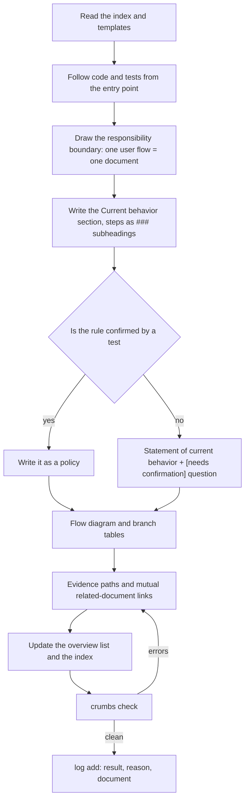
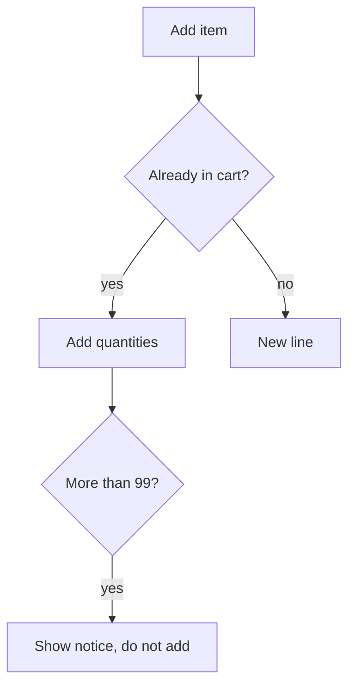

# crumbs-spec 🍞

[한국어](README.ko.md) · **English**

[](https://github.com/Sienna94/crumbs-spec/actions/workflows/ci.yml) [](https://www.npmjs.com/package/crumbs-spec)

crumbs-spec leaves breadcrumbs (links) on every document so an agent never gets lost, and keeps a **living spec** that leads from the index to the detail document in one path. It describes how the repository behaves *right now* in responsibility-sized documents, checks with one command that those documents are properly linked, and ships the procedures an agent follows to write, find, ask about and ingest them as skills.

## Why we built it

While we ran dozens of spec documents with agents on a real app repository, the same three things kept happening.

1. Specs only survived as change units (per-feature `spec.md`, tickets), so months later there was no document that answered "what is the rule right now?".
2. Piling them up like a wiki put the same rule into several documents with slightly different wording, and nobody knew which one was right. A later benchmark had an agent find three such contradictions.
3. When agents read documents they leaned on folder structure and search, so they wandered into other areas or fell back to grep. One question cost eight documents.

"Write better documents" did not fix it. We needed **a tool that enforces structure by machine**. When every policy has exactly one owner, the link graph is checked by a machine, and the unknown is written as a question instead of a guess, agents and people reach the document by the same path. So we started scattering breadcrumbs.

## How it differs from other tools

Spec Kit is good at pre-implementation planning and LLM Wiki at accumulating sources. crumbs-spec fills the gap between them: **the current state that must survive after implementation**. It complements them rather than replacing them.

| | GitHub Spec Kit | OpenSpec | Karpathy's LLM Wiki | **crumbs-spec** |
|---|---|---|---|---|
| Document unit | One change (feature): `spec.md`, `plan.md`, `tasks.md` | Current-state spec + change deltas | Entity, concept and source-summary pages | **One responsibility (user flow)**. Each policy is owned by exactly one document |
| Point in time | Before implementation | Before and after | When a source is ingested | **Current behavior after implementation** |
| Existing code | States that it "does not infer" | Has onboarding, but no code-to-spec drafting | Targets sources, not code | **The crumbs-writer skill drafts from code and tests; the unknown becomes a `[needs confirmation]` question** |
| Navigation | Folders and file names | Folders and file names | Index first | **Index → overview → detail by links only**. No IDs, no front matter |
| Machine checks | Consistency across spec, plan and tasks | `openspec validate` (structure) and delta merge on archive | Orphan page and broken link lint (with LLM judgment) | **16 structural rules**: links, anchors, reachability, backlinks, duplicate policy names, evidence paths, section order, flow diagrams, log format, unterminated comments |
| Sync after implementation | The team picks a maintenance model | `archive`/`sync` for the change in hand | Feeds query results back into the wiki | **Agent rule ("update the owning document in the same change, even unasked") and a decision log** |
| Human readability | Prose | Prose | Prose | **Flow diagrams (Mermaid) and branch tables in the template** |

Kiro specs and BMAD sit close to Spec Kit (per-feature, before implementation) and are not listed separately; the Korean plan document compares all five.

From LLM Wiki we kept the raw/wiki/schema split, index-first navigation, the append-only log and human-supervised ingest. Three things are deliberately different: documents are organized by responsibility rather than entity (only concepts that several flows branch on get a page under `concepts/`), documents are maintained by agents but owned by people, and lint is deterministic with no LLM judgment. See section 1 of [docs/IMPLEMENTATION_PLAN.md](docs/IMPLEMENTATION_PLAN.md) (Korean) for the full comparison.

## What we cared about

- **A single source of truth for the current state.** No change directories. Documents explain "how it behaves now", not "what changed".
- **No guessing.** A rule not confirmed by code, tests or approved sources is written only as "right now it behaves like this" plus a `[needs confirmation]` (`[확인 필요]` with `lang: ko`) question. `check` reports one `open-question` warning per document that still has questions. Whether a statement is a guess is the skill's rule and the reviewer's job; `check` cannot tell.
- **One owner per policy, checked at the name level.** `check` rejects the same policy name in two documents (or twice in one). Two policies that say the same thing under different names are not detected; the writer skill's naming rules exist for that.
- **People-first prose.** No IDs, no status tables, no enforced grammar. Navigation lives in links and headings only.
- **Deterministic checks, human judgment.** `check` looks at structure only. Style, content and staleness are for skill guidance and people.
- **Decisions in one place.** When a question gets its answer, a `decision` entry goes into the log and the document points at it with a single dated link.
- **Two languages.** `lang` in `crumbs.json` selects the language of the templates, skills, messages and AGENTS block for the whole repository. It defaults to English (`en`); `ko` gives Korean. This README is the English guide.

## Does it work on code it has never seen? (RealWorld experiment)

We ran the writer skill on two open-source backends of the [RealWorld](https://github.com/realworld-apps/realworld) "Conduit" API and graded the documents against the project's official API test suite. The generated documents, prompts, ground truth and every grading row are published in [crumbs-spec-conduit](https://github.com/Sienna94/crumbs-spec-conduit).

- **Setup.** Two pinned implementations of the same API: [Nitro + Prisma](https://github.com/realworld-apps/nitro-prisma-zod-realworld-example-app) (TypeScript) and [Django Ninja](https://github.com/c4ffein/realworld-django-ninja) (Python). One Opus 5.5 agent per implementation wrote the documents from code and tests only. The official spec repository was not in the experiment repository while they wrote; it was added in a later commit.
- **Ground truth.** Each request in the official Hurl suite, at the version both implementations pin, is one row: 130 rows after dropping setup and cleanup requests.
- **Grading.** A different model (Sonnet 5.5) graded every row. `correct` means the documents state the status and every essential asserted value, `partial` that one is left out, `wrong` that the documents contradict it, `missing` that no document covers it. It also checked every policy against the code.

| | Nitro + Prisma | Django Ninja |
|---|---|---|
| Code / tests in the repository | ~1,400 lines / 2 unit test files | ~2,300 lines / endpoint tests for each app |
| Documents / policies | 28 / 51 | 26 / 91 |
| Policies confirmed by tests / left as questions | 6 / 45 | 50 / 41 |
| Suite rows correct | **125 / 130** | **116 / 130** |
| Suite rows partial / wrong / missing | 5 / 0 / 0 | 14 / 0 / 0 |
| Invented policies (code does not do it) | 0 | 0 |
| Policies partly overstated | 1 | 6 |
| Writer tokens / wall time | 165k / 2 h 40 min | 202k / 2 h 47 min |

- **Nothing contradicted the suite and nothing was invented.** Every miss is a detail left out. Nitro's five partials are `null` inputs the documents never mention and the order of tags. Twelve of Django's fourteen come from one honest question: the app's error handler and its tests disagree on the 401 body, so the writer stated both and asked.
- **Statements under a question were mostly right.** 12 Nitro rows and 32 Django rows were graded correct on a statement still marked `[needs confirmation]`. "This is what it does now" plus a question kept the documents useful without claiming more than the tests prove.
- **Fewer tests, more questions.** Nitro has two unit test files, so 45 of its 51 policies stayed questions. The suite answers 29 of them, which is the list a maintainer would confirm first.
- **The writers raised what no suite row tests.** As questions: Django's article list ignores the token and reads the session user, and its `createUser` command looks users up by a field a migration renamed. The Nitro documents also say plainly that the email format is not checked, which a newer version of the suite does test.

Limits: one run per implementation and one writer model. The grader is also a model; the author checked that every cited anchor exists and spot-checked rows. RealWorld is well known, so the writer may have seen it in training even without the spec in the repository. The suite asserts only part of what the documents say: 20 of Nitro's and 41 of Django's policies were checked against the code alone. The Django grader ran the code with unpinned dependencies, so some of its "partly" verdicts may depend on library versions.

### An earlier run on a private app (anecdote)

Before this we rewrote three areas of a private app (about 40,000 lines) and asked the existing spec system and crumbs the same 18 questions, documents only. crumbs answered 15 against 17, read 64 files against 70 and used 18% fewer tokens. Its three partial answers were details the writer had dropped, which led to the skill rule "do not drop values that carry a condition". The author graded it, the questions came from the existing specs, and the data cannot be published, so read it as an anecdote. The navigation comparison has not been repeated on public code yet.

## Install and quick start

Node.js 20 or later, no runtime dependencies.

```bash
npx crumbs-spec init --skills all   # document structure + the four agent skills
npx crumbs-spec init                # document structure only
npx crumbs-spec check               # check the link graph and structure
```

Korean repositories: pass `--lang ko`.

`init` creates these files and never overwrites one that exists. With `--skills all` it also writes eight SKILL.md files, and in AGENTS.md it only ever replaces its own block between `<!-- crumbs:start -->` and `<!-- crumbs:end -->`.

```
crumbs.json                      configuration
docs/specs/index.md              index (the entrance)
docs/specs/log.md                append-only log
docs/specs/templates/overview.md overview template
docs/specs/templates/detail.md   detail template
docs/raw/README.md               raw sources directory (read-only)
AGENTS.md                        crumbs block (agent rules)
```

If `crumbs.json` already exists, `init` keeps its settings and ignores `--spec-dir` and `--lang` (it says so). The last line of `init` is the next command to run: `npx crumbs-spec check`.

The package is on npm as [`crumbs-spec`](https://www.npmjs.com/package/crumbs-spec). To run it from a clone instead, use `npm run build` and then `node dist/src/cli.js <command>`.

## Adding it to an existing project

The order for a repository that already has code and documents. Start with one domain instead of moving everything at once.

1. **Run `init` at the repository root.** If your spec root lives elsewhere, pass `--spec-dir` (for example `docs/crumbs`). Existing files are left alone; if `AGENTS.md` already exists, only the block between `<!-- crumbs:start -->` and `<!-- crumbs:end -->` is inserted.

   ```bash
   npx crumbs-spec init --spec-dir docs/crumbs --skills claude
   ```

2. **Let the agent read the rules.** Claude Code only reads the crumbs block if `CLAUDE.md` contains the line `@AGENTS.md`. Skills are found automatically under `.claude/skills/` (Claude Code) and `.agents/skills/` (Codex).

3. **Do not migrate existing documents.** The writer treats code and tests as the only sources and does not read existing wikis, design notes or READMEs unless you name them as sources, because there is no way to know whether they still match the code. Copy the ones worth using as evidence (plans, contracts, decision records) into `docs/raw/` and ingest them one at a time with `crumbs-ingest`.

4. **Write the first domain from code.** Pick the area people ask about most and hand it to the writer's "document existing code" mode. The `[needs confirmation]` questions in the result become the list of things a person has to decide for that area.

   ```
   Document the code under src/billing/ with crumbs-writer in "document existing code" mode.
   The domain directory is docs/crumbs/billing/. Leave unconfirmed policies as questions and finish the whole thing.
   ```

5. **Put `check` in CI.** Fail only on errors (every rule marked error in the check rules table below) and ignore warnings. Markdown under the spec root that is not a crumbs document yet goes into `exclude` in `crumbs.json`: entries are paths relative to the spec root, an entry ending in `/` excludes that directory, there are no glob patterns, and `check` tells you when a document has none of the required sections.

6. **Change the document in the same change as the code.** The AGENTS block tells the agent to "update the owning document in the same change, even when nobody asked", so every PR brings `check` and a log entry with it. The index fills in as domains are added one by one.

If you already have a spec system, try asking both systems the same questions. Files read and correct answers show at once which one is easier to navigate.

## How a spec gets written

The order the writer skill follows in "document existing code" mode. In "reflect a change" mode, steps 1–2 become "find the owning document whose evidence names the changed code path" and the rest is the same.



When an answer arrives, a person answers the questions produced by `crumbs-interview`, and the writer turns the question policy into a confirmed one, leaving a `decision` log entry and a decision link. When new material arrives, `crumbs-ingest` finds the affected documents, gets confirmation and then applies it.

## Document model

There are four roles. Navigation always starts at the index.

```
docs/specs/index.md              index: domain list + log link
docs/specs/<domain>/overview.md  overview: scope, flow diagram, document list, terms
docs/specs/<domain>/<topic>.md   detail: one user flow
docs/specs/log.md                log: what was done, in order
docs/specs/concepts/             concepts shared by several domains (optional)
docs/raw/                        immutable sources such as contracts and plans
```

The sections of a detail document are fixed. Headings follow `lang` (English by default, Korean with `lang: ko`) and can be renamed through `headings` in `crumbs.json`. With `lang: ko` the headings are 목적, 현재 동작, 흐름, 정책, 근거, 확인 필요 사항, 관련 문서.

| Section | Content |
|---|---|
| Purpose | The one responsibility this document owns and what it does not cover |
| Current behavior | As the user experiences it, in the present tense; three or more steps become `###` subheadings |
| Flow | A Mermaid diagram for two or more steps; a table when there are two or more comparison axes |
| Policies | `### policy name` (unique across the repository) and the rule; if unconfirmed, a statement of current behavior followed by a `[needs confirmation]` question |
| Evidence | Backticked paths that contain a `/`, each with a description; `check` verifies the path exists |
| Open questions | `- [needs confirmation] [policy name](#anchor) — question` |
| Related | Link to the overview and neighboring documents; backlinks must be mutual |

Example (`docs/specs/shopping/cart.md`):

````markdown
# Cart
<!-- Read ../index.md first. After changing this document, add an entry to ../log.md -->

## Purpose
Owns the flow from adding an item to changing its quantity and emptying the cart. Coupon application is owned by [Coupon discount](coupon-discount.md).

## Current behavior
- When the user adds the same item again, the app adds the quantities.
- When the quantity would exceed 99, the app shows "You can add up to 99 of this item." and does not add it.

## Flow


## Policies
### Quantity cap
A cart line holds at most 99 of one item.

### Minimum order amount
Right now the checkout button is disabled when the total is under 10,000 KRW.
[needs confirmation] Where does the 10,000 KRW threshold come from?

## Evidence
- `src/cart/cart.ts:12-48` — adding and quantity merge
- `test/cart/cart.test.ts` — quantity cap

## Open questions
- [needs confirmation] [Minimum order amount](#minimum-order-amount) — Where does the 10,000 KRW threshold come from?

## Related
- [Shopping overview](overview.md)
- [Coupon discount](coupon-discount.md)
````

The overview's "Terms" section is a list of aliases linked to the owning policy (`- Subscription pass(flat-rate pass) — [Pass active check](pass.md#pass-active-check)`). A term that is only a definition stops there; only concepts that several flows branch on (channel, currency, member state) get an owning document under `concepts/`.

## Commands

```bash
npx crumbs-spec init [--spec-dir <dir>] [--lang <en|ko>] [--skills <claude|codex|all>]
npx crumbs-spec check [--format text|json] [--config <path>]
npx crumbs-spec log add --kind <ingest|query|lint|drift|change|decision> "<title>" [--body "<body>"]
```

Common options are `--root <dir>` (repository root, default: current directory), `--lang <en|ko>` (language for `init`; errors raised before `crumbs.json` is read; default `en`), `-h`/`--help` and `-v`/`--version`. Configuration lives in `crumbs.json` at the repository root (`specDir`, `index`, `overview`, `log`, `lang`, `headings`, `exclude`, `codeRoot`, `rawDir`).

`check` prints one line per finding as `file:line severity rule: message`, and a summary last.

```
docs/specs/shopping/cart.md:34 error broken-anchor: anchor not found: coupon-discount.md#application-order
docs/specs/shopping/cart.md:20 warning open-question: 1 open question(s)

crumbs check: 4 documents, 1 error, 1 warning
```

**Supported Markdown.** Headings must be ATX (`#` to `######`); setext headings are not recognized. Inline links and reference links (`[text][label]`, and `[label][]` with a `[label]: path` definition) are checked; a shortcut reference such as `[label]` alone is not a link. Heading anchors follow github-slugger: each space becomes `-`, punctuation other than `-` and `_` is dropped, and nothing is collapsed, so `### Quantity & limits` becomes `#quantity--limits`. Symlinked files and directories under the spec root are followed. An evidence path must contain a `/`, so a repository-root file is written `./package.json`; line suffixes such as `:12`, `:12-48`, `:12:5` and `:12-48,60-70` are accepted. Entries in `exclude` are paths relative to the spec root, and an entry ending in `/` excludes that directory. Every finding carries a `line` (1 when there is no better position), so JSON output always includes it.

### Check rules

| Rule | Severity | What it catches |
|---|---|---|
| `index-missing` | error | The index document is missing (no other rule runs) |
| `missing-title` | error | The first heading is not an H1 |
| `broken-link` | error | The link target file does not exist, or its spelling differs from the file on disk |
| `broken-anchor` | error | The link points to a heading that does not exist |
| `unreachable` | error | A document that cannot be reached from the index by links |
| `missing-section` | error | A required section for the role is missing |
| `missing-backlink` | error | No link back to the parent (overview or index), or a detail A→B link without B→A |
| `missing-code-path` | error | An evidence code path does not exist |
| `duplicate-policy` | error | The same policy name appears in two documents, or twice in one |
| `log-format` | error | A log entry is not in the form `## [YYYY-MM-DD] kind \| title`, or the date is more than a day in the future |
| `unterminated-comment` | error | An HTML comment is opened and never closed, hiding the rest of the document |
| `open-question` | warning | One warning per document that still has open questions (the count is the number of questions) |
| `log-order` | warning | Log dates are out of order |
| `missing-flow` | warning | Current behavior has six or more steps but no diagram or table |
| `section-order` | warning | Sections are not in template order |
| `log-body` | warning | A `decision` entry has no document link |

## Log

The log is appended in one place (`docs/specs/log.md`) in chronological order. The title is **one sentence about the user outcome**, not the task name, and the body has three lines.

```bash
npx crumbs-spec log add --kind change "Cart quantity cap raised to 99" \
  --body "Result: a cart line holds up to 99. Reason: request SHOP-42. Document: [Quantity cap](shopping/cart.md#quantity-cap)"
```

`log add` refuses titles or bodies that contain `<!--`.

When a `[needs confirmation]` question gets its answer, add a `decision` entry and put one decision link at the end of the confirmed policy. Instead of change-history tables inside documents, decisions accumulate in the log and documents only point at them. The slug drops the brackets, `|`, comma and colon, so the `|` leaves a double dash in the anchor.

```markdown
## [2026-11-02] decision | Minimum order amount: 10,000 KRW comes from the shipping fee policy
Result: the checkout button is disabled below 10,000 KRW. Reason: 2026-11-02 planning review. Document: [Minimum order amount](shopping/cart.md#minimum-order-amount)
```

```markdown
### Minimum order amount
The checkout button is disabled when the total is under 10,000 KRW. (decision: [2026-11-02](../log.md#2026-11-02-decision--minimum-order-amount-10000-krw-comes-from-the-shipping-fee-policy))
```

The kinds are `ingest` (a source was applied), `query` (an answer fed back), `lint`, `drift`, `change` (a document changed) and `decision` (a question was settled).

## Skills

`init --skills` installs the procedures an agent follows into `.claude/skills/<name>/SKILL.md` (Claude Code) and `.agents/skills/<name>/SKILL.md` (Codex). An existing `SKILL.md` is never overwritten; delete it and run `init --skills` again to upgrade. Claude Code reads the crumbs block only when `CLAUDE.md` contains `@AGENTS.md`.

Each generated SKILL.md starts with a comment naming the crumbs-spec version that produced it. Skills and templates follow the package version: a minor release may change their text, a patch release does not. To upgrade, delete the file and run `init --skills` again.

| Skill | What it does |
|---|---|
| `crumbs-writer` | Writes or updates documents in two modes: "reflect a change" (changed code → owning document) and "document existing code" (first draft from code and tests only). Carries the rules for responsibility size, style, question format, flow diagrams and concept pages |
| `crumbs-finder` | Finds the answer index → overview → detail, cites the source, and feeds good answers back as `query` log entries |
| `crumbs-interview` | Turns the unconfirmed policies a request touches into questions and stops |
| `crumbs-ingest` | Reads new material under `docs/raw/`, finds the affected documents, applies them after confirmation and leaves an `ingest` entry |

## Usage examples

### 1. Document existing code for the first time

```
Document the code under src/cart/ with crumbs-writer in "document existing code" mode.
The domain directory is docs/specs/shopping/. Leave unconfirmed policies as questions and finish the whole thing.
```

The agent reads the index and templates, follows code and tests from the entry point, and produces `shopping/overview.md` plus the detail documents. Rules confirmed by tests become policies; rules that exist only in code become "right now …" statements with `[needs confirmation]` questions. It ends by running `check`, clearing errors and adding a log entry.

```
crumbs check: 5 documents, 0 errors, 3 warnings
```

The three warnings are the three documents that still have open questions. Skimming their "Open questions" sections is enough to see what has to be decided.

### 2. Reflect a code change

```
I raised the cart quantity limit from 99 to 199. Update the docs.
```

The writer finds the owning document with `grep -rl 'src/cart/cart.ts' docs/specs` (the evidence section names the path), fixes the current-behavior section and the `### Quantity cap` policy, updates the value in the flow diagram, and logs `change | Cart quantity cap raised to 199`. If two documents look like owners it stops and asks which one is.

### 3. Ask about what is unknown and record the answer as a decision

```
I want to change the coupon stacking rule. What do I need to confirm first?
```

The interview skill lists the policies the request touches, separates those confirmed by code, tests or sources from those that are not, and turns the unconfirmed ones into questions. Once you answer, the writer rewrites the policy as confirmed and leaves a `decision` log entry and a decision link.

### 4. Ingest a source document

```
Apply docs/raw/coupon-policy-v3.pdf.
```

The ingest skill reads the source, finds the affected documents through the index, backlinks and evidence, and shows the list of intended changes first. Only after confirmation does it edit the owning documents and add an `ingest` entry. There is no automatic merge.

### 5. Find an answer

```
How many items can go into the cart?
```

The finder goes index → shopping overview → cart document and answers with `### Quantity cap` as the source. For term or concept questions it checks the terms section of `concepts/overview.md` first. If the documents do not answer, it says "not in the documents" and names the closest one.

### 6. Check in CI

A GitHub Actions job that fails on errors:

```yaml
jobs:
  specs:
    runs-on: ubuntu-latest
    steps:
      - uses: actions/checkout@v4
      - uses: actions/setup-node@v4
        with: { node-version: 20 }
      - run: npx crumbs-spec check --format json > crumbs-report.json
```

Exit code 1 means there are errors. Warnings (`open-question`, `missing-flow` and so on) do not fail the build.

## Exit codes

| Code | Meaning |
|---|---|
| 0 | `check`: no errors (warnings allowed). `init` and `log add`: done |
| 1 | `check`: at least one error |
| 2 | Usage error, configuration error or unexpected I/O error |

## What we left out

- Requirement IDs, front matter and enforced grammar such as EARS. Navigation lives in links and headings only.
- Change-history tables inside documents and one file per decision. Decisions go into the single log and documents point at them.
- Definition-only term pages. The overview's terms section is enough.
- Style and content judgment in `check`. Style is handled by the skill guidance and the markdownlint sample under [docs/lint/](docs/lint/README.md).

## Tests and compatibility

`npm test` runs the node:test suite on Linux and macOS in CI (see `.github/workflows/ci.yml`). Changes are listed in [CHANGELOG.md](CHANGELOG.md). Until 1.0, a minor version may change check rules, templates and skill text; a patch version only fixes bugs.

## Roadmap

| Step | Content | Status |
|---|---|---|
| 1 | `init`, `check`, templates, AGENTS block | done |
| 2 | Four skills, `log add`, flow section, responsibility-size rules, terms and concept pages, decision log | done |
| 3 | `crumbs reverse <path>` — a command that drafts from code (the writer skill does this today) | planned |
| 4 | `crumbs drift --base <ref>` — finds documents whose evidence changed in a diff | planned |
| 5 | Public example ([crumbs-spec-conduit](https://github.com/Sienna94/crumbs-spec-conduit)) and a navigation-cost benchmark runner | example done, runner planned |

The `lang` setting (`en` by default, `ko` for Korean) selects the language of the templates, skills and messages, so one repository uses one language.
