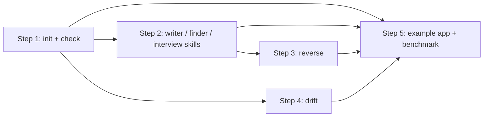

# crumbs-spec 구현 계획

상태: 2026-10-31 소유자 결정을 반영했다(5절). 1단계는 구현과 검증을 마쳤고(테스트 36개 통과), 같은 날 2단계 명세를 6절에 추가했다. [PLAN.md](PLAN.md)와 저장소 README를 기준으로 썼으며, 1단계와 2단계의 단일 구현 계약이다. 2026-11-02 문서 기준 보완(9절)을 반영했다.
대상 독자: 구현자(이 문서만 보고 작업하는 더 작은 모델)와 소유자. 1단계 구현에 필요한 내용은 모두 4절에, 2단계 구현에 필요한 내용은 모두 6절에 있고, 1~3절은 그 이유를 설명한다.
언어: 이 문서, 템플릿, 도구가 내는 모든 문자열은 한국어가 기본이다. 영어판은 별도 브랜치에서 나중에 만든다. 규칙 id, 설정 키, JSON 필드, 파일 이름, 명령, 코드 식별자는 영문 그대로 둔다.

아래에서 쓰는 용어:

- **스펙 루트**: 스펙 문서를 두는 디렉터리(기본 `docs/specs/`).
- **인덱스**: 스펙 루트의 유일한 진입 문서(기본 `docs/specs/index.md`).
- **개요**: 도메인 디렉터리 하나의 진입 문서(기본 `<domain>/overview.md`).
- **상세 문서**: 스펙 루트 아래의 나머지 모든 Markdown 파일.
- **정책**: 이름 붙은 시스템 동작 규칙 하나. 정확히 하나의 상세 문서가 소유한다.
- **근거 경로**: 문서가 설명하는 동작을 구현한 코드라고 문서에 적힌 저장소 경로(파일 또는 디렉터리).
- **로그**: `<specDir>/log.md`에 있는 추가 전용 시간순 기록. 자료 반영, 질의, lint·drift 실행, 문서 변경을 적는다.
- **원본 자료**: `docs/raw/` 아래의 불변 원본 파일. 에이전트는 읽기만 하고 고치지 않는다.

---

## 1. 기존 도구 대비 위치

### 1.1 비교 대상 도구가 실제로 하는 일 (2026-10-31 확인)

출처는 각 도구의 공식 문서나 README다. 문서에 없는 내용은 추측하지 않고 "설명 없음"으로 적었다.

| | GitHub Spec Kit | OpenSpec (Fission-AI) | Kiro specs | BMAD-METHOD | Tessl (SDD tile) | **crumbs-spec (계획)** |
|---|---|---|---|---|---|---|
| **문서 단위** | 변경 단위. 기능마다 디렉터리에 `spec.md`, `plan.md`, `tasks.md`를 두고, 프로젝트 전체 파일은 constitution뿐이다. ([reference](https://github.github.com/spec-kit/reference/overview.html)) | 둘 다. `openspec/specs/<domain>/spec.md`가 현재 상태의 단일 진실이고, 변경은 델타(ADDED / MODIFIED / REMOVED 요구사항)로 두었다가 `archive`가 본 스펙에 합친다. ([concepts](https://github.com/Fission-AI/OpenSpec/blob/main/docs/concepts.md)) | 기능 단위. 스펙마다 `requirements.md`, `design.md`, `tasks.md`. ([docs](https://kiro.dev/docs/specs/)) | 단계별로 만드는 기획 문서(brief, specification, architecture, stories). 이후 최신으로 유지하는지는 설명 없음. ([docs](https://docs.bmad-method.org/)) | 대상 파일 단위. YAML front matter의 `targets`가 설명 대상 파일을 가리키는 "spec as source". ([tile](https://github.com/tesslio/spec-driven-development-tile)) | **책임 단위.** 경계 지어진 책임마다 살아 있는 문서 하나가 항상 현재 시스템을 설명한다. 변경 디렉터리는 없다. |
| **기존(브라운필드) 코드** | 명시적으로 추론하지 않는다. init은 "기존 동작의 스펙을 추론하지 않는다"고 밝히고, 시스템 전체 문서화 대신 다음 변경부터 시작하라고 안내한다. ([existing projects guide](https://github.github.com/spec-kit/guides/existing-projects.html)) | "브라운필드를 위해 만들었다"가 원칙이고, `/opsx:explore`가 계획 전에 코드를 읽고 `/opsx:onboard`도 있지만, 코드에서 현재 상태 스펙 초안을 만드는 명령은 없다. ([README](https://github.com/Fission-AI/OpenSpec), [commands](https://github.com/Fission-AI/OpenSpec/blob/main/docs/commands.md)) | 설명 없음. | `bmad-project-context`가 `AGENTS.md`에 에이전트 지침 블록을 쓴다. 예전 `document-project` 워크플로는 폐기됐다. ([existing codebase](https://docs.bmad-method.org/existing-codebases/start-in-an-existing-codebase/)) | tile 문서에는 설명 없음. | **`reverse`**가 코드에서 현재 동작 문서 초안을 만들고, 확인하지 못한 정책은 추측 대신 `[확인 필요]` 질문으로 남긴다. |
| **구현 후 동기화** | 팀이 세 가지 유지 모델(이력 보존, 살아 있는 `spec.md`, 사후 반영) 중 하나를 고른다. `converge`는 작업을 더하기만 하고, `analyze`는 spec/plan/tasks 일관성을 검사한다. "코어에는 산출물을 자동으로 맞추는 명령이 없다." ([evolving specs](https://github.github.com/spec-kit/guides/evolving-specs.html)) | `archive` / `sync`가 델타 스펙을 본 스펙에 합치고, `/opsx:verify`는 구현을 *그 변경의* 산출물과 대조한다. ([commands](https://github.com/Fission-AI/OpenSpec/blob/main/docs/commands.md)) | 작업 상태는 진행에 따라 갱신된다. 이후 요구사항·설계를 갱신하는지는 설명 없음. | "Learn and adjust"가 기획으로 되돌아간다. 방식은 설명 없음. | 요구사항에서 테스트로 가는 `[@test]` 링크. 재생성 엔진은 별도이며 비공개다. | **`drift`**: diff를 받아 근거 경로나 설명한 사용자 결과는 바뀌었는데 본문은 그대로인 문서를 찾는다. 요청 없이도 문서를 갱신하라는 에이전트 규칙을 더한다. |
| **문서 간 연결·탐색** | 기능이 다른 기능을 대체할 때 교차 링크를 권할 뿐이다(이력 보존 모델만). 링크 모델이나 검사기는 없다. | 도메인 폴더. 스펙 간 참조는 설명 없음. 링크 검사기 없음. | 사이드바 목록. 스펙 간 링크는 설명 없음. | 설명 없음. | `targets`(스펙→코드)와 `[@test]`(스펙→테스트). 스펙→스펙 그래프는 없다. | **링크 그래프.** 인덱스 → 개요 → 상세 → 관련 문서 구조에 역링크·앵커·근거 경로를 두고 `check`가 전부 검증한다. |
| **검증 도구** | `analyze`(산출물 일관성, 에이전트 주도), `checklist`. 결정론적 린터는 없다. | `openspec validate`("구조와 명확성을 확인"). 정확한 규칙은 `cli.md`에 있으며 여기서 확인하지 않았다. | 설명 없음. | 설명 없음. | CI의 tile lint(스킬 품질). | **결정론적 `check`** CLI. CI용 종료 코드. |
| **에이전트 효과 측정** | 없음. | 없음(익명 명령 텔레메트리뿐). | 수치 없음. | 없음. | 레지스트리가 *tile*(스킬 품질)의 평가 점수를 보여 준다. 탐색 비용은 아니다. | **벤치마크**: 같은 질문을 스펙 없음 / 식별자 방식 / 링크 그래프 문서에서 풀게 하고 도구 호출 수, 읽은 파일 수, 토큰, 정답률을 잰다. |

확인한 버전: Spec Kit 1.0.x(2026-08-21 1.0.0, 2026-09-24 1.0.11 보고), BMAD v6.12 안정판과 v7 프리뷰, Tessl tile 1.0.5. OpenSpec과 Kiro 페이지에는 버전 표기가 없었다.

### 1.2 PLAN.md가 주장한 격차의 솔직한 조정

| PLAN.md 2절의 주장 | 판정 | 조정 |
|---|---|---|
| Spec Kit에는 변경 단위 스펙만 있다 | Spec Kit에는 대체로 맞다. **OpenSpec이 이미 해결했다.** `specs/` 폴더가 현재 상태의 단일 진실이고 델타를 합친다. | 차별점은 "살아 있는 문서가 있다"가 아니라 *어떤 단위로 조직하는가*(책임, 정책마다 소유자 하나)와 *그래프를 기계가 검사한다*는 점이다. README에 그렇게 적고, 최초의 살아 있는 스펙 도구라고 주장하지 않는다. |
| Spec Kit은 기존 코드를 문서화하지 않는다 | 맞다. 자체 가이드에 적혀 있다. OpenSpec과 BMAD에는 온보딩·컨텍스트 단계가 있지만 코드에서 현재 동작 스펙 초안을 만들지는 않는다. | `reverse`는 실제 격차로 남는다. "추측하지 않고 질문을 남긴다" 규칙을 구별되는 동작으로 유지한다. |
| 유지 방식을 팀에 맡긴다 | Spec Kit에는 맞다(세 모델, 맞추는 명령 없음). OpenSpec은 `archive`/`sync`/`verify`로 일부 해결하지만 작업 중인 변경에 한한다. | `drift`를 *diff 기반*(추적 중인 변경뿐 아니라 어떤 PR에도 동작)이자 *결과 기반*(어떤 파일이 아니라 사용자에게 무엇이 바뀌었는가)으로 다시 정의한다. |
| 스펙 간 링크가 없다 | 확인한 모든 도구에 맞다. | 핵심 차별점. 1단계는 그래프를 부가 기능이 아니라 제품으로 만들어야 한다. |
| 변경마다 산출물이 너무 많다 | 2차 자료의 주장일 뿐 도구 문서로 확인하지 않았다. | 설계 원칙(사람 우선의 본문, 식별자 없음)으로는 유지하되 측정된 사실로 인용하지 않는다. |
| 효과를 측정하지 않는다 | 확인한 모든 도구에 맞다. | 핵심 차별점. 벤치마크는 MVP에 남긴다. |

### 1.3 crumbs-spec의 차별점, 구체적으로

1. **책임이 소유하는 살아 있는 문서.** 문서는 시스템이 *지금* 어떻게 동작하는지를 책임 하나의 범위로 설명한다. 정책은 이름 붙은 제목이며 정확히 하나의 문서에만 있다. 중복이면 `check`가 실패한다. 위 도구 중 어디에도 이런 것은 없다.
2. **폴더 목록이 아니라 검증된 링크 그래프.** 모든 문서는 인덱스에서 도달할 수 있고, 모든 상세 문서는 개요로 되돌아가는 링크를 두고, 관련 문서는 서로 링크하며, 모든 앵커는 실제로 존재한다. `check`가 이를 결정론적으로 강제하므로(종료 코드 1) 에이전트는 링크를 따라가다 막다른 길에 닿지 않는다고 믿을 수 있다.
3. **근거 경로가 본문과 코드를 묶는다.** 상세 문서마다 설명 대상 코드 경로를 적고 `check`가 존재를 확인한다. 식별자 체계 없이도 나중에 `drift`가 가능한 이유다.
4. **먼저 reverse, 추측은 절대 안 한다.** `reverse`는 기존 코드를 명시적 미결 질문이 달린 초안으로 바꾸고, `check`는 미해결 질문을 세어 묻히지 않고 보이게 한다.
5. **주장이 아니라 측정.** 벤치마크가 같은 질문으로 문서 방식별 탐색 비용을 비교한다.
6. **사람 우선의 본문.** 요구사항 ID 없음, EARS/SHALL 문법 강제 없음, 1단계에 front matter 없음. 탐색 정보는 링크와 제목에만 둔다.

### 1.4 1단계가 차별점을 뒷받침하는 방식

| 차별점 | 1단계 요소 |
|---|---|
| 책임 소유 | 역할 모델(인덱스 / 개요 / 상세), `## 정책` 아래의 제목, `duplicate-policy` 규칙, `현재 동작`("제안하는 변경"이 아님)을 요구하는 `missing-section`. |
| 검증된 링크 그래프 | `unreachable`, `broken-link`, `broken-anchor`, `missing-backlink` 규칙. `init`이 만드는 인덱스·개요·상세 템플릿의 탐색 수단은 링크뿐이다. |
| 근거 경로 | `## 근거` 절, `missing-code-path` 규칙. |
| 먼저 reverse | `[확인 필요]` 마커 집계(`open-question` 경고). 3단계 산출물을 첫날부터 잴 수 있다. |
| 사람 우선 | front matter 없음, ID 없음, 한국어 제목 어휘, 짧은 템플릿. |
| 측정 | `check --format json`의 스키마가 안정적이어서 5단계가 그래프 크기와 발견 수를 프로그램으로 읽는다. |
| 운영 루프(1.5) | `init`이 `log.md`(역할 `log`, 인덱스에서 도달 가능, 구조 규칙 면제)와 `docs/raw/`를 만든다. 에이전트 규칙에 "인덱스를 먼저 읽는다"와 "자료를 반영하거나 문서를 바꾼 뒤 로그 항목을 추가한다"를 넣는다. |

일반 Markdown 링크 검사기는 `broken-link`와 `broken-anchor`만 다룬다. 이 프로젝트의 주장에 중요한 규칙은 `unreachable`, `missing-backlink`, `duplicate-policy`, `missing-section`, `missing-code-path`다.

### 1.5 LLM Wiki 패턴과의 관계

두 번째 설계 영향은 Karpathy의 "LLM Wiki" 패턴([gist](https://gist.github.com/karpathy/442a6bf555914893e9891c11519de94f))이다. LLM이 불변 원본 위에 서로 링크된 Markdown 페이지 집합을 점진적으로 유지하고, 스키마 파일(`CLAUDE.md`/`AGENTS.md`)이 구조와 절차를 정하며, 인덱스를 먼저 읽는 ingest → query(좋은 답은 위키에 되돌려 저장) → lint 루프와 추가 전용 로그로 운영한다. 구조 층(위키 + 스키마 + 고아·누락 교차 참조 lint)은 책임이 소유하는 링크 그래프가 이미 제공한다. 그런 체계에 흔히 빠져 있는 것은 *운영 루프*다: 자료 반영, 질의 결과 환류, 시간순 로그, 노후·모순 lint. crumbs-spec은 gist를 목표가 아니라 설계 영향으로 다룬다.

채택한 속성:
- **원본 / 위키 / 스키마 분리.** `docs/raw/`에 불변 원본 자료를 두고, 스펙 루트 아래 문서가 유지되는 층이며, `AGENTS.md`와 `crumbs.json`이 스키마다. 문서는 `## 근거`에서 원본을 인용한다.
- **인덱스 우선 탐색.** 인덱스가 유일한 입구이고, 에이전트는 매번 인덱스를 먼저 읽는다.
- **추가 전용 로그.** `<specDir>/log.md`에 자료 반영, 질의, lint·drift 실행, 문서 변경을 `## [날짜] kind | 제목` 항목으로 적어 grep으로 찾을 수 있게 한다.
- **사람이 감독하는 ingest.** 새 자료는 한 번에 하나씩 확인을 거쳐 소유 문서에 반영한다(2단계 `ingest` 스킬). 자동 병합은 하지 않는다.
- **지어낸 주장 대신 미결 질문 마커**(1.3에 이미 있음).

의도적으로 채택하지 않은 속성:
- **엔티티 / 요약 페이지 유형과 정의만 있는 용어 페이지.** crumbs 문서는 엔티티가 아니라 시스템 책임으로 조직한다. 개념 페이지는 횡단 규칙이나 값 표가 있는 개념에만 `concepts/`(10절)로 채택하고, 그 밖의 개념은 그 동작을 소유한 문서 안에 둔다. 요약 페이지와 정의만 있는 용어 페이지는 여전히 채택하지 않는다.
- **위키가 산출물이고 사람은 큐레이션만 한다**(gist: 사람은 위키를 거의 직접 쓰지 않는다). crumbs 문서는 사람이 읽고 고칠 수 있는 책임 문서로 남는다. 에이전트가 유지하지만 소유하지는 않는다. `check` 규칙은 양쪽이 고쳐도 그래프가 무너지지 않게 하려고 있다.
- **LLM 판단으로서의 lint.** 1단계 lint는 결정론적이다. 노후·모순 탐지는 판단이 필요하므로 나중에 선택형 명령으로 둔다(2절 "이후").

---

## 2. 로드맵 (MVP, PLAN.md 5절)



| 단계 | 산출물 | 의존 | 증명하는 것 |
|---|---|---|---|
| 1 | `crumbs init`, `crumbs check`, 템플릿, 에이전트 지침 블록 | — | 문서 모델과 링크 그래프가 기계로 검사할 만큼 정밀하다. 저장소가 명령 하나로 도입할 수 있다. |
| 2 | 스킬: Claude Code와 Codex용 `crumbs-writer`, `crumbs-finder`, `crumbs-interview`, `crumbs-ingest`. `init --skills`가 설치. `crumbs log add`. `log-format` 검사 규칙 | 1 | 에이전트가 `check`를 통과하는 문서를 쓰고, 정책을 모르면 멈춰 묻고, 무엇을 반영하고 바꿨는지 로그로 남긴다. |
| 3 | `crumbs reverse <path>` + 스킬 | 1, 2 | 기존 코드를 정책을 지어내지 않고 온보딩할 수 있다. |
| 4 | `crumbs drift --base <ref>` + GitHub Action 출력 | 1 | 유지가 기억이 아니라 diff로 강제된다. |
| 5 | 예제 앱, 문서 변형 4종, 벤치마크 러너와 보고서 | 1–4 | 탐색 비용 주장에 숫자가 있다. |

### 2단계 개요: writer / finder / interview 스킬

상세 명세는 6절이다. 이 개요와 6절이 다르면 6절이 우선한다(예: 아래의 `--note`는 6절에서 `--body`가 됐고, Codex 스킬 위치는 확인을 마쳐 5.1의 Q10으로 확정했다).

- 스킬 파일은 Markdown이다. `crumbs init --skills claude,codex`가 `.claude/skills/<name>/SKILL.md`와 `.agents/skills/<name>/SKILL.md`(Codex)에 설치한다. Codex의 정확한 위치는 그때 확인한다.
- `crumbs-finder`: 탐색 절차(인덱스 → 개요 → 상세 → 관련 문서. 답을 찾으면 멈추고 문서를 인용). 환류 단계: 여러 문서에서 종합해야 했던 답이 재사용 가치가 있으면, 확인을 거친 뒤 그 정책을 소유한 문서에 반영하자고 제안한다. 새 고아 페이지로는 절대 만들지 않는다. `query` 로그 항목을 추가한다.
- `crumbs-interview`: 쓰기 전에 요청이 건드리는 정책을 나열하고, 코드·테스트·제공 자료로 확인된 것과 아닌 것을 표시한 뒤, 확인되지 않은 것은 질문을 남기고 멈춘다. 출력 형식은 `## 확인 필요 사항` 절과 같아 `check`가 센다.
- `crumbs-writer`: 책임 문서를 쓰거나 갱신한다. 정책마다 소유자 하나를 지키고, 역링크를 양방향으로 더하고, 마치기 전에 `crumbs check`를 실행하고, `change` 로그 항목을 추가한다.
- `crumbs-ingest`: 원본 자료(`rawDir` 아래 파일) → 인덱스와 역링크로 영향 문서를 찾는다 → 무엇을 바꿀지 소유자에게 확인한다 → 소유 문서를 갱신한다 → 범위가 바뀌었으면 인덱스 줄을 갱신한다 → `ingest` 로그 항목을 추가한다.
- `crumbs log add --kind <ingest|query|lint|drift|change|decision> "<제목>" [--note "<text>"]`: 4.4.5 형식의 항목을 오늘 날짜로 추가한다. `check`에 `log-format` 규칙이 생긴다: 로그의 항목 제목이 패턴과 다르거나 알 수 없는 kind를 쓰면 오류.
- 증명: writer와 ingest 스킬이 만든 문서와 로그 항목이 `log-format`을 포함한 `check`를 통과하는 픽스처 저장소.

### 3단계 개요: reverse

- `crumbs reverse <path>`(CLI, 결정론적 부분): `## 근거`에 `<path>` 아래 파일을 나열하고 `## 현재 동작`과 `## 정책`을 `[확인 필요]` 자리 표시로 채운 상세 문서 초안을 만들고, 가장 가까운 개요에서 링크한다(개요가 없으면 만든다).
- 이어서 에이전트 스킬이 코드와 테스트로 `현재 동작`을 채우고, 확인할 수 없는 정책은 서술 대신 미결 질문으로 바꾼다.
- 증명: 5단계 예제 앱에 실행했을 때 결과가 `check`를 통과하고, 모든 정책 서술이 근거 경로로 추적되거나 미결 질문이다.

### 4단계 개요: drift

- 두 단계를 명시적으로 나눈다:
  1. **결정론적(CLI).** `crumbs drift --base <ref> [--format text|json|github]`가 그래프에서 역인덱스(근거 경로 → 문서)를 만들고 `git diff --name-only <ref>`와 교차해, 근거는 바뀌었는데 같은 diff에서 수정되지 않은 후보 문서를 보고한다.
  2. **판단(에이전트 스킬).** diff에서 바뀐 사용자 가시 결과를 나열하고, 후보 문서와 그 결과를 언급하는 문서를 읽은 뒤 어느 문서를 갱신할지 정한다. PLAN.md의 "파일 목록이 아니라 결과" 규칙이다. 스킬은 `drift` 로그 항목을 추가한다.
- `--format github`은 발견마다 workflow command 주석을 출력해 GitHub Action이 PR에 표시하게 한다.
- 증명: 예제 앱에서 문서를 건드리지 않고 동작을 바꾼 PR이 CI에서 실패한다.

### 5단계 개요: 예제 앱과 벤치마크

- 작은 앱(직접 만든 코드, 도메인 몇 개, 소스 파일 10~20개)에 문서 변형 4종을 둔다: 없음 / 식별자 방식(REQ-001 표) / crumbs 링크 그래프 / crumbs 링크 그래프 + 인덱스·로그 루프 운영(ingest와 query 항목이 있고 finder 환류가 적용된 상태).
- 정답이 있는 질문 10~20개.
- 변형마다 코딩 에이전트를 headless로 실행해 도구 호출 수, 읽은 파일 수, 입력·출력 토큰, 정답 여부(문자열 또는 루브릭 일치)를 기록하는 러너.
- 보고서는 `benchmark/results/`에 커밋하는 Markdown 표.

### 이후 (MVP 밖)

- `check --stale`: 문서의 마지막 확인일 이후 git에서 근거 경로가 바뀐 경우(문서별 날짜가 필요하다. 형식은 미정).
- `check --conflicts`: 같은 정책 이름이나 근거 경로를 언급하는 문서 사이의 모순 후보(에이전트 보조).
- `check --suggest`: 공유 근거 경로와 정책 언급에서 끌어낸 링크·역링크 제안.
- `graph --json`: 외부 도구와 벤치마크용 링크 그래프 덤프.

---

## 3. 핵심 설계 결정 (트레이드오프 포함)

| 결정 | 선택 | 버린 대안 | 이유 |
|---|---|---|---|
| 런타임 | Node ≥ 20, TypeScript, ESM, 런타임 의존성 0, `node:test` | Commander/yargs, vitest, Markdown 파서 라이브러리 | `npx crumbs-spec`이 즉시 동작해야 한다. `node:util.parseArgs`와 직접 쓴 작은 Markdown 스캐너로 필요한 부분집합을 충분히 다룬다. 의존성이 적을수록 설치가 작고 공급망 노출이 없다. |
| 메타데이터 | 1단계에는 없음. 역할은 파일 위치로, 의미는 제목으로 정한다 | YAML front matter(`status`, `owns`) | 사람 우선. GitHub가 제목과 링크를 그대로 렌더링한다. 파서가 하나 준다. 정책 소유를 `### ` 제목으로 하면 앵커가 공짜로 생겨 "정책으로 링크"와 "정책의 소유자는 하나"가 같은 장치가 된다. `drift`에 필요해지면 나중에 front matter를 더할 수 있다. |
| 역할 판정 | 스펙 루트의 `index.md`, 디렉터리마다 `overview.md`, 나머지는 상세. 이름은 설정 가능 | 파일마다 역할을 명시 | 절차가 없다. 트리에서의 위치가 곧 역할이다. |
| 제목 어휘 | 언어별 고정 어휘(1단계는 `ko`만)와 설정의 키별 override | 자유 제목과 퍼지 매칭 | 결정론적 검사에는 정확한 이름이 필요하다. override가 기존 표현을 쓰는 팀을 감당한다. 어휘 표를 언어별로 두어 영어판 브랜치에서 `en`을 추가한다. |
| 역링크 엄격도 | 부모 역링크와 동료 대칭 모두 **오류** | 경고, 또는 `severity` 설정 | 양방향 탐색이 이 프로젝트의 주장이다. 경고는 무시된다. 소유자가 확정했다(5절 Q2). 1단계에 심각도 설정은 없다. |
| 앵커 알고리즘 | GitHub 방식: 소문자화, 유니코드 문자·숫자·결합 기호 유지, 공백→`-`, 나머지 문장 부호 제거, 중복은 `-1`, `-2` | 자체 슬러그 | 문서는 GitHub에서 읽힌다. 한국어 제목을 포함해 GitHub가 렌더링하는 앵커와 같아야 한다. |
| 코드 경로 | `## 근거` 안의 백틱 스팬만 검사 | 파일의 모든 백틱 스팬 검사 | `` `UserService` `` 같은 식별자의 오탐을 피하면서 규칙을 단순하게 유지한다. |
| 설정 | 저장소 루트의 `crumbs.json` 하나, 엄격한 키 | `package.json` 필드, YAML | JSON은 파서가 필요 없다. 엄격한 키가 오타를 잡는다. |
| 출력 | 텍스트(기본)와 JSON(`--format json`), 안정적인 `version: 1` 스키마 | 텍스트만 | 5단계와 CI가 JSON을 읽는다. |
| `init` 안전성 | 절대 덮어쓰지 않는다. `AGENTS.md`에서는 자기 표시 블록만 교체한다 | `--force` | 문서화 도구가 문서를 파괴해서는 안 된다. |
| 템플릿 | `src/templates/`의 TypeScript 문자열 상수 | 설치 시 복사하는 파일 | `dist/` 말고는 패키징할 것이 없다. |
| 1단계의 운영 루프 | 산출물만: `log.md`(역할 `log`, 도달 가능해야 함, 항목 형식은 검사하지 않음)와 `docs/raw/` | CLI에 ingest·log 도구를 지금 전부 넣기, 또는 2단계까지 아무것도 안 하기 | 2단계 스킬과 네 번째 벤치마크 변형이 쓸 자리가 첫날부터 있어야 한다. `crumbs log add`가 생기기 전에 항목을 검사하면 거짓 실패만 난다. |

---

## 4. 1단계 명세: `crumbs init`과 `crumbs check`

`docs/IMPLEMENTATION_GUIDE.md`(초기 초안)는 삭제했다. 이 문서가 단일 구현 계약이다. 2절과 이 절이 다르면 1단계에서는 이 절이 우선한다.

### 4.1 기술 스택

- Node.js ≥ 20.0.0(`engines.node`), TypeScript ≥ 5.4, ESM(`"type": "module"`), `module: NodeNext`, `target: ES2022`, `strict: true`.
- 런타임 의존성 없음. 개발 의존성은 `typescript`, `@types/node`뿐이다.
- 테스트: `node:test` + `node:assert/strict`. 소스와 함께 `tsc`로 컴파일한다.
- 인자 파싱: `node:util`의 `parseArgs`.
- 패키지 이름 `crumbs-spec`, bin `crumbs`. 패키지에 bin이 정확히 하나이므로 `npx crumbs-spec <command>`가 bin을 실행한다. 로컬 설치 후에는 `crumbs <command>`.

### 4.2 파일 구성

```
crumbs-spec/
  package.json
  tsconfig.json
  .gitignore                    (node_modules/, dist/)
  LICENSE                       (MIT; 소유자가 추가했음)
  README.md                     (기존; 1단계에서 사용법을 추가)
  docs/
    PLAN.md
    IMPLEMENTATION_PLAN.md      (이 파일)
  src/
    cli.ts                      진입점; parseArgs; 명령 분기; 종료 코드
    config.ts                   crumbs.json 읽기, 기본값, 검증
    headings.ts                 언어별 제목 어휘(1단계는 ko만) + 마커 목록
    markdown.ts                 스캐너: 줄, 펜스, 제목, 링크, 코드 스팬; slug()
    model.ts                    타입: Config, SpecDoc, Role, Section, Link, Finding, Report
    graph.ts                    파일 탐색, 문서 파싱, 역할·부모 결정, 링크 그래프 구성
    check.ts                    규칙 실행, Report 조립
    rules/
      broken-link.ts
      broken-anchor.ts
      unreachable.ts
      missing-backlink.ts
      missing-section.ts
      missing-code-path.ts
      duplicate-policy.ts
      open-question.ts
    report.ts                   텍스트·JSON 출력
    init.ts                     스캐폴딩
    templates/
      ko.ts                     인덱스 / 개요 / 상세 / 로그 / 원본 README 템플릿(한국어)
      agents.ts                 AGENTS.md 블록(한국어)
  test/
    helpers.ts                  makeRepo(files) → 임시 디렉터리; runCli(args, cwd)
    markdown.test.ts
    config.test.ts
    graph.test.ts
    rules.test.ts
    check-cli.test.ts
    init.test.ts
```

템플릿과 어휘는 언어 키(`ko`)로 묶어 둔다. 영어판 브랜치에서 `en.ts`와 `en` 어휘를 같은 구조로 더한다. `index-missing`과 `missing-title`은 별도 규칙 파일 없이 `check.ts`에서 처리한다(전자는 다른 규칙을 막는 치명 조건, 후자는 문서 하나만 보는 단순 검사라서다).

`package.json` 핵심:

```json
{
  "name": "crumbs-spec",
  "version": "0.1.0",
  "description": "Living, responsibility-owned spec docs for AI coding agents, connected as a verified link graph.",
  "license": "MIT",
  "type": "module",
  "bin": { "crumbs": "dist/src/cli.js" },
  "files": ["dist/src"],
  "engines": { "node": ">=20" },
  "scripts": {
    "build": "tsc -p tsconfig.json",
    "test": "npm run build && node --test dist/test/",
    "prepublishOnly": "npm test"
  },
  "devDependencies": { "typescript": "^5.4.0", "@types/node": "^20.0.0" }
}
```

`tsconfig.json`: `rootDir: "."`, `outDir: "dist"`, `include: ["src", "test"]`, `module: "NodeNext"`, `moduleResolution: "NodeNext"`, `target: "ES2022"`, `strict: true`, `declaration: false`, `sourceMap: true`. `src/cli.ts`의 첫 줄은 `#!/usr/bin/env node`이며 `tsc`가 그대로 보존한다. `tsc`는 실행 권한을 주지 않아 tarball의 `cli.js`가 0644로 들어가므로, `postbuild` 스크립트 `node -e "require('fs').chmodSync('dist/src/cli.js', 0o755)"`로 권한을 준다.

패키지 버전 읽기: `JSON.parse(readFileSync(new URL('../../package.json', import.meta.url), 'utf8')).version`. `package.json`은 배포 tarball에 항상 포함되므로 `dist/src/cli.js`에서도 동작한다.

### 4.3 설정: `crumbs.json`

저장소 루트(`--root`로 준 디렉터리, 기본 `process.cwd()`)에 둔다. `init`이 쓰고 `check`가 읽는다.

```json
{
  "version": 1,
  "specDir": "docs/specs",
  "index": "index.md",
  "overview": "overview.md",
  "log": "log.md",
  "lang": "en",
  "headings": {},
  "exclude": ["templates/"],
  "codeRoot": ".",
  "rawDir": "docs/raw"
}
```

| 키 | 타입 | 기본값 | 의미 |
|---|---|---|---|
| `version` | `1` | 필수 | 설정 스키마 버전. 다른 값은 설정 오류. |
| `specDir` | string | `docs/specs` | 스펙 루트. 저장소 루트 기준. `.`이나 빈 값은 안 된다. |
| `index` | string | `index.md` | 인덱스 파일 이름. `specDir` 기준. |
| `overview` | string | `overview.md` | 디렉터리의 개요 문서임을 나타내는 기본 이름. |
| `log` | string | `log.md` | 로그 문서 파일 이름. `specDir` 기준(4.4.5). |
| `lang` | `"en"` \| `"ko"` | `en` | 스펙 문서의 언어. 제목 어휘, 템플릿, 스킬, AGENTS 블록, CLI 메시지를 모두 정한다(12절). 다른 값은 설정 오류다. |
| `headings` | object | `{}` | 어휘 키별 override(키 목록은 4.4.3). 값은 정확한 제목 텍스트. |
| `exclude` | string[] | `["templates/"]` | `specDir` 기준 경로 접두사. 이 아래 파일은 탐색·검사하지 않고 도달 가능할 필요도 없다. 제외된 파일*로 가는* 링크는 여전히 존재를 검사한다. |
| `codeRoot` | string | `.` | 근거 경로를 해석하는 기준 디렉터리. 저장소 루트 기준. |
| `rawDir` | string | `docs/raw` | 불변 원본 자료 디렉터리. 저장소 루트 기준(4.4.6). `specDir`과 같거나 그 안에 있으면 안 된다. 1단계에서는 `init`만 쓴다. |

검증(모두 키 이름을 담은 메시지와 함께 종료 코드 2):
- 파일 없음 → `<root>에 crumbs.json이 없음. 먼저 "crumbs init"을 실행하세요.`
- JSON 오류 → `crumbs.json: <parse error>`
- 알 수 없는 최상위 키 → `crumbs.json: 알 수 없는 키 "<key>"`
- 타입이 다르거나, `version !== 1`이거나, `headings`의 키가 어휘에 없거나, `rawDir`가 `specDir`과 같거나 그 안이면 → `crumbs.json: "<key>" 값이 잘못됨: <이유>`. 이유는 각각 `타입이 <expected>이어야 함`, `1만 허용`, `알 수 없는 어휘 키 "<name>"`, `specDir 안에 둘 수 없음`, `"."이나 빈 값은 안 됨`(영어 설정이면 영어 문장). `lang`이 `en`·`ko`가 아니면 `crumbs.json: "lang" 값이 잘못됨: en 또는 ko만 지원`(12.2 문구 그대로).

### 4.4 문서 모델

#### 4.4.1 탐색

- 문서는 `specDir` 아래의 `.md`(대소문자 무시)로 끝나는 모든 파일이다. 재귀적으로 찾되, `exclude` 접두사 아래와 `node_modules`이거나 `.`으로 시작하는 디렉터리는 뺀다.
- 경로는 모든 플랫폼에서 저장소 루트 기준, `/` 구분자로 보고한다.

#### 4.4.2 역할

| 역할 | 조건 |
|---|---|
| `index` | 경로가 `<specDir>/<index>`와 같다 |
| `log` | 경로가 `<specDir>/<log>`와 같다(하위 디렉터리에 같은 이름의 파일이 있어도 로그가 아니다) |
| `overview` | 기본 이름이 `<overview>`와 같고 역할이 `index`도 `log`도 아니다 |
| `detail` | 그 밖의 모든 탐색된 문서 |

문서의 부모(역링크 규칙이 쓴다):
- `index`, `log`: 없음.
- 디렉터리 `D`의 `overview`: `D`보다 위(엄격히 위, `specDir` 이하)의 가장 가까운 조상 디렉터리 중 개요가 있는 것의 개요. 없으면 인덱스.
- 디렉터리 `D`의 `detail`: `D`에 개요가 있으면 그 개요. 없으면 가장 가까운 조상 디렉터리의 개요. 그것도 없으면 인덱스.

#### 4.4.3 제목 어휘

H2 제목이 의미를 가진다. 비교: trim, 내부 공백 하나로 압축, 대소문자 무시(`normalize('NFC')` 뒤 `toLowerCase()`).

어휘는 언어별 표로 둔다(`headings.ts`의 `Record<Lang, …>`). `en`과 `ko`를 모두 채우며, 설정의 `lang`이 어느 열을 쓸지 정한다.

| 키 | 제목(`ko`) | 제목(`en`) | 필수인 역할 |
|---|---|---|---|
| `purpose` | `목적` | `Purpose` | overview, detail |
| `behavior` | `현재 동작` | `Current behavior` | detail |
| `flow` | `흐름` | `Flow` | — (선택. overview, detail 모두 둘 수 있다) |
| `policies` | `정책` | `Policies` | — (선택. `###` 정책 제목을 담는다) |
| `evidence` | `근거` | `Evidence` | detail |
| `questions` | `확인 필요 사항` | `Open questions` | — (선택) |
| `documents` | `문서 목록` | `Documents` | overview |
| `terms` | `용어` | `Terms` | — (선택. overview에 둘 수 있다. 별칭 → 소유 문서 정책 링크만 둔다) |
| `related` | `관련 문서` | `Related` | overview, detail |

인덱스 요구사항: H1 하나(규칙 `missing-title`)뿐이며 필수 절은 없다. 인덱스에 링크가 있는지는 별도 규칙으로 검사하지 않는다(`init` 뒤에는 로그 링크가 항상 하나 있고, 빠진 링크는 `unreachable`이 드러낸다). 로그 문서에도 필수 절이 없다.
모든 문서는 첫 제목이 H1이어야 한다(규칙 `missing-title`). 뒤에 H1이 또 나와도 검사하지 않는다.

미확정 정책 마커: `[확인 필요]`. `[needs confirmation]`도 `lang`과 무관하게 항상 인식한다(영문 자료를 옮겨 온 문서를 위해).

정책 제목: `policies` H2와 다음 H2 사이의 모든 `###` 제목이 정책 이름이다. 정책 이름은 제목과 같은 방식(NFC, trim, 공백 압축, 소문자화)으로 정규화해 비교한다.

#### 4.4.4 상세 문서 예시

```markdown
# 로그인 세션

## 목적
로그인한 세션이 만들어지고, 유지되고, 끝나는 방식.

## 현재 동작
비밀번호나 패스키 로그인에 성공하면 세션이 시작되고, 로그아웃하거나
30일 동안 활동이 없으면 끝난다. ...

## 정책
### 세션 유효 기간
활동이 30일 동안 없으면 세션이 만료된다. 활동은 인증된 요청 전부를 뜻한다.

### 단일 기기
[확인 필요] 다른 기기에서 새로 로그인하면 이전 세션이 끝나는가?

## 근거
- `src/auth/session.ts` — 생성과 만료
- `src/auth/middleware.ts:12-48` — 활동 시 갱신
- `test/auth/session.test.ts`

## 확인 필요 사항
- [확인 필요] 위 단일 기기 규칙.

## 관련 문서
- [인증 개요](overview.md)
- [비밀번호 재설정](password-reset.md)
```

#### 4.4.5 로그 문서

`<specDir>/<log>`(역할 `log`)는 문서에 한 일을 시간순으로 덧붙이는 추가 전용 기록이다. 보통의 탐색된 문서다: H1이 필요하고, 인덱스에서 도달할 수 있어야 하며, 링크·앵커·근거 스팬·마커를 검사한다. `missing-section`, `missing-backlink`, `duplicate-policy`는 면제이고 부모가 없다. 파일이 없으면 `log` 역할 문서가 없을 뿐 별도 발견 사항은 없다. 인덱스가 링크하고 있으면 보통의 `broken-link`로 드러난다.

항목 규약(1단계에는 에이전트가, 2단계부터는 `crumbs log add`가 쓴다). 최신 항목이 마지막에 온다:

```markdown
## [2026-10-31] ingest | 결제사 계약 v3
수정: billing/refunds.md, billing/overview.md. 출처: docs/raw/provider-contract-v3.pdf
```

제목 패턴 `## [YYYY-MM-DD] <kind> | <제목>`, `kind` ∈ `ingest` | `query` | `lint` | `drift` | `change` | `decision`. `decision`은 `[확인 필요]` 질문이 답을 얻어 질문 정책이 확정 정책으로 바뀌었거나 확정 정책의 값·조건이 승인된 근거로 바뀐 결정이다. 본문에 문서 링크가 있어야 하며 `log-body`(4.6)가 검사한다. `grep '^## \[' docs/specs/log.md | tail -5`로 최근 활동을 본다. **1단계 `check`는 항목 형식을 검사하지 않는다.** `log-format` 규칙은 2단계에서 `crumbs log add`와 함께 들어온다.

#### 4.4.6 원본 자료 디렉터리

`<rawDir>`(기본 `docs/raw/`)에는 계약서, 내보낸 티켓, 기획 메모, 스크린샷 같은 불변 원본 자료를 둔다. 에이전트는 읽기만 하고 고치지 않는다. `specDir` 밖에 있으므로 그 안의 어떤 것도 문서로 탐색·검사되지 않는다. 스펙 문서는 `## 근거`에서 링크(`- [결제사 계약 v3](../../raw/provider-contract-v3.pdf) — 환불 기한`, `broken-link`가 존재 검사)나 백틱 경로(`` `docs/raw/provider-contract-v3.pdf` ``, `missing-code-path`가 존재 검사)로 인용한다. 그 밖에는 아무것도 검사하지 않는다. `init`이 `<rawDir>/README.md`(4.9)를 만들어 디렉터리가 git에 남게 한다.

### 4.5 파싱 규칙 (`src/markdown.ts`)

입력은 맨 앞의 UTF-8 BOM(``)을 제거하고, `\r\n`과 `\r`을 `\n`으로 정규화한 뒤 `normalize('NFC')`한 파일 텍스트다(BOM을 두면 첫 줄의 H1을 놓쳐 `missing-title`이 잘못 난다).

1. **펜스 코드 블록과 HTML 주석.** `^ {0,3}(`{3,}|~{3,})`에 맞는 줄이 펜스를 연다. 블록은 (최대 3칸 공백 뒤에) 같은 펜스 문자가 여는 길이 이상 반복되는 다음 줄에서 닫힌다. 펜스 안의 줄에서는 제목, 링크, 코드 스팬을 만들지 않는다. 펜스 밖의 `<!--`부터 다음 `-->`까지(여러 줄에 걸칠 수 있음)는 HTML 주석이며, 그 안에서도 제목·링크·코드 스팬·마커를 만들지 않는다(템플릿의 안내 주석이 `check`에 걸리지 않게 하기 위해서다). 펜스 안의 `<!--`는 주석을 열지 않는다.
2. **제목.** ATX만: `^ {0,3}(#{1,6})[ \t]+(.*?)(?:[ \t]+#+)?[ \t]*$`. Setext 제목은 지원하지 않는다(문서화된 제한). 제목의 `text`는 그룹 2에 인라인 정리를 적용한 값이다: `` `x` ``를 `x`로, `[text](url)`을 `text`로 바꾸고, 강조로 쓴 `*`와 `_`를 없앤다(단어 경계의 `**`, `__`, `*`, `_`를 단순 전역 제거해도 된다. 과하게 만들지 않는다).
3. **제목의 슬러그(앵커)**, GitHub 방식:
   - `text.trim().toLowerCase()`
   - `/[\p{L}\p{N}\p{M}\s_-]/u`에 맞지 않는 모든 문자를 제거
   - 공백 연속을 `-` 하나로 치환(GitHub는 공백마다 치환하지만 제목의 공백을 앞서 압축했으므로 결과가 같다)
   - 같은 문서에서 이미 나온 슬러그면 `-1`, `-2`, …를 붙인다(첫 중복이 `-1`)
   - 예: `Current behavior` → `current-behavior`; `현재 동작` → `현재-동작`; `Session lifetime (v2)` → `session-lifetime-v2`; `C# notes` → `c-notes`; 두 번째 `목적` → `목적-1`.
4. **인라인 코드 스팬.** 한 줄 안의 `` `([^`\n]+)` ``(백틱 하나만). 스팬은 줄 번호와 내용으로 기록하고, 링크 추출 전에 줄에서 제거한다.
5. **링크.** 코드 스팬을 제거한 줄에서 `/(?<!!)\[([^\]]*)\]\(([^)\s]+)(?:\s+"[^"]*")?\)/g`. 이미지(`![`)는 건너뛴다. 참조 방식 링크는 지원하지 않는다(문서화된 제한). 링크마다 `line`, `text`, `rawTarget`을 기록한다.
6. **링크 분류.** 둘러싼 `<>`를 벗긴다. 대상이 `/^[a-z][a-z0-9+.-]*:/i`(스킴)에 맞으면 `external`이며 모든 규칙이 무시한다. 첫 `#`에서 `path`와 `fragment`로 나누고 둘 다 `decodeURIComponent`로 퍼센트 디코딩한다(실패하면 원문 유지). 빈 `path`는 같은 문서. `/`로 시작하는 `path`는 저장소 루트 기준, 아니면 문서의 디렉터리 기준으로 해석한다. fragment는 소문자화한 뒤 슬러그와 비교한다.
7. **절.** 문서는 H2 제목으로 나뉜다. 절의 범위는 제목 줄부터 다음 H2 직전 줄(또는 EOF)까지다. 첫 H2 앞의 제목은 "서문" 절에 속한다. 절 안의 H3 이상 제목은 자식으로 기록한다.
8. **근거 경로.** `evidence` 절 안의 줄에 있는 모든 코드 스팬에 대해, 내용 `c`에 공백이 없고 `http`로 시작하지 않고 `/`나 `.`을 포함하면 후보다. 끝의 `:\d+(-\d+)?` 접미사를 벗긴다. `codeRoot` 기준으로 해석한다. `fs.statSync`가 성공하면(파일 또는 디렉터리) 유효하다.
9. **마커.** 펜스 밖의 줄에서 각 마커 문자열의 출현 횟수를 센다.
10. **흐름 신호.** 스캔하면서 두 값을 센다.
   - `mermaidFences`: 펜스를 여는 줄의 정보 문자열(펜스 문자 뒤 텍스트를 trim, 소문자화)이 `mermaid`로 시작하는 펜스의 수.
   - `tableRows`: 펜스 밖·주석 밖에서 표 구분선 `^\s*\|?\s*:?-{3,}:?\s*(\|\s*:?-{3,}:?\s*)+\|?\s*$`에 맞는 줄의 수(표 하나에 구분선 하나이므로 표의 수와 같다).
   - `bulletLines`: 줄 번호 → 불릿 여부. 펜스 밖·주석 밖에서 `^\s*[-*+]\s+`에 맞는 줄.

   `model.ts`의 `SpecDoc`에 `flow: { mermaidFences: number; tableRows: number; behaviorBullets: number }`를 더한다. `behaviorBullets`는 `behavior` 절 범위(4.5 규칙 7의 startLine~endLine) 안의 불릿 줄 수이고, `behavior` 절이 없으면 0이다. `graph.ts`가 스캔 결과와 절 범위로 계산한다.

출력 타입(`model.ts`):

```ts
type Role = 'index' | 'log' | 'overview' | 'detail';
interface Heading { level: number; text: string; slug: string; line: number }
interface Link { line: number; text: string; rawTarget: string; kind: 'external' | 'internal';
                 path?: string /* absolute, resolved */; fragment?: string }
interface Section { key?: string /* vocabulary key if matched */; heading: Heading; startLine: number; endLine: number; children: Heading[] }
interface SpecDoc { file: string /* repo-relative */; abs: string; role: Role; title?: Heading;
                    headings: Heading[]; sections: Section[]; links: Link[];
                    evidencePaths: { line: number; raw: string; resolved: string }[];
                    policies: { heading: Heading; normalized: string }[];
                    markerCount: number;
                    flow: { mermaidFences: number; tableRows: number; behaviorBullets: number } /* 7.3 */;
                    parent?: SpecDoc }
interface Finding { rule: string; severity: 'error' | 'warning'; file: string; line?: number; message: string }
interface Report { version: 1; ok: boolean; summary: { documents: number; errors: number; warnings: number }; findings: Finding[] }
```

### 4.6 검사 규칙

모든 규칙은 탐색된 전체 문서 집합 위에서 돈다. 발견의 `file`은 문제가 있는 문서이고, `line`은 해당 링크·제목·스팬의 줄이다(있을 때만). 발견은 `file`, `line`(없는 것은 마지막), `rule`, `message` 순으로 정렬한다. 메시지는 한국어이고, 규칙 id와 심각도(`error` | `warning`)는 JSON 값과 같은 영문 식별자다.

| 규칙 | 심각도 | 정확한 조건 | 메시지 템플릿 |
|---|---|---|---|
| `index-missing` | error(치명적: 다른 규칙은 돌지 않음, 종료 1) | `<specDir>/<index>`가 없다. | `인덱스 문서가 없음: <path>` |
| `missing-title` | error | 문서에 H1이 없거나, 파일의 첫 제목이 H1이 아니다. | `첫 제목은 H1이어야 함` |
| `broken-link` | error | 해석된 `path`가 파일로 존재하지 않는 내부 링크. 모든 문서의 모든 내부 링크에 적용하며 `specDir` 밖 파일로 가는 링크도 포함한다. | `링크 대상이 없음: <rawTarget>` |
| `broken-anchor` | error | `fragment`가 있고, 대상 파일이 존재하는 `.md`이며, 그 파일의 어떤 제목 슬러그도 fragment(소문자화)와 같지 않은 내부 링크. 같은 문서 링크(`#x`)는 현재 문서와 비교한다. `.md`가 아닌 대상은 앵커를 검사하지 않는다. | `앵커가 없음: <rawTarget>` |
| `unreachable` | error | 인덱스에서 `path`가 탐색된 문서인 내부 링크만 따라 BFS로 도달하지 못한 탐색된 문서. | `<indexPath>에서 도달할 수 없음` |
| `missing-section` | error | 역할 `overview`/`detail`에서 필수 어휘 키(4.4.3)에 맞는 H2가 없다. 빠진 키마다 발견 하나, line = 제목 줄. | `"## <lang의 제목 텍스트>" 절이 없음` |
| `missing-backlink` | error | (a) 역할 `overview` 또는 `detail`: 문서의 어떤 내부 링크도 부모 문서로 해석되지 않는다. (b) 동료 대칭: 상세 `A`에서 상세 `B`로 가는 모든 내부 링크(둘 다 탐색됨, 둘 다 역할 `detail`, `A ≠ B`)에 대해 `B`에 `A`로 가는 내부 링크가 없다. 발견은 `B`에 하나, line = 제목 줄. | (a) `<parentPath>로 돌아가는 링크가 없음` (b) `<A>에서 링크했지만 되돌아가는 링크가 없음` |
| `missing-code-path` | error | 존재하지 않는 근거 경로 후보(4.5 규칙 8). | `코드 경로가 없음: <raw>` |
| `duplicate-policy` | error | 역할이 `log`가 아닌 서로 다른 두 문서에 정규화한 이름이 같은 정책 제목이 있다. 관련된 문서마다 발견 하나, line = 그 제목 줄. | `중복 정책 "<name>": <otherPath>에도 있음` |
| `missing-flow` | warning | 역할 `detail`이고 `flow.behaviorBullets >= 6`인데 `flow.mermaidFences === 0 && flow.tableRows === 0`. 문서마다 발견 하나, line = `behavior` 절 제목 줄. | `현재 동작이 <n>단계인데 흐름 도식이나 표가 없음` |
| `section-order` | warning | 역할 `overview`/`detail`에서 어휘 키가 있는 H2 절의 순서가 `SECTION_ORDER`(headings.ts)와 다르다: (1) 첫 H2가 `purpose`가 아니다, (2) 마지막 H2가 `related`가 아니다, (3) 키 있는 절이 앞서 나온 키보다 기준 순서에서 앞이다. 조건마다 발견 하나, line = 그 절 제목 줄. 키 없는 H2와 역할 목록에 없는 키는 무시한다. | (1) `첫 절은 "## 목적"이어야 함` (2) `마지막 절은 "## 관련 문서"이어야 함` (3) `"## <이 절>" 절은 "## <앞서 나온 절>" 앞에 와야 함` |
| `open-question` | warning | 문서의 `markerCount > 0`. 문서마다 발견 하나, line = 첫 마커 줄. | `미해결 질문 표시 <n>개` |
| `log-body` | warning | 역할 `log`의 H2 항목 중 제목이 kind `decision`으로 파싱되는(6.5.1) 항목에서, 제목 줄 다음부터 다음 H2 직전까지의 본문에 내부 링크(`kind: 'internal'`)가 하나도 없다. 항목마다 발견 하나, line = 항목 제목 줄. | `결정 항목에 문서 링크가 없음` |

참고:
- 인덱스에서 `specDir` 밖 문서(`rawDir` 포함)로 가는 링크는 허용하며 존재만 검사한다.
- `log` 문서는 `missing-title`, `broken-link`, `broken-anchor`, `unreachable`, `missing-code-path`, `open-question`에만 참여한다. `missing-section`, `missing-backlink`, `duplicate-policy`의 대상이 되는 일은 없다. 항목 형식은 1단계에서 검사하지 않는다(4.4.5).
- `exclude` 아래 문서는 탐색에서 빠지며 어떤 규칙에도 참여하지 않는다. 그 문서로 가는 링크는 여전히 `broken-link` 검사를 받는다.
- `missing-backlink`의 (b)는 개요→상세, 인덱스→개요 링크에는 의도적으로 적용하지 않는다. 그쪽은 (a)가 다룬다.
- `specDir` 안에 개요가 없는 디렉터리를 둘 수 있다. 그 안 상세 문서의 부모는 위로 올라가며 정한다.

### 4.7 CLI 인터페이스

```
crumbs <command> [options]

명령
  init     crumbs.json, 스펙 인덱스, 로그, 템플릿, 원본 자료 디렉터리, 에이전트 지침 블록을 만든다
  check    스펙 링크 그래프와 문서 구조를 검사한다

공통 옵션
  --root <dir>      저장소 루트 (기본값: 현재 디렉터리)
  --lang <en|ko>    스펙 문서의 언어(init), 설정 파일을 읽기 전 오류의 언어 (기본값: en)
  -h, --help        도움말 표시
  -v, --version     버전 표시

init 옵션
  --spec-dir <dir>  저장소 루트 기준 스펙 루트 (기본값: docs/specs)

check 옵션
  --format <text|json>   출력 형식 (기본값: text)
  --config <path>        설정 파일 경로 (기본값: <root>/crumbs.json)
```

`parseArgs({ allowPositionals: true, strict: true, options: {...} })`로 구현한다. 첫 positional이 명령이다. `--lang`은 `init`이 `crumbs.json`에 쓸 언어를 고른다(기본 `en`, 12절). 다른 명령에서는 설정 파일을 읽기 전에 난 오류의 언어만 정한다. 설정을 읽은 뒤의 메시지는 설정의 `lang`을 따른다. 알 수 없는 옵션, 알 수 없는 명령, 명령 없음, 잘못된 옵션 값은 `parseArgs` 오류를 잡아 메시지와 한 줄 사용법 안내를 stderr에 출력하고 종료 코드 2로 끝낸다. 언어는 `--lang` 값(없으면 `en`)을 따른다:

```
crumbs: unknown option "--bogus"
usage: crumbs <init|check|log add> [options]  (details: crumbs --help)
```

한국어 저장소에서는 `--lang ko`를 붙이거나 설정의 `lang`이 `ko`이면 `crumbs: 알 수 없는 옵션 "--bogus"`와 `사용법: crumbs <init|check|log add> [옵션]  (자세히: crumbs --help)`를 낸다.

메시지 형태(영어 / 한국어): `crumbs: unknown option "<name>"` / `crumbs: 알 수 없는 옵션 "<name>"`, `crumbs: unknown command "<name>"` / `crumbs: 알 수 없는 명령 "<name>"`, `crumbs: no command given` / `crumbs: 명령이 없음`, `crumbs: option "<name>" has an invalid value` / `crumbs: 옵션 "<name>"의 값이 잘못됨`. `--help`와 `--version`은 stdout에 출력하고 종료 코드 0.

종료 코드:

| 코드 | 의미 |
|---|---|
| 0 | `check`: 오류 발견 없음(경고는 허용). `init`: 완료(이미 있어 건너뛴 파일이 있어도). |
| 1 | `check`: 오류 발견이 하나 이상. `index-missing` 포함. |
| 2 | 사용법 오류, 설정 오류, 예기치 않은 I/O 오류(stderr에 메시지). |

잡히지 않은 예외: `cli.ts`가 디스패처를 try/catch로 감싸 `crumbs: <message>`를 stderr에 출력하고 종료 코드 2로 끝낸다.

### 4.8 출력 형식

텍스트(stdout): 발견마다 한 줄, 그다음 요약 한 줄:

```
docs/specs/auth/login.md:41 error broken-anchor: 앵커가 없음: ../billing/overview.md#refunds
docs/specs/auth/login.md error missing-backlink: docs/specs/auth/overview.md로 돌아가는 링크가 없음
docs/specs/auth/password-reset.md:9 warning open-question: 미해결 질문 표시 2개

crumbs check: 문서 12개, 오류 2개, 경고 1개
```

형식: `<file>[:<line>] <severity> <rule>: <message>`. 발견이 없으면 `crumbs check: 문서 <n>개, 오류 0개, 경고 0개`만 출력한다. 색은 쓰지 않는다(CI 로그를 깨끗하게 유지한다. 나중에 더할 수 있다).

JSON(`--format json`), 공백 2칸으로 정렬한 `Report` 타입 그대로:

```json
{
  "version": 1,
  "ok": false,
  "summary": { "documents": 12, "errors": 2, "warnings": 1 },
  "findings": [
    { "rule": "broken-anchor", "severity": "error", "file": "docs/specs/auth/login.md", "line": 41,
      "message": "앵커가 없음: ../billing/overview.md#refunds" }
  ]
}
```

`ok`는 `errors === 0`일 때만 `true`다. 설정·사용법 오류는 JSON이 아니라 stderr로 나가며 종료 코드 2다.

### 4.9 `crumbs init` 스캐폴딩

동작:
1. `root`를 정한다. `crumbs.json`이 있으면 읽어서 모든 값을 그 설정에서 가져온다(`--spec-dir`는 무시하고 `참고: crumbs.json이 이미 있어 그 설정을 사용함 (--spec-dir 무시)`를 출력). 없으면 4.3 기본값에 주어진 옵션을 적용해 쓴다. `lang`은 `--lang`(기본 `en`)을 따르고 `crumbs.json`에 쓴다. 기존 설정이 있으면 `--lang`은 무시하고 `참고: ... (--lang 무시)`를 출력한다. 기존 설정이 4.3 검증에 실패하면 `check`와 같은 메시지로 종료 코드 2.
2. 없을 때만 만든다(파일마다 `생성: <path>` 또는 `이미 있음, 건너뜀: <path>` 출력):
   - `<specDir>/index.md`
   - `<specDir>/<log>`(첫 항목의 날짜는 init 시점의 로컬 날짜, `YYYY-MM-DD`)
   - `<specDir>/templates/overview.md`
   - `<specDir>/templates/detail.md`
   - `<rawDir>/README.md`
3. 루트의 `AGENTS.md`: 없으면 블록을 담아 만든다. 있고 `<!-- crumbs:start -->` … `<!-- crumbs:end -->` 표시가 있으면 그 사이 내용만 교체한다(멱등). 있는데 표시가 없으면 빈 줄 하나와 블록을 덧붙인다. 표시가 한쪽만 있거나 순서가 뒤집혀 있으면 아무 파일도 쓰지 않고 `AGENTS.md: crumbs 표시가 짝이 맞지 않음`으로 종료 코드 2. 설정과 `AGENTS.md` 검사를 모두 마친 뒤에 파일을 쓰기 시작하므로, 실패하면 아무것도 바뀌지 않는다. `갱신: AGENTS.md`를 출력한다.
4. 루트에 `CLAUDE.md`가 있고 `@AGENTS.md` 문자열이 없으면 안내를 출력한다: `안내: Claude Code가 crumbs 규칙을 읽도록 CLAUDE.md에 "@AGENTS.md"를 추가하세요`. `CLAUDE.md`는 고치지 않는다(5절 Q5).
5. `다음: crumbs check`를 출력하고 종료 코드 0.

템플릿 내용은 `lang`에 따라 `src/templates/en.ts`(기본) 또는 `ko.ts`에서 온다(12절). 아래 예는 한국어 원문이다. 자리 표시는 꺾쇠괄호로 적어 실제 인덱스에서 `check`가 보지 않게 한다. 템플릿은 기본값으로 제외되는 `templates/` 아래에 둔다.

`index.md`:

```markdown
# 스펙 인덱스

이 문서는 저장소의 모든 스펙 문서로 들어가는 입구다. 링크된 개요 문서는 시스템의
한 영역을, 상세 문서는 하나의 책임을 맡아 현재 동작을 설명한다.

## 도메인

<!-- 도메인마다 한 줄: - [도메인 이름](domain/overview.md) — 한 줄 범위 -->

## 기록
- [로그](log.md) — 이 인덱스를 먼저 읽고, 자료를 반영하거나 문서를 바꾼 뒤 로그 항목을 추가한다
```

`templates/overview.md`:

```markdown
# <도메인 이름>
<!-- ../index.md를 먼저 읽는다. 이 문서를 바꾼 뒤 ../log.md에 항목을 추가한다 -->

## 목적
<이 영역이 맡는 책임과 맡지 않는 범위를 한 문단으로>

## 흐름
<상세 문서 하나를 노드 하나로 한 Mermaid flowchart. 화살표는 사용자가 겪는 순서. 문서가 하나뿐이면 "없음">

## 문서 목록
- [<상세 문서 제목>](<file>.md) — <한 줄 책임>

## 용어
<!-- 선택 절. 기획서·코드·다른 문서가 다르게 부르는 이름만 둔다. 정의는 쓰지 않고 소유 문서의 정책으로 링크한다. 별칭이 없으면 절째로 지운다 -->
- <표준 용어>(<별칭1>, <별칭2>) — [<정책 제목>](<file>.md#<정책-앵커>)

## 관련 문서
- [스펙 인덱스](../index.md)
```

`templates/detail.md`:

```markdown
# <책임 제목>
<!-- ../index.md를 먼저 읽는다. 이 문서를 바꾼 뒤 ../log.md에 항목을 추가한다 -->

## 목적
<이 문서가 소유하는 것. 책임은 하나만. 문서 전체에 공통인 적용 채널·플랫폼이 있으면 한 문장>

## 현재 동작
<독자가 겪는 대로 시스템이 지금 어떻게 동작하는지. 현재형으로. 단계가 셋 이상이면 ### 단계 이름 소제목으로 나눈다>

## 흐름
<현재 동작이 두 단계 이상이면 Mermaid 도식(flowchart, 화면·상태 전환은 stateDiagram-v2).
채널·상태처럼 비교 축이 둘 이상인 분기는 표. 한 단계뿐이면 "없음">

## 정책
### <정책 이름>
<규칙. 코드·테스트·승인된 자료로 확인되지 않았으면 첫 줄에 지금 동작을 평서문으로,
다음 줄에 [확인 필요]와 질문을 적는다>

## 근거
- `<path/to/file.ext>` — <구현하는 내용>

## 확인 필요 사항
- [확인 필요] [<정책 이름>](#<정책-앵커>) — <동작이나 범위를 바꾸는 질문>

## 관련 문서
- [<도메인> 개요](overview.md)
```

`log.md`(`<오늘>`은 init 시점의 로컬 날짜):

```markdown
# 스펙 로그

문서에 한 일을 시간순으로 덧붙이는 기록이다. 최신 항목이 마지막에 온다.
항목 제목: `## [YYYY-MM-DD] kind | 제목`, kind ∈ ingest | query | lint | drift | change | decision.

## [<오늘>] change | crumbs-spec 초기화
```

`<rawDir>/README.md`(스펙 루트 경로는 설정에서 가져온다):

```markdown
# 원본 자료

계약서, 내보낸 티켓, 기획 메모, 스크린샷처럼 바꾸지 않는 원본 자료를 둔다.
에이전트는 여기 파일을 읽기만 하고 고치지 않는다. `docs/specs/` 아래 스펙 문서가
"근거" 절에서 이 파일들을 인용한다.
```

`AGENTS.md` 블록. 이 문구를 그대로 쓴다. 프로젝트 고유 문구다:

```markdown
<!-- crumbs:start -->
## 스펙 문서 (crumbs)

스펙 문서는 `docs/specs/` 아래에 있고 시스템이 지금 어떻게 동작하는지 설명한다.
매번 `docs/specs/index.md`를 먼저 읽는다. `docs/raw/` 아래 원본 자료는 읽기 전용이다.

탐색 순서: 인덱스 → 도메인 개요 → 상세 문서 → 그 문서의 "관련 문서".
답을 소유한 문서를 찾는 즉시 멈추고 그 문서를 인용한다.

동작을 바꿀 때의 규칙:
- 모든 정책은 정확히 하나의 상세 문서가 소유한다. 아무도 문서 갱신을 요청하지 않았더라도
  코드와 같은 변경에서 그 문서를 갱신한다.
- 변경이 아니라 현재 동작을 설명한다. 변경 이력이나 요구사항 ID를 넣지 않는다.
- 근거로 삼은 코드를 "근거" 절에 적는다. 링크는 양방향으로 유지한다: 상세 문서는 개요와
  관련 문서로 링크하고, 그 문서들도 되돌아오는 링크를 둔다.
- 코드·테스트·승인된 자료로 확인할 수 없는 정책은 `[확인 필요]`와 질문을 적는다.
  추측하지 않는다.
- 새 자료를 반영하거나 문서를 바꾼 뒤에는 `docs/specs/log.md`에
  `## [YYYY-MM-DD] kind | 제목` 형식으로 항목을 추가한다
  (kind: ingest, query, lint, drift, change, decision).
- 마치기 전에 `npx crumbs-spec check`를 실행하고 보고된 오류를 모두 고친다.
<!-- crumbs:end -->
```

블록과 원본 README 안의 경로는 설정(`specDir`, `index`, `log`, `rawDir`)에서 가져온다.

### 4.10 테스트

헬퍼(`test/helpers.ts`):
- `makeRepo(files: Record<string, string>): string` — `fs.mkdtempSync(join(tmpdir(), 'crumbs-'))`를 만들고 각 파일을 쓴 뒤(디렉터리 생성 포함) 절대 루트를 돌려준다. 맵에 `crumbs.json`이 없으면 기본 설정을 항상 쓴다.
- `runCli(args: string[], cwd: string): { code: number; stdout: string; stderr: string }` — `spawnSync(process.execPath, [join(dist, 'src/cli.js'), ...args], { cwd })`.
- `baseGraph()` — 유효한 픽스처: `docs/specs/index.md`가 `auth/overview.md`와 `log.md`를 링크; `docs/specs/log.md`는 H1과 항목 하나; `auth/overview.md`는 인덱스와 `auth/login.md`를 링크; `auth/login.md`는 필수 절을 모두 갖추고(한국어 어휘), 근거 `src/auth/session.ts`(픽스처가 만든다)를 적고, 개요로 되돌아가는 링크를 둔다. 이 픽스처에 `check`를 돌리면 발견이 0이어야 한다. 규칙 테스트 대부분은 이 픽스처의 파일 하나를 바꾼다.

필수 테스트 케이스:

`markdown.test.ts`
1. 슬러그: `Current behavior`→`current-behavior`; `현재 동작`→`현재-동작`; `Session lifetime (v2)`→`session-lifetime-v2`; `A.B/C`→`abc`; 중복 → `x`, `x-1`, `x-2`; 인라인 코드가 있는 제목 `` `foo` bar ``→`foo-bar`; 링크가 있는 제목 `[로그인](login.md) 흐름`→`로그인-흐름`.
2. 펜스 안 제목은 무시한다; `~~~` 펜스가 동작한다; 여는 것보다 짧은 닫는 펜스는 닫지 않는다; HTML 주석 안의 제목·링크·마커는 무시한다(한 줄 주석과 여러 줄 주석 모두, 예: `<!-- - [도메인 이름](domain/overview.md) -->`는 링크를 만들지 않는다); 펜스 안의 `<!--`는 주석을 열지 않는다.
3. 링크: 인라인 링크를 줄 번호와 함께 추출; 이미지 링크 건너뜀; 인라인 코드 안 링크 건너뜀; 펜스 안 링크 건너뜀; `<url>` 꺾쇠 형태 허용; 외부 `https://`, `mailto:`는 external로 분류; `#frag`는 같은 문서; `/abs/path.md`는 루트 기준 해석; `%EC%A0%95%EC%B1%85` fragment는 `정책`으로 디코딩.
4. 절: H2 분할, 서문, 자식 H3 기록, 어휘 키는 대소문자 무시와 공백 압축으로 매칭(`##  현재   동작`도 `behavior`); `ko` 어휘가 `## 현재 동작`에 맞는다.
5. 근거 후보: `src/a.ts`, `src/a.ts:10`, `src/a.ts:10-20`, `src/`는 허용; `UserService`, `http://x`, `a b/c`는 거부; 근거 절 밖의 후보는 무시.
6. 마커 집계는 `[확인 필요]`와 `[needs confirmation]`을 모두 세고, 펜스 안은 세지 않는다.
6a. 흐름 신호: `mermaid` 펜스(정보 문자열은 trim·소문자화), 표 구분선, 불릿 줄을 펜스와 주석 밖에서만 센다.

`config.test.ts`
7. 키가 없을 때 기본값 적용; `exclude` 기본 `["templates/"]`, `log` 기본 `log.md`, `lang` 기본 `ko`, `rawDir` 기본 `docs/raw`.
8. 오류: 파일 없음(메시지에 `crumbs init` 포함), JSON 오류, 알 수 없는 키, `version: 2`, `lang: "en"`, `lang: "fr"`, `headings: { nope: "x" }`, `specDir: "."`, `rawDir: "docs/specs/raw"`(`specDir` 안).
9. `headings` override가 필수 제목 텍스트를 바꾸고(예: `evidence: "출처"`) `check`가 그 제목을 쓴 문서를 받아들인다.

`graph.test.ts`
10. 역할 판정: index, log, overview, detail; 사용자 지정 `overview` 이름(`개요.md`); 사용자 지정 `log` 이름(`기록.md`); 하위 디렉터리의 `log.md`는 `detail`; 로그에는 부모가 없다.
11. 부모 결정: 같은 디렉터리에 개요가 있는 상세; 개요 없는 디렉터리의 상세 → 조상 개요; 없으면 → 인덱스; 중첩 개요 → 부모 개요.
12. 탐색이 `exclude` 접두사, 점 디렉터리, `node_modules`, `.md`가 아닌 파일을 무시한다.

`rules.test.ts`(각각 변형한 `baseGraph()`에서)
13. `broken-link`: 없는 파일로 가는 링크 → 줄 번호가 있는 오류 1개; `specDir` 밖의 없는 파일(예: `../../README2.md`) → 오류; 존재하는 제외 템플릿 파일로 가는 링크 → 오류 없음; 근거의 링크가 존재하는 `docs/raw/contract.pdf`를 가리키면 → 발견 없음, 없는 원본 파일이면 → `broken-link`; 근거의 백틱 `docs/raw/contract.pdf` 스팬 → `missing-code-path`로만 검사.
14. `broken-anchor`: 잘못된 fragment → 오류; 올바른 한국어 fragment(원문과 퍼센트 인코딩) → 오류 없음; `.md`가 아닌 대상의 fragment → 오류 없음; 같은 문서 `#목적`은 유효, `#nope`는 오류.
15. `unreachable`: 아무도 링크하지 않는 상세 파일 → 오류; 도달 불가 파일에서만 링크된 파일 → 둘 다 오류; 개요에 링크를 더하면 → 0.
16. `missing-section`: 상세에서 `## 근거`를 지우면 → `"## 근거"`를 담은 오류 1개; 개요에 `## 문서 목록`이 없으면 → 오류; 인덱스에는 `missing-section`이 절대 나오지 않는다.
17. `missing-backlink` (a): 개요로 가는 링크가 없는 상세 → 상세에 오류; 인덱스로 가는 링크가 없는 개요 → 개요에 오류. (b): `login.md`가 `password-reset.md`를 링크하는데 되돌아오는 링크가 없으면 → `password-reset.md`에 `login.md`를 담은 오류; 역링크를 더하면 → 0; 개요→상세 링크는 (b)를 절대 일으키지 않는다.
17a. 로그 면제: H2 절이 없고, 인덱스로 돌아가는 링크가 없고, `login.md`에도 있는 `### 세션 유효 기간` 제목을 `## 정책` H2 아래에 둔 `log.md` → 두 파일 모두 `missing-section`, `missing-backlink`, `duplicate-policy` 없음; 인덱스→로그 링크를 지우면 → `log.md`에 `unreachable`; `log.md` 안의 깨진 링크 → `broken-link`; 첫 제목이 `##`인 로그 → `missing-title`; 형식이 틀린 항목 제목(`## 2026-10-31 ingest`) → 1단계에서는 발견 없음.
18. `missing-code-path`: 없는 근거 파일 → 줄 번호가 있는 오류; `:12-30` 접미사를 벗긴 뒤 존재하면 → 오류 없음; 디렉터리 경로 → 오류 없음; `codeRoot: "app"`이 해석 기준을 바꾼다.
19. `duplicate-policy`: 두 상세 문서에 `### 세션 유효 기간` → 오류 2개(파일마다 하나)이며 각각 상대 파일을 담는다; 한 파일 안에서만 같은 이름 → `duplicate-policy` 없음; 대소문자·공백만 다름 → 여전히 중복.
20. `open-question`: 마커 둘이 있는 파일 → 개수 2와 첫 마커 줄을 담은 경고 1개; `ok`는 `true`로 남고 종료 코드 0.
21. `missing-title`: 첫 제목이 `##`인 파일 → 오류; 제목이 없는 파일 → 오류.
22. `index-missing`: 인덱스를 지우면 → 발견 정확히 1개, 종료 1, 다른 규칙은 보고되지 않음.
23. 정렬: 한 파일에 30줄과 5줄의 발견 둘과 줄 없는 발견 하나를 만들면 → 5, 30, 없음 순
36. `missing-flow`: "현재 동작"에 불릿 6줄이고 도식·표가 없는 상세 → 경고 1개, line = "현재 동작" 제목 줄, 메시지에 `6단계` 포함; mermaid 펜스를 "흐름" 절에 더하거나 "현재 동작" 안에 표를 두면 → 없음; 불릿 5줄이면 → 없음; 개요 문서의 불릿 10줄 → 없음; ```` ```text ```` 펜스 안의 `|---|` 줄은 표로 세지 않는다(경고 유지).
37. 어휘 `flow`: 상세 문서에 `## 흐름`이 없어도 `missing-section` 없음; `headings: { flow: "플로우" }` 재정의가 받아들여지고 그 제목이 flow 절로 인식된다.

`check-cli.test.ts`
24. 유효한 픽스처(로그를 뺀 인덱스·개요·상세 3개 문서) → 종료 0, stdout이 `crumbs check: 문서 3개, 오류 0개, 경고 0개`로 끝난다. `baseGraph()`는 로그를 포함해 4개 문서다.
25. 깨진 픽스처 → 종료 1, 텍스트 줄 형식이 `^docs/specs/.+?(:\d+)? (error|warning) [a-z-]+: .+$`에 맞는다.
26. `--format json` → 파싱되고, `version === 1`, `ok === false`, `summary` 수가 `findings`와 일치한다.
27. 설정 없음 → 종료 2, stderr에 `crumbs init` 포함; 알 수 없는 명령 → 종료 2, stderr에 `알 수 없는 명령` 포함; `--lang ko` → 종료 2(알 수 없는 옵션); `--version`은 `package.json` 버전을 출력; `--help`는 종료 0이고 stdout에 `명령`과 `check 옵션`이 있다.
28. `--root <dir>`가 다른 cwd에서 동작한다.

`init.test.ts`
29. 빈 디렉터리: `crumbs.json`(`lang`은 `ko`), `docs/specs/index.md`, `docs/specs/log.md`(첫 항목이 `## [<오늘>] change | crumbs-spec 초기화`), 템플릿 둘, `docs/raw/README.md`, 표시가 있는 `AGENTS.md`를 만든다. 이어서 `check`는 종료 0에 `문서 2개`(인덱스와 로그), 발견 0.
30. `--spec-dir specs`: 설정에 반영되고, 인덱스·로그·템플릿이 `specs/` 아래에 생기며, AGENTS 블록이 `specs/index.md`와 `specs/log.md`를 언급한다.
31. 두 번째 실행: 아무것도 덮어쓰지 않고(파일 내용이 바이트 단위로 같음), 기존 파일마다 `이미 있음, 건너뜀`을 출력하며, AGENTS 블록은 중복되지 않고 교체된다(`<!-- crumbs:start -->`가 정확히 하나).
32. 표시가 없는 기존 `AGENTS.md`: 원래 내용이 위에 보존되고 블록이 한 번 덧붙는다.
33. `@AGENTS.md`가 없는 기존 `CLAUDE.md` → 안내 출력; 있으면 → 안내 없음; `CLAUDE.md`는 절대 고치지 않는다.
34. `specDir: "spec"`인 기존 `crumbs.json`과 인덱스 없음: `init --spec-dir other`가 참고를 출력하고 `spec/index.md`를 만든다(옵션 무시). `lang: "en"`인 기존 `crumbs.json`: `init`이 설정 오류로 종료 2.
35. `rawDir: "sources"`인 기존 `crumbs.json`: `sources/README.md`가 생기고 AGENTS 블록이 `sources/`를 언급한다.

### 4.11 완료 기준

`/Users/mac/crumbs-spec`에서 다음이 모두 성공한다:

```bash
npm install            # 개발 의존성만. 잠금 파일에 "dependencies"가 없어야 한다
npm run build
npm test               # 4.10의 모든 케이스 통과
node -e "const p=require('./package.json'); if (p.dependencies && Object.keys(p.dependencies).length) process.exit(1)"
npm pack --dry-run     # tarball에 package.json, README.md, LICENSE, dist/src/**만 있고 test/나 src/는 없다

# 임시 디렉터리에서 끝에서 끝까지
d=$(mktemp -d) && cd "$d" && git init -q && node /Users/mac/crumbs-spec/dist/src/cli.js init && node /Users/mac/crumbs-spec/dist/src/cli.js check; echo "exit=$?"   # 기대: exit=0, "문서 2개"
ls crumbs.json docs/specs/index.md docs/specs/log.md docs/specs/templates/overview.md docs/specs/templates/detail.md docs/raw/README.md AGENTS.md   # 모두 존재
mkdir -p docs/specs/auth && printf '# 인증\n\n## 목적\nx\n\n## 문서 목록\n- [로그인](login.md)\n\n## 관련 문서\n- [스펙 인덱스](../index.md)\n' > docs/specs/auth/overview.md
node /Users/mac/crumbs-spec/dist/src/cli.js check; echo "exit=$?"   # 기대: exit=1, unreachable(인덱스가 개요를 링크하지 않음)과 broken-link(login.md)
node /Users/mac/crumbs-spec/dist/src/cli.js check --format json | node -e "let s='';process.stdin.on('data',c=>s+=c).on('end',()=>{const r=JSON.parse(s);if(r.version!==1||r.ok!==false)process.exit(1)})"
```

빈 디렉터리에서 `init`이 만드는 파일은 정확히 다음 일곱이다: `crumbs.json`, `docs/specs/index.md`, `docs/specs/log.md`, `docs/specs/templates/overview.md`, `docs/specs/templates/detail.md`, `docs/raw/README.md`, `AGENTS.md`. 모두 한국어이고, `init`과 `check`가 내는 모든 줄도 한국어다(규칙 id, 심각도, 경로, 명령은 영문).

또한 `README.md`(한국어)에 설치(`npx crumbs-spec init`), 두 명령, 종료 코드, 1.3에서 끌어낸 세 문장짜리 위치 설명을 더한다(README에 비교표는 아직 넣지 않는다).

### 4.12 1단계에서 하지 않는 것

참조 방식 링크, setext 제목, HTML 앵커(`<a id>`), front matter, 색, watch 모드, 자동 수정, `--strict`, 심각도 설정, 스킬 설치, 어떤 네트워크 접근도 없다. `ko` 외의 언어도 없다.

`check`에 문장·문체 규칙(제목 길이, 표현, 문체)을 넣지 않는다. 언젠가 더하더라도 기본은 꺼져 있고 사용자가 켜는 선택형으로만 둔다.

---

## 5. 소유자 결정 사항과 미결 질문

### 5.1 결정 사항 (2026-10-31)

- **Q1 위치 설명**: 1.3에 적힌 대로 간다. "책임 단위로 조직한 살아 있는 문서 + 검증된 링크 그래프 + 벤치마크"로 위치를 잡고, "Spec Kit의 살아 있는 문서 대안"이라고 주장하지 않는다.
- **Q2 역링크 엄격도**: 동료 대칭(상세 A가 상세 B를 링크하면 B도 A를 링크)은 **오류**다. 1단계에 심각도 설정은 없다.
- **Q3 정책 소유 장치**: 정책은 `## 정책` 아래의 `###` 제목이고, 저장소 전체에서 유일하며, front matter는 없다. `owns:` 목록은 두지 않는다.
- **Q4 기본 언어**: `ko`. 1단계는 `ko`만 지원하고 다른 값은 설정 오류다(4.3). 영어판은 별도 브랜치에서 나중에 만든다.
- **Q5 Claude Code 지침 파일**: `init`은 `CLAUDE.md`를 절대 건드리지 않고 안내만 출력한다(4.9).
- **Q6 스펙 루트 기본값**: `docs/specs`, 인덱스는 `docs/specs/index.md`.
- **Q9 라이선스**: MIT. `LICENSE`는 이미 있고(소유자가 추가), `package.json`의 `"license"`는 `"MIT"`다. npm 공개 시점은 아직 정하지 않았다.
- **Q10 Codex 스킬 위치(2단계, 2026-10-31 확인)**: `.agents/skills/<name>/SKILL.md`. OpenAI 공식 "Build skills" 문서(`developers.openai.com/codex/skills`가 이 문서로 리디렉션된다)가 Codex는 현재 작업 디렉터리부터 저장소 루트까지 모든 디렉터리의 `.agents/skills`를 훑고(`$REPO_ROOT/.agents/skills`가 저장소 범위), `SKILL.md`에 `name`과 `description`이 필수이며, 작업이 `description`과 맞으면 스킬을 스스로 고른다고 적고 있다. Claude Code는 `.claude/skills/<name>/SKILL.md`이며 같은 두 필드를 쓴다. 두 도구 모두 Agent Skills 공개 명세(`agentskills.io/specification`)의 frontmatter를 따르므로 스킬 본문은 하나로 두고 두 경로에 설치한다. 따라서 `init --skills <claude|codex|all>`을 지원한다(6.6). 선택형 `agents/openai.yaml` 사이드카는 만들지 않는다.
- **Q12 스킬 기본 설치 여부(2단계)**: 설치하지 않는다. `init`은 `--skills`를 명시할 때만 스킬을 만든다. 이유는 6.6에 있다.
- **Q13 로그 항목 순서 검사의 심각도(2단계)**: 별도 규칙 `log-order`, 경고. 형식 검사 `log-format`은 오류다. 이유는 6.5에 있다.

### 5.2 미결 질문

각 항목은 적힌 설계를 막거나 바꾼다. 괄호 안 기본값은 답이 없을 때 구현자가 쓰는 값이며, 코드에 `// Q<n>` 주석으로 표시해 쉽게 다시 찾을 수 있게 한다.

- **Q7 — CI에서의 미해결 질문 마커.** 경고는 `check`를 실패시키지 않는다. `[확인 필요]`가 CI를 실패시키는 모드(예: `main`에서만)가 필요한가? 지금 원하지 않으면 2단계/4단계로 미룬다. (기본값: 경고만.)
- **Q8 — 근거의 줄 범위.** `src/x.ts:12-48`을 허용하되 파일 존재만 검사한다. 범위를 벗어난 줄을 오류로 볼 것인가(소스 파일을 읽어야 한다)? (기본값: 존재만.)
- **Q10 — 해결됨.** 5.1로 옮겼다.
- **Q11 — 벤치마크 에이전트(5단계).** 어떤 에이전트로 벤치마크를 돌릴지(Claude Code headless만, 또는 Codex도), 유료 실행을 허용할지. 5단계에만 영향을 준다.
- **Q14 — 설치된 스킬의 갱신 방식(2단계 이후).** `init --skills`는 기존 `SKILL.md`를 절대 덮어쓰지 않으므로(6.6), crumbs-spec의 새 버전이 스킬 본문을 바꾸면 사용자는 파일을 지우고 다시 설치해야 한다. `AGENTS.md`처럼 표시 블록으로 자기 부분만 교체할지, `--skills-force` 같은 옵션을 둘지는 2단계 뒤 실제 갱신이 생겼을 때 정한다. (기본값: 지우고 다시 설치. 스킬 파일에 표시 블록을 넣지 않는다.)
- **Q15 — `log-order` 심각도 승격.** 병렬 브랜치 병합으로 항목 날짜가 뒤섞이는 일이 실제로 드물면 오류로 올릴 수 있다. 5단계 예제 앱 운영 뒤 로그로 판단한다. (기본값: 경고.)
- **Q16 — `query` 로그 항목의 범위(5단계 네 번째 변형에 영향).** 2단계의 `crumbs-finder`는 답을 문서에 환류했을 때만 `query` 항목을 남긴다(6.3.3). LLM Wiki 패턴처럼 모든 질의를 기록하면 벤치마크의 "인덱스·로그 루프 운영" 변형에 데이터가 더 쌓이지만 로그가 빨리 비대해진다. (기본값: 환류했을 때만.)
- **Q17 — 근거 경로 후보의 판정 기준(2026-11-01 인수 검사에서 발견).** 4.5의 후보 규칙("공백 없음, http 아님, `/` 또는 `.` 포함")은 근거 설명에 적은 `Cart.add` 같은 점 표기 식별자를 경로로 보고 `missing-code-path` 오류를 낸다. 2단계에서는 스킬 6.3.2가 "설명에는 백틱을 쓰지 않는다"로 피해 간다. `/`를 포함하는 스팬만 후보로 좁히면 오탐은 사라지지만 저장소 루트의 `README.md` 같은 슬래시 없는 경로는 검사에서 빠진다. 5단계 벤치마크에서 오탐 빈도를 본 뒤 정한다. (기본값: 규칙 유지, 스킬 문구로 안내.)
- **Q18 — 근거 경로의 복수 줄 범위(2026-11-02 비교 실험에서 발견).** 4.5의 후보 규칙은 끝의 `:N-M` 하나만 떼어 내므로 `a.dart:12-48,60-70`처럼 범위를 쉼표로 이어 쓰면 경로 존재 검사에 실패해 `missing-code-path` 오류가 난다. 스킬 6.3.2는 `src/auth/session.ts:12-48` 한 범위만 예시하고 복수 범위를 말하지 않는다. 실험의 writer는 `경로 (줄 12-48, 60-70)`으로 우회했는데, 이 형식은 `check`가 범위를 보지 않아 나중에 `drift`가 추적할 수 없다. 선택지: (a) `:N-M(,N-M)*`를 허용한다, (b) 한 파일에 범위가 여럿이면 줄을 나눠 적도록 스킬에 명시한다. (2026-11-02에 (b)를 6.3.2 writer 5번 문장에 추가했다. 3단계 reverse 설계 때 (a)를 검토한다.)
- **Q19 — writer 스킬 모호점(2026-11-02 비교 실험, writer 3개 공통 보고).** 반영함: "규칙"의 정의(사용자 결과를 가르는 조건·한도·순서)와 7개 상한의 집계 방식(질문 정책 포함, 넘치면 쪼개지 말고 묶기), 로그 본문의 n(확인 필요 사항 항목 수), "근거"에 넣는 테스트 범위(근거 절의 테스트만), 개요 로그 불필요, 정책 이름 전역 유일, 테스트가 일부만 확정하는 규칙의 분할, 조건 있는 수치·채널 분기를 버리지 않는 기준. 모두 6.3.2 writer 본문에 넣었다.

---

## 6. 2단계 명세: 스킬, `crumbs log add`, `log-format`, `init --skills`

이 절이 2단계의 단일 구현 계약이다. 2절의 2단계 개요와 다르면 이 절이 우선한다. 1단계 코드(4절)의 규약을 그대로 따른다: 런타임 의존성 없음, `parseArgs`, 한국어 메시지, 영문 규칙 id·설정 키·옵션 이름, 종료 코드 0/1/2, "절대 덮어쓰지 않는다". 1단계의 동작과 출력은 이 절에서 명시한 것 외에는 바꾸지 않으며, 4.10의 테스트 36개는 6.7에서 명시한 갱신(17a, 27)을 빼고 그대로 통과해야 한다.

이 절에서 쓰는 용어:

- **스킬**: 에이전트가 작업이 `description`과 맞을 때 스스로 불러 읽는 Markdown 지침 파일 `SKILL.md`. 하나의 디렉터리 `<스킬 루트>/<name>/`에 들어간다.
- **스킬 루트**: 도구별 스킬 디렉터리. Claude Code는 `.claude/skills/`, Codex는 `.agents/skills/`(5.1 Q10). 둘 다 저장소 루트 기준이다.
- **로그 항목**: 로그 문서의 H2 하나와 다음 H2 직전까지의 본문(4.4.5).
- **kind**: 로그 항목의 종류. `ingest` | `query` | `lint` | `drift` | `change` | `decision`(11.2). 2단계는 `lint`와 `drift`를 쓰는 도구를 만들지 않지만, 값은 1단계 규약대로 여섯 가지를 모두 받는다.

### 6.1 범위와 완료 조건

2단계가 만드는 것은 넷이다.

| 산출물 | 무엇 | 증명하는 것 |
|---|---|---|
| 스킬 4종 | `crumbs-writer`, `crumbs-finder`, `crumbs-interview`, `crumbs-ingest`의 `SKILL.md` 본문(한국어). `src/templates/skills-ko.ts`의 상수로 패키지에 들어간다(6.3) | 에이전트가 `check`를 통과하는 문서를 쓰고, 정책을 모르면 멈춰 묻고, 답을 문서에 환류하고, 자료를 확인을 거쳐 반영한다 |
| `crumbs log add` | 4.4.5 형식의 로그 항목을 오늘 날짜로 덧붙이는 명령(6.4) | 에이전트가 로그 형식을 손으로 맞출 필요가 없다. 항목 형식이 한 곳에서 정해진다 |
| `log-format`, `log-order` | `check`의 새 규칙 둘(6.5). 형식은 오류, 날짜 순서는 경고 | 로그를 `grep '^## \['`로 믿고 읽을 수 있다 |
| `init --skills` | 스킬을 스킬 루트에 설치하는 옵션(6.6). 기존 파일은 절대 덮어쓰지 않는다 | 저장소가 명령 하나로 스킬까지 도입한다 |

2단계에서 미리 정한 결정(5.1 Q10, Q12, Q13):

- Codex 스킬 위치는 `.agents/skills/<name>/SKILL.md`로 확인했다. `init --skills`는 `claude`, `codex`, `all`을 받는다.
- 스킬은 기본으로 설치하지 않는다. `--skills`를 명시할 때만 만든다(이유는 6.6).
- 로그 항목의 날짜 순서는 별도 규칙 `log-order`의 **경고**다. 형식은 `log-format`의 **오류**다(이유는 6.5).
- 2절 개요의 `--note`는 `--body`로 이름을 바꿨다. 본문이 메모가 아니라 항목의 일부이기 때문이다.
- `AGENTS.md` 블록 문구(4.9)는 2단계에서 바꾸지 않는다. 스킬은 도구가 `description`으로 스스로 고르므로 블록에 스킬 목록을 둘 필요가 없고, 블록을 바꾸지 않아야 1단계 테스트 31이 그대로 통과한다.

완료 조건은 6.8이다. 요약하면: `npm test`가 4.10의 36개와 6.7의 새 케이스를 모두 통과하고, 6.8의 끝에서 끝까지 명령이 기대한 종료 코드와 출력을 내며, 6.7.5의 수동 인수 검사(픽스처 저장소에서 `crumbs-writer`가 만든 문서가 `check`를 통과)를 한 번 수행해 결과를 기록한다.

### 6.2 파일 구성

4.2에 더하거나 바꾸는 파일만 적는다. 그 밖의 파일은 그대로다.

```
crumbs-spec/
  README.md                     (변경) log add, --skills, 스킬 절 추가(6.8)
  docs/
    IMPLEMENTATION_PLAN.md      (이 파일)
  src/
    cli.ts                      (변경) log add 명령, --kind/--body/--skills 옵션, 도움말·사용법 갱신
    check.ts                    (변경) logFormat, logOrder 규칙 등록; 설정 읽기는 config.ts의 loadRepoConfig로
    config.ts                   (변경) loadRepoConfig(root, configPath?) 추가 — check와 log add가 --config 해석을 같이 쓴다
    init.ts                     (변경) --skills 처리; localDate는 dates.ts로 옮긴다
    dates.ts                    (신규) localDate(now), isCalendarDate(year, month, day)
    log.ts                      (신규) LOG_KINDS, parseLogHeading, formatLogHeading, addLogEntry
    skills.ts                   (신규) SKILL_NAMES, SKILL_ROOTS, skillFiles(agents, paths)
    rules/
      log-format.ts             (신규)
      log-order.ts              (신규)
    templates/
      skills-ko.ts              (신규) 스킬 4종의 SKILL.md 본문(한국어)
  test/
    log-add.test.ts             (신규) 6.7의 36~43
    log-rules.test.ts           (신규) 6.7의 44~47
    init-skills.test.ts         (신규) 6.7의 48~55
    helpers.ts                  (변경) localDate, readRepoFile, skillPath 추가(6.7)
    rules.test.ts               (변경) 17a의 마지막 단정을 갱신(47)
    check-cli.test.ts           (변경) 27의 사용법 줄과 도움말 단정을 갱신(54)
  acceptance/
    step2/
      README.md                 (신규) 6.7.5의 수동 인수 검사 절차와 체크리스트
      RESULTS.md                (신규) 인수 검사 결과 기록(추가 전용 표)
      fixture/                  (신규) 문서가 없는 작은 예제 코드(6.7.5)
```

모듈 경계:

- `src/log.ts`가 로그 항목 형식의 유일한 소유자다. `log add`(쓰기)와 두 규칙(읽기)이 같은 정규식과 kind 목록을 여기서 가져온다. 형식을 바꿀 일이 생기면 이 파일만 바꾼다.
- `src/dates.ts`의 `localDate(now = new Date())`는 1단계 `init.ts`의 같은 이름 함수를 옮긴 것이다(동작 동일: 로컬 시간대, `YYYY-MM-DD`). `init.ts`와 `log.ts`가 가져다 쓴다. 테스트 파일 `init.test.ts` 안의 복사본은 그대로 둔다(테스트는 구현에 의존하지 않는다).
- `src/skills.ts`는 설치 경로와 내용 목록만 만들고 파일은 쓰지 않는다. 파일 쓰기와 "없을 때만 만든다"는 `init.ts`의 기존 반복문이 맡는다.
- `src/templates/skills-ko.ts`는 `ko.ts`와 같은 방식의 문자열 상수다. 템플릿 리터럴 안의 백틱은 `` \` ``로, 백슬래시는 `\\`로 이스케이프하고(writer의 `grep '^## \['`), 본문에 `${`가 글자 그대로 들어가지 않게 한다(6.3의 본문에는 없다).
- `acceptance/`는 패키지에 들어가지 않는다(`package.json`의 `files`가 `dist/src`뿐이다). `tsconfig.json`의 `include`에도 넣지 않는다.

타입과 시그니처(`model.ts`는 바꾸지 않는다):

```ts
// src/dates.ts
export function localDate(now?: Date): string;                       // 'YYYY-MM-DD', 로컬 시간대
export function isCalendarDate(year: number, month: number, day: number): boolean;  // 윤년 포함 실제 달력 날짜

// src/log.ts
export const LOG_KINDS = ['ingest', 'query', 'lint', 'drift', 'change'] as const;
export type LogKind = (typeof LOG_KINDS)[number];
export type ParsedLogHeading =
  | { ok: true; date: string; kind: LogKind; title: string }
  | { ok: false; reason: 'format' }
  | { ok: false; reason: 'kind'; kind: string }
  | { ok: false; reason: 'date'; date: string };
export function parseLogHeading(text: string): ParsedLogHeading;      // H2의 text(4.5 규칙 2의 정리된 값)를 받는다
export function formatLogHeading(date: string, kind: LogKind, title: string): string;  // '[date] kind | title' (앞의 '## ' 없이)
export class LogError extends Error {}                                // 로그 문서 없음 등. cli.ts가 'crumbs: ' 접두사로 출력, 종료 2
export function isLogKind(value: string): value is LogKind;
export function normalizeLogBody(text: string): string | undefined;   // CRLF→LF, 앞뒤 공백·빈 줄 제거, 남는 게 없으면 undefined
export function hasHeadingLine(body: string): boolean;                // 본문 어느 줄이 ATX 제목이면 true(거부 대상)
export function assertLogDocument(root: string, config: Config): void; // 로그 문서가 없으면 LogError. cli.ts가 addLogEntry 전에 부른다
export function addLogEntry(root: string, config: Config, kind: LogKind, title: string, body?: string): string;
// → 덧붙인 뒤 출력 줄 '추가: <specDir>/<log> — [date] kind | title'을 돌려준다. 문서 존재는 다시 확인하지 않는다

// src/config.ts (추가)
export function loadRepoConfig(root: string, configPath?: string): Config;  // configPath가 없으면 <root>/crumbs.json

// src/skills.ts
export const SKILL_NAMES = ['crumbs-writer', 'crumbs-finder', 'crumbs-interview', 'crumbs-ingest'] as const;
export type SkillName = (typeof SKILL_NAMES)[number];
export type SkillAgent = 'claude' | 'codex';
export const SKILL_ROOTS: Record<SkillAgent, string> = { claude: '.claude/skills', codex: '.agents/skills' };
export function agentsOf(option: 'claude' | 'codex' | 'all'): SkillAgent[];   // all → ['claude', 'codex']
export function skillFiles(agents: SkillAgent[], paths: TemplatePaths): Array<[string, string]>;
// → [저장소 기준 경로, 내용] 목록. 순서: agents 순서 × SKILL_NAMES 순서

// src/templates/skills-ko.ts
export const skillsKo: Record<SkillName, (p: TemplatePaths) => string>;   // TemplatePaths는 ko.ts의 것을 가져온다

// src/init.ts
export function runInit(root: string, specDirOption: string | undefined, skillsOption?: 'claude' | 'codex' | 'all'): string[];
```

### 6.3 스킬 명세

#### 6.3.1 공통 형식

- 파일: `<스킬 루트>/<name>/SKILL.md`. `name`은 디렉터리 이름과 같다. Agent Skills 공개 명세의 제약을 따른다: 1~64자, 소문자 영숫자와 `-`만, `-`로 시작하거나 끝나지 않고, `--`를 포함하지 않으며, 상위 디렉터리 이름과 같다. 네 이름 모두 이 제약을 만족한다.
- frontmatter는 파일의 첫 줄 `---`부터 닫는 `---`까지이고 `name:`과 `description:`만 둔다. `description`은 한 줄, 1~1024자(명세의 상한. Claude Code는 스킬 목록에서 1,536자에서 자른다)이며 도구가 스킬을 고르는 유일한 근거다. 그래서 "무엇을 하는가, 언제 쓰는가, 언제 대신 다른 crumbs 스킬을 쓰는가"를 담는다. 다른 필드(`allowed-tools`, `disable-model-invocation` 등)는 두지 않는다. 같은 파일이 Claude Code와 Codex 양쪽에서 그대로 유효해야 하기 때문이다.
- 본문은 한국어, `-한다` 문체, 150줄 이하(명세 권고는 500줄 이하). 절차는 번호 목록으로 쓰고, "하지 않는 것"과 "마치기 전에"가 끝에 온다.
- 본문의 경로는 `agentsBlock`(4.9)과 같은 방식으로 설정에서 가져온다. 아래 6.3.2~6.3.5의 원문은 기본 설정 기준이며 다음 문자열을 설정 값으로 치환한다. 기본 설정에서는 원문과 바이트 단위로 같아야 한다.

| 원문 | 템플릿 식 |
|---|---|
| `docs/specs/index.md` | `${p.specDir}/${p.index}` |
| `../index.md` | `../${p.index}` |
| `docs/specs/log.md` | `${p.specDir}/${p.log}` |
| `docs/specs/templates/overview.md`, `docs/specs/templates/detail.md` | `${p.specDir}/templates/overview.md`, `${p.specDir}/templates/detail.md` (템플릿 파일 이름은 `init`이 고정한다) |
| `docs/specs/` (그 밖의 모든 자리. frontmatter의 `description`도 포함) | `${p.specDir}/` |
| `docs/specs` (슬래시 없이 grep 대상으로 쓰인 자리) | `${p.specDir}` |
| `docs/raw/` (frontmatter의 `description` 포함) | `${p.rawDir}/` |
| `overview.md` (개요 파일 이름으로 쓰인 그 밖의 자리) | `${p.overview}` |

구현은 템플릿 리터럴에 식을 직접 넣으므로 치환 순서 문제는 없다. 이 표는 어느 자리가 설정을 따르는지와 테스트 52의 기대값을 정하기 위한 것이다.

- 명령은 `npx crumbs-spec …`로 적는다(`AGENTS.md` 블록과 같다).
- 스킬 본문은 4.9의 `AGENTS.md` 블록을 전제한다. 블록이 이미 말한 규칙(인덱스 먼저, 정책 소유자 하나, 추측 금지, 로그 추가, `check` 실행)은 스킬에서 절차로 구체화할 뿐 모순되게 적지 않는다.
- 절 이름은 큰따옴표로 적는다("현재 동작", "근거"). `## 현재 동작`처럼 적으면 스킬 파일 자체가 그 제목을 가진 것처럼 보이기 때문이다. 정책 제목과 로그 명령처럼 글자 그대로 써야 하는 것만 백틱으로 적는다.

#### 6.3.2 `crumbs-writer`

```markdown
---
name: crumbs-writer
description: crumbs 스펙 문서(docs/specs/ 아래의 책임 문서)를 쓰거나 갱신한다. 코드 변경으로 바뀐 동작·정책을 소유 문서에 반영할 때, 문서가 없는 기존 코드를 코드와 테스트만으로 처음 문서화할 때, 새 도메인 개요나 상세 문서를 만들 때 쓴다. 정책이 확인되지 않은 요청은 먼저 crumbs-interview로 질문을 만들고, 문서를 고치지 않고 답만 찾을 때는 crumbs-finder를 쓴다.
---

# crumbs-writer

책임 하나를 설명하는 살아 있는 스펙 문서를 쓰거나 갱신한다. 문서는 변경 이력이 아니라
시스템이 지금 어떻게 동작하는지를 설명하고, 모든 정책은 정확히 하나의 상세 문서가 소유한다.

## 먼저 읽는 것

1. `docs/specs/index.md`. 매번 먼저 읽는다. 도메인과 개요 문서의 목록이다.
2. 요청이 건드리는 도메인의 `overview.md`, 그다음 상세 문서와 그 문서의 "관련 문서".
3. `crumbs.json`. `specDir`, `overview`, `log`, `rawDir`, `headings`가 기본값과 다르면 그 값을 쓴다.
4. `docs/specs/templates/detail.md`와 `docs/specs/templates/overview.md`. 새 문서는 이 템플릿에서 시작한다.

## 모드 고르기

- 바뀐 동작을 이미 있는 문서에 반영한다 → "변경 반영".
- 설명하는 문서가 아직 없는 코드를 코드와 테스트만으로 처음 문서화한다 → "기존 코드 문서화".
- 둘 다 해당하면 "기존 코드 문서화"로 문서를 만든 뒤 "변경 반영"을 한다.
- "변경 반영"에서 요청이 건드리는 정책 중 코드·테스트·승인된 자료로 확인되지 않은 것이 있으면, 쓰기 전에 crumbs-interview로 질문을 먼저 만든다. "기존 코드 문서화"에서는 묻지 않고 질문을 문서에 남긴다(그 절의 5번).

## 변경 반영

1. 소유 문서를 찾는다. 인덱스 → 개요 → 상세 순으로 내려가고, 바뀐 코드 경로를 "근거"에 적은 문서를 `grep -rl '<경로>' docs/specs`로, 바뀐 정책 이름을 `grep -rn '^### ' docs/specs`로 찾는다. API 번호나 엔드포인트가 바뀌었으면 `docs/specs/api/`의 소유 문서도 찾는다.
2. 소유 문서가 둘 이상으로 보이면 멈추고 어느 문서가 소유자인지 묻는다. 정책 하나를 두 문서에 적지 않는다.
3. "현재 동작"을 바뀐 뒤의 동작으로 고쳐 쓴다. "이전에는 … 지금은 …" 같은 이력 서술, 변경 날짜, 요구사항 ID를 넣지 않는다. "흐름"의 도식·표가 그 동작을 담고 있으면 같이 고친다.
4. "정책"에서 바뀐 정책의 본문을 고치고, 새 정책은 `### 정책 이름`으로 더하고, 없어진 정책은 지운다. 같은 이름의 정책이 다른 문서에 이미 있으면 그 문서가 소유자이므로 거기서 고치고, 이 문서에는 링크만 둔다. 확정된 정책은 본문 마지막 문장 뒤에 결정 링크 `(결정: [YYYY-MM-DD](../log.md#<항목 앵커>))`를 하나 둘 수 있다. 이것이 변경 이력을 넣지 않는다는 규칙의 유일한 예외다. 이유와 원본은 적지 않고, 링크 글자에 결정 날짜만 쓴다. 항목 앵커는 `decision` 항목 제목의 슬러그다(`## [2026-11-02] decision | 세션 유효 기간: 30일`이면 `2026-11-02-decision-세션-유효-기간-30일`).
5. "근거"의 코드·테스트 경로를 바뀐 코드에 맞춘다. 경로는 저장소 루트 기준 백틱 경로로 적고, 줄 범위가 필요하면 `src/auth/session.ts:12-48`처럼 붙인다. 범위는 경로 하나에 하나만 붙이고, 한 파일에 범위가 여럿이면 줄을 나눠 적는다.
6. 코드·테스트·사용자가 준 자료로 확인되지 않은 정책은 서술하지 않고 "기존 코드 문서화" 5번 형식대로 `[확인 필요]`와 질문으로 적는다.
7. 링크를 양방향으로 맞춘다. 다른 상세 문서로 링크를 더했으면 그 문서의 "관련 문서"에 되돌아오는 링크를 더한다. 문서 제목이나 범위가 바뀌었으면 개요의 "문서 목록" 한 줄과 인덱스의 한 줄을 고친다.
8. 로그 항목을 추가한다. 제목은 작업명이 아니라 사용자 결과 한 문장이고, 본문은 `결과:`·`이유:`·`문서:` 순서로 쓰며 파일 목록은 적지 않는다. 같은 작업을 여러 문서에 반복했으면 도메인마다 한 항목으로 묶고 `결과:`에 수량을 적는다.
   `npx crumbs-spec log add --kind change "<사용자 결과 한 문장>" --body "결과: <바뀐 사용자 결과>. 이유: <요청·Jira 키·인터뷰 답·원본 자료·코드 변경>. 문서: [<정책 이름>](<도메인>/<문서>.md#<정책 앵커>)"`
   질문 정책이 답을 얻어 확정됐으면 `decision` 항목을 더한다. 제목은 `<정책 이름>: <답 한 문장>`이고, `이유:`에는 답을 준 사람이나 원본을 적는다.
   `npx crumbs-spec log add --kind decision "<정책 이름>: <답 한 문장>" --body "결과: <확정된 값·조건>. 이유: <답을 준 사람·원본 자료>. 문서: [<정책 이름>](<도메인>/<문서>.md#<정책 앵커>)"`

## 기존 코드 문서화 (처음 쓰기)

자료는 코드와 테스트뿐이다. 저장소에 이미 있는 다른 설명 문서(README, 위키, 설계 메모, 주석 밖의 문서)는 사용자가 원본 자료로 지목하지 않는 한 읽지도 옮기지도 않는다. 그 문서가 지금 코드와 맞는지 확인할 수 없기 때문이다.

1. 책임의 경계를 정한다. 상세 문서 하나는 사용자 흐름 하나다: 사용자가 어떤 일을 시작해서 끝낼 때까지(예: 간편 로그인은 버튼을 누른 뒤 SDK 인증, 결과 처리, 약관 동의, 완료까지가 한 문서). 흐름의 단계는 문서를 나누는 이유가 아니라 "현재 동작" 안의 `###` 소제목이다.
   - 나누는 경우는 둘뿐이다: 호출자(사용자·화면·시스템)가 다르거나, 시작과 끝이 다른 별개의 흐름일 때(예: 로그인과 비밀번호 재설정). 여러 흐름이 같이 쓰는 부품(입력 칸, 약관 동의 화면)은 부품 하나가 문서 하나다.
   - 정책이 12개를 넘거나 "현재 동작"이 60줄을 넘으면 그제야 나눌 후보다. 12개는 확정 정책과 질문 정책을 합쳐 센다. 테스트가 없어 질문 정책만 늘어난다면 나누지 말고, 같은 이유로 함께 바뀔 규칙들을 정책 하나로 묶고 질문도 하나로 합친다.
   - 정책이 하나도 없는 문서는 보통 다른 문서의 한 문단이어야 한다.
   - 도메인 디렉터리의 상세 문서가 15개를 넘으면 흐름이 가까운 것끼리 하위 디렉터리로 묶고 그 디렉터리에도 `overview.md`를 둔다(검사 규칙은 중첩 개요를 지원한다: 하위 개요의 부모는 상위 개요다).
   - 서버 API·SDK 계약(요청·응답 필드, 응답·오류 코드의 뜻, 재시도·멱등성·인증)은 화면 문서가 아니라 `docs/specs/api/<엔드포인트>.md`가 소유한다. `api/`는 개요를 둔 도메인 하나이고, API 번호가 있으면 파일 이름과 정책 이름에 넣는다. 화면 문서는 코드별로 사용자가 보는 결과만 적고 그 api/ 문서의 정책으로 링크한다. 헤더·인증·쿠키·재시도 같은 공통 전송 계약은 `api/` 안의 상세 문서 하나에 한 번만 둔다. 화면 문서에 API 번호를 적을 때마다 그 api/ 문서가 있는지 확인하고, 없으면 같은 템플릿으로 만든다.
   - 개념 페이지. 두 도메인 이상의 흐름이 같은 규칙이나 값 표를 쓰거나, 코드의 판정 기준(플래그·enum)이 사용자 문구와 달라 매번 풀어 써야 하거나, 흐름 문서들이 분기 축으로 쓰는 개념(채널, 회원 상태, 재화 종류)은 `docs/specs/concepts/<개념>.md`가 소유한다. 정의만 있고 규칙이 없는 용어는 페이지를 만들지 않고 개요의 "용어" 한 줄로 둔다. `concepts/`가 없으면 도메인처럼 만들고 인덱스에 `- [개념](concepts/overview.md) — 여러 도메인이 함께 쓰는 개념의 정의와 횡단 규칙`을 더한다.
2. 진입점(라우트, 핸들러, 명령, 화면)부터 호출을 따라가며 코드 경로를 읽고, 같은 경로를 다루는 테스트에서 기대 동작을 확인한다. 읽은 경로 중 "현재 동작"이나 "정책"의 근거가 된 것만 적어 둔다. 맥락을 보려고 읽은 다른 영역의 파일은 "근거"에 넣지 않는다.
3. 파일을 놓는다.
   - 도메인 디렉터리 `docs/specs/<도메인>/`. 없으면 만들고 `docs/specs/templates/overview.md`를 복사해 `overview.md`를 만든다.
   - 상세 문서는 `docs/specs/<도메인>/<책임>.md`. 파일 이름은 책임을 나타내는 짧은 이름이고 한글도 된다(`로그인-세션.md`, `login-session.md`). 공백 대신 `-`를 쓰고, 한 저장소 안에서는 한 가지 방식으로 통일한다.
   - `docs/specs/templates/detail.md`를 복사해 시작하고, 꺾쇠괄호 자리 표시를 모두 실제 내용으로 바꾼다. 비울 절이 있으면 "없음"이라고 쓴다(절 제목은 지우지 않는다).
4. 절을 채운다.
   - "목적": 이 문서가 소유하는 책임 하나와 맡지 않는 범위. 문서 전체에 공통인 적용 채널·플랫폼이 있으면 한 문장으로 덧붙인다(가지마다 다르면 "현재 동작"의 분기로 적는다).
   - "현재 동작": 단계가 셋 이상이면 단계마다 `### 단계 이름` 소제목을 두고 그 아래에 불릿을 쓴다. 사용자가 겪는 대로, 현재형으로. 코드 구조가 아니라 결과를 설명한다.
     - 조건이 붙은 값은 버리지 않는다: 폭·크기·시간 같은 수치에 분기 조건이 있으면(예: 카드 폭이 220보다 좁으면 세로로 쌓고 안쪽 여백을 줄인다) 조건과 결과를 함께 적고, 채널·플랫폼·권한·로그인 상태로 갈리는 분기는 모든 가지를 적는다(예: 채널 A와 B는 항상, iOS는 심사 버전 안에서만, 채널 C는 표시하지 않는다). 색, 고정 여백 값, 애니메이션처럼 조건 없이 꾸미기만 하는 값은 생략해도 된다.
     - 문장 규칙: 불릿 하나에 규칙 하나, 한 문장에 조건 하나와 결과 하나. 기본 동작을 먼저, 예외와 분기를 뒤에 둔다. 한 문장 안에서는 조건을 앞에 둔다(예: 로그인하지 않았으면 안내 화면으로 보낸다).
     - 표현 규칙: 화면 문구는 따옴표 안에 원문 그대로 적는다. 같은 것을 영어와 한국어로 번갈아 부르지 않고 문서 안에서 한 이름만 쓴다. 처음 나오는 용어는 괄호로 한 번 풀어 쓴다. 개념 페이지가 있는 개념은 처음 나올 때 `[채널](../concepts/채널.md)`처럼 링크하고 다시 정의하지 않으며, 분기 표의 행 값은 그 페이지의 값 이름을 그대로 쓴다.
     - 문체: 본문은 `-한다`체 평서문이고, 불릿도 조사와 어미를 갖춘 완전한 문장이다(개조식은 표 안에서만). `-합니다`·`-해요`를 섞지 않는다.
     - 주어와 시제: 행위 주체(사용자·앱·서버·SDK)를 주어로 세운다. "~에 의해 ~된다"·"보여진다" 같은 피동·번역투, 이중 부정, "곧"·"예정"·"향후" 같은 미래 서술을 쓰지 않는다.
     - 수량과 군더더기: 수량은 숫자와 이상·이하·초과·미만으로 적고 "많은"·"등"·"기타"를 쓰지 않는다. "간단히"·"쉽게"·"참고로"처럼 뜻을 더하지 않는 단어를 뺀다.
     - 소제목: `###`는 사용자 행동이나 결과를 담은 명사구이고, "기타"·"참고" 같은 범용 이름과 "위에서"·"아래" 같은 방향 표현을 쓰지 않는다. 한 문서 안에서 같은 소제목을 두 번 쓰지 않는다.
     - 불릿이 3문장을 넘거나 한 불릿의 나열이 4개를 넘으면 불릿이나 `###` 소제목으로 나눈다.
     - 클래스·메서드·DTO·필드 이름, 내부 플래그, 호출 순서는 여기 쓰지 않고 "근거"의 ` — ` 설명에 둔다. 예외는 사용자 결과를 가르는 상수 값과 API 번호다.
   - "흐름": "현재 동작"이 두 단계 이상이면 Mermaid 도식(순서·분기는 flowchart, 화면·상태 전환은 stateDiagram-v2) 하나로 구조를 그린다. 채널·상태·권한·로그인 여부처럼 비교 축이 둘 이상인 분기는 표로 적는다(행 = 분기 값, 열 = 비교 축). 도식과 표는 "현재 동작"의 문장을 되풀이하지 않고 구조만 보여 준다. 한 단계뿐이면 "없음"이라고 쓴다.
     - 서버 API·SDK·결제창 응답이 분기를 가르면 표의 첫 열은 응답 코드(또는 오류 종류)이고, 나머지 열은 그 코드가 바꾸는 결과(롤백·안내 문구·복귀)다. 도식의 분기 간선 라벨에도 그 코드를 적는다.
     - 한 값만 전달하는 표, 배경·이유·시간 순서를 쪼갠 표는 쓰지 않는다. 표의 빈 셀은 "없음"으로 채우고 셀을 병합하지 않는다.
     - 간선 라벨은 조건 하나로 짧게 쓴다. 분기는 색이 아니라 라벨과 도형으로 구분한다.
     - 도식 앞에 이 도식이 보여 주는 범위를 한 문장으로, 도식 뒤에 핵심 분기와 종료 상태를 한두 문장으로 쓴다. "현재 동작"에 없는 상태·분기를 도식에서 처음 소개하지 않는다.
   - "정책": 테스트가 확정하는 규칙마다 `### 이름`과 본문. 규칙이란 사용자 결과를 가르는 조건·한도·순서(분기, 상수, 상태 전이)다. 본문 첫 문장이 규칙이고 예외는 그 뒤에 온다. 여러 흐름이 같이 쓰는 규칙은 흐름 문서가 아니라 개념 페이지가 소유하고, 흐름 문서는 결과만 적고 규칙은 링크한다.
     - 코드 구조와 호출 순서는 규칙이 아니다. 화면 배치처럼 사용자가 보는 것은 "현재 동작"에, 구현 구조는 "근거"의 설명에 둔다. 숫자·기한·조건은 코드에서 읽은 값 그대로 적는다.
     - 코드에만 있고 테스트가 없는 규칙은 5번대로 쓴다. 테스트가 규칙의 일부만 확정하면 확정된 부분을 확정 정책으로, 나머지를 질문 정책으로 나눈다.
     - 정책 이름은 저장소 전체에서 유일해야 한다(`check`의 duplicate-policy). 다른 도메인에 같은 이름이 생길 수 있으면 대상을 이름에 넣는다(예: "가입 유효시간 만료 안내"가 아니라 "이메일 가입 유효시간 만료 안내"). 이름은 맥락 없이 읽혀야 하고 질문형이 아니다.
   - "근거": 읽은 코드·테스트 경로를 백틱으로 적고 ` — ` 뒤에 그 경로가 구현하는 내용을 적는다. 설명에는 백틱을 쓰지 않는다(`Cart.add` 같은 식별자도 경로로 검사된다).
   - "확인 필요 사항": 코드·테스트가 답하지 않는 질문 전부. 형식은 5번.
   - "관련 문서": 개요로 가는 링크 하나와, 같은 흐름을 나누어 맡은 상세 문서들.
5. 확인되지 않은 정책은 서술이 아니라 질문으로 쓴다. 분기는 있는데 이유를 알 수 없거나, 테스트가 없거나, 상수의 근거를 모르면 `### 정책 이름`(제목은 질문이 아니라 정책 이름) 아래 첫 단락에 코드에서 읽은 지금 동작을 평서문으로 적되, 조건·수치·분기 결과가 빠지지 않게 필요하면 여러 문장을 쓴다(단락 하나). 그다음 줄에 `[확인 필요] <질문>`을 적는다. 질문은 모르는 것을 그대로 묻는다(예: 그것이 의도인가, 아니라면 무엇이어야 하는가 / 이 상수의 근거는 무엇인가 / 주석과 코드 중 어느 쪽이 맞는가). 근거나 대안을 묻던 질문을 의도 확인으로 바꾸지 않는다. 이 서술은 관찰이지 확정이 아니므로 마커 줄 없이 두지 않는다. "확인 필요 사항"에는 `- [확인 필요] [정책 이름](#정책-이름) — <같은 질문>`을 둔다(링크는 `check`의 broken-anchor가 검사한다). 그럴듯한 값이나 의도를 지어내지 않는다.
6. 개요와 인덱스를 갱신한다. 개요와 인덱스를 고친 것은 상세 문서의 로그 항목에 포함되므로 개요 문서를 위한 로그 항목은 따로 만들지 않는다.
   - `overview.md`의 "문서 목록"에 `- [제목](<파일>.md) — 한 줄 책임`을 더하고, 새 도메인이면 `docs/specs/index.md`의 "도메인"에 `- [도메인 이름](<도메인>/overview.md) — 한 줄 범위`를 더한다. 개요의 "관련 문서"에는 `[스펙 인덱스](../index.md)`가 있어야 한다.
   - 개요의 "흐름"에는 상세 문서 하나를 노드 하나로 한 Mermaid flowchart를 두고 사용자가 겪는 순서대로 화살표를 긋는다. 문서를 더하거나 빼면 노드도 같이 고친다. 도식 앞뒤 문장 규칙은 상세 문서와 같다.
   - 정책 이름이나 화면 이름을 기획서·코드·다른 문서가 다른 표현으로 부르면 개요의 "용어"에 `- 표준 용어(별칭1, 별칭2) — [정책 제목](<파일>.md#<앵커>)` 한 줄을 더한다. 정의 본문은 쓰지 않고 링크만 둔다. 다른 도메인이 소유한 용어는 그 도메인의 문서로 링크한다. "용어" 절이 없는 개요에는 "문서 목록" 뒤에 절을 새로 만든다.
7. 로그 항목을 추가한다. 제목과 본문 규약은 "변경 반영" 8번과 같다. 같은 도메인의 상세 문서를 여러 개 만들었으면 문서마다 항목을 쓰지 않고 도메인당 한 항목으로 묶어 `결과:`에 개수를 적는다.
   `npx crumbs-spec log add --kind change "<사용자 결과 한 문장>" --body "결과: <도메인> 상세 문서 <n>개 초안, 확인 필요 <m>건. 이유: 코드와 테스트로 처음 문서화. 문서: [<정책 이름>](<도메인>/<책임>.md#<정책 앵커>)"`
   <m>은 그 문서들의 "확인 필요 사항" 절에 있는 항목 수의 합이다.

## 하지 않는 것

- 변경 이력, 요구사항 ID, 상태 표, front matter를 넣지 않는다. 확정 정책 끝의 결정 링크(변경 반영 4번)만 예외다.
- 같은 정책을 두 문서에 적지 않는다. 다른 문서가 소유한 정책은 그 정책 제목으로 링크한다(`[세션 유효 기간](../auth/login.md#세션-유효-기간)`).
- `docs/raw/` 아래 파일을 고치지 않는다.
- 확인하지 못한 정책을 서술로 적지 않는다.
- `> [!NOTE]` 같은 알림 블록, 굵은 글씨로 만든 제목, 본문에 그대로 적은 URL을 쓰지 않는다. 라벨은 `[확인 필요]` 하나다.

## 마치기 전에

1. `npx crumbs-spec check`를 실행하고 오류를 모두 고친다. 경고 `open-question`은 질문을 남긴 결과이므로 그대로 둔다. 경고 `missing-flow`는 "현재 동작"이 여섯 단계 이상인데 도식도 표도 없다는 뜻이므로 "흐름"을 채워서 없앤다. 경고 `section-order`는 절 순서가 템플릿과 다르다는 뜻이므로 절을 옮겨서 없앤다.
2. 더하거나 바꾼 모든 정책이 "근거"의 경로로 추적되거나 `[확인 필요]` 질문인지, "근거"에 적은 테스트가 검증하는 규칙이 빠짐없이 어느 `###` 정책에 적혔는지, 그리고 읽은 코드에서 채널·플랫폼·권한·로그인 상태로 갈리는 분기가 모두 "현재 동작"의 어느 문장에 적혔는지 다시 본다.
3. 로그 항목이 들어갔는지 `grep '^## \[' docs/specs/log.md | tail -3`으로 확인한다.
```

#### 6.3.3 `crumbs-finder`

```markdown
---
name: crumbs-finder
description: crumbs 스펙 문서(docs/specs/)에서 현재 동작과 정책을 찾아 파일 경로와 제목을 출처로 붙여 답한다. "지금 어떻게 동작하는가", "정책이 무엇인가", "어느 문서가 맡는가" 같은 질문에 쓴다. 답이 여러 문서를 종합했거나 코드에서 나왔으면 소유 문서에 되돌려 놓자고 제안한다. 문서를 쓰거나 고치는 작업은 crumbs-writer, 쓰기 전 정책 확인은 crumbs-interview를 쓴다.
---

# crumbs-finder

스펙 문서에서 답을 찾아 출처를 붙여 답한다. 답을 소유한 문서를 찾는 즉시 멈추고,
답이 문서에 없었다면 그 사실을 문서에 되돌려 놓자고 제안한다. 적용은 사용자가 동의한 뒤에만 한다.

## 탐색 순서

1. `docs/specs/index.md`를 읽고 질문이 속한 도메인을 고른다. 도메인을 모르겠으면 `grep -ril '<핵심어>' docs/specs`로 후보를 찾되, 최종 답은 아래 순서로 확인한 문서에서만 낸다.
2. 질문이 용어나 개념의 정의·값이면 `docs/specs/concepts/overview.md`의 "용어"와 "문서 목록"을 먼저 본다.
3. 그 도메인의 `overview.md`에서 "문서 목록"을 읽고 책임이 맞는 상세 문서를 고른다. 질문의 표현이 "용어" 절의 별칭에 있으면 그 줄의 링크가 소유 문서다.
4. 상세 문서의 "현재 동작"과 "정책"을 읽는다. 질문한 정책의 `### 제목`이 여기 있으면 이 문서가 소유자다. 여기서 멈춘다.
5. 없으면 그 문서의 "관련 문서"를 한 단계만 따라간다. 그래도 없으면 질문은 문서에 없는 것이다. 다른 도메인을 모두 뒤지지 말고 "문서에 없음"으로 답한다.
6. 문서가 침묵하고 사용자가 원하면 "근거"의 코드 경로를 읽어 답한다. 이때 답이 코드에서 왔다고 밝힌다.

## 답하는 방식

- 답마다 출처를 붙인다: 파일 경로와 제목. 예: `docs/specs/auth/login.md > 정책 > 세션 유효 기간`.
- 문서를 그대로 옮기기보다 질문에 맞게 요약하되, 숫자·기한·조건은 문서의 값을 그대로 쓴다.
- `[확인 필요]`가 붙은 정책은 "미확정"이라고 함께 알린다. 확정된 것처럼 답하지 않는다.
- 문서와 코드가 다르게 보이면 둘 다 인용하고 어느 쪽이 맞는지 모른다고 말한다. 추측으로 고르지 않는다.
- 문서에도 코드에도 없으면 "없음"이라고 답한다. 그럴듯한 답을 만들지 않는다.
- 답을 먼저, 출처를 뒤에 쓴다. 정책 하나면 한 단락(5문장 이내), 여럿이면 정책마다 불릿 하나, 비교 축이 둘 이상이면 표로 답한다.
- 문서의 표준 용어로 답하고, 질문자가 다른 표현을 썼으면 첫 문장에서 괄호로 한 번 잇는다(예: 포인트(마일리지)). 약어는 첫 사용에서 풀어 쓴다.
- "위에서 말한"·"아래 문서"처럼 대화 위치에 기대지 않고 매번 경로로 가리킨다.

## 환류 (답을 문서에 되돌려 놓기)

다음 중 하나면 답을 낸 뒤 환류를 제안한다.

- 여러 문서의 내용을 종합해야 답할 수 있었다.
- 문서가 침묵해 코드를 읽어 답했다.
- 문서의 표현이 질문에 바로 답하지 못해 해석이 필요했다.

절차:

1. 소유 문서를 하나 정한다. 종합한 답이면 그 정책의 주체가 속한 책임 문서다. 새 문서나 고아 페이지를 만들지 않는다.
2. 추가할 문장을 어느 절("현재 동작", 또는 "정책"의 어느 `###`)에 넣을지와 함께 제안문으로 보여 준다. 자동으로 적용하지 않는다.
3. 사용자가 동의하면 적용한다. 코드에서 읽은 내용이면 "근거"에 그 경로를 더한다. 그다음 로그 항목을 추가한다.
   `npx crumbs-spec log add --kind query "<질문 요지>" --body "결과: <답 한 문장>. 문서: [<정책 이름>](<도메인>/<문서>.md#<정책 앵커>)"`
   query 항목 본문은 `결과:`(답 한 문장)와 `문서:`(답을 준 문서 링크)로 쓴다.
4. 사용자가 거절하면 아무것도 바꾸지 않고 로그도 남기지 않는다.

## 하지 않는 것

- 답만 하는 경우 어떤 파일도 바꾸지 않는다.
- 환류를 사용자 동의 없이 적용하지 않는다.
- 질문과 무관한 문서까지 넓게 읽지 않는다. 소유 문서를 찾으면 멈춘다.

## 마치기 전에

문서를 바꿨다면 `npx crumbs-spec check`를 실행하고 오류를 모두 고친다. 답만 했다면 작업 트리에 변경이 없는지 확인한다.
```

#### 6.3.4 `crumbs-interview`

본문 안에 펜스 코드 블록이 있으므로 아래는 네 개짜리 백틱으로 감쌌다. 템플릿 상수에는 안쪽의 세 개짜리 펜스가 그대로 들어간다.

````markdown
---
name: crumbs-interview
description: crumbs 스펙 문서를 쓰거나 바꾸기 전에, 요청이 건드리는 정책을 모두 나열하고 코드·테스트·원본 자료로 확인된 것과 미확인인 것을 가른 뒤, 미확인 정책을 "확인 필요 사항" 형식의 질문으로 묻고 멈춘다. 새 기능 요청, 정책 변경 요청, 기획·계약 자료 반영처럼 문서를 바꾸게 될 요청의 첫 단계로 쓴다. 답을 받은 뒤의 작성은 crumbs-writer가 한다.
---

# crumbs-interview

문서를 쓰기 전에 무엇을 모르는지 먼저 드러낸다. 확인되지 않은 정책은 서술하지 않고
질문으로 남기며, 답이 오기 전에는 범위를 바꾸는 작성을 시작하지 않는다.

## 절차

1. `docs/specs/index.md`를 읽고, 요청이 건드리는 도메인의 `overview.md`와 상세 문서를 읽는다.
2. 요청이 건드리는 정책을 전부 나열한다. 이미 문서에 있는 정책(바뀌는 것)과 새로 생기는 정책을 나누고, 정책마다 소유 문서(없으면 "신규")를 적는다.
3. 정책마다 상태를 정한다.
   - 확인됨: 코드, 테스트, `docs/raw/` 아래 자료, 또는 사용자가 이번에 준 자료가 그 규칙을 확정한다. 근거(파일 경로, 필요하면 줄 범위, 또는 자료 파일)를 함께 적는다.
   - 미확인: 위 어느 것도 확정하지 않는다. 그럴듯한 기본값이 떠오르더라도 미확인이다.
4. 아래 "출력 형식"대로 정책 표와 질문 목록을 보여 준다.
5. 미확인 정책이 하나라도 있으면 멈추고 답을 기다린다. 답이 오기 전에는 범위·동작·정책 본문을 바꾸는 작성을 시작하지 않는다. 예외는 사용자가 "확인 필요 표시를 남긴 채 진행"하라고 명시적으로 말한 경우뿐이며, 그때는 미확인 정책을 `[확인 필요]` 질문으로 적은 채 crumbs-writer로 넘어간다.
6. 답을 받으면 답마다 출처를 정한다. 사용자의 답은 승인된 자료이므로 문서에 확정 서술로 적되, 구현 뒤 "근거"에 코드 경로를 더해 코드와 대조되게 한다.

## 출력 형식

정책 표:

```markdown
| 정책 | 소유 문서 | 상태 | 근거 |
|---|---|---|---|
| 세션 유효 기간 | auth/login.md | 확인됨 | `src/auth/session.ts:40-52`, `test/auth/session.test.ts` |
| 단일 기기 로그인 | auth/login.md | 미확인 | — |
```

질문 목록은 문서에 그대로 옮길 수 있도록 "확인 필요 사항" 절과 같은 형식으로 쓴다. 한 줄에 질문 하나. 마커, 정책 이름, ` — `, 완전한 질문 문장, 괄호 안에 소유 문서 순서다. 문서에 옮길 때 crumbs-writer가 정책 이름을 `[정책 이름](#앵커)` 링크로 바꾼다.

```markdown
## 확인 필요 사항
- [확인 필요] 단일 기기 로그인 — 다른 기기에서 새로 로그인하면 이전 세션이 끝나는가? (소유: auth/login.md)
- [확인 필요] 세션 만료 안내 — 세션 만료를 미리 알리는가, 알린다면 며칠 전인가? (소유: auth/login.md, 신규)
```

이 형식은 `crumbs check`의 `open-question` 집계와 같다. 문서에 옮기면 질문 수가 그대로 세어진다.

## 질문을 고르는 기준

- 답에 따라 문서의 범위, 동작 서술, 정책 본문이 달라지는 것만 묻는다. 표현이나 문체는 묻지 않는다.
- 사용자가 이미 준 자료로 답할 수 있는 것은 묻지 않고 그 자료를 근거로 적는다.
- 한 번에 묻는다. 질문을 나눠 여러 번 왕복하지 않는다.

## 하지 않는 것

- 이 스킬은 문서를 바꾸지 않는다. 표와 질문만 낸다.
- 로그 항목을 남기지 않는다. 답은 crumbs-writer가 반영하면서 로그에 적는다. 질문이 확정되면 `decision` 항목을 남기고 본문은 `결과:`·`이유:`·`문서:` 순서로 쓴다.
- 미확인 정책에 기본값을 넣어 두고 나중에 고치자고 제안하지 않는다.

## 마치기 전에

문서를 바꾸지 않았으면 실행할 것이 없다. 사용자가 표시를 남긴 채 진행하라고 해서 작성까지 했다면 `npx crumbs-spec check`를 실행하고 오류를 모두 고친다. 질문 정책이 확정되면 `decision` 항목을 남기고, 확정한 정책 본문 끝에 결정 링크를 둔다.
````

#### 6.3.5 `crumbs-ingest`

```markdown
---
name: crumbs-ingest
description: docs/raw/ 아래에 새로 놓인 원본 자료(계약서, 기획 메모, 내보낸 티켓, 회의 기록 등)를 읽고, 영향을 받는 crumbs 스펙 문서를 인덱스·역링크·근거 경로로 찾아, 바꿀 내용의 목록을 사용자에게 확인받은 뒤 소유 문서에 반영하고 ingest 로그 항목을 남긴다. "이 자료를 스펙에 반영해 줘"처럼 원본 자료를 문서에 옮기는 요청에 쓴다. 자료 없이 코드 변경을 반영할 때는 crumbs-writer를 쓴다.
---

# crumbs-ingest

원본 자료 하나를 스펙 문서에 반영한다. 자료는 읽기만 하고 고치지 않으며, 무엇을 바꿀지
먼저 보여 주고 확인을 받은 뒤에만 문서를 바꾼다. 자료는 한 번에 하나씩 처리한다.

## 절차

1. 자료를 정한다. 사용자가 경로를 주지 않았으면 `docs/raw/`에서 최근 파일을 보여 주고 어느 것을 반영할지 묻는다. 자료가 `docs/raw/` 밖에 있으면 먼저 그 안으로 옮겨 달라고 요청한다(에이전트가 옮기지 않는다). 자료는 절대 수정하지 않는다.
2. 자료를 끝까지 읽고 정책·동작에 관한 주장만 뽑아 목록으로 만든다. 배경 설명, 일정, 담당자, 의견은 뽑지 않는다.
3. 후보 문서를 찾는다.
   - `docs/specs/index.md` → 도메인 `overview.md` → 상세 문서 순으로 자료의 주제에 맞는 문서를 고른다.
   - 자료가 말하는 정책 이름으로 `grep -rn '^### ' docs/specs`를 훑어 소유 문서를 찾는다. 자료의 표현이 문서와 다르면 개요의 "용어" 절 별칭을 본다.
   - 자료가 말하는 코드·화면·API가 있으면 "근거"에 그 경로를 적은 문서를 `grep -rl '<경로>' docs/specs`로 찾는다.
   - 찾은 문서의 "관련 문서"에서 영향이 이어지는 문서를 한 단계 더 본다.
4. 변경 목록을 만들어 보여 준다. 항목마다 소유 문서, 절("현재 동작" 또는 `### 정책 이름`), 지금 서술 → 자료에 따른 서술, 자료의 어느 부분이 근거인지를 적는다. 자료와 현재 문서가 충돌하면 충돌로 표시하고 어느 쪽이 맞는지 묻는다. 자료가 기존 문서에 없는 새 정책을 말하면 "신규"로 표시하고 어느 문서가 소유할지 제안한다.
5. 확인을 기다린다. 확인 없이 문서를 바꾸지 않는다. 일부만 승인되면 승인된 항목만 반영한다.
6. 소유 문서를 갱신한다. 정책마다 소유 문서 하나만 고치고, 다른 문서에는 그 정책으로 가는 링크만 둔다. 질문 정책이 확정되면 `decision` 항목을 남기고, 확정한 정책 본문 끝에 결정 링크를 둔다. 자료가 값을 확정하면 서술로 적고, 자료가 모호하면 `[확인 필요]` 질문으로 적는다(형식은 crumbs-writer "기존 코드 문서화" 5번). "근거"에 자료를 백틱 경로로 인용한다(`docs/raw/<파일>` — `check`가 존재를 확인한다). 자료의 특정 부분을 가리켜야 하면 ` — ` 뒤에 쪽이나 절을 적는다.
7. 범위가 바뀌었으면 개요의 "문서 목록" 한 줄과 인덱스의 한 줄을 고친다. 새 문서를 만들었으면 crumbs-writer의 "기존 코드 문서화" 3~6단계대로 템플릿에서 시작해 개요와 인덱스에 연결한다.
8. 로그 항목을 추가한다. 본문에 자료 파일과 수정한 문서를 적는다.
   `npx crumbs-spec log add --kind ingest "<사용자 결과 한 문장>" --body "결과: <바뀐 사용자 결과>. 이유: docs/raw/<파일>. 문서: [<정책 이름>](<도메인>/<문서>.md#<앵커>)"`

## 하지 않는 것

- 자료를 요약한 새 페이지를 만들지 않는다. 자료의 내용은 그 정책을 소유한 문서에 들어간다.
- 자료가 말하지 않은 것을 채우지 않는다. 비어 있는 값은 질문으로 남긴다.
- 자료 여러 개를 한 번에 반영하지 않는다. 하나를 끝내고 로그를 남긴 뒤 다음 자료로 간다.
- `docs/raw/` 아래 파일을 고치거나 옮기거나 지우지 않는다.

## 마치기 전에

1. `npx crumbs-spec check`를 실행하고 오류를 모두 고친다. 자료의 백틱 경로가 틀리면 `missing-code-path`로 나온다.
2. 변경 목록에서 승인된 항목이 모두 반영됐는지, 거절된 항목은 반영되지 않았는지 대조한다.
```

### 6.4 `crumbs log add`

#### 6.4.1 명령줄

```
crumbs log add --kind <ingest|query|lint|drift|change|decision> "<제목>" [--body "<본문>"] [--root <dir>] [--config <path>]
```

- positional은 `log`, `add`, `<제목>` 셋이다. `parseArgs`가 옵션과 positional을 섞어 받으므로 `--kind`는 제목 앞뒤 어디든 올 수 있다. 제목이 `-`로 시작하면 `--` 뒤에 둔다: `crumbs log add --kind change -- "-로 시작하는 제목"`. `parseArgs`는 `--` 뒤를 모두 positional로 받는다(Node 20에서 확인했다).
- `--root`, `--config`의 의미는 `check`와 같다. `--config`로 설정 파일을 따로 줘도 로그 경로는 `--root`(기본 현재 디렉터리) 기준 `<specDir>/<log>`다.
- 날짜는 `localDate()`(로컬 시간대, `YYYY-MM-DD`)다. `init`이 로그 첫 항목에 쓰는 것과 같은 함수다. 날짜를 지정하는 옵션은 없다(6.9).

#### 6.4.2 입력 검증

모두 종료 코드 2, stderr 출력, 아무 파일도 바꾸지 않는다. "사용법"은 1단계와 같이 메시지 다음 줄에 붙는 한 줄 안내다. 사용법 줄은 `사용법: crumbs <init|check|log add> [옵션]  (자세히: crumbs --help)`로 바뀐다(1단계 테스트 27을 갱신한다).

| 조건 | stderr |
|---|---|
| `crumbs log` (하위 명령 없음) | `crumbs: 하위 명령이 없음 (log add)` + 사용법 |
| `crumbs log <x>` (`x` ≠ `add`) | `crumbs: 알 수 없는 명령 "log <x>"` + 사용법 |
| `--kind` 없음 | `crumbs: 옵션 "--kind"이 없음` + 사용법 |
| `--kind` 값이 여섯 kind가 아님(대소문자 구분. `CHANGE`, 빈 문자열도 오류) | `crumbs: 옵션 "--kind"의 값이 잘못됨` + 사용법 |
| `--kind`가 마지막 인자라 값이 없음 | `parseArgs`가 `ERR_PARSE_ARGS_INVALID_OPTION_VALUE`를 내므로 1단계 변환 그대로 `crumbs: 옵션 "--kind"의 값이 잘못됨` + 사용법 |
| 제목 positional 없음 | `crumbs: 제목이 없음` + 사용법 |
| 제목 positional이 둘 이상 | `crumbs: 제목은 하나여야 함 (따옴표로 묶으세요)` + 사용법 |
| 제목이 `trim()` 뒤 빈 문자열 | `crumbs: 제목이 비어 있음` + 사용법 |
| 제목에 `\n` 또는 `\r` | `crumbs: 제목에 줄바꿈을 넣을 수 없음` + 사용법 |
| `--body`의 어떤 줄이 `^ {0,3}#{1,6}[ \t]`에 맞음(제목 줄이 되어 로그 구조를 깨뜨린다) | `crumbs: 본문에 제목 줄(#)을 넣을 수 없음` + 사용법 |
| `crumbs.json` 없음·잘못됨 | 4.3의 설정 오류 메시지 그대로(사용법 없음) |
| `<specDir>/<log>` 파일 없음 | `crumbs: 로그 문서가 없음: <specDir>/<log>. 먼저 "crumbs init"을 실행하세요.` (`LogError`. `cli.ts`의 기본 분기가 `crumbs: ` 접두사로 출력. 사용법 없음) |
| `init`·`check`에 `--kind`/`--body`, `log add`에 `--format`/`--spec-dir`/`--skills` | `crumbs: 알 수 없는 옵션 "<name>"` + 사용법(1단계처럼 명령별로 거부) |

검증은 표의 순서대로 하고 첫 번째로 걸린 조건만 보고한다.

#### 6.4.3 덧붙이기

- 제목은 `trim()`하고 내부 공백은 그대로 둔다. 본문은 `\r\n`과 `\r`을 `\n`으로 바꾸고 앞뒤의 공백·빈 줄을 뗀다(`trim()`). 뗀 뒤 비어 있으면 본문이 없는 것으로 본다(`--body ""`는 오류가 아니다).
- 파일을 UTF-8로 읽는다. 파일 앞은 건드리지 않는다(BOM이 있어도 유지). 끝의 줄바꿈을 모두 뗀 뒤 `\n\n` + 제목 줄 + `\n` + (본문이 있으면 본문 + `\n`)을 이어 쓴다. 뗀 결과가 빈 문자열이면 앞의 `\n\n` 없이 제목 줄부터 쓴다. 결과: 항목 앞에 빈 줄이 정확히 하나, 파일은 `\n` 하나로 끝난다. 파일이 이미 빈 줄 두 개로 끝났어도 하나로 정규화된다.
- 제목 줄은 `## ` + `formatLogHeading(date, kind, title)` = `## [YYYY-MM-DD] <kind> | <제목>`.
- 쓰기는 읽고-다듬고-`writeFileSync` 한 번이다(`appendFileSync`가 아니다. 끝의 줄바꿈을 정규화해야 한다).
- 파일 내용이 로그 형식인지(H1이 있는지 등)는 검사하지 않는다. 그것은 `check`의 일이다. `check`를 자동으로 실행하지도 않는다.
- stdout: `추가: <specDir>/<log> — [YYYY-MM-DD] <kind> | <제목>` 한 줄과 `\n`, 종료 0. 경로는 저장소 루트 기준, `/` 구분자, 설정 값 그대로(예: `specs/기록.md`).

예:

```
$ crumbs log add --kind ingest "결제사 계약 v3" --body "수정: billing/refunds.md, billing/overview.md. 출처: docs/raw/provider-contract-v3.pdf"
추가: docs/specs/log.md — [2026-10-31] ingest | 결제사 계약 v3
```

실행 뒤 `docs/specs/log.md`의 끝:

```markdown
## [2026-10-31] ingest | 결제사 계약 v3
수정: billing/refunds.md, billing/overview.md. 출처: docs/raw/provider-contract-v3.pdf
```

#### 6.4.4 `cli.ts` 구조

- `OPTIONS`에 `kind: { type: 'string' }`, `body: { type: 'string' }`, `skills: { type: 'string' }`를 더한다. 1단계처럼 옵션 표는 하나이고, 명령에 맞지 않는 옵션은 명령 분기에서 `알 수 없는 옵션`으로 거부한다.
- 명령 판정: 첫 positional이 `init`, `check`, `log` 중 하나. 그 밖은 1단계대로 `알 수 없는 명령 "<name>"`. `init`·`check` 뒤의 추가 positional은 1단계대로 `알 수 없는 명령 "<extra>"`. `log`는 6.4.2의 표를 따른다.

| 명령 | 허용 옵션 | 그 밖의 옵션 |
|---|---|---|
| `init` | `--root`, `--spec-dir`, `--skills` | `알 수 없는 옵션 "<name>"` |
| `check` | `--root`, `--format`, `--config` | 〃 |
| `log add` | `--root`, `--config`, `--kind`, `--body` | 〃 |

`--help`와 `--version`은 1단계처럼 명령보다 먼저 처리한다.

- `log add` 실행: 설정 읽기(`check`와 같은 방식: `--config`가 있으면 그 파일, 없으면 `<root>/crumbs.json`) → `addLogEntry(root, config, kind, title, body)` → 돌려받은 줄 + `\n`을 stdout에 → 종료 0.
- `main()`의 오류 분기는 1단계 그대로다. `LogError`는 별도 분기 없이 기본 분기(`crumbs: <message>`)로 간다.

#### 6.4.5 도움말

`--help` 출력 전체. 1단계 텍스트에 `log add` 명령, `init`의 `--skills`, `log add 옵션`, `예` 절을 더한 것이다. 열 맞춤은 아래와 같이 공백으로 한다.

```
crumbs <command> [options]

명령
  init       crumbs.json, 스펙 인덱스, 로그, 템플릿, 원본 자료 디렉터리, 에이전트 지침 블록을 만든다
  check      스펙 링크 그래프와 문서 구조를 검사한다
  log add    로그 문서에 항목을 추가한다

공통 옵션
  --root <dir>      저장소 루트 (기본값: 현재 디렉터리)
  -h, --help        도움말 표시
  -v, --version     버전 표시

init 옵션
  --spec-dir <dir>             저장소 루트 기준 스펙 루트 (기본값: docs/specs)
  --skills <claude|codex|all>  에이전트 스킬 4종을 설치한다 (.claude/skills/, .agents/skills/)

check 옵션
  --format <text|json>   출력 형식 (기본값: text)
  --config <path>        설정 파일 경로 (기본값: <root>/crumbs.json)

log add 옵션
  --kind <ingest|query|lint|drift|change|decision>   항목 종류 (필수)
  --body "<본문>"                                      제목 아래에 붙일 본문 (선택)
  --config <path>                                    설정 파일 경로 (기본값: <root>/crumbs.json)

예
  crumbs init --skills all
  crumbs log add --kind change "환불 기한을 14일로 변경" --body "결과: 환불 신청 기한 14일. 이유: 정책 변경 요청. 문서: [환불 기한](billing/refunds.md#환불-기한)"
```

### 6.5 `log-format`과 `log-order` 규칙

4.6의 규칙 표를 아래 두 줄로 확장한다. 둘 다 역할 `log` 문서에만 적용하며, 로그 문서가 없으면 발견이 없다(4.4.5). 다른 역할의 문서에 `## [2026-10-31] change | x` 같은 제목이 있어도 검사하지 않고, 하위 디렉터리의 `log.md`는 역할이 `detail`이므로 대상이 아니다. 로그 문서의 다른 면제·참여 규칙(4.6 참고 둘째 항목)은 그대로다.

| 규칙 | 심각도 | 정확한 조건 | 메시지 템플릿 |
|---|---|---|---|
| `log-format` | error | 로그 문서의 모든 H2 제목(4.5 규칙 2의 정리된 `text`. 펜스·주석 안의 제목은 이미 빠져 있다)이 6.5.1의 항목 제목 형식에 맞고 날짜가 실제 달력 날짜다. 어긋나는 H2마다 발견 하나, line = 그 제목 줄. H1과 H3 이상은 보지 않는다. | 6.5.1의 세 메시지 중 하나 |
| `log-order` | warning | `log-format`을 통과한 H2 항목들을 파일 순서로 볼 때, 어떤 항목의 날짜가 바로 앞의 통과 항목 날짜보다 앞선다(`YYYY-MM-DD` 문자열 비교. 사전순이 곧 시간순). 같은 날짜는 허용. 그런 항목마다 발견 하나, line = 그 제목 줄. 통과하지 못한 항목은 비교에서 건너뛰고 "바로 앞"으로도 치지 않는다. | `이전 항목(<prev>)보다 날짜가 앞섬: <date>` |

#### 6.5.1 항목 제목 형식과 `parseLogHeading`

항목 제목(`## ` 뒤의 텍스트)의 형식은 4.4.5의 규약과 같다:

```
^\[(\d{4})-(\d{2})-(\d{2})\] (ingest|query|lint|drift|change|decision) \| .+$
```

구현(`src/log.ts`의 `parseLogHeading(text)`)은 더 나은 메시지를 내기 위해 세 단계로 판정한다. 1~2단계를 모두 통과하는 것과 위 정규식에 맞는 것은 동치다.

1. `/^\[(\d{4}-\d{2}-\d{2})\] ([A-Za-z]+) \| (.+)$/`에 맞지 않으면 `{ ok: false, reason: 'format' }`. kind 자리를 `[A-Za-z]+`로 느슨하게 받는 것은 `CHANGE` 같은 대문자를 다음 단계에서 kind 오류로 안내하기 위해서다. `[2026-1-5]`처럼 자릿수가 모자라거나, `|` 양옆 공백이 없거나, 제목이 비어 있으면 여기서 걸린다.
2. kind가 `LOG_KINDS`에 없으면(대소문자 구분) `{ ok: false, reason: 'kind', kind }`.
3. 날짜를 `-`로 나눠 `isCalendarDate(year, month, day)`가 거짓이면 `{ ok: false, reason: 'date', date }`. `isCalendarDate`는 월 1~12, 일 1~그 달의 일수(2월은 윤년이면 29, 윤년은 4로 나누어떨어지고 100으로 나누어떨어지지 않거나 400으로 나누어떨어지는 해)로 판단한다. `Date` 객체를 쓰지 않는다(두 자리 연도 보정 같은 함정을 피한다).
4. 아니면 `{ ok: true, date, kind, title }`. `title`은 그룹 3 그대로다(`text`는 이미 trim되어 있다). 제목 안의 `|`는 허용한다(`a | b`도 제목).

`log-format`의 메시지(사유별 하나):

- `format`: `로그 항목 제목 형식이 틀림: "<text>" (형식: [YYYY-MM-DD] kind | 제목)`
- `kind`: `알 수 없는 kind "<kind>" (ingest, query, lint, drift, change, decision 중 하나)`
- `date`: `날짜가 유효하지 않음: <date>`

검사 대상은 `cleanInline`(4.5 규칙 2)을 거친 `text`이므로 `## [2026-10-31] change | *초안*`은 통과하고, 제목 안의 `[x](y)` 링크는 `x`만 남는다. 날짜와 kind 부분은 정리의 영향을 받지 않는다. `formatLogHeading(date, kind, title)`은 `` `[${date}] ${kind} | ${title}` ``을 돌려주며, 이 값은 항상 `parseLogHeading`을 통과한다(`log add`의 검증이 제목의 줄바꿈과 빈 값을 막기 때문이다).

출력 예(4.8 형식 그대로):

```
docs/specs/log.md:12 error log-format: 로그 항목 제목 형식이 틀림: "2026-10-31 ingest | 결제사 계약" (형식: [YYYY-MM-DD] kind | 제목)
docs/specs/log.md:18 warning log-order: 이전 항목(2026-10-31)보다 날짜가 앞섬: 2026-10-30
```

#### 6.5.2 구현 위치

- `src/rules/log-format.ts`의 `logFormat(graph)`, `src/rules/log-order.ts`의 `logOrder(graph)`. 1단계 규칙 모듈과 같은 모양(`(graph: Graph) => Finding[]`)이다. 둘 다 `graph.docs.find((doc) => doc.role === 'log')`로 로그 문서를 찾고 없으면 `[]`를 돌려준다. H2는 `doc.headings.filter((h) => h.level === 2)`다.
- `log-order`는 `parseLogHeading`을 다시 호출한다. 규칙끼리 상태를 공유하지 않는다(파싱은 싸다).
- `src/rules/log-body.ts`의 `logBody(graph)`(규칙 `log-body`, 4.6)는 같은 방식으로 로그 문서를 찾고, 항목 본문의 내부 링크를 파싱된 `doc.links`와 H2 줄 번호로만 판정한다(마크다운을 다시 파싱하지 않는다). `check.ts`의 `checkGraph`에서 `...logOrder(graph)` 다음에 `...logBody(graph)`를 더한다.
- `check.ts`의 `checkGraph` 배열에 `...logFormat(graph), ...logOrder(graph)`를 `openQuestion` 앞에 더한다(정렬하므로 위치는 결과에 영향이 없다).
- JSON 스키마는 바뀌지 않는다(`version: 1`). 새 `rule` 값 둘이 생길 뿐이다. `ok`는 여전히 `errors === 0`이므로 `log-order`만 있는 저장소는 종료 0이다.

#### 6.5.3 순서를 별도 경고 규칙으로 둔 이유 (Q13)

- 형식은 항목 하나만 보고 결정론적으로 판단되고, 틀리면 `grep '^## \['`와 이후 도구(4단계 `drift`, 5단계 벤치마크 러너)가 그 항목을 못 읽는다. 오류가 맞다.
- 순서는 항목 둘 사이의 속성이고 아무도 잘못하지 않아도 깨진다. 병렬 브랜치 둘이 각자의 날짜로 항목을 덧붙인 뒤 병합되면 뒤섞일 수 있다. 이를 오류로 두면 병합 PR의 CI가 실패하고 누군가 로그를 손으로 재배열해야 하는데, 추가 전용 기록을 편집하게 만드는 것은 로그의 취지와 반대다. 경고는 `ok`를 바꾸지 않으므로 보이되 막지 않는다. Q7의 "경고만" 기본과 같은 태도다.
- 규칙 하나에 두 심각도를 섞지 않는다. 4.6의 모든 규칙처럼 규칙 id 하나는 조건 하나·심각도 하나다. JSON에서 `rule`만으로 걸러 쓸 수 있어야 한다.
- 승격 여부는 Q15로 남긴다.

### 6.6 `init --skills`

#### 6.6.1 동작

- `init --skills <claude|codex|all>`. 값이 셋 밖이거나 빈 문자열이면 `crumbs: 옵션 "--skills"의 값이 잘못됨` + 사용법, 종료 2. `--skills`가 마지막 인자라 값이 없으면 `parseArgs` 오류가 1단계 변환을 거쳐 같은 메시지가 된다. `--skills`는 `init`에서만 받고 다른 명령에서는 `알 수 없는 옵션 "--skills"`다(6.4.4 표).
- `--skills` 없이 실행하면 1단계와 바이트 단위로 같다: 같은 일곱 파일, 같은 출력 줄. 테스트 29~35는 그대로 통과한다.
- `--skills`가 있으면 4.9의 2단계(다섯 파일) 바로 뒤, 3단계(`AGENTS.md`) 앞에 스킬 파일을 같은 "없을 때만 만든다" 반복문으로 만든다. 목록은 `skillFiles(agentsOf(option), paths)`가 주는 `[경로, 내용]` 쌍이고, 순서는 agents 순서(`claude`, `codex`) × `SKILL_NAMES` 순서(`crumbs-writer`, `crumbs-finder`, `crumbs-interview`, `crumbs-ingest`)다. 경로는 `<SKILL_ROOTS[agent]>/<name>/SKILL.md`. `claude`와 `codex`는 4개, `all`은 8개다. 디렉터리는 1단계처럼 `mkdirSync(dirname(abs), { recursive: true })`로 만든다.
- 출력은 파일마다 `생성: .claude/skills/crumbs-writer/SKILL.md` 또는 `이미 있음, 건너뜀: <path>`다. 그 뒤의 `갱신: AGENTS.md`, `안내: …`, `다음: crumbs check`는 1단계 그대로다. 출력 순서는 구현 순서와 같다: `crumbs.json` 줄 → 다섯 파일 → 스킬 파일들 → `갱신: AGENTS.md` → (안내) → `다음: crumbs check`.
- 내용은 `skillsKo[name](paths)`다. `paths`는 1단계가 `ko.*`와 `agentsBlock`에 넘기는 것과 같은 객체이므로(기존 `crumbs.json`이 있으면 그 값, 없으면 기본값에 `--spec-dir`를 적용한 값) 두 스킬 루트에 설치된 같은 이름의 파일은 바이트 단위로 같다.
- 절대 덮어쓰지 않는다. 기존 `SKILL.md`는 내용과 무관하게 건너뛴다(사용자가 고친 스킬을 보존한다). `AGENTS.md`와 달리 표시 블록 교체도 없다(Q14). crumbs-spec의 새 버전으로 바꾸려면 파일을 지우고 다시 실행한다. 이 사실을 README의 스킬 절에 적는다.
- 이미 초기화된 저장소에서 `init --skills all`을 실행하면 일곱 파일은 `이미 있음, 건너뜀`, 스킬 8개는 `생성:`, 그 뒤 `갱신: AGENTS.md`와 `다음: crumbs check`가 나오며 종료 0이다. 스킬만 추가된다. 한 번 더 실행하면 스킬 8개도 `이미 있음, 건너뜀`이고 어떤 파일도 바뀌지 않는다.
- 원자성은 1단계와 같다. 설정과 `AGENTS.md` 검사를 마친 뒤에 쓰기 시작한다. `--skills` 값 검증은 `cli.ts`에서 설정을 읽기 전에 끝난다.
- `check`에 영향이 없다. 스킬 루트는 `specDir` 밖이므로 문서로 탐색되지 않는다(빈 디렉터리에서 `init --skills all` 뒤 `check`는 여전히 `문서 2개`).
- `.gitignore` 안내는 하지 않는다. 저장소 스킬은 팀이 공유하도록 커밋하는 파일이다(Claude Code와 Codex 문서 모두 저장소 스킬을 그렇게 설명한다).
- `runInit(root, specDirOption, skillsOption)`의 셋째 인자가 `undefined`면 1단계 동작이다. `cli.ts`는 검증을 마친 값(`'claude' | 'codex' | 'all'`)만 넘긴다.

#### 6.6.2 기본으로 설치하지 않는 이유 (Q12)

- 1단계 계약 "빈 디렉터리에서 `init`이 만드는 파일은 정확히 일곱"(4.11)과 테스트 29·31이 그대로 유지된다. 기본 설치는 계약 변경이다.
- 스킬 루트는 도구별 디렉터리다. Claude Code만 쓰는 저장소에 `.agents/`가, Codex만 쓰는 저장소에 `.claude/`가 생기면 그 팀은 의미 없는 파일 4개를 지워야 한다. 어느 도구를 쓰는지는 사용자만 안다.
- 스킬은 `AGENTS.md` 블록과 달리 길고(각 60~100줄) 에이전트가 작업하는 방식 자체를 바꾼다. 도입은 명시적이어야 한다.
- 비용은 플래그 하나다. README의 설치 절은 `npx crumbs-spec init --skills all`을 첫 예로 보여 준다.

#### 6.6.3 설치된 파일의 모양

설치된 `SKILL.md`는 정확히 `---\nname: <name>\ndescription: <한 줄>\n---\n\n# <name>\n`으로 시작한다. `<name>`은 디렉터리 이름과 같다. 6.3.1의 제약(이름 1~64자, 소문자 영숫자와 `-`, `description` 1~1024자 한 줄)을 테스트 55가 확인한다.

### 6.7 테스트

번호는 4.10에 이어 36부터다. 4.10의 36개는 17a와 27의 단정 갱신(47, 54)을 빼고 그대로 통과해야 한다. `baseGraph()`의 로그 항목 `## [2026-10-31] change | 초기 구성`은 `log-format`을 통과하므로 픽스처를 바꿀 필요가 없다.

헬퍼 추가(`test/helpers.ts`):
- `localDate(): string` — `init.test.ts`에 있던 것과 같은 계산. 새 테스트 파일이 함께 쓴다(`init.test.ts`의 복사본은 그대로 둬도 된다).
- `readRepoFile(root, rel): string` — `readFileSync(join(root, rel), 'utf8')`.
- `skillPath(agent: 'claude' | 'codex', name): string` — `.claude/skills/<name>/SKILL.md` 또는 `.agents/skills/<name>/SKILL.md`.

#### 6.7.1 `log-add.test.ts`

모두 `runCli`로 실행하고 로그 파일을 읽어 단정한다. 픽스처는 `makeRepo(baseGraph())`다. `<오늘>`은 `localDate()`.

36. 정상 경로: `log add --kind change "환불 기한 변경" --body "수정: docs/specs/billing/refunds.md"` → 종료 0; stdout이 정확히 `추가: docs/specs/log.md — [<오늘>] change | 환불 기한 변경\n`; 파일이 "실행 전 내용에서 끝 줄바꿈을 뗀 것" + `\n\n## [<오늘>] change | 환불 기한 변경\n수정: docs/specs/billing/refunds.md\n`과 같다; 이어서 `check` → 종료 0, 발견 0(새 항목이 `log-format`과 `log-order`를 통과한다).
37. 본문 없음과 연속 추가: `--body` 없이 → 파일이 `## [<오늘>] change | 첫째\n`으로 끝나고 본문 줄이 없다; 바로 또 추가 → 두 항목 사이에 빈 줄이 정확히 하나(`첫째\n\n## [<오늘>] change | 둘째\n`); `--body ""`와 `--body "  \n  "` → 본문 없음과 같다.
38. 끝 줄바꿈 정규화: 로그가 줄바꿈 없이 끝나는 경우(`'# 스펙 로그\n\n## [2026-10-31] change | 초기 구성'`)와 빈 줄 둘로 끝나는 경우(`'…초기 구성\n\n\n'`) 모두 추가 뒤 `초기 구성\n\n## [`(빈 줄 하나); 본문의 `\r\n`은 `\n`으로 저장; 본문 앞뒤의 빈 줄은 뗀다; 0바이트 파일에 추가하면 앞의 빈 줄 없이 `## [`로 시작한다.
39. 다섯 kind: `ingest`, `query`, `lint`, `drift`, `change` 각각 종료 0이고 파일에 `] <kind> | `가 있다; 이어서 `check`의 `log-format` 발견 0.
40. 오류: 6.4.2 표의 조건마다 종료 2, stderr에 그 메시지, 로그 파일 바이트 불변 — `--kind nope`, `--kind CHANGE`, `--kind ""`, `--kind` 없음(`옵션 "--kind"이 없음`), `--kind`가 마지막 인자(`값이 잘못됨`), 제목 없음, 제목 둘(`"a" "b"` → `제목은 하나여야 함`), `""`와 `"   "`(`제목이 비어 있음`), `'a\nb'`(`줄바꿈`), `--body '본문\n## 가짜 제목'`(`본문에 제목 줄`), `crumbs log`(`하위 명령이 없음`), `crumbs log remove`(`알 수 없는 명령 "log remove"`), 로그 파일을 지운 뒤(`로그 문서가 없음: docs/specs/log.md`와 `crumbs init` 포함, 사용법 줄 없음), `crumbs.json` 없음(`crumbs init` 포함, 사용법 줄 없음). 사용법 오류의 stderr에는 `사용법: crumbs <init|check|log add> [옵션]  (자세히: crumbs --help)`가 있다.
41. 명령별 옵션 거부: `check --kind change`와 `init --body x` → `알 수 없는 옵션 "--kind"`, `"--body"`; `log add --kind change "x" --format json` → `알 수 없는 옵션 "--format"`; `… --spec-dir s` → `"--spec-dir"`; `… --skills all` → `"--skills"`. 모두 종료 2, 로그 불변.
42. 경로와 설정: `specDir: "specs"`, `log: "기록.md"`인 저장소 → `specs/기록.md`에 덧붙이고 stdout은 `추가: specs/기록.md — …`; `--root <dir>`로 다른 cwd에서 동작; `--config <path>`로 설정 파일을 다른 위치에서 줘도 로그는 `--root` 기준 `<specDir>/<log>`; 제목 `"  a  b  "` → `| a  b`(trim, 내부 공백 유지); `log add --kind change -- "-제목"` → 종료 0, `| -제목`.
43. 단위(`src/log.ts`, `src/dates.ts`를 직접 import): `parseLogHeading` — `[2026-10-31] change | 제목` → `{ ok: true, date: '2026-10-31', kind: 'change', title: '제목' }`; `[2026-10-31] change | a | b` → `title: 'a | b'`; `2026-10-31 ingest | x`, `[2026-10-31] change |`, `[2026-10-31] change`, `[2026-1-5] change | x`, `[2026-10-31] 반영 | x`, `[2026-10-31]  change | x`(공백 둘) → `reason: 'format'`; `[2026-10-31] CHANGE | x` → `reason: 'kind', kind: 'CHANGE'`; `[2026-13-01] change | x`, `[2026-00-10] change | x`, `[2026-02-30] change | x`, `[2023-02-29] change | x`, `[1900-02-29] change | x` → `reason: 'date'`; `[2024-02-29] change | x`, `[2000-02-29] change | x` → ok. `isCalendarDate(2026, 4, 31)`은 false, `(2026, 4, 30)`은 true. `formatLogHeading('2026-10-31', 'change', '제목')` = `[2026-10-31] change | 제목`. `localDate(new Date(2026, 0, 5))` = `2026-01-05`.
61. decision: `log add --kind decision "세션 유효 기간: 30일" --body "… 문서: [세션 유효 기간](auth/login.md#세션-유효-기간)"` → 종료 0; stdout이 `추가: docs/specs/log.md — [<오늘>] decision | 세션 유효 기간: 30일`; 파일 끝이 제목 줄과 본문 한 줄; 이어서 `check`의 `log-format`·`log-body` 발견 0.

#### 6.7.2 `log-rules.test.ts`

`checkRepo(makeRepo(files))`에 `rulesNamed`를 써서 단정한다. `baseGraph()`의 로그를 바꾸는 방식이다.

44. `log-format` 통과: `baseGraph()` 그대로 → `log-format` 0; 다섯 kind 항목 각 하나 + 제목에 ` | `가 든 항목 + `*강조*`가 든 항목 + 영문·이모지 제목 → 0; 펜스 안의 `## 잘못된 제목`과 HTML 주석 안의 `## 잘못된 제목` → 0; 로그에 H1만 있거나 H1과 `### 세부`만 있는 경우 → 0(검사할 H2가 없다); 본문에 링크가 있는 항목(`[로그인](auth/login.md)`) → 0.
45. `log-format` 실패(각각 발견 정확히 1개, `file`은 `docs/specs/log.md`, `line`은 그 제목 줄, `severity`는 `error`, 메시지 정확히 일치): `## 2026-10-31 ingest | x` → `로그 항목 제목 형식이 틀림: "2026-10-31 ingest | x" (형식: [YYYY-MM-DD] kind | 제목)`; `## [2026-10-31] 반영 | x` → 형식 틀림; `## [2026-10-31] CHANGE | x` → `알 수 없는 kind "CHANGE" (ingest, query, lint, drift, change 중 하나)`; `## [2026-13-01] change | x` → `날짜가 유효하지 않음: 2026-13-01`; `## [2026-10-31] change` → 형식; `## [2026-10-31] change |` → 형식; `## 참고` → 형식. 틀린 제목이 둘이면 발견 2개. 이때 로그 문서에 다른 규칙의 발견은 없다(면제 유지). `check` CLI는 종료 1이고 `--format json`의 발견에 `"rule": "log-format"`이 있다.
46. 대상 한정: 상세 `login.md`에 `## 2026-10-31 ingest` H2를 더해도 `log-format` 0; `docs/specs/auth/log.md`(역할 `detail`, 필수 절을 갖춘 문서)에 틀린 제목 → 0; `log: "기록.md"` 설정에서 `docs/specs/기록.md`의 틀린 제목 → 1; 로그 파일이 없고 인덱스의 로그 링크도 지운 경우 → `log-format`·`log-order` 모두 0.
47. `log-order`: 10-31, 11-01 → 0; 10-31, 10-30 → 경고 1개, `line`은 둘째 제목 줄, 메시지 `이전 항목(2026-10-31)보다 날짜가 앞섬: 2026-10-30`, `ok === true`, CLI 종료 0, 요약 줄이 `경고 1개`; 같은 날짜 둘 → 0; 10-29, 10-31, 10-30 → 1개(10-30); 10-29, `## 깨짐`, 10-28 → `log-format` 1개(깨짐)와 `log-order` 1개(10-28, 메시지의 이전 항목은 10-29); 10-31, 10-30, 10-29 → 2개. 그리고 `rules.test.ts` 17a의 마지막 단정("형식이 틀린 항목 제목 → 1단계에서는 발견 없음")을 "`log-format` 오류 정확히 1개, 다른 규칙 발견 없음"으로 바꾼다.
62. log-body: decision 항목 본문에 내부 링크가 없으면 제목 줄에 경고 하나(`결정 항목에 문서 링크가 없음`, line = 제목 줄)이고, 다음 H2의 링크는 이 항목 본문이 아니므로 경고가 남으며, `###` 아래 본문의 링크는 경고를 없앤다; `change` 항목은 본문이 없어도 발견 0; `init` 직후 `check`의 발견 0.

#### 6.7.3 `init-skills.test.ts`

48. 빈 디렉터리 `init --skills claude`: 일곱 파일과 `.claude/skills/<name>/SKILL.md` 4개가 생기고, stdout에 `생성: .claude/skills/crumbs-writer/SKILL.md` 등 4줄이 다섯 파일 줄 뒤, `갱신: AGENTS.md` 앞에 있다; `.agents/`는 없다; 이어서 `check` → 종료 0, `문서 2개`.
49. `--skills codex` → `.agents/skills/` 아래 4개만; `--skills all` → 두 루트에 8개, 같은 이름끼리 바이트 동일.
50. `--skills` 없음 → `.claude/`도 `.agents/`도 없고 stdout이 1단계와 같다(일곱 파일 줄, `갱신: AGENTS.md`, `다음: crumbs check`).
51. 이미 초기화된 저장소: `init` 뒤 `init --skills all` → 일곱 파일은 `이미 있음, 건너뜀`, 스킬 8개는 `생성:`, `AGENTS.md`의 `<!-- crumbs:start -->`는 1개, 종료 0; 세 번째 `init --skills all` → 스킬 8개도 `이미 있음, 건너뜀`이고 15개 파일 모두 바이트 불변; 사용자가 `.claude/skills/crumbs-writer/SKILL.md`를 `# 내 스킬\n`으로 바꾼 뒤 `init --skills claude` → 그 내용이 그대로 남고 `이미 있음, 건너뜀`이 출력된다.
52. 설정 경로: `crumbs.json`이 `specDir: "specs"`, `log: "기록.md"`, `rawDir: "sources"`, `overview: "개요.md"`일 때 `init --skills claude` → 네 스킬 모두 `specs/index.md`를 포함하고, writer가 `specs/기록.md`를, finder·ingest가 `npx crumbs-spec log add` 줄을(6.3.3·6.3.5 원문에는 로그 경로가 없다), interview는 `log add`도 `기록.md`도 없이, writer·interview·ingest가 `sources/`를, 네 스킬 모두 `개요.md`를 포함한다; 어느 스킬에도 `docs/specs/`, `docs/raw/`가 없고, `overview.md`는 writer의 `specs/templates/overview.md`에만 나온다; 설정 없이 `init --spec-dir specs --skills claude`도 `specs/index.md`를 쓴다.
53. 옵션 오류: `init --skills gemini`, `init --skills ""`, `init --skills`(값 없음) → 종료 2, stderr에 `옵션 "--skills"의 값이 잘못됨`, 아무 파일도 생기지 않는다(`crumbs.json`도 없음); `check --skills all`과 `log add --kind change "x" --skills all` → `알 수 없는 옵션 "--skills"`.
54. 도움말과 사용법: `--help` stdout에 `log add`, `--skills <claude|codex|all>`, `--kind <ingest|query|lint|drift|change|decision>`, `log add 옵션`, `예`가 있고 1단계가 보던 `명령`, `check 옵션`도 있다; 알 수 없는 명령의 stderr에 `사용법: crumbs <init|check|log add> [옵션]  (자세히: crumbs --help)`가 있다. `check-cli.test.ts` 27의 사용법 줄 단정을 이 줄로 바꾼다.
55. 템플릿 단위(`skillsKo`를 직접 import, 기본 `paths`): 네 이름 모두 — 처음 네 줄이 `---`, `name: <name>`, `description: <한 줄>`, `---`; `name`이 `SKILL_NAMES`의 값이고 `/^[a-z0-9]+(-[a-z0-9]+)*$/`에 맞으며 64자 이하; `description`이 비어 있지 않고 1024자 이하(`.length`); 본문에 `## 마치기 전에`와 `## 하지 않는 것`이 있다; `${`와 `<스킬 루트>` 같은 미치환 흔적이 없다; 150줄 이하; 네 스킬 모두 `docs/specs/index.md`와 `npx crumbs-spec check`를 포함한다. 개별: writer에 `## 변경 반영`, `## 기존 코드 문서화 (처음 쓰기)`, `--kind change`, `[확인 필요]`; finder에 `## 환류`, `--kind query`; interview에 `## 확인 필요 사항`, `확인됨`, `미확인`이 있고 `--kind`는 없다; ingest에 `--kind ingest`와 `docs/raw/`.
56. 흐름 지침: crumbs-writer 본문에 "흐름" 절의 도식·표 지침과 `missing-flow` 경고 지침이 있다(`skillsKo`를 직접 import).
63. decision 규약: writer 본문에 `결과:`·`이유:`·`문서:` 규약, `--kind decision` 예시와 결정 링크 `(결정: [YYYY-MM-DD](../log.md#<항목 앵커>))`가 있고, finder의 query 본문 문장, interview·ingest의 결정 문장, ingest 8번의 `<사용자 결과 한 문장>` 제목과 옛 `수정:` 형식 없음, AGENTS 블록과 로그 머리말의 `decision`이 있다(`skillsKo`와 `init` 출력 직접 확인).

#### 6.7.4 테스트가 보장하지 않는 것

자동 테스트는 스킬 파일이 설치되고 형식이 맞으며 본문에 약속한 절이 있는지까지만 본다. 스킬을 읽은 에이전트가 실제로 `check`를 통과하는 문서를 만드는지는 에이전트를 돌려야 안다. 그것이 6.7.5다.

#### 6.7.5 수동 인수 검사: 픽스처 저장소에서 `crumbs-writer` 실행

사람이 한 번 수행하고 결과를 기록하는 단계다. 자동화하지 않는다(에이전트 실행이 유료이거나 비결정적이다). 유료 실행은 소유자가 직접 한다.

픽스처 `acceptance/step2/fixture/`: 문서가 전혀 없는 작은 Node 프로젝트. 의존성 없음, `node:test`, `"type": "module"`, `"test": "node --test test/"`.

| 파일 | 내용 | 역할 |
|---|---|---|
| `src/cart.js` | 장바구니. 항목 추가·삭제, 같은 상품은 수량 합산, 수량 상한 `MAX_QUANTITY = 99`를 넘기면 오류 | 테스트로 확인되는 정책 둘(합산, 상한 99) |
| `src/coupon.js` | 쿠폰. 정률 할인은 50%에서 자름, 만료일이 지난 쿠폰은 거부, 최소 주문 금액 `MIN_ORDER = 10000` 미만이면 적용 안 함 | 테스트로 확인되는 정책 둘(50% 상한, 만료 거부)과 **테스트·주석이 없는 상수 하나**(`MIN_ORDER`). 의도적 미확인 정책 |
| `src/checkout.js` | 합계 = 장바구니 합 − 쿠폰 할인, 합계가 30000 미만이면 배송비 3000 추가, 음수는 0 | 테스트가 전혀 없는 파일. 배송비 규칙은 미확인 후보 |
| `test/cart.test.js`, `test/coupon.test.js` | 위 "테스트로 확인되는" 정책만 검증 | `checkout` 테스트는 일부러 없다 |
| `package.json` | 위 설정 | — |

`README.md`, `docs/`, 주석 속 설계 설명은 두지 않는다. 에이전트가 코드와 테스트만으로 쓰게 하기 위해서다.

절차(`acceptance/step2/README.md`에 그대로 적는다):

1. `d=$(mktemp -d) && cp -R acceptance/step2/fixture/. "$d" && cd "$d" && git init -q && npm test` — 테스트가 통과하는지 확인한다. 커밋된 픽스처를 직접 쓰지 않는다.
2. `node <crumbs-spec 경로>/dist/src/cli.js init --skills claude`(Codex로 할 때는 `codex`).
3. 에이전트를 그 디렉터리에서 열고 다음 요청을 그대로 보낸다: `src/ 아래 코드를 crumbs-writer 스킬의 "기존 코드 문서화" 모드로 문서화해 줘. 확인하지 못한 정책은 질문으로 남기고 멈추지 말고 끝까지 해 줘.`
4. 에이전트가 끝나면 사람이 아래 체크리스트를 채운다.
5. `acceptance/step2/RESULTS.md`에 한 줄을 더한다.

체크리스트(모두 "예"여야 통과):

- [ ] `node <crumbs-spec 경로>/dist/src/cli.js check`가 종료 0이다(오류 0. 경고는 허용).
- [ ] `docs/specs/index.md`에 도메인 링크가 하나 이상 생겼고, 링크된 각 디렉터리에 `overview.md`가 있다.
- [ ] 상세 문서가 둘 이상이고(장바구니·쿠폰·결제를 둘 이상으로 나눴거나 다른 합리적인 분할), 각 문서의 "목적"이 책임 하나를 말한다.
- [ ] 모든 상세 문서의 "근거"가 실제 `src/`·`test/` 경로를 백틱으로 적고(`missing-code-path` 0), 경로마다 ` — ` 설명이 있다.
- [ ] 수량 합산, 상한 99, 할인 상한 50%, 만료 쿠폰 거부가 `###` 정책으로 적혔고 값이 코드와 같다.
- [ ] 최소 주문 금액 10000과 배송비 규칙은 확정 서술이 **아니라** `[확인 필요]` 질문으로 적혔다(`open-question` 경고 1개 이상). 이유를 지어낸 문장("고객 만족을 위해…" 같은 것)이 없다.
- [ ] 어떤 문서에도 변경 이력, 요구사항 ID, front matter가 없다.
- [ ] 상세 문서끼리 링크했다면 양방향이다(`missing-backlink` 0은 `check`가 보장한다).
- [ ] `docs/specs/log.md`에 `change` 항목이 하나 이상 추가됐고 `log-format` 오류가 없다.
- [ ] 에이전트가 픽스처에 없는 문서를 읽었다고 말하거나 README·설계 의도를 지어내지 않았다.
- [ ] `docs/raw/` 아래는 `README.md`뿐이다.

통과 기준은 체크리스트 전부 "예"다. 실패하면 6.3의 스킬 본문을 고치고 다시 수행한다. 스킬 본문을 고치면 `skills-ko.ts`와 이 문서 6.3의 원문을 함께 고친다(둘은 항상 같아야 한다).

`acceptance/step2/RESULTS.md`의 형식(추가 전용):

```markdown
# 2단계 수동 인수 검사 결과

| 날짜 | 에이전트 / 모델 | 통과 항목 | 비고 |
|---|---|---|---|
| YYYY-MM-DD | Claude Code / <모델> | 11/11 | — |
```

`crumbs-finder`, `crumbs-interview`, `crumbs-ingest`의 수동 검사는 2단계 필수가 아니다. 5단계 벤치마크의 네 번째 변형에서 같이 본다. 미리 보고 싶으면 같은 픽스처에서 "쿠폰 할인 상한은?"(finder: 출처가 붙은 답), "배송비를 5000으로 바꿔 줘"(interview: 쓰기 전에 배송비 규칙이 미확인임을 묻는다), `docs/raw/`에 메모 파일을 넣고 "이 자료를 반영해 줘"(ingest: 변경 목록을 먼저 보여 준다)로 돌려 본다.

### 6.8 완료 기준

`/Users/mac/crumbs-spec`에서 다음이 모두 성공한다:

```bash
npm run build
npm test               # 4.10의 36개(17a·27은 갱신된 단정으로)와 6.7의 36~55가 모두 통과
node -e "const p=require('./package.json'); if (p.dependencies && Object.keys(p.dependencies).length) process.exit(1)"
npm pack --dry-run     # dist/src/log.js, dist/src/skills.js, dist/src/rules/log-format.js, dist/src/templates/skills-ko.js가 있고 acceptance/, test/, src/는 없다

# 임시 디렉터리에서 끝에서 끝까지
C=/Users/mac/crumbs-spec/dist/src/cli.js
d=$(mktemp -d) && cd "$d" && git init -q
node $C init --skills all; echo "exit=$?"                        # 기대: exit=0, "생성:" 14줄(파일 6 + 스킬 8), "갱신: AGENTS.md"
ls .claude/skills/*/SKILL.md .agents/skills/*/SKILL.md | wc -l   # 기대: 8
head -4 .claude/skills/crumbs-writer/SKILL.md                    # 기대: ---, name: crumbs-writer, description: …, ---
cmp .claude/skills/crumbs-ingest/SKILL.md .agents/skills/crumbs-ingest/SKILL.md && echo same   # 기대: same
node $C log add --kind change "스킬 설치" --body "수정: .claude/skills/, .agents/skills/"; echo "exit=$?"   # 기대: exit=0, "추가: docs/specs/log.md — [<오늘>] change | 스킬 설치"
node $C check; echo "exit=$?"                                    # 기대: exit=0, "문서 2개, 오류 0개, 경고 0개"
printf '\n## [2020-01-01] change | 과거 날짜\n' >> docs/specs/log.md
node $C check; echo "exit=$?"                                    # 기대: exit=0, warning log-order 1개
printf '\n## 2026-10-31 change | 형식 오류\n' >> docs/specs/log.md
node $C check; echo "exit=$?"                                    # 기대: exit=1, error log-format 1개(log-order 경고는 그대로)
node $C check --format json | node -e "let s='';process.stdin.on('data',c=>s+=c).on('end',()=>{const r=JSON.parse(s);const rules=r.findings.map(f=>f.rule);if(r.ok!==false||!rules.includes('log-format')||!rules.includes('log-order'))process.exit(1)})"
node $C log add --kind nope "x"; echo "exit=$?"                  # 기대: exit=2, stderr에 옵션 "--kind"의 값이 잘못됨
node $C init --skills claude; echo "exit=$?"                     # 기대: exit=0, 모든 파일 "이미 있음, 건너뜀", 스킬 4개도 건너뜀
node $C init; echo "exit=$?"                                     # 기대: exit=0, 스킬 관련 줄 없음
grep -c 'crumbs:start' AGENTS.md                                 # 기대: 1
```

빈 디렉터리에서 `init --skills all`이 만드는 파일은 정확히 열다섯이다: 4.11의 일곱과 `.claude/skills/<name>/SKILL.md` 넷, `.agents/skills/<name>/SKILL.md` 넷. `--skills` 없는 `init`은 여전히 정확히 일곱이다. 모두 한국어이고, `init`·`check`·`log add`가 내는 모든 줄도 한국어다(규칙 id, 심각도, 경로, 명령, kind는 영문).

6.7.5의 수동 인수 검사를 한 번 수행해 `acceptance/step2/RESULTS.md`에 결과가 한 줄 이상 있어야 2단계가 끝난다. 체크리스트에 "아니오"가 남으면 스킬 본문을 고쳐 다시 수행한다.

`README.md`(한국어)를 다음 절 구성으로 갱신한다. 4.11에서 정한 내용은 유지하고 굵게 표시한 것을 더한다:

- **설치**: `npx crumbs-spec init --skills all`을 첫 예로, 스킬 없이 도입하는 `npx crumbs-spec init`을 둘째 예로. Node 20 이상, 실행 의존성 없음(기존).
- **명령**: `init`(기존 설명 + `--skills <claude|codex|all>`이 하는 일과 "절대 덮어쓰지 않음"), `check`(기존 설명 + **로그 항목 형식 `log-format`과 날짜 순서 `log-order`(경고)도 검사한다**), **`log add`(형식 `## [YYYY-MM-DD] kind | 제목`, kind 다섯 가지, `--body`, 출력 예 한 줄)**.
- **스킬**(새 절): 네 스킬의 이름과 한 줄 설명(6.3의 `description` 첫 문장), 설치 위치 둘(`.claude/skills/`, `.agents/skills/`), 같은 내용이 두 곳에 들어간다는 것, 기존 파일은 덮어쓰지 않으므로 새 버전으로 바꾸려면 지우고 다시 `init --skills`를 실행한다는 것, Claude Code는 `CLAUDE.md`에 `@AGENTS.md`가 있어야 crumbs 규칙을 읽는다는 것(스킬은 그와 별개로 자동 발견된다).
- **종료 코드**: 기존 표 그대로. `log add`는 0과 2만 쓴다는 한 줄 추가.
- **위치**: 기존 세 문장 그대로.

README에 비교표는 여전히 넣지 않는다.

### 6.9 2단계에서 하지 않는 것

- `reverse` CLI(3단계)와 `drift` CLI·GitHub Action(4단계). 스킬 본문이 `drift`나 `reverse`를 언급하지도 않는다.
- 영어판. 스킬, 메시지, 도움말 모두 `ko`뿐이다. `lang`은 여전히 `ko`만 허용한다.
- 스킬 마켓플레이스·플러그인 패키징. Codex의 `agents/openai.yaml` 사이드카, Claude Code 플러그인 매니페스트, 스킬 안의 `scripts/`·`references/` 디렉터리를 만들지 않는다. 스킬은 `SKILL.md` 한 파일이다.
- `name`·`description` 밖의 frontmatter 필드(`allowed-tools`, `disable-model-invocation`, `license`, `metadata` 등).
- `crumbs-finder` 환류의 자동 적용. 제안은 항상 사용자 동의 뒤에만 적용한다. 그 동의를 스킬이 건너뛰게 하는 옵션은 없다.
- 설치된 스킬의 갱신·버전 표시·표시 블록 교체(Q14). `init --skills`는 없을 때만 만든다.
- `log` 하위 명령 중 `add` 외의 것(`list`, `tail`, `grep` 같은 조회, 항목 수정·삭제). 조회는 `grep '^## \[' docs/specs/log.md | tail -5`로 충분하다.
- `log add`의 `--date` 같은 날짜 지정. 항목 날짜는 항상 오늘이다. 과거 항목을 옮겨 적어야 하면 손으로 쓰고 `check`로 형식을 확인한다.
- `log add` 뒤의 자동 `check` 실행, `log add`가 로그 문서의 구조(H1, 기존 항목 형식)를 검사하는 것.
- `log-order`를 오류로 두는 것(Q15), `[확인 필요]`가 CI를 실패시키는 모드(Q7은 그대로 미결).
- 판단이 필요한 lint(노후·모순 탐지). 2절 "이후"에 남는다.
- `AGENTS.md` 블록 문구 변경, `CLAUDE.md` 수정(Q5 유지).
- 스킬 내용의 자동 평가(에이전트를 돌리는 테스트). 6.7.5의 수동 검사로 대신한다.
- `check`에 문장·문체 규칙을 넣지 않는 원칙(4.12)은 그대로다. `log-format`은 구조 검사이지 문체 검사가 아니다.

---

## 7. 2단계 보강: 사람 가독성 — `흐름` 절과 `missing-flow`

### 7.1 배경과 목표

2026-11-02 비교 실험(결제·뷰어·인증 94문서)에서 에이전트 탐색은 기존 체계보다 빨랐지만, 사람이 VS Code로 열었을 때 "전체 구조와 흐름이 한눈에 안 보인다"는 피드백을 받았다. 6절 불릿 서술만 있어 책임 사이의 순서, 화면·상태 전환, 채널별 분기를 머릿속에서 조립해야 하기 때문이다. 목표는 두 가지다.

1. 상세 문서는 두 단계 이상의 흐름을 Mermaid 도식으로, 비교 축이 둘 이상인 분기를 표로 함께 보여 준다.
2. 개요 문서는 그 도메인의 상세 문서들이 사용자 순서로 어떻게 이어지는지 도식 하나로 보여 준다.

원칙은 유지한다: 도식과 표는 "현재 동작"의 문장을 되풀이하지 않고 **구조만** 보여 준다. `check`는 도식의 내용을 판단하지 않고 있는지만 본다(4.12의 "문체 규칙 없음" 유지). 탐색 벤치마크가 느려지지 않도록 도식은 절 하나에만 두고 링크·제목 어휘는 바꾸지 않는다.

### 7.2 문서 모델 변경

#### 7.2.1 어휘 키 `flow`

4.4.3 표에 한 행을 더한다.

| 키 | 제목(`ko`) | 필수인 역할 |
|---|---|---|
| `flow` | `흐름` | — (선택. overview, detail 모두 둘 수 있다) |

- `headings.ts`: `VocabKey`에 `'flow'`, `VOCAB_KEYS`에 `'flow'`(`'behavior'` 다음), `VOCAB.ko.flow = '흐름'`. `REQUIRED_SECTIONS`는 바꾸지 않는다(선택 절).
- `crumbs.json`의 `headings.flow`로 제목을 바꿀 수 있다(기존 override 규칙 그대로).

#### 7.2.2 절의 내용 규약(스킬이 지키고 `check`가 일부만 본다)

- 상세 문서의 `흐름`: "현재 동작"이 두 단계 이상이면 Mermaid 펜스 하나(`flowchart` 또는 화면·상태 전환이면 `stateDiagram-v2`)로 순서와 분기를 그린다. 채널·상태·권한·로그인 여부처럼 비교 축이 둘 이상인 분기는 Markdown 표로 적는다(행 = 분기 값, 열 = 비교 축). 둘 다 해당하면 둘 다 둔다. 한 단계뿐이면 본문에 `없음`이라고 쓴다(절 제목은 지우지 않는다).
- 개요 문서의 `흐름`: 상세 문서 하나를 노드 하나로 한 Mermaid `flowchart` 하나. 노드 글자는 상세 문서 제목과 같고, 화살표는 사용자가 겪는 순서·전환이다. 도메인에 상세 문서가 하나뿐이면 `없음`.
- 도식 노드의 글자는 링크가 아니다(Mermaid `click`을 쓰지 않는다). 탐색은 여전히 "문서 목록"의 링크가 맡는다.

### 7.3 파싱 변경 (`src/markdown.ts`, 4.5에 추가)

10. **흐름 신호.** 스캔하면서 두 값을 센다.
   - `mermaidFences`: 펜스를 여는 줄의 정보 문자열(펜스 문자 뒤 텍스트를 trim, 소문자화)이 `mermaid`로 시작하는 펜스의 수.
   - `tableRows`: 펜스 밖·주석 밖에서 표 구분선 `^\s*\|?\s*:?-{3,}:?\s*(\|\s*:?-{3,}:?\s*)+\|?\s*$`에 맞는 줄의 수(표 하나에 구분선 하나이므로 표의 수와 같다).
   - `bulletLines`: 줄 번호 → 불릿 여부. 펜스 밖·주석 밖에서 `^\s*[-*+]\s+`에 맞는 줄.

`model.ts`의 `SpecDoc`에 `flow: { mermaidFences: number; tableRows: number; behaviorBullets: number }`를 더한다. `behaviorBullets`는 `behavior` 절 범위(4.5 규칙 7의 startLine~endLine) 안의 불릿 줄 수이고, `behavior` 절이 없으면 0이다. `graph.ts`가 스캔 결과와 절 범위로 계산한다.

### 7.4 검사 규칙 `missing-flow` (4.6 표에 추가)

| 규칙 | 심각도 | 정확한 조건 | 메시지 템플릿 |
|---|---|---|---|
| `missing-flow` | warning | 역할 `detail`이고 `flow.behaviorBullets >= 6`인데 `flow.mermaidFences === 0 && flow.tableRows === 0`. 문서마다 발견 하나, line = `behavior` 절 제목 줄. | `현재 동작이 <n>단계인데 흐름 도식이나 표가 없음` |

- `n`은 `behaviorBullets`다. 문턱 6은 비교 실험의 상세 문서 94개 중 "현재 동작" 불릿이 5~15줄이었고, 5줄 이하는 한 문단으로 읽히는 길이였다는 관찰에서 잡았다. 설정으로 바꾸지 않는다(필요해지면 Q로 올린다).
- `overview`·`index`·`log`에는 내지 않는다. 개요의 흐름 도식은 스킬이 책임지고 `check`는 보지 않는다(개요는 "현재 동작" 절이 없다).
- 도식이나 표가 `흐름` 절 밖(예: "현재 동작" 안)에 있어도 조건을 만족한다. 위치를 강제하지 않는다.
- `src/rules/missing-flow.ts`의 `missingFlow(graph)`, 모양은 다른 규칙과 같다. `check.ts`의 규칙 목록에서 `openQuestion` 앞에 둔다(정렬은 4.6대로 `file`, `line`, `rule` 순이므로 등록 순서는 출력에 영향이 없다).

### 7.5 템플릿 변경 (`src/templates/ko.ts`, 4.9)

`templates/detail.md`: `## 현재 동작` 절 다음, `## 정책` 앞에 추가.

```markdown
## 흐름
<현재 동작이 두 단계 이상이면 Mermaid 도식(flowchart, 화면·상태 전환은 stateDiagram-v2).
채널·상태처럼 비교 축이 둘 이상인 분기는 표. 한 단계뿐이면 "없음">
```

`templates/overview.md`: `## 목적` 절 다음, `## 문서 목록` 앞에 추가.

```markdown
## 흐름
<상세 문서 하나를 노드 하나로 한 Mermaid flowchart. 화살표는 사용자가 겪는 순서. 문서가 하나뿐이면 "없음">
```

꺾쇠 안내는 다른 자리 표시와 같은 규칙(사용자가 실제 내용으로 바꾼다)이며, 4.5 규칙 1의 HTML 주석이 아니라 꺾쇠 본문이므로 `check`는 템플릿 디렉터리를 `exclude`로 건너뛴다(변경 없음). 4.9의 "`init`이 만드는 파일은 정확히 일곱"은 그대로다(파일 수가 아니라 내용이 바뀐다).

### 7.6 스킬 변경 (`src/templates/skills-ko.ts`, 6.3.2 `crumbs-writer` 원문)

아래 문장을 더하고, 6.3.2 원문을 같은 내용으로 갱신한다(두 사본은 이스케이프와 경로 치환을 빼면 같아야 한다).

- "변경 반영" 3번 끝에 추가: ` "흐름"의 도식·표가 그 동작을 담고 있으면 같이 고친다.`
- "기존 코드 문서화" 4번, "현재 동작" 불릿 다음에 새 불릿: `- "흐름": "현재 동작"이 두 단계 이상이면 Mermaid 도식(순서·분기는 flowchart, 화면·상태 전환은 stateDiagram-v2) 하나로 구조를 그린다. 채널·상태·권한·로그인 여부처럼 비교 축이 둘 이상인 분기는 표로 적는다(행 = 분기 값, 열 = 비교 축). 도식과 표는 "현재 동작"의 문장을 되풀이하지 않고 구조만 보여 준다. 한 단계뿐이면 "없음"이라고 쓴다.`
- "기존 코드 문서화" 6번 끝에 추가: ` 개요의 "흐름"에는 상세 문서 하나를 노드 하나로 한 Mermaid flowchart를 두고 사용자가 겪는 순서대로 화살표를 긋는다. 문서를 더하거나 빼면 노드도 같이 고친다.`
- "마치기 전에" 1번의 `경고 \`open-question\`은 질문을 남긴 결과이므로 그대로 둔다.` 뒤에 추가: ` 경고 \`missing-flow\`는 "현재 동작"이 여섯 단계 이상인데 도식도 표도 없다는 뜻이므로 "흐름"을 채워서 없앤다.`

`crumbs-finder`·`crumbs-interview`·`crumbs-ingest` 본문은 바꾸지 않는다. `AGENTS.md` 블록도 바꾸지 않는다(Q5 유지).

### 7.7 테스트 (4.10·6.7에 추가)

`test/rules.test.ts`에 추가:
- 36. `missing-flow`: "현재 동작"에 불릿 6줄이고 도식·표가 없는 상세 → 경고 1개, line = "현재 동작" 제목 줄, 메시지에 `6단계` 포함; 같은 문서에 ```` ```mermaid ```` 펜스를 "흐름" 절에 더하면 → 없음; 펜스 대신 표(구분선 `|---|---|`)를 "현재 동작" 안에 두어도 → 없음; 불릿 5줄이면 → 없음; 개요 문서에 불릿 10줄이 있어도 → 없음; ```` ```text ```` 펜스만 있으면 → 경고 유지(정보 문자열이 `mermaid`가 아님); 펜스 안의 `|---|` 줄은 표로 세지 않는다.
- 37. 어휘 `flow`: 상세 문서에 `## 흐름`이 없어도 `missing-section` 없음; `headings: { flow: "플로우" }` override가 받아들여진다(`config.test.ts`의 알 수 없는 키 검사에 `flow`가 걸리지 않음).

`test/init.test.ts`: 템플릿 비교 단정이 있으면 새 `## 흐름` 절을 포함하도록 갱신. `test/markdown.test.ts`에 추가: 흐름 신호 — `mermaidFences`·`tableRows`·불릿 줄 계산, 주석 안의 `|---|`는 세지 않음.

`test/init-skills.test.ts`: writer 본문에 `missing-flow` 문장이 있는지 단정 하나 추가.

### 7.8 완료 기준

- `npm test` 전부 통과(기존 56 + 새 테스트), 런타임 의존성 0 유지.
- `node dist/src/cli.js init`으로 만든 `templates/detail.md`·`templates/overview.md`에 `## 흐름`이 있다.
- 비교 실험 워크트리에서 `check`를 돌리면 `missing-flow` 경고가 상세 문서에 나고(불릿 6줄 이상인 문서 수와 같아야 한다) 오류 수는 그대로 0이다.
- 6.3.2 원문과 `skills-ko.ts`의 writer 본문이 같다(이스케이프·경로 치환 제외).

### 7.9 하지 않는 것

- 도식 내용의 검사(노드가 문서 제목과 같은지, 흐름이 "현재 동작"과 맞는지). 판단이 필요하므로 lint 범위 밖이다.
- 링크 그래프에서 도식을 자동 생성하는 `crumbs map`. 사용자가 이번에는 템플릿·스킬만 고르기로 했다(2026-11-02). 필요해지면 5단계 벤치마크 러너와 함께 검토한다.
- 인덱스 문서의 도식. 인덱스는 도메인 목록만 유지한다.

비교 실험 문서 94개에는 스킬 반영 뒤 고친 스킬로 "흐름" 절을 소급 적용해 사람이 읽을 때의 효과를 확인한다(2026-11-02 사용자 요청). 이 결과는 crumbs-spec 저장소에 넣지 않는다.

---

## 8. 2단계 보강: 책임 단위를 사용자 흐름 하나로

### 8.1 배경

흐름 절을 넣은 뒤에도 사용자는 "문서가 너무 작은 단위로 나뉘어 있다"고 했다(2026-11-02). 인증 도메인 34개 중 간편 로그인 하나가 여섯 문서(간편 로그인, 결과, 약관 동의, 계정 연결, 최근 로그인 수단, 계정 전환 데이터 정리)로 쪼개져 있었다. 원인은 6.3.2의 나누기 기준이다.

- "정책이 7개를 넘으면 나눌 후보"인데, 테스트가 없는 코드에서는 분기마다 질문 정책이 생겨 7개를 금방 넘는다(실험: 정책 489개 중 질문 391개).
- "서로 다른 때에 바뀌면 나눈다"가 흐름 하나의 단계(시작 → SDK → 결과 → 약관 → 완료)를 각각 다른 때에 바뀌는 것으로 읽히게 했다.
- 상세 문서가 많아졌을 때 하위 디렉터리로 묶으라는 안내가 없어 도메인 하나가 평평한 34개 파일이 됐다. 4.4.2의 역할 모델은 하위 디렉터리 개요를 이미 지원한다.

### 8.2 바뀌는 기준 (6.3.2 "기존 코드 문서화" 1번 전체를 아래로 교체)

2026-11-02 인증 병합 결과(13개)를 본 사용자가 하위 디렉터리 문턱을 12에서 15로 올렸다. 정책 상한 12는 그대로다.

```
1. 책임의 경계를 정한다. 상세 문서 하나는 사용자 흐름 하나다: 사용자가 어떤 일을 시작해서 끝낼 때까지(예: 간편 로그인은 버튼을 누른 뒤 SDK 인증, 결과 처리, 약관 동의, 완료까지가 한 문서). 흐름의 단계는 문서를 나누는 이유가 아니라 "현재 동작" 안의 `###` 소제목이다.
   - 나누는 경우는 둘뿐이다: 호출자(사용자·화면·시스템)가 다르거나, 시작과 끝이 다른 별개의 흐름일 때(예: 로그인과 비밀번호 재설정). 여러 흐름이 같이 쓰는 부품(입력 칸, 약관 동의 화면)은 부품 하나가 문서 하나다.
   - 정책이 12개를 넘거나 "현재 동작"이 60줄을 넘으면 그제야 나눌 후보다. 12개는 확정 정책과 질문 정책을 합쳐 센다. 테스트가 없어 질문 정책만 늘어난다면 나누지 말고, 같은 이유로 함께 바뀔 규칙들을 정책 하나로 묶고 질문도 하나로 합친다.
   - 정책이 하나도 없는 문서는 보통 다른 문서의 한 문단이어야 한다.
   - 도메인 디렉터리의 상세 문서가 15개를 넘으면 흐름이 가까운 것끼리 하위 디렉터리로 묶고 그 디렉터리에도 `overview.md`를 둔다(검사 규칙은 중첩 개요를 지원한다: 하위 개요의 부모는 상위 개요다).
```

같은 절 4번 "현재 동작" 불릿 앞에 한 문장을 더한다: `단계가 셋 이상이면 단계마다 \`### 단계 이름\` 소제목을 두고 그 아래에 불릿을 쓴다.` (4.5 규칙 7에 따라 H3는 절의 자식으로 기록될 뿐 어휘 키·정책과 충돌하지 않는다. `policies` 절 밖의 H3는 정책이 아니다.)

템플릿 `detail.md`의 "현재 동작" 자리 표시를 `<독자가 겪는 대로 시스템이 지금 어떻게 동작하는지. 현재형으로. 단계가 셋 이상이면 ### 단계 이름 소제목으로 나눈다>`로 바꾼다.

`missing-flow`의 문턱(7.4)은 그대로 6이다. 문서가 커지면 도식이 더 필요해지므로 방향이 같다.

### 8.3 테스트

- `test/init-skills.test.ts`: writer 본문에 `사용자 흐름 하나다`와 `12개를 넘거나`가 있고 `7개를 넘으면`이 없음을 단정.
- `test/rules.test.ts`에 추가: "현재 동작" 절 안의 `### 단계` 소제목은 `duplicate-policy`에 세지 않는다(두 문서가 같은 `### 시작` 소제목을 "현재 동작"에 두어도 발견 없음). 이미 4.4.3이 보장하는 동작이므로 회귀 방지용이다.

### 8.4 실험 문서 소급 적용

인증 34개를 13개로 묶어 사용자에게 먼저 보여 주고, 확인 뒤 결제·뷰어에 적용한다(2026-11-02 결정). 묶는 표는 세션 스크래치패드에 두고 crumbs-spec에는 넣지 않는다.

---

## 9. 2단계 보강: 문서 기준 보완 (2026-11-02 브리프)

### 9.1 배경

`docs/briefs/2026-11-02-문서-기준-보완.md`가 crumbs-eval 산출물 91개 문서와 외부 기준(plainlanguage, Google·Microsoft 스타일 가이드, Diátaxis, C4, Render, Anthropic skills 문서)을 대조해 네 격차를 정리했다: 교차 개념의 진입점이 없다, 흐름 도표와 표에 응답 코드가 없다, API 계약을 소유하는 문서가 없다, 문장·질문 형식 기준이 없다. 이 절은 그 브리프의 C1~C5·C9·C11~C13을 반영한 기록이다. 원칙은 유지한다: 정책 하나는 문서 하나가 소유하고, 정의만 있는 용어 페이지는 만들지 않으며(1.5; 횡단 규칙이 있는 개념은 10절의 concepts/가 소유한다), 문체·내용 판정은 `check`에 넣지 않는다(4.12).

### 9.2 변경 표

| 브리프 번호 | 변경 | 파일 |
|---|---|---|
| C1 | 개요 템플릿에 선택 절 `## 용어`(정의 없이 `- 표준 용어(별칭) — [정책 제목](파일#앵커)` 링크만). 어휘 키 `terms`. writer 6번·finder 2번·ingest 3번에 별칭 안내 | `src/templates/ko.ts`, `src/headings.ts`, `src/templates/skills-ko.ts`, 6.3.2~6.3.5 |
| C2 | writer 4번 "흐름"에 응답 코드 첫 열·간선 라벨·표 축 규칙·도식 앞뒤 문장·도식 전용 분기 금지. 6번 개요 흐름에 같은 앞뒤 문장 규칙 | `skills-ko.ts`, 6.3.2 |
| C3 | writer 1번: 서버 API·SDK 계약은 `<specDir>/api/<엔드포인트>.md`가 소유, 화면 문서는 코드별 사용자 결과와 링크만, 공통 전송 계약은 api/ 안 문서 하나. "변경 반영" 1번에 api/ 탐색 | `skills-ko.ts`, 6.3.2 |
| C4 | writer 4번 "현재 동작" 문장·표현·나누기 규칙(불릿 하나 규칙 하나, 조건 하나 결과 하나, 기본 동작 먼저, 따옴표 원문, 영어·한국어 혼용 금지, 미소개 용어 괄호 설명, 3문장·4항목 초과 시 분할) | `skills-ko.ts`, 6.3.2 |
| C5 | 질문 정책 형식: `###` 아래 첫 줄은 지금 동작 평서문, 다음 줄 `[확인 필요] <질문>`. "확인 필요 사항"은 `- [확인 필요] [정책 이름](#앵커) — 질문`. interview 출력·ingest 6번·detail 템플릿 동일 | `skills-ko.ts`, `ko.ts`, 6.3.2~6.3.5 |
| C9 | 검사 규칙 `section-order`(warning) | `src/rules/section-order.ts`, `src/check.ts`, `headings.ts`의 `SECTION_ORDER` |
| C11 | writer 4번 "목적"에 문서 전체 공통 적용 채널·플랫폼 한 문장. 템플릿 자리 표시 동일 | `skills-ko.ts`, `ko.ts` |
| C12 | writer 4번 "현재 동작"에 클래스·메서드·DTO·필드·내부 플래그·호출 순서 금지(근거 설명으로). "정책" 불릿의 "호출 순서는 현재 동작에" 문장을 모순 없이 고침 | `skills-ko.ts`, 6.3.2 |
| C13 | 6.3.2~6.3.5 원문과 `skills-ko.ts`의 동기화를 렌더링 스크립트로 수행(기본 경로에서 바이트 동일) | `docs/IMPLEMENTATION_PLAN.md` |
| 초안 2 | 레퍼런스 브리프 매핑: writer "현재 동작" 문체·주어와 시제·수량과 군더더기·소제목, "흐름" 표 셀·도식 색, "정책" 분할, "하지 않는 것" 알림 금지, finder 답변 형식 셋 | `skills-ko.ts`, 6.3.2·6.3.3, `docs/lint/` |

### 9.3 api/ 문서의 절 대응

api/ 문서는 일반 어휘를 그대로 쓴다. `crumbs.json`의 `headings` override는 저장소 전체에 적용되므로 api/에만 다른 제목을 줄 수 없고, 주지도 않는다(2026-11-02 결정).

| 일반 어휘 | api/ 상세 문서에서의 내용 |
|---|---|
| 목적 | 이 엔드포인트가 소유하는 계약 하나와 맡지 않는 범위(사용자 안내는 화면 문서) |
| 현재 동작 | 요청 필드, 응답 필드(타입·필수·nullable·의미), 응답·오류 코드 표, 정의되지 않은 응답 처리 |
| 정책 | 재시도·멱등성·인증·버전 |
| 근거 | 클라이언트 호출 경로(+rawDir의 API 원문) |
| 관련 문서 | 호출하는 화면 문서 역링크 |

공통 전송·세션 계약(헤더·인증·쿠키·재시도)은 api/ 안의 상세 문서 하나에 한 번만 둔다. 정책 이름은 전역 유일 규칙 때문에 API 번호가 있으면 번호를 넣는다.

### 9.4 질문 정책 형식과 `open-question` 집계

질문 정책은 `### 정책 이름` 아래 첫 단락에 코드에서 읽은 지금 동작을 평서문으로 적되, 조건·수치·분기 결과를 빠뜨리지 않기 위해 한 단락 안에서 여러 문장을 쓸 수 있다(2026-11-02 병합본 적용에서 한 문장 제한이 조건을 지우는 것을 확인해 완화). 다음 줄에 `[확인 필요] <질문>`을 둔다. 제목은 질문이 아니라 정책 이름이다(Google·Microsoft headings: 제목은 맥락 없이 통해야 한다). "확인 필요 사항" 절은 `- [확인 필요] [정책 이름](#정책-이름) — <질문>`으로 소유 정책에 링크하고, `broken-anchor`가 링크를 검사한다. 마커 수는 질문당 2개(정책 1 + 확인 필요 사항 1)로 이전과 같으므로 `open-question` 집계와 로그의 "확인 필요 <n>건"은 바뀌지 않는다.

### 9.5 검사 규칙 `section-order`

4.6 표의 행을 따른다. 기준 순서는 `headings.ts`의 `SECTION_ORDER`다: overview = purpose, flow, documents, terms, related / detail = purpose, behavior, flow, policies, evidence, questions, related. 어휘 키가 없는 H2와 역할 목록에 없는 키는 순서 검사에서 제외한다. 심각도는 warning이다(2026-11-02 결정: 기존 저장소의 CI를 깨지 않고, 템플릿으로 만든 문서는 통과한다. 필요해지면 error로 올린다). `log`·`index`에는 내지 않는다. `check.ts` 목록에서 `missingFlow` 앞에 둔다.

### 9.6 테스트

- `test/rules.test.ts` 39: `section-order` 세 조건 각각 경고 하나와 메시지·줄, 기본 픽스처와 `## 용어`를 둔 개요는 발견 없음, 키 없는 H2는 어디 있어도 발견 없음, 로그는 면제.
- `test/init-skills.test.ts` 58: writer 본문에 api/ 소유 문장, "용어" 안내, 문장 규칙, 응답 코드 첫 열, 질문 정책 형식, `section-order` 경고 안내가 있다.
- `test/init-skills.test.ts` 59: writer 본문에 문체·주어와 시제·소제목·알림 금지 문장, finder 본문에 답 먼저·표준 용어 문장이 있다.
- 기존 테스트 20·26(open-question 집계), 29(init 뒤 check 경고 0), 52(경로 치환), 55(150줄 이하), 56·57은 그대로 통과해야 한다.

### 9.7 완료 기준

- `npm test` 전부 통과.
- 임시 디렉터리에서 `init --skills all` 뒤 `check`가 문서 2개, 오류 0, 경고 0.
- 기본 경로 렌더링과 6.3.2~6.3.5 원문이 바이트 단위로 같다.
- 네 스킬 모두 150줄 이하(writer 97, finder 54, interview 57, ingest 37).

### 9.8 하지 않는 것

- 브리프의 C6(문서 목록 탐색 키), C7(인덱스 "찾는 방법"), C8(검증 어휘), C10(인터뷰 답 기록 저장)은 2차로 보류한다. C14(파일 길이 상한)는 두지 않는다. 기존 기준(정책 12개 초과·현재 동작 60줄 초과 시 분할 후보)으로 충분하다.
- `AGENTS.md` 블록(`src/templates/agents.ts`), 스킬 description, README는 바꾸지 않는다.
- 문체 규칙(C4)과 응답 코드 표(C2)를 `check`로 승격하지 않는다.

### 9.9 레퍼런스 브리프 매핑 (2026-11-02, 초안 2)

`docs/briefs/2026-11-02-읽기-좋은-기술문서-레퍼런스.md`의 핵심 원칙 10가지와 가독성 체크리스트 27항목을 세 갈래로 나눴다. 사람이 판단하는 규칙만 스킬 지침에 넣고, 린터·스크립트가 잡는 규칙은 9.10의 설정 샘플로 분리했으며, crumbs 구조와 맞지 않는 규칙은 제외했다. 어느 것도 `check` 규칙으로 올리지 않는다(4.12).

| 레퍼런스 기준 | 반영 위치 |
|---|---|
| 원칙 2 결론 먼저(Nielsen, GOV.UK) | writer 4번 "정책": 본문 첫 문장이 규칙, 예외는 뒤. finder "답하는 방식": 답 먼저 출처 뒤 |
| 원칙 4 군더더기 제거(Strunk, Orwell) | writer 4번 "현재 동작" 수량과 군더더기 |
| 원칙 5 능동태·행위 주체(Google Technical Writing One, 법제처), 한국어 번역투·이중 피동(공공언어 바로 쓰기, hanlint), 현재 시제(Microsoft Korean Style Guide 4.1.12) | writer 4번 "현재 동작" 주어와 시제 |
| 원칙 6 제목은 홀로 읽힘(WCAG 2.4.6), 범용 제목 금지(GOV.UK, GitHub Docs), 방향 표현 금지(Every Page is Page One) | writer 4번 "현재 동작" 소제목, "정책" 이름 규칙. finder: 대화 위치에 기대지 않음 |
| 원칙 8 같은 용어·약어 풀어쓰기(RFC 7322 §3.6) | 이미 충족(C1·C4). finder: 표준 용어로 답하고 별칭은 괄호 |
| 한국어 문체 하나(Microsoft Korean, 카카오디벨로퍼스), 개조식은 표 안에서만(공공언어 바로 쓰기) | writer 4번 "현재 동작" 문체 |
| 수량은 숫자와 이상·이하·초과·미만, 불확실 표현 금지(카카오디벨로퍼스) | writer 4번 "현재 동작" 수량과 군더더기 |
| 표의 빈 셀·셀 병합(GitLab, Google), 도식 색 의존 금지(GitLab) | writer 4번 "흐름" |
| 알림 절제(Google, Microsoft Learn), 굵은 글씨 제목(MD036), 날 URL(MD034) | writer "하지 않는 것" |
| 단락 5문장(GOV.UK, 카카오), 비교 축 둘 이상이면 표 | finder "답하는 방식" |
| 원칙 1·3·7·9·10, 단락 주제문, 링크 텍스트 | 초안 1까지로 이미 충족 |

적용하지 않는 레퍼런스 규칙과 이유: "제목과 하위 제목 사이에 본문"(`## 정책` 바로 아래 `### 이름`이 템플릿 구조), "자기참조 문구 금지"("목적" 절은 소유 선언이 역할), "2인칭 you"(스펙은 3인칭 서술), 편향 표현 규칙(영어 어휘 중심), 알림 1~2개 허용(crumbs는 0개), 공문서식 날짜 `2022. 12. 31.`(로그와 같은 `YYYY-MM-DD`로 통일), MD043 필수 절 순서(`missing-section`·`section-order`가 담당).

### 9.10 린트 설정 샘플 (`docs/lint/`)

린터·스크립트로 잡히는 규칙은 `docs/lint/markdownlint.jsonc`(markdownlint 설정 샘플)와 `docs/lint/README.md`(한국어 스크립트 정규식 표, hanlint·Vale 안내)로 둔다. `init`은 이 파일을 설치하지 않는다(4.9의 일곱 파일 계약 유지). 스펙 저장소가 복사해 쓰며, `check`가 보는 구조(필수 절·순서·링크·앵커·정책 중복)는 거기서 다시 검사하지 않는다. 설정의 요점: `MD013` 끔(불릿 한 줄에 문장 여러 개를 두는 writability 프로필), `MD026`에 `?`를 더해 질문형 제목 금지(9.4와 일치), `MD043` 끔, `MD022`·`MD032` 끔(crumbs 템플릿은 절 제목 바로 아래 본문을 둔다), `MD059` 금지어는 영어만(markdownlint 0.42가 링크 텍스트를 `\W` 기준으로 정규화해 한국어를 빈 문자열로 만들므로 한국어 금지어는 스크립트로 검출), 템플릿 디렉터리는 cli2의 `#` 글롭이나 `ignores`로 제외(자리 표시 `<file>`이 MD033에 걸린다).

---

## 10. 2단계 보강: 횡단 개념 페이지 (`concepts/`)

### 10.1 배경과 결정

9절의 `## 용어`는 별칭을 소유 정책으로 잇는 링크 목록이라 정의와 규칙을 두지 않는다. 그런데 9.1의 브리프가 남긴 결정("도메인 간 공통 개념의 진입점이 없다")과 비교 실험의 P5(채널 분기를 한 흐름 문서가 빠뜨림)는 같은 원인이다: 채널·재화·정액권·회원 상태처럼 **여러 흐름이 분기 축으로 쓰는 개념**을 소유하는 문서가 없어서, 흐름 문서마다 자기 식으로 풀어 쓰고 빠뜨린다. 2026-11-02에 사용자와 합쳐 쓰기로 정했다.

- 개요의 `## 용어`(9절)는 그대로 둔다. 별칭 → 소유 정책 링크.
- 횡단 규칙이나 값 표가 있는 개념만 `<specDir>/concepts/`에 소유 문서를 둔다. 카파시 위키의 개념 페이지를 이 범위로만 채택한다. 1.5의 "채택하지 않은 속성" 첫 항목과 9.1의 "엔티티·용어 정의 페이지는 만들지 않으며"는 이 절에 맞춰 고친다(정의만 있는 용어는 여전히 페이지를 만들지 않는다).

### 10.2 문서 모델

- `concepts/`는 개요를 둔 도메인 디렉터리 하나다. 인덱스 "도메인" 절에 `- [개념](concepts/overview.md) — 여러 도메인이 함께 쓰는 개념의 정의와 횡단 규칙` 한 줄을 둔다. 역할·검사 규칙은 다른 도메인과 같다(개요 = overview, 개념 페이지 = detail). `check` 변경 없음.
- `concepts/overview.md`: "목적"은 이 디렉터리가 무엇을 소유하는지 한 문단. "문서 목록"은 개념 페이지 목록. "용어"는 저장소 공통 용어의 별칭 → 소유 정책 링크(개념 페이지가 소유하면 그 페이지의 정책 앵커). 도메인 개요의 "용어"에는 그 도메인 안에서만 쓰는 별칭만 남긴다.
- 개념 페이지 `concepts/<개념>.md`(상세 역할, 절은 그대로):
  - "목적": 개념 정의 한 문단과 이 페이지가 소유하는 횡단 규칙의 범위, 맡지 않는 것(그 개념을 쓰는 흐름의 동작).
  - "현재 동작": 개념이 사용자에게 드러나는 방식. 값이 여럿이면 표(행 = 값, 열 = 코드 식별자·사용자 문구·적용 채널 등)가 중심이다.
  - "흐름": 상태 전환이 있는 개념(회원 상태, 세션)은 stateDiagram-v2, 아니면 "없음".
  - "정책": 횡단 규칙(채널 판정 기준, 재화 단위와 표기, 정액권 종류별 만료 규칙 같은 것). 흐름 문서는 이 규칙을 다시 적지 않고 링크한다(`duplicate-policy`가 중복을 막는다).
  - "근거": enum·상수·판정 코드 경로.
  - "관련 문서": 개념 개요와 이 개념을 쓰는 흐름 문서들. 역링크는 상호(기존 `missing-backlink` (b)).

### 10.3 스킬 변경 (6.3.2 writer, 6.3.3 finder)

writer "기존 코드 문서화" 1번 끝에 하위 불릿 추가:

```
   - 개념 페이지. 두 도메인 이상의 흐름이 같은 규칙이나 값 표를 쓰거나, 코드의 판정 기준(플래그·enum)이 사용자 문구와 달라 매번 풀어 써야 하거나, 흐름 문서들이 분기 축으로 쓰는 개념(채널, 회원 상태, 재화 종류)은 `<specDir>/concepts/<개념>.md`가 소유한다. 정의만 있고 규칙이 없는 용어는 페이지를 만들지 않고 개요의 "용어" 한 줄로 둔다. `concepts/`가 없으면 도메인처럼 만들고 인덱스에 `- [개념](concepts/<overview>) — 여러 도메인이 함께 쓰는 개념의 정의와 횡단 규칙`을 더한다.
```

writer 4번 "현재 동작" 표현 규칙 뒤에 한 문장: `개념 페이지가 있는 개념은 처음 나올 때 \`[채널](../concepts/채널.md)\`처럼 링크하고 다시 정의하지 않으며, 분기 표의 행 값은 그 페이지의 값 이름을 그대로 쓴다.`

writer 4번 "정책" 불릿에 한 문장: `여러 흐름이 같이 쓰는 규칙은 흐름 문서가 아니라 개념 페이지가 소유하고, 흐름 문서는 결과만 적고 규칙은 링크한다.`

finder "탐색 순서"에 한 줄: `질문이 용어나 개념의 정의·값이면 \`<specDir>/concepts/<overview>\`의 "용어"와 "문서 목록"을 먼저 본다.`

interview·ingest·AGENTS 블록·템플릿·`check`는 바꾸지 않는다. writer는 150줄 이하를 유지한다(9.7).

### 10.4 테스트

- `test/init-skills.test.ts` 60: writer 본문에 `concepts/` 승격 기준 문장과 "다시 정의하지 않으며", finder 본문에 `concepts/` 탐색 문장이 있다.
- 기존 55(150줄 이하)·58·59 그대로 통과.

### 10.5 실험 문서 적용 (crumbs-spec에 넣지 않음)

후보 페이지 5개: 채널(배포 채널 넷과 판정 플래그), 재화(재화 두 종과 마일리지, 단위·표기·충전 채널), 정액권(만화·소설, 정기결제, 만료 표기), 회원과 세션 상태(비로그인·게스트·회원·성인 인증 상태), 적립 프로그램. `concepts/overview.md`의 "용어"에 공통 별칭을 모으고, 각 도메인 개요의 "용어"에는 도메인 전용 별칭만 둔다. 흐름 문서에서 그 개념이 처음 나오는 자리에 링크를 더하고 역링크를 맞춘다.

---

## 11. 2단계 보강: 로그를 결정 기록으로

### 11.1 배경

비교 실험의 `log.md` 105건은 전부 `change`이고, 94건이 "<도메인>/<책임> 문서 초안", 나머지가 흐름 절 추가·병합·보정이다. 본문은 6.3.2가 지정한 대로 `수정: <문서 경로들>`과 `근거: <읽은 경로들>`이라 파일 목록뿐이다. 에이전트가 "무엇을 건드렸나"를 찾기엔 충분하지만 사람이 "어느 정책이 왜 바뀌었나"를 읽을 수는 없고, 파일 목록은 git이 이미 가지고 있다(2026-11-02 사용자 피드백).

비교 대상이 된 기존 체계는 결정 단위로 쌓는다: 책임 문서 안의 `변경 이력` 표(날짜·변경 이유·근거 링크)와 `records/decisions/<날짜>-<주제>.md`. 사람에게 의미 있는 단위는 이쪽이다. 다만 문서마다 이력 표를 두면 같은 결정이 여러 문서에 반복되고, 기록 파일을 날짜·주제별로 두는 것은 1.5의 "추가 전용 로그 하나" 원칙과 어긋난다. 그래서 **로그 한 곳에 결정을 쌓고, 문서는 링크로만 가리킨다.**

### 11.2 변경

1. **kind `decision` 추가.** `src/log.ts`의 `LOG_KINDS`에 `decision`을 더하고(`log-format` 메시지·4.4.5·6.5.1 표·`templates/ko.ts`의 로그 머리말 `kind ∈ ingest | query | lint | drift | change | decision`도 같이). 뜻: `[확인 필요]` 질문이 답을 얻어 질문 정책이 확정 정책으로 바뀌었거나, 확정 정책의 값·조건이 승인된 근거로 바뀌었다.
2. **항목 규약(스킬 문구, `log add` 코드 변경 없음).**
   - 제목은 작업명이 아니라 사용자 결과 한 문장이다: `change | 간편 로그인 약관 동의 저장 실패 시 이용을 허용` (아니라: `change | authentication/간편-로그인 문서 초안`).
   - 본문은 세 줄이다. `결과: <바뀐 사용자 결과 한 문장>` / `이유: <요청·Jira 키·인터뷰 답·원본 자료·코드 변경 중 무엇이 근거인지>` / `문서: [정책 이름](<도메인>/<문서>.md#<정책 앵커>)`. 파일 목록은 적지 않는다.
   - `decision` 제목은 `decision | <정책 이름>: <답 한 문장>`이고 본문 `이유:` 줄에 답을 준 사람·원본을 적는다.
   - 같은 작업을 여러 문서에 반복했으면(초안 작성, 절 추가, 병합) 도메인당 한 건으로 묶고 본문 `결과:`에 수량을 적는다(`viewer 상세 39개 초안, 정책 194개 중 질문 165개`).
3. **문서 쪽 고리.** 확정 정책 본문의 마지막 문장 뒤에 `(결정: [YYYY-MM-DD](../<log>#<항목 앵커>))` 링크 하나를 둘 수 있다. 6.3.2 "하지 않는 것"의 "변경 이력을 넣지 않는다"의 유일한 예외이며, 날짜·이유·원본은 적지 않고 링크만 둔다. 항목 앵커는 4.5 규칙 3의 슬러그다(`## [2026-11-02] decision | 세션 유효 기간: 30일` → `2026-11-02-decision-세션-유효-기간-30일`; `[`, `]`, `|`, `:`은 제거되고 공백은 `-`). `broken-anchor`가 검사한다.
4. **검사 규칙 `log-body`(warning).** 역할 `log`의 H2 항목 중 kind가 `decision`인데 본문(다음 H2 전까지)에 내부 링크가 하나도 없으면 경고 하나, line = 항목 제목 줄, 메시지 `결정 항목에 문서 링크가 없음`. 다른 kind는 검사하지 않는다(초기화 항목처럼 본문 없는 `change`가 있고, 9.7의 "init 뒤 경고 0"을 유지한다). `src/rules/log-body.ts`, `check.ts`에서 `logOrder` 뒤.
5. **스킬 문구.**
   - writer "변경 반영" 8번과 "기존 코드 문서화" 7번의 `log add` 예시를 2번 규약으로 바꾼다. 7번의 `확인 필요 <n>건`은 `결과:` 줄로 옮긴다.
   - interview "마치기 전에"와 ingest "절차"의 반영 단계에 "질문 정책이 확정되면 `decision` 항목을 남기고, 확정한 정책 본문 끝에 결정 링크를 둔다"를 더한다.
   - finder "환류"의 `query` 항목 본문도 `결과:`(답 한 문장) / `문서:`(답을 준 문서 링크) 두 줄로 맞춘다.
   - `AGENTS.md` 블록(`src/templates/agents.ts`)의 kind 목록에 `decision`을 더한다(Q5의 "블록 문구 변경 금지"는 kind 목록 추가에 한해 예외로 둔다. 2026-11-02 결정).

### 11.3 테스트

- `test/log-add.test.ts`: `--kind decision`이 받아들여지고 제목이 `## [날짜] decision | …`로 들어간다.
- `test/log-rules.test.ts`: `decision` 항목에 링크가 없으면 `log-body` 경고 하나(line = 제목 줄), 링크가 있으면 없음, `change` 항목은 본문이 없어도 없음, `init` 직후 `check` 경고 0 유지.
- `test/init-skills.test.ts`: writer 본문에 `결과:`·`이유:`·`문서:` 규약과 `decision` 문장, interview·ingest에 결정 항목 문장, AGENTS 블록에 `decision`이 있다.
- 기존 로그 형식 테스트(44~47)와 writer 150줄 이하 테스트 유지.

### 11.4 실험 문서 적용

기존 105건은 이력이므로 고치지 않는다. 규약이 들어간 뒤 새 항목부터 적용하고, 예문으로 결정 1건을 남긴다: 비교 실험에서 코드로 확인한 "정기결제 할인 안내는 채널 C에서 표시하지 않는다"(`concepts/채널.md`의 심사 버전 대응 정책 또는 `payment/충전-화면.md`의 해당 정책)를 `decision` 항목과 문서 링크로 연결해 사람이 읽는 모습을 보여 준다.

### 11.5 하지 않는 것

- 문서 안 `변경 이력` 표. 같은 결정이 여러 문서에 반복된다.
- 결정마다 별도 파일(`records/decisions/`). 로그 하나 원칙을 지킨다.
- `log add`에 `--result`·`--reason` 같은 새 옵션. 본문 규약은 스킬이 지키고 `log-body`가 최소한만 본다.
- 과거 항목의 소급 수정.

---

## 12. 언어 옵션 `lang`: 영어 기본, 한국어 지원

### 12.1 결정

2026-11-02 사용자 결정: 도구는 영어가 기본이고 한국어를 옵션으로 지원한다. `crumbs.json`의 `lang`은 `en` | `ko`이며 기본값은 `en`이다. 스펙 문서의 언어는 저장소마다 하나이고(`lang` 하나가 절 제목 어휘·템플릿·스킬·AGENTS 블록·CLI 메시지를 모두 정한다), 이미 `ko`로 만든 저장소는 그대로 동작한다. 1.5의 "한국어 먼저"와 4.3의 `lang: ko만 지원`은 이 절로 대체한다. README는 영어 기본(`README.md`) + 한국어(`README.ko.md`)로 이미 바뀌었다.

### 12.2 변경

| 항목 | 내용 |
|---|---|
| 설정 | `defaultConfig().lang = 'en'`. `validate`는 `en`·`ko`만 받고 그 밖은 `"lang" 값이 잘못됨: en 또는 ko만 지원`. `Config.lang: Lang`. |
| 어휘 | `headings.ts`: `Lang = 'en' \| 'ko'`, `VOCAB.en = { purpose: 'Purpose', behavior: 'Current behavior', flow: 'Flow', policies: 'Policies', evidence: 'Evidence', questions: 'Open questions', documents: 'Documents', terms: 'Terms', related: 'Related' }`. 비교 규칙(4.4.3)은 같다. 마커는 두 언어 모두 `[확인 필요]`·`[needs confirmation]`을 항상 인식한다(변경 없음). |
| 템플릿 | `src/templates/en.ts`가 `ko.ts`와 같은 다섯 템플릿(index, overview, detail, log, rawReadme)을 영어로 둔다. 안내 주석·자리 표시·로그 머리말까지 문장 단위로 대응한다. `init`은 `lang`으로 고른다. |
| 스킬 | `src/templates/skills-en.ts`가 `skills-ko.ts`의 네 스킬을 문장 단위로 대응해 영어로 둔다(절 제목 수와 번호 항목 수가 같다). 영어판은 `[needs confirmation]` 마커를 쓰고, 명령 예시는 같다. `skillFiles(agents, paths, lang)`. frontmatter `name`은 같고 `description`만 번역한다. |
| AGENTS 블록 | `agents.ts`의 `agentsBlock(p, lang)`. 마커 두 줄(`crumbs:start/end`)은 같다. |
| 메시지 | `src/messages.ts`: `MESSAGES: Record<Lang, …>`에 CLI 사용법·도움말, `init` 출력 줄(`생성:`/`created:`, `건너뜀:`/`skipped:`, `갱신:`/`updated:`, `다음:`/`next:`), `check` 요약(`crumbs check: 문서 N개, 오류 N개, 경고 N개` / `crumbs check: N documents, N errors, N warnings`), 규칙 메시지 15종, `log add` 출력과 오류, 설정 오류를 둔다. 규칙 모듈은 `graph.lang`으로 메시지를 고른다. 규칙 id·심각도·종료 코드·JSON 스키마는 언어와 무관하다. 설정 파일을 읽기 전의 오류(파일 없음, JSON 오류)는 `--lang`이 없으면 영어로 낸다. |
| CLI | `init --lang <en\|ko>`(기본 `en`)가 `crumbs.json`에 기록한다. `check`·`log add`는 설정의 `lang`을 따른다. |
| 문서 | README 두 판에 `--lang` 설명과 "한국어 저장소는 `--lang ko`" 한 줄. 4.3 표의 `lang` 행, 4.4.3 표에 영어 열, 4.7 사용법, 4.9 템플릿 설명을 갱신한다. 6.3.x 원문과 `skills-ko.ts`의 동기화 규칙은 그대로이고, 영어 스킬의 원문은 `skills-en.ts`가 유일한 원본이다(계획서에 복사하지 않는다). |

### 12.3 테스트

- `config.test.ts`: 기본값 `en`; `lang: "ko"` 수용; `lang: "fr"` 거부 메시지. 기존 픽스처는 한국어 문서이므로 `test/helpers.ts`의 `DEFAULT_CONFIG.lang`은 `'ko'`로 두어 기존 테스트가 그대로 통과한다.
- `init.test.ts`: `init`(옵션 없음) → 영어 템플릿·`lang: "en"`, 출력 줄 영어; `init --lang ko` → 지금과 같은 한국어 파일; 두 경우 모두 `init` 뒤 `check` 경고 0.
- `rules.test.ts`: 영어 어휘로 쓴 상세·개요 픽스처에서 `missing-section`·`section-order`·`missing-flow`가 영어 제목으로 동작하고 메시지가 영어다; `[needs confirmation]`만 쓴 문서의 `open-question` 수.
- `init-skills.test.ts`: `--lang en --skills all`이 영어 스킬을 설치하고, 네 스킬의 H2 수와 번호 항목 수가 한국어판과 같다; writer(en)에 `[needs confirmation]`·`concepts/`·`log add` 규약 문장이 있다. 영어 writer도 150줄 이하.
- 기존 테스트 69개는 그대로 통과한다.

### 12.4 하지 않는 것

- 한 저장소 안의 두 언어 혼용. `lang`은 하나다.
- 문서 본문의 자동 번역.
- 로그 항목의 `kind` 번역. `ingest`·`query`·`lint`·`drift`·`change`·`decision`은 양쪽 모두 영문 식별자다.
